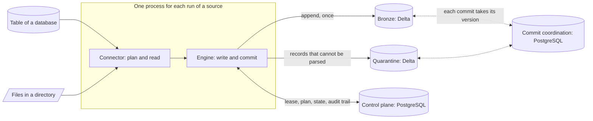

# lakehouse-ingestion-framework

[](https://github.com/MiguelOrtegaMilla/lakehouse-ingestion-framework/actions/workflows/ci.yml)

A metadata-driven ingestion framework on Apache Spark and Delta Lake: adding a source is writing configuration, not code. It takes tables of a relational database (JDBC) and files that are dropped in a directory into the Bronze layer of a lakehouse, and it is built to stay correct when a run dies halfway and when several instances run at the same time.

It runs on one machine, with no cloud service: Spark in local mode, Delta Lake on a local disk, and one PostgreSQL in Docker.

> **Status: Checkpoint A, and the failures of a run (P8).** Files and JDBC into Bronze, in full and incrementally, once whatever happens: a process killed at any point, a lease taken over, two processes writing one table. Every run is audited, and an operator has commands for a source that is stuck. A failure is classified once and ends in a code that says what to do, a run that may pass rides it out within a budget, a file that cannot be read stops its source or is skipped as the source says, and what a source set apart is read with a command. Schema evolution, Silver and observability come next ([the plan](docs/architecture/00-architecture-discovery.md#17-revised-phase-plan)).

## What it does, and what shows it

Each line is something the framework is to guarantee, with the test that fails if it does not. Nothing here is shown by a mock: the tests run against a real PostgreSQL, real Delta tables and real files.

| It guarantees | How | What shows it |
|---|---|---|
| **A source is configuration.** One YAML file for each source, validated whole before anything is touched | A field that is not known is an error, a secret is never written out, and a run records the hash of the configuration it ran with | `sbt "cli/run validate …"`; [how to add a source](docs/configuration/adding-a-source.md) |
| **A batch is in its table once**, however many times it is run | The plan of a batch is written down before anything is read, the write to Delta carries the number of the batch, and the state, the batch and the run are committed in one transaction ([ADR-0005](docs/adr/0005-batch-wal-and-idempotent-writes.md)) | `IngestionServiceSpec`, and a ledger that compares the control plane with the tables after every test of recovery |
| **A run that dies is finished by the next one** | The next run asks the table whether it has the batch: if it has, the batch is committed with nothing read; if not, its plan is run again as it was written | `FaultMatrixSpec`: more than a hundred cells, a run that dies at each point of the engine and inside its commits, for every kind of batch. `KilledRunSpec`: the same with the real command and `kill -9` |
| **One run at a time on a source**, and a run that lost its turn writes nothing | A lease in PostgreSQL with an expiry and a heartbeat; its epoch is named by every commit, and the commit is refused once a later run has announced its own ([ADR-0006](docs/adr/0006-source-leases-with-epoch-fencing.md), [ADR-0019](docs/adr/0019-a-commit-names-the-epoch-of-its-lease.md)) | `LeaseFencingSpec`, `LeaseLossSpec`, and the column of the matrix where a lease is taken over |
| **Several processes write one Delta table and no commit is lost**, on a local file system, where Delta by itself does lose them | A Delta `LogStore` that takes each version of a table in PostgreSQL before the commit exists ([ADR-0004](docs/adr/0004-postgresql-coordinated-delta-logstore.md)) | With Delta's own LogStore a commit was lost in 7 runs of 7 when the race was forced; with this one, none of 10,954 commits in 33 runs, writers and PostgreSQL killed among them ([results](docs/testing/tests-and-ci.md#results-deltas-default-logstore-and-postgreslogstore)) |
| **An incremental load loses no change** that is committed within a margin | A batch reads a window of the clock of the source, fixed when the batch is planned, and never the highest value that it happened to read ([ADR-0020](docs/adr/0020-the-watermark-of-an-incremental-load.md)) | `WatermarkPlanSpec`, `GeneratedTableSpec`: a table changed from a seed, with ties and transactions left open, read after each round |
| **Every run can be asked about**: who ran what, with which configuration, how many rows, how it ended | Tables of the control plane that the engine can add to and cannot rewrite | `ControlSchemaSpec`; the query at the end of the demo below |
| **An operator has a way out, and it is audited** | Giving a batch up, resetting the state of a source, reading files again and loading a history are each a run under a lease, with who asked and why ([ADR-0021](docs/adr/0021-operator-actions-and-backfills.md)); a table that the LogStore refuses is mended by a command that records what it did | `AbandonBatchSpec`, `ResetStateSpec`, `ReprocessSpec`, `BackfillBesideRunSpec`: a backfill beside the incremental load of the same table, in two processes, one of them killed; `MaintainTableCommandSpec` |
| **A failure ends in a code that says what to do** (3 again later, 4 not until something is changed, 5 the data, 70 a bug) | One classifier where a run ends; what passes is tried again where the run is durable, within a budget of time; a run whose last answer was lost reads its own row before it says how it ended ([ADR-0022](docs/adr/0022-the-classification-of-failures-and-the-retries-of-a-run.md), [the codes](docs/architecture/00-architecture-discovery.md#141-exit-codes-the-contract-with-the-orchestrator)) | `FailureClassesSpec`, `RetriesSpec` and `LostAnswerSpec`, with the control plane, the source and the coordination database cut for real by a proxy |
| **A file that cannot be read stops its source, or is skipped and recorded**, as the source says | Each file of a batch that fails is read alone; a file cut short, one that may not be opened, one not of its encoding, and one with a value or a line too long for memory are named, and never what they hold ([ADR-0023](docs/adr/0023-a-file-that-cannot-be-read.md)) | `UnreadableFilesSpec`, with files broken for real; `SparkUnreadableFileContractSpec`, what Spark raises for each |
| **What a source sent is kept as it sent it** | A line of JSON is a record only as it was written; CSV says its dialect and its encoding, and a batch is read as it was planned; a record that cannot be parsed is kept whole in a quarantine, which a command reads ([ADR-0024](docs/adr/0024-the-dialect-and-the-encoding-of-a-source-of-csv.md)) | `JsonRecordsSpec`, `CsvDialectSpec`, `QuarantineCommandSpec` |
| **No value of a source reaches a log** at the level that a process logs at | Delta writes no statistics of a row where it logs them, and the log of the application takes out what Spark's parser of CSV says it parsed | `RunCommandLogsSpec`, which looks at every line of the log of a run, in the JVM and in processes of their own |

The [table of decisions](docs/architecture/00-architecture-discovery.md#22-decisions-that-the-code-enforces-where-and-what-shows-it) has all 142 of them, each with the code that enforces it and its tests, and CI fails when a row names something that is no longer there.

## How it works



A run of a source is one process, started by whatever schedules it, and its exit code is all that it says back:

1. It takes the **lease** of the source, or ends at once if another run holds it (exit code 2).
2. It looks for a batch that a run before it left **planned**. If there is one, it finishes that one first.
3. Otherwise the connector **plans** the next batch, files or a window of time, and the plan is written down before anything is read.
4. It **reads** what the plan says and **writes** it to Delta under the number of the batch: a second write of the same batch adds nothing.
5. It **commits**, in one transaction of PostgreSQL: the state of the source, the batch, the run and the lease.

The whole design, with the alternatives that were weighed, is in the [discovery document](docs/architecture/00-architecture-discovery.md) and in 22 [decision records](docs/adr/README.md).

## A source is a file

Adding a source is writing one file, [`conf/sources/<id>.yaml`](conf/sources/sales.orders.yaml): what is read, how it is loaded, and into which tables. Where the application runs is another file, the profile ([`conf/app/local.example.yaml`](conf/app/local.example.yaml)): its lake, its databases, how long it waits.

```bash
sbt "cli/run validate --profile conf/app/local.example.yaml --sources conf/sources"
```

```text
The configuration is valid: conf/app/local.example.yaml, and 2 sources.
The lake is file:///home/CHANGE_ME/lakehouse-data/lake.
  sales.orders   enabled  jdbc  incremental  bronze/sales/orders, silver/sales/orders  5828380c988b
  sales.returns  enabled  file  new_files    bronze/sales/returns                      2526a17a25b6
```

The last column is the start of the hash of the configuration that each source would run with. For a profile of your own, copy the example to `conf/app/local.yaml`, which git ignores, and put the directories of your machine in it.

`validate` reads the profile and every source and says everything that is wrong in them, each mistake with its file and its field. It opens no connection, so it runs anywhere in a moment, and it ends in 0 for a valid configuration and in 4 for one that is not.

- **A file is not trusted.** YAML is read without a loader that could construct anything, with limits on size, nesting and aliases, and no tag. Names and paths are allow-lists: `orders; DROP TABLE orders` is no table, and `bronze/../../x` is no path.
- **Nothing in a file is a secret.** A password is written as where it is (`env:NAME`, `file:/run/secrets/name`), and one that is written out is refused and never repeated in an error.
- **A field that the model does not have is an error**, with the one that was probably meant. A misspelt `watermark` does not become a full load that nobody asked for.
- **A configuration has a version**: the SHA-256 of the profile and the source as they ran, defaults included. A change that what is already ingested cannot follow, another key or another table to read from, is found by comparing two of them.

[Adding a source](docs/configuration/adding-a-source.md), step by step. [The reference](docs/configuration/reference.md) of every field, which a test holds to the code.

## Run the demo

About ten minutes, most of them the first download. It needs Docker, JDK 17 and `sbt` ([environment](docs/setup/dev-environment.md)).

```bash
scripts/dev-secrets.sh                                     # a random password for each role, in docker/secrets/ (git-ignored)
docker compose -f docker/docker-compose.yml up -d --wait   # PostgreSQL: the control plane, the coordination store and a demo database
sed "s|/home/CHANGE_ME|$HOME|" conf/app/local.example.yaml > conf/app/local.yaml
mkdir -p ~/lakehouse-data/lake ~/lakehouse-data/landing/sales/returns

for role in ingest_migrator ingest_control ingest_coordination sales_owner sales_ro; do
  export "$(echo $role | tr a-z A-Z)_PASSWORD=$(cat docker/secrets/${role}_password)"
done
sbt "cli/run migrate --profile conf/app/local.yaml --password env:INGEST_MIGRATOR_PASSWORD"
```

```text
control: version 9, 9 migrations applied (jdbc:postgresql://localhost:5432/ingestion_control)
delta_coordination: version 5, 5 migrations applied (jdbc:postgresql://localhost:5432/ingestion_control)
```

**A table, loaded incrementally.** The source [`sales.orders`](conf/sources/sales.orders.yaml) reads `public.orders` by its column `updated_at`, four weeks a batch. A demo makes the table, as the source system would, and `run` loads it:

```bash
sbt "integration-tests/Test/runMain lakehouse.ingestion.it.demo.SalesOrders --create"
sbt "cli/run run --profile conf/app/local.yaml --sources conf/sources --source sales.orders"
```

```text
public.orders was made, with 2118 rows changed in 47 rounds of a week, from 2026-01-01T00:00:00Z to 2026-11-25T23:25:55Z.

The run 01a21509-ad80-… of sales.orders committed the batch sales.orders/bronze#1: 80 rows read, 80 written, 0 rejected, into bronze/sales/orders at version 0.
The run 01a21509-f39d-… of sales.orders committed the batch sales.orders/bronze#2: 119 rows read, 119 written, 0 rejected, into bronze/sales/orders at version 1.
…
The run 01a2150a-98a5-… of sales.orders committed the batch sales.orders/bronze#12: 179 rows read, 179 written, 0 rejected, into bronze/sales/orders at version 11.
The invocation of sales.orders made 12 runs and committed 12 batches.
```

The numbers are of a table made on 2026-11-25: there is a batch more every four weeks. Each batch is a run of its own, with its lease and its row in the audit trail; kill the process at any moment and run the command again, and it goes on from the batch that was left.

**Only what changed.** The demo changes some orders, and the next invocation reads those, once the minute of margin that the source allows its transactions has passed:

```bash
sbt "integration-tests/Test/runMain lakehouse.ingestion.it.demo.SalesOrders --changes"
sleep 61
sbt "cli/run run --profile conf/app/local.yaml --sources conf/sources --source sales.orders"
```

```text
public.orders was changed at moments after 2026-11-25T23:28:10Z and up to 2026-11-25T23:29:10Z: 9 rows inserted, 6 updated and 2 deleted. A run reads them once the clock of the database is a minute past 2026-11-25T23:29:10Z.

The run 01a2150b-f7bb-… of sales.orders committed the batch sales.orders/bronze#13: 14 rows read, 14 written, 0 rejected, into bronze/sales/orders at version 12.
```

The 14 rows are the 9 orders that are new, one of them updated again before it was read, and the 5 that were there and changed. Run sooner than the minute, a batch reads only the changes that are older than the margin, and the next one the rest: none is lost, and none is read twice. A deleted order is not seen by a load by a column, which is what the reconciliation of keys in Silver is for.

**A stretch of history, beside the regular load.** A backfill reads a range of the same column on a sequence of its own, with its own lease, so the regular runs of the source neither wait for it nor are moved by it:

```bash
sbt 'cli/run backfill --profile conf/app/local.yaml --sources conf/sources --source sales.orders --backfill march-again --from 2026-03-01T00:00:00Z --to 2026-03-15T00:00:00Z --chunk 7d --reason "two weeks of March read again, to show a backfill"'
```

```text
The run 01a2150c-67f0-… of sales.orders created the backfill march-again: it reads (2026-03-01T00:00:00Z, 2026-03-15T00:00:00Z] of updated_at, in chunks of 7d. The rows whose updated_at is 2026-03-01T00:00:00Z exactly are not read; those at 2026-03-15T00:00:00Z are.
warning: the regular sequence of sales.orders reads the rows whose updated_at is after 2026-01-01T00:00:00Z, its load.watermark.start: all of (2026-03-01T00:00:00Z, 2026-03-15T00:00:00Z] is read by both, and is in Bronze twice, each copy with its run, unless a reset of the state took the watermark of the source past it.
The run 01a2150c-67f0-… of sales.orders committed the chunk 1 of the backfill march-again: 43 rows read, 43 written, 0 rejected, into bronze/sales/orders at version 13.
The run 01a2150c-b98a-… of sales.orders committed the chunk 2 of the backfill march-again: 30 rows read, 30 written, 0 rejected, into bronze/sales/orders at version 14.
The backfill march-again of sales.orders is complete: it has read (2026-03-01T00:00:00Z, 2026-03-15T00:00:00Z].
The invocation of the backfill march-again of sales.orders made 2 runs and committed 2 chunks.
```

**What happened, asked of the control plane:**

```bash
docker compose -f docker/docker-compose.yml exec postgres psql -U ingest_control -d ingestion_control -c \
  "SELECT run_kind, txn_app_id AS sequence, status, count(*) AS runs, sum(rows_written) AS rows_written, min(requested_by) AS asked_by
     FROM control.ingestion_run WHERE source_id = 'sales.orders' GROUP BY 1, 2, 3 ORDER BY 2"
```

```text
 run_kind |                 sequence                 |  status   | runs | rows_written | asked_by
----------+------------------------------------------+-----------+------+--------------+----------
 regular  | sales.orders/bronze                      | SUCCEEDED |   13 |         2132 |
 backfill | sales.orders/bronze/backfill/march-again | SUCCEEDED |    2 |           73 | you
```

Files work the same way, with the source [`sales.returns`](conf/sources/sales.returns.yaml): drop a CSV in `~/lakehouse-data/landing/sales/returns`, and `run --source sales.returns` takes it once it is a minute old. That, the exit codes, and the commands of an operator (`abandon-batch`, `reset-state`, `reprocess`) are in [Running it](docs/operations/running-a-source.md). `docker compose -f docker/docker-compose.yml down -v` removes the demo's database.

**What a source set apart.** A record of CSV with more values or fewer than its header is set apart, kept whole in the quarantine of its source, and by default no record may be (`quality.max_rejected_ratio`): the run ends in 5, with nothing written to Bronze.

```bash
printf 'id,amount\n1,10\n2,20\n3,30,extra\n4\n5,50\n' > ~/lakehouse-data/landing/sales/returns/returns-1.csv
sbt "cli/run run --profile conf/app/local.yaml --sources conf/sources --source sales.returns"      # ends in 5
sbt -error "cli/run quarantine --profile conf/app/local.yaml --sources conf/sources --source sales.returns --records 20" > rejected.jsonl
```

```text
error: The run 01a221d2-fc06-… of sales.returns failed (data): 2 of the 5 records of sales.returns/bronze#1 were set apart, […] The batch is not committed, and nothing of it was written to Bronze: it stays planned.
```

`rejected.jsonl` has the two records, a line of JSON each and nothing else, and the warning that they may hold personal data is on the error output:

```text
{"run_id":"01a221d2-fc06-…","backfill":null,"batch_seq":1,"batch_status":"PLANNED","source_file":"sales/returns/returns-1.csv","error_type":"unparsed","error_detail":null,"quarantined_at":"2026-11-28T11:03:29.102136Z","raw_record":"3,30,extra","raw_record_chars":10,"truncated":false}
{"run_id":"01a221d2-fc06-…","backfill":null,"batch_seq":1,"batch_status":"PLANNED","source_file":"sales/returns/returns-1.csv","error_type":"unparsed","error_detail":null,"quarantined_at":"2026-11-28T11:03:29.102136Z","raw_record":"4","raw_record_chars":1,"truncated":false}
```

Under sbt the file is the records alone only when the command ends in 0: with another code, sbt adds two lines of its own to it ([Running it](docs/operations/running-a-source.md#what-a-source-had-set-apart-quarantine) says what to do with the batch, and with the file).

## How it is tested

| Level | What it is | Command | Needs |
|---|---|---|---|
| Pure logic | Configuration, planning of files and of windows, the model of the control plane | `sbt core/test cli/test` | Nothing: seconds |
| The LogStore, one JVM | Its protocol with every fault injected between two steps | `sbt delta-pg-logstore/test` | Nothing |
| Integration | Every component against a real PostgreSQL (Testcontainers), real Delta and real files; the security controls, each with a test that fails without it | `sbt integration-tests/test` | Docker |
| Faults in one JVM | A run that dies, a lease that is taken over and a source that changes, at each point of the engine and inside its commits, for every kind of batch | `sbt "integration-tests/testOnly *FaultMatrixSpec"` | Docker: about six minutes |
| Faults for real | The command killed with `kill -9` at a point, and run again; a backfill and the regular load in two processes | `sbt "integration-tests/testOnly *KilledRunSpec *BackfillBesideRunSpec"` | Docker |
| Stress | Several writer processes on one table, killed and cut off from PostgreSQL, checked by a verifier that reads the log by itself | `sbt stress` | Docker: minutes, and memory |

CI runs all but the stress runs on every pull request, with the formatting, the dependency rules between modules, a rule that fails on code that only tests reach, and a review of the dependencies. [Every suite, what CI does, and the results of the stress runs](docs/testing/tests-and-ci.md).

```bash
sbt scalafmtCheckAll scalafmtSbtCheck checkBoundaries checkUnconnected Test/compile test   # what CI runs: needs Docker
```

## What is in the repository

Java 17 · Scala 2.13.17 · Apache Spark 4.1.4 · Delta Lake 4.4.1 · sbt 1.13.1 · PostgreSQL 17 ([why these](docs/adr/0014-stack-versions-pinned-at-p1.md)).

| Module | Responsibility |
|---|---|
| `core` | The configuration and its validation, the planning of a batch, the model of the control plane and the decision of recovery. No Spark, no JDBC |
| [`delta-pg-logstore`](modules/delta-pg-logstore/README.md) | The PostgreSQL-coordinated Delta `LogStore`. It depends on no other module, and can be taken out as a library |
| `engine` | The connectors (files, JDBC), the writers of Bronze and of the quarantine, the repositories of the control plane, and one run of one source |
| `cli` | The commands: `validate`, `migrate`, `run`, `backfill`, `abandon-batch`, `reset-state`, `reprocess`, `maintain-table`, `quarantine`, and their exit codes |
| `integration-tests` | The tests against real services, the fault injection, the stress harness and its verifier |

What a module may depend on is enforced by the build ([ADR-0012](docs/adr/0012-module-structure.md)): `sbt checkBoundaries` reads the classpath as it is resolved, and fails as well on two packages of `core` or of `engine` that depend on each other. `sbt checkUnconnected` fails on code of production that no code of production reaches; what is left so on purpose is in [`project/unconnected.txt`](project/unconnected.txt), each with its reason.

## Where to read more

| To know | Read |
|---|---|
| How to add a source, and every field of the configuration | [Adding a source](docs/configuration/adding-a-source.md), [the reference](docs/configuration/reference.md) |
| How to run it, the exit codes, and what an operator does | [Running it](docs/operations/running-a-source.md) |
| Why each thing is as it is | [The discovery document](docs/architecture/00-architecture-discovery.md), [the decision records](docs/adr/README.md) |
| How multi-writer tables are made safe, and the proof | [ADR-0004](docs/adr/0004-postgresql-coordinated-delta-logstore.md), the write-ups of the spikes: [RED](docs/spikes/logstore-red.md) and [GREEN](docs/spikes/logstore-green.md) |
| The tests, CI and the stress runs | [Building, testing and continuous integration](docs/testing/tests-and-ci.md) |
| What is known not to be done yet | [Open items](docs/architecture/00-architecture-discovery.md#open-items-and-accepted-exceptions) |

## What it does not do yet

It stops at Bronze. The policies for a schema that changes (P9), Silver (typing, deduplication by key, `MERGE`, deletes, masking of personal data: P10), and lineage and observability (P11) are the phases that follow, in that order. It runs on one machine and a local disk; a cluster and object storage are extensions that the design allows for and that are not built. What is known to be left, phase by phase, is in [the open items](docs/architecture/00-architecture-discovery.md#open-items-and-accepted-exceptions).

## License

[Apache License 2.0](LICENSE).
