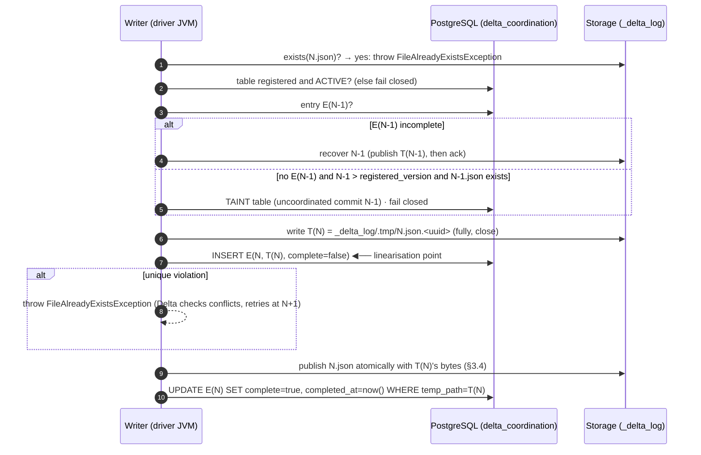

# ADR-0004 — PostgreSQL-coordinated Delta LogStore for multi-writer tables

| | |
|---|---|
| **Status** | Accepted (D3, 2026-09-25) |
| **Risk** | ⚠️ **Highest-risk component of the project** (R0). A defect here corrupts tables. |
| **Supersedes** | AD-06 of discovery v1 ("one writer per Delta table") |
| **Related** | [ADR-0003](0003-control-plane-in-postgresql.md), [ADR-0005](0005-batch-wal-and-idempotent-writes.md), [ADR-0010](0010-concurrent-write-conflict-handling.md), [ADR-0011](0011-storage-profiles.md) |
| **Sources studied** | `delta-io/delta` tag `v4.4.0`: `storage/.../LogStore.java`, `HadoopFileSystemLogStore.java`, `HDFSLogStore.java`, `storage-s3-dynamodb/.../BaseExternalLogStore.java`, `ExternalCommitEntry.java`, `S3DynamoDBLogStore.java`, `storage/.../commit/CommitCoordinatorClient.java`, `spark/.../coordinatedcommits/*`, `PROTOCOL.md` (catalog-managed tables); docs.delta.io *Storage configuration* and *Catalog-managed tables*. `BaseExternalLogStore` and `S3DynamoDBLogStore` are identical in `v4.4.0` and `master` at the time of writing. Re-read at tag `v4.4.1`, with Hadoop 3.4.2's `ChecksumFileSystem`, `ChecksumFs` and `RawLocalFileSystem`, in P2a.1. |
| **Superseded in part** | [ADR-0015](0015-hard-link-publish-on-local-file-systems.md) (2026-11-14) replaces the `file://` publish of §3.4, with the rows of §3.8 and §4 that describe it. [ADR-0017](0017-a-failed-publish-is-reported-not-swallowed.md) (2026-11-14) replaces the handling of a failed publish in §3.2 and in deviation 4. Those passages keep their original text and point to the new ADR. |
| **Amended** | P1.4d (2026-11-13): §1.2, §3.4, §3.6, from the RED spike. P2a (2026-11-14): open items answered (§8), and with them §2, §3.2, §3.5, §3.9 (new), §6, §7. P2a.6 (2026-11-15): §3.6, as built. P2a.7 (2026-11-15): §3.5, layer 1; §8, item 5 closed. P2a.8 (2026-11-15): §3.2 and §7.3, as built. Each change is dated in place and says what the text said before. |

---

## 1. Context

### 1.1 What Delta requires from storage

The `LogStore` Javadoc (`@since 1.0.0`, a `DeveloperApi`) makes Delta's ACID guarantees conditional on three properties:

1. **Atomic visibility**: if `isPartialWriteVisible` is false, a file is either fully visible or not visible at all.
2. **Mutual exclusion**: only one writer can create (or rename) a file at the final destination.
3. **Consistent listing**: once a file is written in a directory, every later listing returns it.

A commit is the creation of `_delta_log/<N>.json` (N zero-padded to 20 digits). Delta's `OptimisticTransaction` relies on property 2. When `write(N.json, overwrite=false)` throws `FileAlreadyExistsException`, it checks the winning commit for logical conflicts and retries at N+1 if there are none. Confirmed for 4.4.1 in P2a.1 (§8, item 2).

### 1.2 Why the defaults are insufficient

| Storage | Atomic visibility | Mutual exclusion across processes | Consistent listing |
|---|---|---|---|
| Local POSIX FS, default `HDFSLogStore` | ✅ temp + rename | ❌ It checks that `N.json` does not exist, then renames onto it with `rename(2)`, which replaces an existing file. Its only guard is `synchronized (this)`. That lock is per `HDFSLogStore` instance, so it never spans JVMs. Delta takes it only when the log's `FileSystem` is a `RawLocalFileSystem`; on `file://` it is a `LocalFileSystem`, so the lock is not taken at all. Its own comment says it exists "in our tests". ¹ | ✅ |
| S3 / MinIO, default `S3SingleDriverLogStore` | ✅ PUT | ❌ (single driver only) | ✅ (S3 is strongly consistent; MinIO too) |
| HDFS | ✅ | ✅ atomic rename-if-absent | ✅ |

¹ *Corrected in P1.4d (2026-11-13).* This row first described a JVM-static `LOCAL_FS_WRITE_LOCK`. Delta 4.4.1's `HDFSLogStore` has no such lock; the facts above come from its code and from each writer's probe in the RED spike (§7.3). The decision is unchanged: if anything, the default is weaker than first stated.

The docs say it outright: *"Delta Lake on local file system may not support concurrent transactional writes"*. For S3 multi-cluster writes the official answer is `S3DynamoDBLogStore`, which is *"only safe when all writers use this LogStore implementation as well as the same DynamoDB table and region"*.

### 1.3 Project requirements (D3)

- **Type 2 concurrency in the MVP**: several processes write the **same** Delta table.
- Correct for **multi-instance, multi-node and multi-cluster**. Multi-instance is demonstrated in the MVP; the other two are extensions (E1, E2).
- **Storage-agnostic**: the same mechanism on `file://` and `s3a://`, without relying on the filesystem's rename semantics for exclusivity.
- Recovery of half-finished commits; consistent reads of the latest version.
- **Fail closed** when PostgreSQL is unavailable: never write without coordination.
- A safeguard so that no writer without this LogStore can write to the tables, **validated at startup**.
- Exhaustive tests: fault injection at every protocol step, a stress test with N concurrent writers, and a final verifier.
- A spike demonstrating commit loss without the LogStore and its absence with it.

---

## 2. Decision

Implement **`PostgresLogStore`**, a `LogStore` that obtains mutual exclusion for each commit version from a conditional `INSERT` in PostgreSQL, and register it for every lake scheme:

```properties
spark.delta.logStore.file.impl=<basePackage>.logstore.PostgresLogStore
spark.delta.logStore.s3a.impl=<basePackage>.logstore.PostgresLogStore
```

It follows the **prepare → commit → acknowledge** protocol of Delta's `BaseExternalLogStore`. That protocol is production-proven through `S3DynamoDBLogStore`; the implementation here is a **port with ten justified deviations** (§4), not a subclass. It lives in its own module, `delta-pg-logstore`, with no dependency on the rest of the project (ADR-0012), and it owns the PostgreSQL schema `delta_coordination`.

**Schemes implemented** *(decided in P2a, 2026-11-14)*. The protocol is the same for every scheme; only the publish step differs (§3.4), and it sits behind an interface.
- P2a implements and tests it for `file://`.
- The `s3a://` implementation arrives in E1, where MinIO exists to test it. Correctness-critical code does not ship untested.
- Until then the LogStore refuses every scheme but `file` at startup (fail closed, §3.5 layer 1).

---

## 3. Design

### 3.1 Coordination schema (conceptual)

```sql
-- schema delta_coordination (migrations owned by the delta-pg-logstore module)
commit_entry(
  table_uri        text        not null,   -- canonical table URI (§3.6)
  file_name        text        not null,   -- e.g. 00000000000000000042.json
  version          bigint      not null,   -- parsed from file_name
  temp_path        text        not null,   -- relative to _delta_log, e.g. .tmp/<file>.<uuid>
  complete         boolean     not null,
  created_at       timestamptz not null default now(),   -- PostgreSQL clock, never the client's
  completed_at     timestamptz,
  writer_instance  text        not null,   -- host:pid:spark.app.id
  run_id           uuid,                    -- best effort, from the commit context (§3.7)
  primary key (table_uri, file_name)
)
-- plus an index on (table_uri, version desc) for "latest entry"

coordinated_table(
  table_uri          text primary key,
  delta_table_id     text,          -- metaData.id, captured at version 0 or on adoption
  registered_at      timestamptz not null default now(),
  registered_version bigint not null,   -- -1 if created through the LogStore; N if adopted at N
  status             text not null,     -- ACTIVE | TAINTED
  taint_reason       text
)
```

*As built (P2a.3, 2026-11-14):* the migration `V1__coordination_schema.sql` of `delta-pg-logstore`, described in discovery §13.3. It holds the same information in a slightly different form: the entry's key is `(table_uri, version)`, a taint is a row of a `table_taint` table, and the schema version has a one-row table.

### 3.2 Write path — `write(path, actions, overwrite=false)` for commit N



- **Durability point:** the committed `INSERT`. From then on version N belongs to this writer, even if it crashes. Any later reader or writer finishes publishing it.
- **A taken version** is reported with `java.nio.file.FileAlreadyExistsException`. It is the only exception Delta answers with a conflict check and a retry at the next version. Hadoop's exception of the same name just fails the commit (§8, item 2).
- **Errors after the `INSERT`:** transient errors in publish/ack are logged and swallowed, as in the base class, because the commit is already durable and recovery will finish it. **Fatal integrity errors are never swallowed** (deviation 4).

  > **Superseded for a failed publish by [ADR-0017](0017-a-failed-publish-is-reported-not-swallowed.md)** (2026-11-14): it is retried and then reported with a dedicated exception, because Delta reads `N.json` as soon as `write` returns (§8, item 2). A failed acknowledgement is still swallowed.
- **An `INSERT` whose outcome is unknown** *(added in P2a, 2026-11-14)*. If the connection drops during the statement, the entry may or may not exist. The `INSERT` is therefore repeatable:
  - it is an `INSERT … ON CONFLICT DO NOTHING`, followed by a read of the entry;
  - the writer compares the entry's `temp_path` with its own, which contains a UUID only this attempt knows;
  - its own path means the version is its own, whichever attempt inserted the row; another path means the version is taken.

  If PostgreSQL stays unreachable, `write` fails with an `IOException`. A later reader publishes the commit if the entry did land (F15).

*As built (P2a.8, 2026-11-15):* `PostgresLogStore.write` and `CommitProtocol`. What the implementation fixed:
- **Before anything is written**, the registry must allow the write. A table that is not registered is refused unless the commit is version 0, which registers it, with the `metaData.id` read from that commit. A tainted table is refused. So is a write at or below the version a table was adopted at, and a version 0 for a table whose commits the registry already knows (F9, widened to adopted tables). Each refusal is a `WriteRefusedException`.
- **A claim that loses** removes its temporary file at once: no entry points at it. A claim whose outcome stays unknown leaves it, since the entry may exist.
- **The claim is repeated** up to three times, 100 ms and 200 ms apart, and so is a publish that fails (ADR-0017).
- **Files that are not commits** are written to a temporary file and given their name in one step, without an entry. A commit is never overwritten, whatever `overwrite` says.
- **Not ported yet:** the per-JVM `PathLock` of §4. It only spares duplicate recoveries, so it is decided with the read path (P2a.9).

### 3.3 Read path — `listFrom(path)` on `_delta_log`

1. Fetch the latest entry for the table, by numeric `version` among commit files.
2. If it is incomplete, **recover** it: publish `T(N)` if `N.json` is absent, then ack.
3. List the directory (the storage provides consistent listing).
4. **Consistency check:** if the latest *complete* entry's version is greater than the latest listed `N.json`, a published commit is missing (deleted, or storage misconfigured). **Fail closed.**
5. Gap check: a listed `N.json` above `registered_version` with no entry means a foreign writer. **Taint the table** and log at ERROR. Reads may proceed so that forensics are possible. Writes are refused (§3.5).

`VACUUM` also calls `listFrom` on data directories. As in the base class, recovery and checks only apply to `_delta_log` paths.

### 3.4 Atomic publish — the storage-specific part

| Scheme | How `N.json` is published | Why it gives atomic visibility |
|---|---|---|
| `s3a://` (S3, MinIO) | Server-side copy / PUT of `T(N)`'s bytes to `N.json` | An object becomes visible only when complete |
| `file://` (POSIX) | Copy `T(N)` → `.tmp/N.json.<uuid>.pub`, then `rename` to `N.json` | `rename(2)` is atomic. It may *replace* an existing file, but that is harmless: exclusivity comes from PostgreSQL, and concurrent recoverers publish identical bytes. |

> **The `file://` row is superseded by [ADR-0015](0015-hard-link-publish-on-local-file-systems.md)** (2026-11-14): `N.json` is published as a hard link to `T(N)`, which is atomic and fails if the file exists.

**`.crc` sidecars on `file://`** *(added in P1.4d)*. Hadoop's checksummed local file system (`LocalFs` behind a `FileContext`, `LocalFileSystem` behind a `FileSystem`) writes a `.<name>.crc` sidecar next to every file it creates. A rename moves the file first and then its sidecar, in a second step that does not overwrite. So publishing through it is two renames, not one. With identical bytes the sidecars are identical too. Still, a crash between the two steps leaves `N.json` without its sidecar and a stray temporary sidecar behind. A foreign writer's `N.json` leaves a sidecar that no longer matches. Every checksum-verifying reader then fails on that file, which is what the RED spike observed (§7.3).

How the publish deals with sidecars was left to P2a (§8). [ADR-0015](0015-hard-link-publish-on-local-file-systems.md) decides it: coordinated commit files have none.

`isPartialWriteVisible` returns `true` for `file://` and `false` for `s3a://`. Delta uses it to decide whether checkpoints must be written via temp + rename. Answering `true` has two more effects, found in P2a.1 (§8, items 1 and 4):
- files that are not commits reach `write` with `overwrite=false` (a V2 checkpoint in JSON). They need an atomic write, and no coordination entry (deviation 9);
- Delta holds its per-`DeltaLog` lock around each commit, so threads of one JVM never contend inside the LogStore for the same table.

Writes with `overwrite=true` (`_last_checkpoint`, `_last_vacuum_info`) must be atomic on `file://` too: a temporary file, then a rename that replaces.

### 3.5 Fail closed and safeguards

**Fail closed.** Every error talking to PostgreSQL surfaces as an `IOException`, never as "entry not found". There is no fallback to the default LogStore. JDBC connect, statement and lock timeouts are bounded so that a hung PostgreSQL produces a failure, not a hang. Reads fail too, because without the coordination store the latest version cannot be guaranteed.

**Safeguards against uncoordinated writers**, layered:

| Layer | Mechanism | Catches |
|---|---|---|
| 1 — Startup enforcement (`cli`) | The engine refuses to start (exit 4) unless `spark.delta.logStore.<scheme>.impl` is `PostgresLogStore` for every scheme of the active lake profile, the coordination schema version matches, and a probe on the lake root resolves to this LogStore. *(P2a)* Also unless the scheme is one this LogStore implements (§2) and, on `file://`, the lake root supports hard links (ADR-0015). *(P2a.7, 2026-11-15)* And unless `file://` is served by Hadoop's own local file system, checksummed or raw. The LogStore writes log files to the disk directly (ADR-0015), so under a replacement registered as `fs.file.impl` it could write a commit where readers do not look. `LogStorage.of` makes the check. | Our own processes misconfigured: the realistic risk |
| 2 — Table registry | A table is registered at creation (version 0 through this LogStore) or explicitly adopted (`adopt-table` at its current version, recording `metaData.id`). Commits to unregistered `table_uri`s are rejected. | Aliased paths (§3.6); tables created outside the framework |
| 3 — Gap detection | A published `N.json` above `registered_version` without an entry → `TAINTED`; writes refused until an operator verifies and re-adopts (runbook) | A foreign writer's commit |
| 4 — Publish-race detection | If `N.json` already exists when publishing our entry and its bytes differ from `T(N)` → fatal `UncoordinatedWriteDetected`, `TAINTED` | A foreign writer racing our own commit N, which the base class would lose silently |
| — Limit | *Preventing* an arbitrary external writer needs storage access control (only the service identity may write `_delta_log/`), or protocol-level blocking (`catalogManaged`, §5) | Documented as **Enterprise** |

**A foreign commit that detection misses** *(added in P2a, 2026-11-14)*. Layers 3 and 4 do not catch every foreign write:
- A foreign writer checks that `N.json` does not exist, then we publish `N.json`, then it renames its own file over ours. A rename replaces.
- Version N has an entry, so layer 3 sees no gap. Layer 4 compares only at the moment we publish, and that moment has passed.
- Our commit is lost, its writer was told it succeeded, and the log looks healthy. This is the lost commit of the RED spike, with one writer of each kind.
- The table is tainted only when that writer commits again: its next version has no entry.
- The window is the same few microseconds as the spike's natural race, and it needs a process that runs without this LogStore, which layer 1 exists to prevent.
- `T(N)` keeps the lost commit's bytes until the temp GC, so an operator can compare them with `N.json`. Nothing compares them automatically.

Closing it would take a check of every published commit against its entry, or the storage access control above. It is recorded as a known limit.

### 3.6 Canonical table identity

Mutual exclusion holds only if every writer maps the same table to the **same key**. Two spellings mean two keys, and therefore no exclusion. Rules:
- Qualify the path with its `FileSystem` and strip user info, as the base class does.
- For `file://`, resolve to the real path, so symlinks cannot alias.
- One scheme per lake profile (ADR-0011): `s3://`, `s3n://` and `s3a://` must never be mixed.
- Aliases that slip through are caught by the registry (layer 2): an aliased key is unregistered, so its commits are rejected.
- Delta treats spellings as distinct too, though only at creation. `DeltaTable.create(...).location("file:///x")` fails with `DELTA_AMBIGUOUS_PATHS_IN_CREATE_TABLE`. Delta compares the location as given with Hadoop's qualified form `file:/x` and refuses to choose between them (found in P1.4b: the stress table is created from the qualified form). This is a single check at creation; Delta does not reconcile spellings across writers. The coordination key must therefore always be the qualified form, never the string a caller passed. *(Added in P1.4d.)*

*As built (P2a.6, 2026-11-15):* `TableIdentity.of` is the one function that makes a key, and code outside the module has no other way to get one. On `file://`:
- The key is Hadoop's qualified form of the table's real directory, such as `file:/home/user/lake/bronze/orders`.
- Links are resolved for the part of the path that exists. A table that is about to be created has its key already, and creating it does not change the key.
- A location with no single key is refused:
  - a `_delta_log` that is itself a symbolic link, through which two table directories would share one log under two keys;
  - a link whose target does not exist, whose key would change when the target is created;
  - another scheme (§2), or a URI that names a host.
- A `file:` URI has no user info to strip. That rule belongs to the `s3a://` key (E1).
- Two paths can reach one directory without a link between them, as when a file system is mounted twice. Resolving paths cannot see that; layer 2 catches the second path (§3.5).

### 3.7 Attribution (commit context)

The engine wraps each Delta write in `CommitContext.withRun(runId) { … }`, a thread-local API exposed by the LogStore module. The LogStore stores `run_id` on the entry and increments a per-run `commit_contention` counter each time the `INSERT` hits a unique violation. This relies on the commit executing on the caller's thread. P2a.1 verified it for appends with a `txnAppId`, `MERGE`, `DELETE` and `OPTIMIZE` (§8, item 3), so the `userMetadata` fallback is not needed. Attribution is **best effort** and never fails a commit.

### 3.8 Recovery semantics summary

| Crash point | State left | Who finishes | Outcome |
|---|---|---|---|
| Before `T(N)` is closed | Partial temp file, no entry | Nobody; temp GC | Commit N never happened; the Delta txn failed |
| After `T(N)`, before `INSERT` | Orphan temp | Temp GC | Same as above |
| After `INSERT`, before publish | Entry incomplete, no `N.json` | Next `listFrom` (any reader) or the writer of N+1 | **Commit N is durable** and becomes visible |
| During publish (`file://`) | Entry incomplete, `.pub` temp, no `N.json`. *(Superseded by ADR-0015: a hard link has no such state; it is the row above or the row below.)* | Same | Published atomically by the recoverer |
| After publish, before ack | Entry incomplete, `N.json` present | Same (identical bytes → mark complete) | Complete |
| After ack | Entry complete | — | Complete |
| Any, and `T(N)` is later lost *(P2a, F17)* | Entry incomplete, no `T(N)`, no `N.json` | Nobody can: the bytes are gone | Reads and writes fail closed, naming the entry, until an operator resolves it |

Temp GC deletes `.tmp/` files whose entry is complete, or that have no entry and are older than a safety window. It runs only in maintenance mode, never on the commit path.

### 3.9 Instances, configuration and connections *(added in P2a.1, 2026-11-14)*

Delta, not this project, creates the LogStore instances (§8, item 4):
- one per `DeltaLog`, that is per table, and per scheme;
- a new one whenever a `DeltaLog` is rebuilt, for example after its cache entry expires (60 minutes without use);
- more inside Spark tasks, for some commands (table below);
- always by reflection, through the constructor that takes one Hadoop `Configuration`;
- never closed: the `LogStore` API has no lifecycle method.

**Consequences for the design**

| Aspect | Decision |
|---|---|
| Constructor | Keeps the configuration and nothing else: no connection, no I/O. It runs often, and in tasks that never need PostgreSQL. |
| Connection pool | One per JVM and per (JDBC URL, user), shared by every instance, created by the first operation that needs PostgreSQL. |
| Settings | Carried in the Hadoop configuration, set as `spark.hadoop.*` when the application starts. Delta hands that configuration to the constructor and to every call, on the driver and in tasks. They are the JDBC URL, the user, the password reference, the pool size and the timeouts: the keys are listed below. |
| Password | By reference only, in the syntax of ADR-0007: `env:NAME` or `file:/path`. The JVM that opens the pool resolves it. The value never enters the Spark or Hadoop configuration, which Spark sends to executors and lists in its UI. |
| Pool size | At most 4 connections (configurable), no idle minimum, idle connections closed after about a minute. The same in every JVM. |

Settings, as fixed in P2a.5 (`CoordinationSettings`). Under Spark each key takes the prefix `spark.hadoop.`:

| Key | Meaning | Default |
|---|---|---|
| `lakehouse.logstore.jdbc.url` | A `jdbc:postgresql:` URL. TLS options go here. It may not carry a password, nor the driver's own timeouts: the LogStore sets those. | Required |
| `lakehouse.logstore.jdbc.user` | The role of the commit path | Required |
| `lakehouse.logstore.jdbc.passwordRef` | `env:NAME` or `file:/path` | Required |
| `lakehouse.logstore.pool.maxSize` | Connections this JVM may hold | 4 |
| `lakehouse.logstore.timeout.connectMs` | Wait for a connection, new or from the pool | 5000 |
| `lakehouse.logstore.timeout.statementMs` | One statement, including a wait for a lock. The socket gives up two seconds later, for a server or a network that no longer answers. | 10000 |

Why 4: a thread uses one connection for one short statement at a time, so a JVM needs as many as the tables it commits to or refreshes at once. An idle JVM holds none. The budget to respect is `JVMs that reach PostgreSQL × pool maximum`, below PostgreSQL's `max_connections` minus what the control plane and the sources use. The largest planned run, 8 stress writers in CI, takes 32 of the default 100.

**LogStores created in Spark tasks.** In local mode a task is a thread of the driver JVM. In a cluster it runs on an executor, in another process and usually on another machine. Delta's classic connector creates a LogStore inside a task in four places. The first three are pinned by `DeltaLogStoreContractSpec`; the project never generates symlink manifests.

| Command | What the task calls | Needs PostgreSQL |
|---|---|---|
| `VACUUM` | `listFrom` on the table directory and its partition directories. Hidden directories, `_delta_log` among them, are skipped. | No |
| `DESCRIBE HISTORY` | `read` of commit files | No |
| Resolving a timestamp to a version (time travel by timestamp) over a history longer than twice `spark.databricks.delta.history.maxKeysPerList`: 2000 commits by default | `listFrom` on `_delta_log` | **Yes** |
| Generating a symlink manifest | `write` of manifest files with `overwrite=true`, outside `_delta_log` | No |

**Decision: one behaviour in every JVM.** `listFrom` on a `_delta_log` path is the coordinated read of §3.3, wherever it runs. There is no executor mode.
- **Why not skip coordination in tasks.** The module cannot see Spark (ADR-0012), so it has no reliable way to tell an executor from a driver, and in local mode they are one JVM. Two behaviours behind one method is also how a read path ends up without its consistency check.
- **Who connects.** Commits always run on the driver, on the caller's thread. A call that does not touch `_delta_log` never opens the pool. So an executor connects only for the timestamp search above, with the pool described in the first table.
- **Credentials on executors.** The reference travels in the configuration; each executor resolves it in its own JVM. In a cluster the secret file is therefore mounted at the same path on every worker, or the variable is set in every worker's environment (E1 documents the mount).
- **If a worker cannot resolve the reference or reach PostgreSQL,** the task fails with an `IOException` that names the reference, never its value. It never falls back to a plain listing (fail closed, §3.5).
- **The engine does not use that path.** Silver follows Bronze by version, not by timestamp (discovery §17, P10). A deployment that wants to keep the search on the driver can raise `maxKeysPerList`.

---

## 4. Deviations from `BaseExternalLogStore`

| # | Base class behaviour (v4.4.0) | `PostgresLogStore` | Reason |
|---|---|---|---|
| 1 | Reused by **inheritance**; ships in `delta-storage-s3-dynamodb` (pulls in the AWS SDK) | **Ported** into a class extending `HadoopFileSystemLogStore` (`delta-storage`, already on the classpath) | Deviations 4 and 5 sit inside the private flow of `write()`, which a subclass cannot change. Avoids AWS dependencies. |
| 2 | Publish = streaming copy `fs.create(dst, overwrite=false)` + `IOUtils.copy` | `file://`: copy to a second temp + `rename` *(superseded by ADR-0015: a hard link)*; `s3a://`: copy | The streaming copy is atomic only on object stores. On POSIX a concurrent reader could see a partial `N.json`, which violates property 1. |
| 3 | `isPartialWriteVisible` always `false` | `true` on `file://`, `false` on `s3a://` | So that Delta writes checkpoints via temp + rename on POSIX |
| 4 | After `putExternalEntry`, **every** `Throwable` from publish/ack is logged and ignored — including a `FileAlreadyExistsException` caused by a foreign `N.json` | Transient errors ignored (recovery will finish) *(superseded for a failed publish by ADR-0017: retried, then reported)*. A content mismatch with an existing `N.json` is **fatal** + taint. | Otherwise, with a foreign writer, our commit is lost silently while Delta believes it succeeded |
| 5 | No detection of uncoordinated commits: a missing entry for N-1 falls back to `fs.exists(N-1.json)` | Registry + gap detection + `TAINTED` state | Safeguard requirement |
| 6 | Complete entries expire (DynamoDB TTL, default 1 day) | Kept (commit audit trail). Optional pruning keeps the latest entry per table and anything younger than ≥ 1 day. | PostgreSQL storage is cheap. Entries serve lineage. The 1-day floor keeps the base class's safety argument. |
| 7 | `expireTime` computed with the client clock | PostgreSQL `now()` | Clock skew across nodes and clusters |
| 8 | No run attribution | `run_id`, `writer_instance`, contention counter | Lineage *Delta version ↔ run* without `DESCRIBE HISTORY`; `commit_contention` metric |
| 9 | Latest entry = last by `fileName` sort (DynamoDB range key) | Latest by numeric `version`, among commit files only | Robust to non-commit files that also pass through `write(overwrite=false)` (inventory in P2) |
| 10 | Creates its store table on first use (`tryEnsureTableExists`) | Schema created by migrations; at init the LogStore checks the schema version and **fails closed** if it is missing or wrong | Least privilege: no DDL from the data path; explicit upgrades |

**Kept as is:** the protocol and its linearisation point; step 1 (`N-1` must be published before writing `N`); the "old entries for table still exist" check at version 0 (a table deleted and recreated at the same path); the per-JVM `PathLock` as an *optimisation* against duplicate recoveries (correctness never depends on it); read retries for S3 `RemoteFileChangedException` during concurrent recoveries (`s3a` only).

---

## 5. Alternatives considered

| Option | Pros | Cons | Verdict |
|---|---|---|---|
| **A. Single writer per table** (v1 AD-06) | Simplest; zero new components | Does not meet Type 2 (D3) | Rejected by the owner |
| **B. `S3DynamoDBLogStore` + MinIO + DynamoDB Local** | Official; production-proven; zero custom correctness code | `s3a` only by design; adds a DynamoDB Local container and the AWS SDK; duplicates the coordination store we already run in PostgreSQL; on `file://` it would suffer from deviations 2 and 4 | Rejected for the project. **The right choice on AWS in production.** |
| **C. `coordinatedCommits-preview` writer feature** with a custom `CommitCoordinatorClient` over PostgreSQL. `CommitCoordinatorProvider.registerBuilder` exists in 4.4; `delta.coordinatedCommits.commitCoordinator-preview` table property. | Official extension point; works with path-based tables; **writers that do not support the writer feature are blocked by the protocol**, which is stronger than our safeguards 1–4 | Preview-named config and feature; not documented for users; upstream is converging on `catalogManaged` (the Spark module only ships in-memory and Unity Catalog builders); different backfill model (unbackfilled commits) with more moving parts; high API-churn risk across Delta minors | Rejected for the MVP. Recorded as the benchmark for our safeguards. |
| **D. `catalogManaged` tables + Unity Catalog OSS (≥ 0.4)** as commit coordinator. GA since Delta 4.0.1. | The official direction; the catalog ratifies commits; protocol-level blocking of filesystem-based writers; enables multi-table transactions in the future | Requires running a Unity Catalog server; **no path-based access**; cannot be enabled on existing tables; `CREATE OR REPLACE` unsupported; heavier on 7.4 GB RAM | **Future evolution.** `TableLocator` (ADR-0011) keeps the engine independent of path vs catalog addressing. |
| **E. Single-node HDFS in Docker** | Native atomic rename-if-absent | Heavy (NameNode + DataNode); not how modern lakes run; says nothing about object stores or multi-cluster | Rejected |
| **F. Table-level lock in PostgreSQL held around each whole write** (advisory lock) | Trivial to implement | Serialises writers for the whole Spark job, killing concurrent blind appends; connection-bound lock (silent loss on network blips); fixes neither atomic visibility nor recovery | Rejected |

---

## 6. Consequences

**Positive**
- Type 2 concurrency is correct on `file://` and `s3a://` with one mechanism (the `s3a://` publish is implemented in E1, §2). Commits are always written by a driver, and every JVM that reads or writes a `_delta_log` through the LogStore uses the same store, so it holds unchanged across multi-instance, multi-node and multi-cluster deployments. ²
- Delta's optimistic concurrency semantics are preserved. The LogStore supplies the primitive (exclusive creation of version N); `OptimisticTransaction` resolves logical conflicts.
- A commit audit trail and Delta version ↔ run lineage come for free.
- The module is reusable outside this project: an interview-grade artifact on its own.

² *Corrected in P2a.1 (2026-11-14).* This said "Only drivers talk to PostgreSQL and every driver uses the same store". Delta also creates LogStores inside Spark tasks, and one of those paths lists `_delta_log` (§3.9). The decision is unchanged. What is new is a deployment requirement: in a cluster, the workers need the coordination secret and a route to PostgreSQL for that path.

**Negative / accepted**
- We own a correctness-critical component. Mitigated by the port of a proven protocol, fault injection and a stress verifier.
- **PostgreSQL is on the commit and read path.** Its availability is the tables' availability, by design (fail closed). In production the coordination store would have stricter HA than the control plane.
- Latency: about three extra round trips per commit plus one per snapshot refresh. That is milliseconds, negligible next to a Spark job. It is measured in E3.
- Every writer of these tables **must** use this LogStore. This is the same documented caveat as `S3DynamoDBLogStore`, enforced at startup and detected at runtime.

---

## 7. Verification plan

### 7.1 Fault injection (Testcontainers PostgreSQL, one JVM)

The protocol is tested against a `CoordinationStore` trait with a fault-injecting implementation, plus named hooks. Each case asserts the table state **and** that a subsequent reader or writer converges.

| # | Scenario | Expected |
|---|---|---|
| F1 | Crash after `T(N)` written, before `INSERT` | N not visible; next writer commits N; orphan temp collected by GC |
| F2 | Crash after `INSERT`, before publish | N durable; first `listFrom` publishes it; next writer's step 1 publishes it |
| F3 | Crash in the middle of publish (`file://`) | No partial `N.json` ever visible; recoverer publishes |
| F4 | Crash after publish, before ack | Recoverer marks complete; bytes unchanged |
| F5 | PostgreSQL down before `INSERT` | Commit fails (`IOException`); nothing visible; nothing written without coordination |
| F6 | PostgreSQL down after `INSERT` (ack fails) | Commit durable; completed later by recovery |
| F7 | PostgreSQL down during `listFrom` | Read fails (fail closed) |
| F8 | Two recoverers of the same N concurrently | Identical `N.json`; entry complete; no error surfaced |
| F9 | Table deleted and recreated at the same path | Version-0 write rejected ("old entries exist") until the operator resets the registry |
| F10 | Foreign commit (default LogStore writes N) | Gap detected → `TAINTED`; our writes refused |
| F11 | Foreign writer races our commit N (their `N.json` lands between our `INSERT` and publish) | Content mismatch → fatal, `TAINTED`; no silent loss |
| F12 | Commit to an unregistered or aliased `table_uri` | Rejected |
| F13 | Coordination schema missing or wrong version at init | LogStore init fails; engine exits 4 |
| F14 | Latest complete entry > latest listed `N.json` | Read fails closed |
| F15 | Connection lost during the `INSERT`: its outcome is unknown | The repeated `INSERT` and the `temp_path` comparison settle it (§3.2): the writer owns N and publishes it, or gets `FileAlreadyExistsException`. Never two owners, never an owner that believes it lost. If PostgreSQL stays down: `IOException`, and a later reader publishes N if the entry landed. |
| F16 | Publish fails after the `INSERT`, without a crash (storage error) | Retried; then a dedicated `IOException` ("committed, publication pending"), never a normal return (ADR-0017). The first `listFrom` publishes N. |
| F17 | Incomplete entry whose `T(N)` no longer exists | Recovery cannot publish. Reads and writes fail closed with an error that names the entry; nothing is published and the entry stays incomplete, for an operator to resolve. |

*F15–F17 were added in P2a (2026-11-14), from the review of Delta 4.4.1's commit path (§8). The suite is F1–F17.*

### 7.2 Stress test + verifier (multi-process)

- **Harness:** N writer **JVMs** (`local[1]`), each performing K blind appends to the same table with `txnAppId = writer-<i>`, `txnVersion = k`. Each commit writes rows tagged `(writer, k)`. Optional chaos: random `kill -9` of writers, PostgreSQL restart mid-run, concurrent `OPTIMIZE`.
- **Verifier** (runs after a final `listFrom`):
  - versions `0..V` contiguous; every `N.json` parses;
  - every coordination entry is complete, and `entries == published commits` above `registered_version`;
  - for each surviving writer, the set of `txnVersion`s in the Delta log equals `{1..K}`;
  - for each killed writer, a prefix `{1..k'}` (its last in-flight commit is either fully present or absent);
  - row counts per `(writer, k)` match what was written; no duplicates;
  - no orphan incomplete entries; `DESCRIBE HISTORY` consistent with the entries.
- **Sizes:** N=3, K=200 locally; N=8, K=500 in CI (ADR-0001 resource budget).

### 7.3 Spike (before / after, same harness)

- **RED (P1):** default LogStore on `file://`. Expected result: lost commits, meaning versions that were overwritten, so some `(writer, k)` are missing although their writer saw success. Two variants:
  - the natural race, measured over many commits;
  - a **widened window** using a delaying `FileSystem` wrapper between the existence check and the rename, for deterministic reproduction.

  If the natural race does not reproduce within a reasonable budget, the widened variant is the evidence, and the README states it honestly.
- **GREEN (P2):** the same harness with `PostgresLogStore`, zero anomalies over the same budget, including the widened-window variant.
  - *(P2a, 2026-11-14)* `DelayingLocalFs` delays a rename, and the hard-link publish (ADR-0015) never renames a commit file. Left as it is, the widened variant would pass without testing anything.
  - GREEN therefore widens the LogStore's own windows, with a delay at its fault hooks: between the existence check and the `INSERT`, and between the `INSERT` and the publish.
  - The writers are separate JVMs, so the hooks can be selected from configuration (P2a.8).
  - *As built (P2a.8, 2026-11-15):* three points, `beforeInsert`, `afterInsert` and `afterPublish`, each with a setting `lakehouse.logstore.fault.<point>.delayMs` (under Spark, with the `spark.hadoop.` prefix). A configuration can only make a writer wait. Stopping or failing a writer at a point takes hooks that only tests can install. Every LogStore warns, when it is created, of each fault hook its configuration turns on, with the point and the wait: one left on in a deployment cannot go unnoticed.
- Both results go in the README, side by side.

**RED result (P1.4c, 2026-11-13).** Full write-up: [docs/spikes/logstore-red.md](../spikes/logstore-red.md).
- Over five runs, the natural race lost acknowledged commits in **2 of 5**; the widened window lost one in **5 of 5**. There was never a version gap: the lost commit's file is replaced, not removed. Delta detects a gap (`DELTA_VERSIONS_NOT_CONTIGUOUS`), but not an overwrite.
- On `file://`, an overwrite usually leaves a stale `.crc` sidecar (§3.4). Every reader that checks it then fails, writers included. That is Hadoop's detection, by accident and after the fact: the writer was already told it succeeded. A reader that checks no sidecars, as on object storage, reads the table without error and without the commit.
- The fallback of the plan above was not needed: the natural race did reproduce.
- GREEN must also show no stale sidecar, and both readers clean.

---

## 8. Open items and their answers

Items 1–4 were closed in P2a.1 (2026-11-14) by reading Delta at tag `v4.4.1`. Each answer is pinned by a test of `DeltaLogStoreContractSpec`, which runs Delta over a LogStore that records every call. A Delta upgrade that changes one of them fails that suite (ADR-0014, upgrade procedure).

**Scope.** The answers describe Delta's classic connector, which works through `DeltaLog` and therefore through the registered LogStore. Delta 4.4 also ships a connector built on Delta Kernel, switched by `spark.databricks.delta.v2.enableMode` (default `AUTO`):
- with `delta-spark_4.1`, `AUTO` uses it only for streaming reads of tables managed by Unity Catalog, which this project does not have;
- with `delta-spark_4.2`, `AUTO` also routes change-feed reads to it. A move to Spark 4.2 must first establish how that connector lists the log, and whether it goes through the LogStore.

### Item 1 — Which files Delta writes through `LogStore.write`

| File | `overwrite` | Notes |
|---|---|---|
| `N.json`, a commit | `false` | The only file that needs mutual exclusion. `VACUUM` commits too: `VACUUM START` and `VACUUM END`. |
| `N.checkpoint.<uuid>.json`, the top-level file of a V2 checkpoint in JSON | `!isPartialWriteVisible` | `false` on `file://` with deviation 3. Delta wants an atomic write, not exclusion: the name holds a UUID. |
| `_last_checkpoint` | `true` | |
| `_last_vacuum_info` | `true` | Written when a `VACUUM` ends |

- **Not through the LogStore:** Delta's version checksums `N.crc` (Spark's `CheckpointFileManager`), Parquet checkpoints and V2 sidecars (Spark write jobs), deletion vectors.
- **Outside `_delta_log`:** symlink manifests (`overwrite=true`); the project does not generate them.
- **Not applicable here:** backfills of coordinated commits (`overwrite=false`), which exist only on tables with a commit coordinator.
- **Mapping onto `commit_entry`:** only names matching `<20 digits>.json` directly under `_delta_log` get an entry, and "latest entry" ranges over those alone (deviation 9). Every other `overwrite=false` write is an atomic write without an entry.

### Item 2 — The retry path of `OptimisticTransaction`

- `doCommitRetryIteratively` catches `java.nio.file.FileAlreadyExistsException` from `LogStore.write`. It then lists the log for the winning commits (through `listFrom`, on the committing thread), checks each for a logical conflict, and retries at the next free version. A conflict fails the transaction instead (for example `MetadataChangedException`).
- Hadoop's `org.apache.hadoop.fs.FileAlreadyExistsException` is not caught: the commit fails with it. The exception type is part of the contract.
- **Found here:** as soon as `write` returns, Delta reads the file status of `N.json` (`FileSystemBasedCommitCoordinatorClient.commit`). A LogStore that returns before the file is visible fails the transaction with a `FileNotFoundException`. It led to [ADR-0017](0017-a-failed-publish-is-reported-not-swallowed.md) and to F16.

### Item 3 — The commit runs on the caller's thread

Yes: for appends with a `txnAppId`, `MERGE`, `DELETE` and `OPTIMIZE`. `OPTIMIZE` runs its compaction jobs on a thread pool, and the commit still comes back to the caller. Thread-local attribution (§3.7) stands.

### Item 4 — LogStore instantiation lifecycle

- One instance per `DeltaLog` and scheme; a new one when the `DeltaLog` leaves Delta's cache; more inside Spark tasks (`VACUUM`, `DESCRIBE HISTORY`, timestamp resolution over long histories).
- The constructor's `Configuration`, and the one passed with each call, carry `spark.hadoop.*` settings with the prefix stripped, and every Spark setting under its full name, session settings included. Tasks receive the same configuration.
- Design consequences, the pool and the decision on executors: §3.9.
- **Found here:** with `isPartialWriteVisible = true`, Delta takes the `DeltaLog`'s lock around each commit (`spark.databricks.delta.commitLock.enabled` defaults to that answer). Inside one JVM, a second thread committing to the same table waits in Delta and never reaches the LogStore. Contention inside a JVM is therefore tested against the LogStore's own API (P2a), and contention between processes by the stress harness (P2b).

### Item 5 — How the `file://` publish handles Hadoop's `.crc` sidecars

Decided in [ADR-0015](0015-hard-link-publish-on-local-file-systems.md) (2026-11-14): a hard link, outside Hadoop's checksummed file system, so that coordinated commit files have no sidecar. *(Item added in P1.4d, from the RED spike.)* Closed in P2a.7 (2026-11-15) by `LocalLogStorage`, the `file://` implementation of the storage interface of §2 (`LogStorage`).

### Item 6 — Isolation level and statements

Closed in P2a.5 (2026-11-14), with `PostgresCoordinationStore`.
- **Statements.** Every operation of the store is one statement, or an `INSERT … ON CONFLICT DO NOTHING` followed by a read. No SQLState `23505` is caught. The entry's `temp_path` tells a writer whether a version is its own, so a claim can be repeated when its outcome is unknown (§3.2, F15).
- **Isolation.** Each statement runs in its own transaction at `READ COMMITTED`, which is enough. `ON CONFLICT DO NOTHING` waits for a concurrent insert of the same key to commit or roll back before it answers, so the primary key puts the claims in one order. The read that follows finds the committed row, because nothing on the commit path deletes.
- **"Every decision is a single-row atomic statement" holds.** Registering a table and taking its first version are two operations, and need not be one: a registered table without entries is a harmless state, and the foreign key rules out the opposite order. *(On 2026-11-14 this item said that registration at version 0 broke that statement. It does not.)*
- **Waiting is bounded.** The server cancels a statement after `statement_timeout`, which also covers a wait for a lock; a `lock_timeout` of the same length would never fire first.
- **Shown against a real PostgreSQL** by `PostgresCoordinationFaultSpec`: a claim held in flight by another transaction, with both outcomes; a reply to the `INSERT` lost on a cut connection, and the claim repeated; a frozen and a stopped server.
