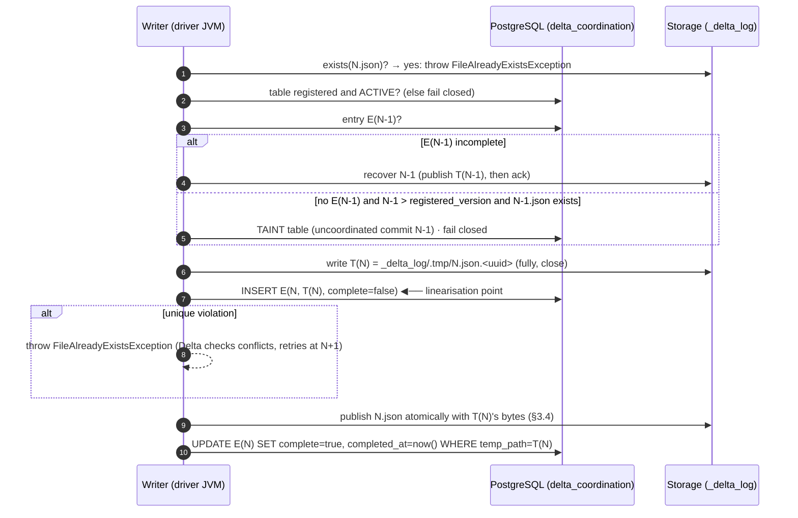

# ADR-0004 — PostgreSQL-coordinated Delta LogStore for multi-writer tables

| | |
|---|---|
| **Status** | Accepted (D3, 2026-09-25) |
| **Risk** | ⚠️ **Highest-risk component of the project** (R0). A defect here corrupts tables. |
| **Supersedes** | AD-06 of discovery v1 ("one writer per Delta table") |
| **Related** | [ADR-0003](0003-control-plane-in-postgresql.md), [ADR-0005](0005-batch-wal-and-idempotent-writes.md), [ADR-0010](0010-concurrent-write-conflict-handling.md), [ADR-0011](0011-storage-profiles.md) |
| **Sources studied** | `delta-io/delta` tag `v4.4.0`: `storage/.../LogStore.java`, `HadoopFileSystemLogStore.java`, `HDFSLogStore.java`, `storage-s3-dynamodb/.../BaseExternalLogStore.java`, `ExternalCommitEntry.java`, `S3DynamoDBLogStore.java`, `storage/.../commit/CommitCoordinatorClient.java`, `spark/.../coordinatedcommits/*`, `PROTOCOL.md` (catalog-managed tables); docs.delta.io *Storage configuration* and *Catalog-managed tables*. `BaseExternalLogStore` and `S3DynamoDBLogStore` are identical in `v4.4.0` and `master` at the time of writing. |

---

## 1. Context

### 1.1 What Delta requires from storage

The `LogStore` Javadoc (`@since 1.0.0`, a `DeveloperApi`) makes Delta's ACID guarantees conditional on three properties:

1. **Atomic visibility**: if `isPartialWriteVisible` is false, a file is either fully visible or not visible at all.
2. **Mutual exclusion**: only one writer can create (or rename) a file at the final destination.
3. **Consistent listing**: once a file is written in a directory, every later listing returns it.

A commit is the creation of `_delta_log/<N>.json` (N zero-padded to 20 digits). Delta's `OptimisticTransaction` relies on property 2. When `write(N.json, overwrite=false)` throws `FileAlreadyExistsException`, it checks the winning commit for logical conflicts and retries at N+1 if there are none. This retry path is to be confirmed in 4.4 code during P2 (§20 of the discovery).

### 1.2 Why the defaults are insufficient

| Storage | Atomic visibility | Mutual exclusion across processes | Consistent listing |
|---|---|---|---|
| Local POSIX FS, default `HDFSLogStore` | ✅ temp + rename | ❌ It checks that `N.json` does not exist, then renames onto it with `rename(2)`, which replaces an existing file. Its only guard is `synchronized (this)`. That lock is per `HDFSLogStore` instance, so it never spans JVMs. Delta takes it only when the log's `FileSystem` is a `RawLocalFileSystem`; on `file://` it is a `LocalFileSystem`, so the lock is not taken at all. Its own comment says it exists "in our tests". ¹ | ✅ |
| S3 / MinIO, default `S3SingleDriverLogStore` | ✅ PUT | ❌ (single driver only) | ✅ (S3 is strongly consistent; MinIO too) |
| HDFS | ✅ | ✅ atomic rename-if-absent | ✅ |

¹ *Corrected in P1.4d (2026-11-13).* This row first described a JVM-static `LOCAL_FS_WRITE_LOCK`. Delta 4.4.1's `HDFSLogStore` has no such lock; the facts above come from its code and from each writer's probe in the RED spike (§7.3). The decision is unchanged: if anything, the default is weaker than first stated.

The docs say it outright: *"Delta Lake on local file system may not support concurrent transactional writes"*. For S3 multi-cluster writes the official answer is `S3DynamoDBLogStore`, which is *"only safe when all writers use this LogStore implementation as well as the same DynamoDB table and region"*.

### 1.3 Project requirements (D3)

- **Type 2 concurrency in the MVP**: several processes write the **same** Delta table.
- Correct for **multi-instance, multi-node and multi-cluster**. Multi-instance is demonstrated in the MVP; the other two are extensions (E1, E2).
- **Storage-agnostic**: the same mechanism on `file://` and `s3a://`, without relying on the filesystem's rename semantics for exclusivity.
- Recovery of half-finished commits; consistent reads of the latest version.
- **Fail closed** when PostgreSQL is unavailable: never write without coordination.
- A safeguard so that no writer without this LogStore can write to the tables, **validated at startup**.
- Exhaustive tests: fault injection at every protocol step, a stress test with N concurrent writers, and a final verifier.
- A spike demonstrating commit loss without the LogStore and its absence with it.

---

## 2. Decision

Implement **`PostgresLogStore`**, a `LogStore` that obtains mutual exclusion for each commit version from a conditional `INSERT` in PostgreSQL, and register it for every lake scheme:

```properties
spark.delta.logStore.file.impl=<basePackage>.logstore.PostgresLogStore
spark.delta.logStore.s3a.impl=<basePackage>.logstore.PostgresLogStore
```

It follows the **prepare → commit → acknowledge** protocol of Delta's `BaseExternalLogStore`. That protocol is production-proven through `S3DynamoDBLogStore`; the implementation here is a **port with ten justified deviations** (§4), not a subclass. It lives in its own module, `delta-pg-logstore`, with no dependency on the rest of the project (ADR-0012), and it owns the PostgreSQL schema `delta_coordination`.

---

## 3. Design

### 3.1 Coordination schema (conceptual)

```sql
-- schema delta_coordination (migrations owned by the delta-pg-logstore module)
commit_entry(
  table_uri        text        not null,   -- canonical table URI (§3.6)
  file_name        text        not null,   -- e.g. 00000000000000000042.json
  version          bigint      not null,   -- parsed from file_name
  temp_path        text        not null,   -- relative to _delta_log, e.g. .tmp/<file>.<uuid>
  complete         boolean     not null,
  created_at       timestamptz not null default now(),   -- PostgreSQL clock, never the client's
  completed_at     timestamptz,
  writer_instance  text        not null,   -- host:pid:spark.app.id
  run_id           uuid,                    -- best effort, from the commit context (§3.7)
  primary key (table_uri, file_name)
)
-- plus an index on (table_uri, version desc) for "latest entry"

coordinated_table(
  table_uri          text primary key,
  delta_table_id     text,          -- metaData.id, captured at version 0 or on adoption
  registered_at      timestamptz not null default now(),
  registered_version bigint not null,   -- -1 if created through the LogStore; N if adopted at N
  status             text not null,     -- ACTIVE | TAINTED
  taint_reason       text
)
```

### 3.2 Write path — `write(path, actions, overwrite=false)` for commit N



- **Durability point:** the committed `INSERT`. From then on version N belongs to this writer, even if it crashes. Any later reader or writer finishes publishing it.
- **Errors after the `INSERT`:** transient errors in publish/ack are logged and swallowed, as in the base class, because the commit is already durable and recovery will finish it. **Fatal integrity errors are never swallowed** (deviation 4).

### 3.3 Read path — `listFrom(path)` on `_delta_log`

1. Fetch the latest entry for the table, by numeric `version` among commit files.
2. If it is incomplete, **recover** it: publish `T(N)` if `N.json` is absent, then ack.
3. List the directory (the storage provides consistent listing).
4. **Consistency check:** if the latest *complete* entry's version is greater than the latest listed `N.json`, a published commit is missing (deleted, or storage misconfigured). **Fail closed.**
5. Gap check: a listed `N.json` above `registered_version` with no entry means a foreign writer. **Taint the table** and log at ERROR. Reads may proceed so that forensics are possible. Writes are refused (§3.5).

`VACUUM` also calls `listFrom` on data directories. As in the base class, recovery and checks only apply to `_delta_log` paths.

### 3.4 Atomic publish — the storage-specific part

| Scheme | How `N.json` is published | Why it gives atomic visibility |
|---|---|---|
| `s3a://` (S3, MinIO) | Server-side copy / PUT of `T(N)`'s bytes to `N.json` | An object becomes visible only when complete |
| `file://` (POSIX) | Copy `T(N)` → `.tmp/N.json.<uuid>.pub`, then `rename` to `N.json` | `rename(2)` is atomic. It may *replace* an existing file, but that is harmless: exclusivity comes from PostgreSQL, and concurrent recoverers publish identical bytes. |

**`.crc` sidecars on `file://`** *(added in P1.4d)*. Hadoop's checksummed local file system (`LocalFs` behind a `FileContext`, `LocalFileSystem` behind a `FileSystem`) writes a `.<name>.crc` sidecar next to every file it creates. A rename moves the file first and then its sidecar, in a second step that does not overwrite. So publishing through it is two renames, not one. With identical bytes the sidecars are identical too. Still, a crash between the two steps leaves `N.json` without its sidecar and a stray temporary sidecar behind. A foreign writer's `N.json` leaves a sidecar that no longer matches. Every checksum-verifying reader then fails on that file, which is what the RED spike observed (§7.3). Whether the publish goes through the raw local file system, so that commit files have no sidecar, and how F3 and F11 cover sidecars, is decided in P2a (§8).

`isPartialWriteVisible` returns `true` for `file://` and `false` for `s3a://`. Delta uses it to decide whether checkpoints must be written via temp + rename.

### 3.5 Fail closed and safeguards

**Fail closed.** Every error talking to PostgreSQL surfaces as an `IOException`, never as "entry not found". There is no fallback to the default LogStore. JDBC connect, statement and lock timeouts are bounded so that a hung PostgreSQL produces a failure, not a hang. Reads fail too, because without the coordination store the latest version cannot be guaranteed.

**Safeguards against uncoordinated writers**, layered:

| Layer | Mechanism | Catches |
|---|---|---|
| 1 — Startup enforcement (`cli`) | The engine refuses to start (exit 4) unless `spark.delta.logStore.<scheme>.impl` is `PostgresLogStore` for every scheme of the active lake profile, the coordination schema version matches, and a probe on the lake root resolves to this LogStore | Our own processes misconfigured: the realistic risk |
| 2 — Table registry | A table is registered at creation (version 0 through this LogStore) or explicitly adopted (`adopt-table` at its current version, recording `metaData.id`). Commits to unregistered `table_uri`s are rejected. | Aliased paths (§3.6); tables created outside the framework |
| 3 — Gap detection | A published `N.json` above `registered_version` without an entry → `TAINTED`; writes refused until an operator verifies and re-adopts (runbook) | A foreign writer's commit |
| 4 — Publish-race detection | If `N.json` already exists when publishing our entry and its bytes differ from `T(N)` → fatal `UncoordinatedWriteDetected`, `TAINTED` | A foreign writer racing our own commit N, which the base class would lose silently |
| — Limit | *Preventing* an arbitrary external writer needs storage access control (only the service identity may write `_delta_log/`), or protocol-level blocking (`catalogManaged`, §5) | Documented as **Enterprise** |

### 3.6 Canonical table identity

Mutual exclusion holds only if every writer maps the same table to the **same key**. Two spellings mean two keys, and therefore no exclusion. Rules:
- Qualify the path with its `FileSystem` and strip user info, as the base class does.
- For `file://`, resolve to the real path, so symlinks cannot alias.
- One scheme per lake profile (ADR-0011): `s3://`, `s3n://` and `s3a://` must never be mixed.
- Aliases that slip through are caught by the registry (layer 2): an aliased key is unregistered, so its commits are rejected.
- Delta treats spellings as distinct too, though only at creation. `DeltaTable.create(...).location("file:///x")` fails with `DELTA_AMBIGUOUS_PATHS_IN_CREATE_TABLE`. Delta compares the location as given with Hadoop's qualified form `file:/x` and refuses to choose between them (found in P1.4b: the stress table is created from the qualified form). This is a single check at creation; Delta does not reconcile spellings across writers. The coordination key must therefore always be the qualified form, never the string a caller passed. *(Added in P1.4d.)*

### 3.7 Attribution (commit context)

The engine wraps each Delta write in `CommitContext.withRun(runId) { … }`, a thread-local API exposed by the LogStore module. The LogStore stores `run_id` on the entry and increments a per-run `commit_contention` counter each time the `INSERT` hits a unique violation. This relies on the commit executing on the caller's thread, which is verified in P2. If it does not hold, `run_id` is recovered from the commit's `userMetadata` instead. Attribution is **best effort** and never fails a commit.

### 3.8 Recovery semantics summary

| Crash point | State left | Who finishes | Outcome |
|---|---|---|---|
| Before `T(N)` is closed | Partial temp file, no entry | Nobody; temp GC | Commit N never happened; the Delta txn failed |
| After `T(N)`, before `INSERT` | Orphan temp | Temp GC | Same as above |
| After `INSERT`, before publish | Entry incomplete, no `N.json` | Next `listFrom` (any reader) or the writer of N+1 | **Commit N is durable** and becomes visible |
| During publish (`file://`) | Entry incomplete, `.pub` temp, no `N.json` | Same | Published atomically by the recoverer |
| After publish, before ack | Entry incomplete, `N.json` present | Same (identical bytes → mark complete) | Complete |
| After ack | Entry complete | — | Complete |

Temp GC deletes `.tmp/` files whose entry is complete, or that have no entry and are older than a safety window. It runs only in maintenance mode, never on the commit path.

---

## 4. Deviations from `BaseExternalLogStore`

| # | Base class behaviour (v4.4.0) | `PostgresLogStore` | Reason |
|---|---|---|---|
| 1 | Reused by **inheritance**; ships in `delta-storage-s3-dynamodb` (pulls in the AWS SDK) | **Ported** into a class extending `HadoopFileSystemLogStore` (`delta-storage`, already on the classpath) | Deviations 4 and 5 sit inside the private flow of `write()`, which a subclass cannot change. Avoids AWS dependencies. |
| 2 | Publish = streaming copy `fs.create(dst, overwrite=false)` + `IOUtils.copy` | `file://`: copy to a second temp + `rename`; `s3a://`: copy | The streaming copy is atomic only on object stores. On POSIX a concurrent reader could see a partial `N.json`, which violates property 1. |
| 3 | `isPartialWriteVisible` always `false` | `true` on `file://`, `false` on `s3a://` | So that Delta writes checkpoints via temp + rename on POSIX |
| 4 | After `putExternalEntry`, **every** `Throwable` from publish/ack is logged and ignored — including a `FileAlreadyExistsException` caused by a foreign `N.json` | Transient errors ignored (recovery will finish). A content mismatch with an existing `N.json` is **fatal** + taint. | Otherwise, with a foreign writer, our commit is lost silently while Delta believes it succeeded |
| 5 | No detection of uncoordinated commits: a missing entry for N-1 falls back to `fs.exists(N-1.json)` | Registry + gap detection + `TAINTED` state | Safeguard requirement |
| 6 | Complete entries expire (DynamoDB TTL, default 1 day) | Kept (commit audit trail). Optional pruning keeps the latest entry per table and anything younger than ≥ 1 day. | PostgreSQL storage is cheap. Entries serve lineage. The 1-day floor keeps the base class's safety argument. |
| 7 | `expireTime` computed with the client clock | PostgreSQL `now()` | Clock skew across nodes and clusters |
| 8 | No run attribution | `run_id`, `writer_instance`, contention counter | Lineage *Delta version ↔ run* without `DESCRIBE HISTORY`; `commit_contention` metric |
| 9 | Latest entry = last by `fileName` sort (DynamoDB range key) | Latest by numeric `version`, among commit files only | Robust to non-commit files that also pass through `write(overwrite=false)` (inventory in P2) |
| 10 | Creates its store table on first use (`tryEnsureTableExists`) | Schema created by migrations; at init the LogStore checks the schema version and **fails closed** if it is missing or wrong | Least privilege: no DDL from the data path; explicit upgrades |

**Kept as is:** the protocol and its linearisation point; step 1 (`N-1` must be published before writing `N`); the "old entries for table still exist" check at version 0 (a table deleted and recreated at the same path); the per-JVM `PathLock` as an *optimisation* against duplicate recoveries (correctness never depends on it); read retries for S3 `RemoteFileChangedException` during concurrent recoveries (`s3a` only).

---

## 5. Alternatives considered

| Option | Pros | Cons | Verdict |
|---|---|---|---|
| **A. Single writer per table** (v1 AD-06) | Simplest; zero new components | Does not meet Type 2 (D3) | Rejected by the owner |
| **B. `S3DynamoDBLogStore` + MinIO + DynamoDB Local** | Official; production-proven; zero custom correctness code | `s3a` only by design; adds a DynamoDB Local container and the AWS SDK; duplicates the coordination store we already run in PostgreSQL; on `file://` it would suffer from deviations 2 and 4 | Rejected for the project. **The right choice on AWS in production.** |
| **C. `coordinatedCommits-preview` writer feature** with a custom `CommitCoordinatorClient` over PostgreSQL. `CommitCoordinatorProvider.registerBuilder` exists in 4.4; `delta.coordinatedCommits.commitCoordinator-preview` table property. | Official extension point; works with path-based tables; **writers that do not support the writer feature are blocked by the protocol**, which is stronger than our safeguards 1–4 | Preview-named config and feature; not documented for users; upstream is converging on `catalogManaged` (the Spark module only ships in-memory and Unity Catalog builders); different backfill model (unbackfilled commits) with more moving parts; high API-churn risk across Delta minors | Rejected for the MVP. Recorded as the benchmark for our safeguards. |
| **D. `catalogManaged` tables + Unity Catalog OSS (≥ 0.4)** as commit coordinator. GA since Delta 4.0.1. | The official direction; the catalog ratifies commits; protocol-level blocking of filesystem-based writers; enables multi-table transactions in the future | Requires running a Unity Catalog server; **no path-based access**; cannot be enabled on existing tables; `CREATE OR REPLACE` unsupported; heavier on 7.4 GB RAM | **Future evolution.** `TableLocator` (ADR-0011) keeps the engine independent of path vs catalog addressing. |
| **E. Single-node HDFS in Docker** | Native atomic rename-if-absent | Heavy (NameNode + DataNode); not how modern lakes run; says nothing about object stores or multi-cluster | Rejected |
| **F. Table-level lock in PostgreSQL held around each whole write** (advisory lock) | Trivial to implement | Serialises writers for the whole Spark job, killing concurrent blind appends; connection-bound lock (silent loss on network blips); fixes neither atomic visibility nor recovery | Rejected |

---

## 6. Consequences

**Positive**
- Type 2 concurrency is correct on `file://` and `s3a://` with one mechanism. Only drivers talk to PostgreSQL and every driver uses the same store, so it holds unchanged across multi-instance, multi-node and multi-cluster deployments.
- Delta's optimistic concurrency semantics are preserved. The LogStore supplies the primitive (exclusive creation of version N); `OptimisticTransaction` resolves logical conflicts.
- A commit audit trail and Delta version ↔ run lineage come for free.
- The module is reusable outside this project: an interview-grade artifact on its own.

**Negative / accepted**
- We own a correctness-critical component. Mitigated by the port of a proven protocol, fault injection and a stress verifier.
- **PostgreSQL is on the commit and read path.** Its availability is the tables' availability, by design (fail closed). In production the coordination store would have stricter HA than the control plane.
- Latency: about three extra round trips per commit plus one per snapshot refresh. That is milliseconds, negligible next to a Spark job. It is measured in E3.
- Every writer of these tables **must** use this LogStore. This is the same documented caveat as `S3DynamoDBLogStore`, enforced at startup and detected at runtime.

---

## 7. Verification plan

### 7.1 Fault injection (Testcontainers PostgreSQL, one JVM)

The protocol is tested against a `CoordinationStore` trait with a fault-injecting implementation, plus named hooks. Each case asserts the table state **and** that a subsequent reader or writer converges.

| # | Scenario | Expected |
|---|---|---|
| F1 | Crash after `T(N)` written, before `INSERT` | N not visible; next writer commits N; orphan temp collected by GC |
| F2 | Crash after `INSERT`, before publish | N durable; first `listFrom` publishes it; next writer's step 1 publishes it |
| F3 | Crash in the middle of publish (`file://`) | No partial `N.json` ever visible; recoverer publishes |
| F4 | Crash after publish, before ack | Recoverer marks complete; bytes unchanged |
| F5 | PostgreSQL down before `INSERT` | Commit fails (`IOException`); nothing visible; nothing written without coordination |
| F6 | PostgreSQL down after `INSERT` (ack fails) | Commit durable; completed later by recovery |
| F7 | PostgreSQL down during `listFrom` | Read fails (fail closed) |
| F8 | Two recoverers of the same N concurrently | Identical `N.json`; entry complete; no error surfaced |
| F9 | Table deleted and recreated at the same path | Version-0 write rejected ("old entries exist") until the operator resets the registry |
| F10 | Foreign commit (default LogStore writes N) | Gap detected → `TAINTED`; our writes refused |
| F11 | Foreign writer races our commit N (their `N.json` lands between our `INSERT` and publish) | Content mismatch → fatal, `TAINTED`; no silent loss |
| F12 | Commit to an unregistered or aliased `table_uri` | Rejected |
| F13 | Coordination schema missing or wrong version at init | LogStore init fails; engine exits 4 |
| F14 | Latest complete entry > latest listed `N.json` | Read fails closed |

### 7.2 Stress test + verifier (multi-process)

- **Harness:** N writer **JVMs** (`local[1]`), each performing K blind appends to the same table with `txnAppId = writer-<i>`, `txnVersion = k`. Each commit writes rows tagged `(writer, k)`. Optional chaos: random `kill -9` of writers, PostgreSQL restart mid-run, concurrent `OPTIMIZE`.
- **Verifier** (runs after a final `listFrom`):
  - versions `0..V` contiguous; every `N.json` parses;
  - every coordination entry is complete, and `entries == published commits` above `registered_version`;
  - for each surviving writer, the set of `txnVersion`s in the Delta log equals `{1..K}`;
  - for each killed writer, a prefix `{1..k'}` (its last in-flight commit is either fully present or absent);
  - row counts per `(writer, k)` match what was written; no duplicates;
  - no orphan incomplete entries; `DESCRIBE HISTORY` consistent with the entries.
- **Sizes:** N=3, K=200 locally; N=8, K=500 in CI (ADR-0001 resource budget).

### 7.3 Spike (before / after, same harness)

- **RED (P1):** default LogStore on `file://`. Expected result: lost commits, meaning versions that were overwritten, so some `(writer, k)` are missing although their writer saw success. Two variants:
  - the natural race, measured over many commits;
  - a **widened window** using a delaying `FileSystem` wrapper between the existence check and the rename, for deterministic reproduction.

  If the natural race does not reproduce within a reasonable budget, the widened variant is the evidence, and the README states it honestly.
- **GREEN (P2):** the same harness with `PostgresLogStore`, zero anomalies over the same budget, including the widened-window variant.
- Both results go in the README, side by side.

**RED result (P1.4c, 2026-11-13).** Full write-up: [docs/spikes/logstore-red.md](../spikes/logstore-red.md).
- Over five runs, the natural race lost acknowledged commits in **2 of 5**; the widened window lost one in **5 of 5**. There was never a version gap: the lost commit's file is replaced, not removed. Delta detects a gap (`DELTA_VERSIONS_NOT_CONTIGUOUS`), but not an overwrite.
- On `file://`, an overwrite usually leaves a stale `.crc` sidecar (§3.4). Every reader that checks it then fails, writers included. That is Hadoop's detection, by accident and after the fact: the writer was already told it succeeded. A reader that checks no sidecars, as on object storage, reads the table without error and without the commit.
- The fallback of the plan above was not needed: the natural race did reproduce.
- GREEN must also show no stale sidecar, and both readers clean.

---

## 8. Open items (closed in P2)

- Inventory of the files Delta 4.4 writes through `LogStore.write(overwrite=false)` (commits, `.crc` checksums, compacted log files, …) and with `overwrite=true` (`_last_checkpoint`), and how each maps onto `commit_entry` and "latest entry".
- Confirm the `OptimisticTransaction` retry path on `FileAlreadyExistsException`.
- Confirm that the commit runs on the caller's thread (attribution, §3.7).
- LogStore instantiation lifecycle, which decides how the JVM-wide HikariCP pool keyed by JDBC URL is shared.
- How the `file://` publish handles Hadoop's `.crc` sidecars (§3.4): publish through the raw local file system, or through `LocalFs` with the second rename covered by recovery and by F3/F11. *(Added in P1.4d, from the RED spike.)*
- Isolation level and statements: `INSERT … ON CONFLICT DO NOTHING RETURNING` vs catching SQLState `23505`; `READ COMMITTED` is sufficient because every decision is a single-row atomic statement.
