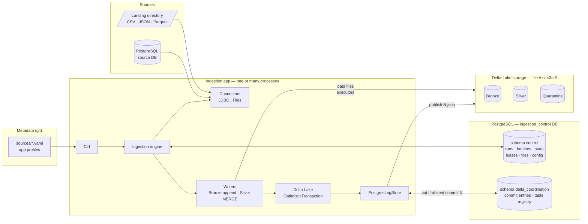

# Phase 0 — Architecture Discovery & Project Definition

| | |
|---|---|
| **Status** | v3 — **Phase 0 closed** · decisions D1–D7 applied · next phase: P1 |
| **Date** | 2026-09-25 · closed 2026-11-10 |
| **Scope** | Analysis and decisions prior to writing code. No implementation. |
| **Decision records** | [`docs/adr/`](../adr/README.md) — this document summarises; the ADRs are authoritative |

**Revision history**

| Version | Change |
|---|---|
| v1 | Initial discovery (Spanish). Proposed a single writer per Delta table (AD-06). |
| v2 | Decisions D1–D6 applied. **AD-06 removed**: multi-writer tables are in the MVP through a PostgreSQL-coordinated Delta LogStore (ADR-0004). Phase plan re-sequenced around the LogStore, which is now the highest-risk component. Translated to English (D6). |
| v3 | Phase 0 closed. Phase plan confirmed, with P2 split into P2a (protocol, one JVM) and P2b (multi-process proof). Application security baseline added (D7, ADR-0013). Repository name `lakehouse-ingestion-framework`, base package `lakehouse.ingestion` (ADR-0012). |

---

## 0. Summary of decisions

| # | Decision | Outcome | ADR |
|---|---|---|---|
| D1 | Development environment | WSL2 (Ubuntu) + Docker Engine inside WSL + JDK 17/sbt in WSL + VS Code Remote-WSL with Metals. Code lives in the WSL filesystem. | [ADR-0001](../adr/0001-development-environment.md) |
| D2 | Control plane | PostgreSQL holds state, leases (with epoch), the batch write-ahead log and the audit trail. This is a design decision that holds in the cloud too, not a workaround for the local filesystem. | [ADR-0003](../adr/0003-control-plane-in-postgresql.md) |
| D3 | Multi-writer concurrency | Custom **PostgreSQL-coordinated Delta LogStore** (same pattern as `S3DynamoDBLogStore`). The MVP covers *Type 2* concurrency: several processes writing the **same** Delta table. Correct by design for multi-instance, multi-node and multi-cluster. Multi-instance is demonstrated in the MVP; multi-node and multi-cluster are extensions. | [ADR-0004](../adr/0004-postgresql-coordinated-delta-logstore.md), [ADR-0010](../adr/0010-concurrent-write-conflict-handling.md), [ADR-0011](../adr/0011-storage-profiles.md) |
| D4 | Versions | Spark 4.1.4 · Delta 4.4.1 (`delta-spark_4.1_2.13`) · Java 17 · Scala 2.13.17 · sbt 1.13.1 — patch versions updated in P1 | [ADR-0002](../adr/0002-technology-stack.md), [ADR-0014](../adr/0014-stack-versions-pinned-at-p1.md) |
| D5 | Phase plan | Confirmed at closure: re-sequenced for D3, spike split RED (P1) / GREEN (P2b), P2 split into P2a and P2b (§17) | — |
| D6 | Repository identity | Code, comments, commits and docs in English. Repository `lakehouse-ingestion-framework`, base package `lakehouse.ingestion`, independent of the GitHub handle. Organization placeholder defined in one place (§21). | [ADR-0012](../adr/0012-module-structure.md) |
| D7 | Application security | Validated SQL identifiers and no concatenated SQL; file paths confined to allowed roots; least-privilege PostgreSQL roles; dependency vulnerability scanning in CI. Recommended: pinned non-root images, configurable TLS, safe YAML loading, a brief threat model. Woven into existing phases (§17). | [ADR-0013](../adr/0013-application-security-baseline.md) |

---

## 1. Critical analysis

### What is well framed
- **Scope ends at Silver.** Gold is business modelling; an ingestion framework that owns it becomes a "framework for everything".
- **Concurrency is designed in from the start.** Retrofitting it is what breaks in-house frameworks.
- **Correctness before performance**, with before/after measurement for any optimisation.
- **Finishing is the main risk.** The phase plan has two coherent stopping points (§17).

### What was challenged, and how it was resolved

| # | Topic | Problem | Resolution |
|---|---|---|---|
| C1 | Environment | Spark Standalone on native Windows is fragile (bash launch scripts, `winutils`). Docker Desktop on Windows Home needs WSL2 anyway. Memory is tight at 7.4 GB. | WSL2 with Docker Engine and memory caps (ADR-0001). |
| C2 | Delta on the local filesystem with several writer processes | `HDFSLogStore` checks that `N.json` does not exist, then renames onto it with `rename(2)`, which replaces an existing file. Its `synchronized (this)` lock is per instance, so it never spans JVMs, and on `file://` it is not even taken (corrected in P1.4d: first described as a JVM-static `LOCAL_FS_WRITE_LOCK`). Two JVMs committing to the same table can overwrite each other's `N.json` and lose a commit. Delta does not notice. The RED spike measured it: [docs/spikes/logstore-red.md](../spikes/logstore-red.md). | Commit exclusivity is moved to PostgreSQL through a custom LogStore (ADR-0004). The loss is demonstrated before and after in the spike (RED in P1, GREEN in P2b). |
| C3 | Type 2 concurrency in the MVP | v1 proposed one writer per table. The owner requires Type 2 in the MVP (D3). | AD-06 removed. The LogStore makes multi-writer tables safe on `file://` and `s3a://`. |
| C4 | Separate "synthetic data" phase | Data generators without a consumer drift from what the tests need. | Each generator is built in the phase of the connector that consumes it. |
| C5 | Lineage, observability and audit as three phases | All three derive from one execution model (run, batch, Delta version). | Modelled once (P4), exposed in P11. |
| C6 | CI/CD late (old phase 15) | CI added at the end only declares good practice. | Minimal CI in P1, growing every phase. |
| C7 | Advanced testing as a late phase | Failure tests need injection points designed into the code. | Fault hooks are part of the engine and LogStore design. |
| C8 | Parquet in the MVP | Adds little to the story, but costs nothing through `DataFrameReader`. | Supported; one smoke test. |
| C9 | Streaming | Nothing blocks it as long as connectors split *plan* from *read*. | Contract keeps `plan`/`read` replayable (§12). |
| C10 | *New in v2:* owning a correctness-critical LogStore | A bug here corrupts tables, which is worse than any bug in the engine. | Port a proven protocol (`BaseExternalLogStore`), justify every deviation, test with fault injection at each step plus a stress verifier. It is the first thing built after bootstrap (P2a protocol, P2b multi-process proof) and the top-ranked risk (R0). |

---

## 2. Functional requirements

| ID | Requirement | MVP |
|---|---|---|
| RF-01 | Define sources through versioned metadata files, with no per-source code | ✅ |
| RF-02 | Validate the whole configuration at startup, before touching data, reporting all errors at once | ✅ |
| RF-03 | JDBC connector (PostgreSQL as reference): full load and incremental by watermark | ✅ |
| RF-04 | File connector (CSV, JSON; Parquet at no extra cost): process only new files | ✅ |
| RF-05 | Bronze append with ingestion metadata and fidelity to the source | ✅ |
| RF-06 | Silver: typing, name normalisation, deduplication by key, upsert (`MERGE`) | ✅ |
| RF-07 | Delete detection: implicit on full loads, key reconciliation on incremental loads | ✅ |
| RF-08 | Persistent incremental state, consistent with the data written | ✅ |
| RF-09 | Automatic recovery of an interrupted run | ✅ |
| RF-10 | Explicit, audited reprocessing and backfills that do not disturb incremental state | ✅ |
| RF-11 | Controlled, audited reset of a source's state | ✅ |
| RF-12 | Configurable per-source schema evolution policy, including schema changes made concurrently by another writer | ✅ (basic) |
| RF-13 | Corrupt records routed to quarantine, with a rejection threshold | ✅ |
| RF-14 | Error classification (transient / permanent / data / conflict) with bounded retries | ✅ |
| RF-15 | Mutual exclusion per (source, layer) across instances: lease with expiry and epoch | ✅ |
| RF-16 | Audit record per run and per batch | ✅ |
| RF-17 | Table/batch lineage: source → Bronze Delta version → Silver Delta version | ✅ |
| RF-18 | Real per-run metrics and per-source freshness | ✅ |
| RF-19 | PII tagging in metadata; pseudonymisation in Silver | ✅ |
| RF-20 | CLI modes `run`, `plan` (dry run), `backfill`, `reprocess`, `reset-state`, `reconcile-deletes`, `maintain`, `adopt-table` | ✅ (progressive) |
| RF-21 | Parallel ingestion of N sources inside one Spark application | ✅ |
| **RF-25** | **Coordinated commits: several processes can write the same Delta table safely (Type 2), on `file://` and `s3a://`** | ✅ |
| **RF-26** | **Refuse to run if the LogStore is not configured for every lake scheme, and detect commits written without coordination** | ✅ |
| RF-22 | Multi-instance demonstration: N processes on one machine writing shared tables, checked by a verifier | ✅ (was an extension in v1) |
| RF-27 | Multi-node demonstration (Spark Standalone with several workers + MinIO) | Extension |
| RF-28 | Multi-cluster demonstration (independent Spark applications/clusters sharing storage and coordination) | Extension |
| RF-23 | REST connector | Extension |
| RF-24 | SCD type 2 in Silver | Extension |

## 3. Non-functional requirements

| ID | Requirement | Verification |
|---|---|---|
| RNF-01 | **Correct under failure**: killing a run at any point neither duplicates nor loses data | Fault injection at every engine hook and every LogStore protocol step, plus an e2e `kill -9` test |
| RNF-02 | **Idempotent**: re-running the same ingestion produces the same final state | Run twice, compare tables and state |
| RNF-03 | **Concurrency-safe (same source)**: N instances on one source give one effective executor and N−1 audited `SKIPPED_LOCKED` | Lease tests with N threads against real PostgreSQL |
| **RNF-12** | **Concurrency-safe (Type 2, same table)**: N writer processes produce contiguous versions with no lost commits, and every expected `txnVersion` is present exactly once | LogStore stress test with random `kill -9` and a final verifier (ADR-0004) |
| **RNF-13** | **Fail closed**: if coordination (PostgreSQL) is unavailable, no commit is ever written without it | Fault tests with PostgreSQL stopped at each step |
| **RNF-14** | **Deployment-level agnostic**: nothing in the design assumes one JVM, one machine or one cluster for correctness | Design review against ADR-0011; E1/E2 demonstrations |
| RNF-04 | **Extensible**: a new source type is one class implementing the contract plus a registration | A test connector added without touching the `engine` module |
| RNF-05 | **Auditable**: every run, including failed and skipped ones, leaves a record | Tests on audit records |
| RNF-06 | **Testable**: domain logic does not depend on Spark or I/O | The `core` module has no Spark dependency (compiler-enforced) |
| RNF-07 | **Reproducible**: deterministic seeded test data; environment up with one command | `docker compose up` + `sbt test` |
| RNF-08 | **Observable**: structured logs with `run_id` and `source_id` on every line | Log layout test |
| RNF-09 | **Secure**: no secret in configuration, logs or audit | Redaction test |
| RNF-10 | **Resource bounded**: the MVP runs inside the WSL budget (§7.3) | `.wslconfig` limits and Spark memory settings |
| RNF-11 | **Streaming-ready** (not implemented): no decision closes the door | Connector contract review |
| **RNF-15** | **Hardened inputs**: identifiers and paths from configuration can neither inject SQL nor escape their allowed roots; runtime database roles have least privilege | Malicious-input corpus, symlink tests, privilege-denial tests (ADR-0013) |
| **RNF-16** | **Supply chain**: no new dependency with a known high-severity vulnerability; images and actions pinned | CI dependency review; pinned-image check (ADR-0013) |

---

## 4. Requirements missing from the original brief

| Missing requirement | Why it matters | Level |
|---|---|---|
| **Orchestrator contract**: CLI and exit codes (0 OK, 2 skipped/locked, 3 transient failure, 4 permanent failure, 5 data threshold exceeded, 64 usage error, 70 internal error; the whole table is in §14.1) | The framework does not schedule itself. The orchestrator must tell "retry" from "do not retry". | Required |
| **Partially written files** | A file still being copied would be ingested truncated. Needs a minimum file age, temp-name exclusion, or a marker file. | Required |
| **Bounded batch size** (`max_files_per_batch`, max watermark range) | An unbounded first load or a file backlog breaks memory and produces huge commits. | Required |
| **Time zones** | `timestamp without time zone` combined with a different Spark session zone is a classic watermark bug. Everything is UTC. | Required |
| **Clock source** | Instances' clocks differ. Leases and commit-entry timestamps use PostgreSQL `now()`; watermark upper bounds use the **source's** clock. | Required |
| **First run of a source** | Incremental with no watermark means a bounded full load. | Required |
| **Breaking configuration changes** (primary key, watermark column, target) | They invalidate state. Detected against the last used config snapshot; require an explicit `reset-state`. | Required |
| **Canonical table identity** *(new)* | Two spellings of the same table path (symlink, `s3://` vs `s3a://`) would give two coordination keys, and therefore **no mutual exclusion**. | Required (ADR-0004, ADR-0011) |
| **LogStore enforcement** *(new)* | One misconfigured writer without the LogStore voids every guarantee. | Required (ADR-0004) |
| **Dry run / `plan`** | Show what would be read without writing. Cheap, and valuable for demos and operations. | Recommended |
| **Retention**: Bronze, quarantine (holds PII), audit history, `VACUUM`, LogStore temp files | Without retention there is no credible GDPR story and no cost control. | Recommended |
| **Ownership of Delta maintenance** (`OPTIMIZE`/`VACUUM`) | Concurrent maintenance is now *allowed* (Type 2); its conflicts must be classified (ADR-0010). | Recommended |
| **Retiring a source** | Deleting the YAML orphans its state. A `disabled` flag is enough. | Recommended |
| **CSV encoding and dialect** | The real source of most "corrupt records". | Required (in config) |
| **Freshness SLA per source** | `source_freshness` needs a threshold to alert on. | Recommended |
| **Environment profiles** (local / test / CI / multinode) | Different lake URIs and connections without touching source definitions. | Required |

---

## 5. Risks and decision index

### Risks

| Risk | Prob. | Impact | Mitigation |
|---|---|---|---|
| **R0 — PostgreSQL LogStore is incorrect** (lost or duplicated commit, partial `N.json` visible, deadlock, fail-open path). **Highest-risk component of the project.** | Medium | **Critical**: table corruption | Port Delta's proven prepare–commit–acknowledge protocol; every deviation justified (ADR-0004); fault injection at each step; stress test with `kill -9` and a verifier; built right after bootstrap (P2a/P2b) so the rest of the project stands on verified ground; spike shows before/after. |
| R1 — Local environment insufficient (RAM, Windows) | High | High | WSL2 with caps; `local[*]` day to day; stress and multi-node at small N locally, full size in CI (§7.3). |
| R2 — Scope creep / not finishing | High | High | Checkpoints A and B; README kept useful from P1; extensions kept separate. |
| R3 — Reliance on Delta internals (`Snapshot.transactions`, `DeltaLog.getChanges` and the `txn` action of a commit, commit on the caller thread, which files go through `LogStore.write`) | Medium | Medium | Isolated behind small adapters; verification items listed in §20; pinned Delta version with an upgrade test. |
| R4 — Over-designed control plane | Medium | Medium | Seven control tables plus two coordination tables; every column justified. |
| R5 — Consistency subtleties (zombies, expired leases, non-monotonic commit order) | Medium | High | Epoch fencing in the control plane; `txnAppId`/`txnVersion` discard stale writes in Delta; Silver cursor is the Bronze Delta version (ADR-0010). |
| R6 — Slow Spark tests discourage testing | Medium | Medium | `core` and LogStore unit tests have no Spark; one shared session per suite; integration module separate. |
| R7 — Spark 4 / Scala 2.13 ecosystem | Low | Medium | Few, mature dependencies; verified in P1. |
| R8 — Windows ↔ WSL friction (filesystem performance, IDE) | Medium | Medium | Code lives in the WSL filesystem, never under `/mnt/c`. |

### Architectural decisions

| ID | Decision | ADR |
|---|---|---|
| AD-01 | Metadata as YAML (one file per source), typed validation at startup | [0007](../adr/0007-metadata-format.md) |
| AD-02 | State, leases, WAL and audit in PostgreSQL | [0003](../adr/0003-control-plane-in-postgresql.md) |
| AD-03 | Data ↔ state consistency via *plan → idempotent write → commit* with a batch WAL | [0005](../adr/0005-batch-wal-and-idempotent-writes.md) |
| AD-04 | `run_id` = UUIDv7 (attempt) ≠ `batch_seq` (logical unit of data) | [0005](../adr/0005-batch-wal-and-idempotent-writes.md) |
| AD-05 | Per-(source, layer) lease with expiry, heartbeat and epoch fencing | [0006](../adr/0006-source-leases-with-epoch-fencing.md) |
| ~~AD-06~~ | ~~One writer per Delta table~~ — **removed (D3)** | — |
| **AD-13** | Multi-writer Delta tables through a PostgreSQL-coordinated LogStore | [0004](../adr/0004-postgresql-coordinated-delta-logstore.md) · [0015](../adr/0015-hard-link-publish-on-local-file-systems.md) (publish on `file://`) · [0017](../adr/0017-a-failed-publish-is-reported-not-swallowed.md) (failed publish) |
| **AD-14** | Conflict classification (retry vs re-plan), Silver partitioning for concurrent `MERGE`, Silver cursor = Bronze Delta version | [0010](../adr/0010-concurrent-write-conflict-handling.md) |
| **AD-15** | Lake storage profiles (`file://` single machine, `s3a://` multi-node/multi-cluster) and canonical table identity | [0011](../adr/0011-storage-profiles.md) |
| AD-07 | Bronze keeps text formats as `string` + rescue column; typing happens in Silver | [0008](../adr/0008-layer-responsibilities.md) |
| AD-08 | Bronze append · Silver `MERGE` | [0008](../adr/0008-layer-responsibilities.md) |
| AD-09 | Deletes: `WHEN NOT MATCHED BY SOURCE` on full loads; periodic key reconciliation on incremental loads; CDC as a future option | [0009](../adr/0009-delete-detection.md) |
| AD-10 | Tables addressed by path; no metastore (behind a `TableLocator` so a catalog can be added later) | [0011](../adr/0011-storage-profiles.md) |
| AD-11 | sbt multi-module: `core` / `delta-pg-logstore` / `engine` / `cli` / `integration-tests` | [0012](../adr/0012-module-structure.md) · [0016](../adr/0016-delta-storage-provided-to-the-logstore-module.md) (the LogStore module's dependencies) |
| **AD-16** | Application security baseline: validated SQL identifiers and no concatenated SQL, path confinement, least-privilege PostgreSQL roles, dependency scanning in CI | [0013](../adr/0013-application-security-baseline.md) |
| **AD-17** | An incremental load reads a window of the source's clock, fixed when its batch is planned: a timestamp as the watermark, a margin that loses nothing, a cut counted from the watermark, and a horizon for a chain of batches | [0020](../adr/0020-the-watermark-of-an-incremental-load.md) |
| **AD-18** | A failure of a run is classified once, where the run ends; a run that may pass resumes where it is durable, within a budget of time; what nothing classified ends the run as `internal` and the process in 70 | [0022](../adr/0022-the-classification-of-failures-and-the-retries-of-a-run.md) |

---

## 6. Overall architecture

### 6.1 High-level view



**Two planes, three coordination mechanisms.** Each mechanism protects exactly one thing, and none of them depends on a single JVM, machine or cluster:

| Mechanism | Protects | Scope | ADR |
|---|---|---|---|
| **Source lease** (row in `control.source_lease`, epoch fencing) | That only one run at a time advances the state (watermark, processed files) of a (source, layer) | Control plane | 0006 |
| **Batch WAL + `txnAppId`/`txnVersion`** | That a logical batch is applied to a table exactly once, even across crashes and zombies | Control plane + Delta log | 0005 |
| **PostgresLogStore** (put-if-absent on `(table, version)`) | That exactly one writer creates `N.json` for each version of a table (Delta's *mutual exclusion* requirement) | Delta log | 0004 |
| **Delta optimistic concurrency** (built in) | That a commit is not logically invalidated by a concurrent one (e.g. two `MERGE`s touching the same files) | Delta log | 0010 |

### 6.2 Concurrency taxonomy and deployment levels

| Concurrency type | Example | What makes it safe |
|---|---|---|
| **Same source, same layer** | Two overlapping orchestrator triggers for `sales.orders` | Lease: the second run is `SKIPPED_LOCKED` (exit 2) |
| **Type 1 — different sources, different tables** | 20 sources ingested in parallel | Nothing is shared except the control plane (row-level operations) |
| **Type 2 — several processes, same Delta table** | Fan-in (several sources → one table), backfill running alongside the incremental run, `OPTIMIZE` alongside ingestion | LogStore (physical exclusivity per version) + Delta OCC (logical conflicts) + `txnAppId` (idempotence) |

| Deployment level | Definition | Requirement for correctness | Demonstrated in |
|---|---|---|---|
| **Multi-instance** | Several driver JVMs on one machine | Shared PostgreSQL; shared lake (`file://` is fine on one machine) | MVP (P2b stress test, P11 engine demo) |
| **Multi-node** | One Spark cluster; executors on different machines write data files | Shared storage reachable by every executor (`s3a://` MinIO); `file://` is not valid | Extension E1 |
| **Multi-cluster** | Independent Spark applications/clusters, each with its own driver | Same PostgreSQL and the same canonical lake URI for all writers | Extension E2 |

Decisions that would have closed the door on multi-node or multi-cluster, and are therefore **forbidden** (ADR-0011):
- JVM-local locks or in-memory state for correctness (only as an optimisation, as `PathLock` is in Delta's base class).
- Client clocks for leases or commit timestamps.
- Temporary files outside the table's `_delta_log/` (a recovering node must see them).
- Mixing URI schemes or path spellings for the same table.

### 6.3 Layer responsibilities

(Full rationale in [ADR-0008](../adr/0008-layer-responsibilities.md).)

| Layer | Holds | Does NOT hold / do | Write | Errors |
|---|---|---|---|---|
| **Landing** (files only) | The producer's drop directory. **The framework neither copies nor moves files**; it records what it processed. | Intermediate copies. Moving files would be a side effect that is not atomic with the Delta commit, and it would break replay. | Written by the producer | Unreadable file → `FAILED` record + policy (`fail` or `skip`) |
| **Bronze** | Fidelity to the source. JDBC keeps native types; CSV/JSON are kept as `string` + `_rescued_data`. Minimal ingestion metadata: `_run_id`, `_batch_seq`, `_ingested_at`, `_source_file` (files only). | Typing of text, deduplication, renames, business logic | Idempotent append (`txnAppId`/`txnVersion`) | Structurally broken records → Bronze quarantine. Threshold exceeded → the batch is not committed. |
| **Silver** | Current state per key, typed to the declared schema, `snake_case` names, pseudonymised PII, soft deletes (`_is_deleted`, `_deleted_at`) | Cross-source joins, aggregates, business rules | `MERGE` on the primary key with an ordering guard (`updated_at`), partitioned where writers fan in | Cast failures → Silver quarantine with the original Bronze record |
| **Gold** | Out of scope | — | — | — |

### 6.4 Lineage

- **Required (MVP)**: table + batch level. Every Bronze row carries `_run_id` and `_batch_seq`. Every batch records its input (watermark range or file list) and its output (table + **Delta version**).
- **v2 improvement**: the LogStore records, for each commit entry, the `run_id` of the committing run (via a commit context set by the engine; ADR-0004 §Attribution). The mapping *Delta version ↔ run* then lives in the control plane directly, with no `DESCRIBE HISTORY` scans. `userMetadata` in the commit is kept as a redundant, self-describing copy.
- **Future**: column-level lineage and OpenLineage events. The run/batch/input/output model maps 1:1 onto an OpenLineage `RunEvent`.

---

## 7. Stack, environment and resource budget

### 7.1 Stack

(Verified 2026-09-25 against Maven Central and the official docs; details in [ADR-0002](../adr/0002-technology-stack.md). Patch versions re-pinned in P1, 2026-11-13: [ADR-0014](../adr/0014-stack-versions-pinned-at-p1.md).)

| Component | Version |
|---|---|
| Java | 17 (Temurin, inside WSL) |
| Scala | 2.13.17 (the patch Spark 4.1.4 is built with) |
| Apache Spark | 4.1.4 |
| Delta Lake | 4.4.1 — `io.delta:delta-spark_4.1_2.13` (+ `delta-storage`, transitive) |
| sbt | 1.13.1 (pinned in `project/build.properties`) |
| PostgreSQL | 17 (`postgres:17`): source DB and control DB in one container, separate databases |
| JDBC driver | `org.postgresql:postgresql` 42.7.x |
| Connection pool (LogStore) | HikariCP. Justified by the LogStore's commit-path round trips (ADR-0004). |
| Control-plane migrations | Flyway |
| Config | circe + circe-yaml (safe loading, ADR-0013) |
| Tests | ScalaTest 3.2.x + Testcontainers (PostgreSQL; MinIO in E1) |
| Logging | log4j2 (Spark's own) with `JsonTemplateLayout` |
| Quality | scalafmt, `-Xlint` + selective `-Werror`, scoverage |
| CI | GitHub Actions · sbt dependency submission + Dependabot alerts + dependency review (ADR-0013) |
| Object storage (extension) | MinIO + `hadoop-aws` matching Spark's Hadoop version (verified in E1) |

### 7.2 Environment

Target environment: WSL2 Ubuntu 24.04 on Windows 10 22H2 (build 19045.6466, firmware virtualisation enabled, 8 cores, 7.4 GB RAM, 131 GB free disk).

Step-by-step installation and `.wslconfig`: **[`docs/setup/dev-environment.md`](../setup/dev-environment.md)**.

### 7.3 Resource budget (updated for D3)

WSL cap: `memory=5GB`, `swap=4GB`, `processors=6`. Outside WSL, Windows + the VS Code UI + a browser use about 2.4 GB.

| Scenario | Processes inside WSL | Est. RAM | Where it runs |
|---|---|---|---|
| Daily development | VS Code server + Metals (~1.2) · sbt + forked test JVM (~1.5) · PostgreSQL (~0.3) | ~3.0 GB | Local |
| LogStore stress test (P2b), default N=3 | PostgreSQL (~0.4) · 3 writer JVMs, `local[1]`, 512 MB heap (~0.75 each) · sbt orchestrator (~0.8) · **Metals stopped** | ~3.5 GB | Local (N=3); CI with N=8 |
| Engine multi-instance demo (P11) | PostgreSQL (~0.4) · 3 ingestion processes `local[2]` (~0.9 each) | ~3.1 GB | Local |
| Same, on local Spark Standalone (optional variant) | master (~0.3) · worker with 2 cores / 2 GB for executors (~2.2) · 3 client-mode drivers (~0.5 each) · PostgreSQL (~0.4) | ~4.4 GB | Local, Metals stopped |
| **E1 — multi-node** | MinIO (~0.4) · master (~0.3) · 2 workers × 1 GB (~2.4) · 2 drivers (~1.0) · PostgreSQL (~0.4) | ~4.5 GB | At the limit locally with small N; full size in CI |
| **E2 — multi-cluster** | Two independent stacks | > budget | CI (GitHub-hosted runner) or cloud |

Mitigations: swap as a safety net rather than something to rely on; configurable writer counts (`-Dstress.writers`, `-Dstress.commits`); heavy suites tagged and run in CI. Standard GitHub-hosted Linux runners for public repositories have considerably more memory than this laptop's WSL budget. The exact size is verified when E1/E4 start.

---

## 8. State, idempotency and recovery (summary)

Full design: [ADR-0005](../adr/0005-batch-wal-and-idempotent-writes.md).

- **Run ≠ Batch.** `run_id` (UUIDv7) identifies an *attempt*. `batch_seq` identifies a *logical unit of data* (watermark range or file set) and is allocated by the control plane per `txnAppId`. Idempotence is anchored to the batch.
- **`txnAppId` = `<source_id>/<layer>`** (not per table). A backfill uses its own `<source_id>/<layer>/backfill/<backfill_id>`, so it can run concurrently with the incremental run on the same table (Type 2). `txnVersion` = `batch_seq`, monotonic per `txnAppId`.
- **Protocol:** lease → recover pending batch → plan + persist (WAL) → read → write quarantine and data with `txnAppId`/`txnVersion` → one PostgreSQL transaction advances the watermark, marks the batch `COMMITTED` and the run `SUCCEEDED`, conditional on the lease epoch.
- **Recovery:** if a `PLANNED` batch exists, check the table's `txn` for its `txnAppId`. If `version ≥ batch_seq`, *roll forward* the state. Otherwise *replay* exactly the persisted plan.
- **Zombies:** a writer that lost its lease cannot advance the state (epoch check). If it still commits data, Delta discards any `txnVersion ≤` the recorded one; a concurrent commit with the same `txnAppId` raises `ConcurrentTransactionException` for one of the two. The residual window (v1 §9.3) closes much further than in v1.
  - *From P5.10 ([ADR-0019](../adr/0019-a-commit-names-the-epoch-of-its-lease.md)):* it commits no data either. A run announces the epoch of its lease to the LogStore before it asks a table anything, every commit names its epoch, and the LogStore takes a commit only while that epoch is the one in force. What a table says of a batch is then true for the run that asked, and the residual window is closed.
- **Incremental watermark:** the upper bound is fixed at planning time using the source clock (`now() − safety_margin`); a `lookback` handles late commits; Silver's ordering guard deduplicates. Detail in [ADR-0020](../adr/0020-the-watermark-of-an-incremental-load.md).
- **Files:** the plan *is* the file list. Identity is `path + size + mtime`. Reprocessing creates a new batch.
- **Deletes:** [ADR-0009](../adr/0009-delete-detection.md).

---

## 9. Multi-writer concurrency (summary)

Full design: [ADR-0004](../adr/0004-postgresql-coordinated-delta-logstore.md) (LogStore) and [ADR-0010](../adr/0010-concurrent-write-conflict-handling.md) (conflict handling).

### 9.1 The LogStore in one paragraph

Delta's ACID guarantees require three properties from the storage layer: **atomic visibility**, **mutual exclusion** and **consistent listing** (the `LogStore` Javadoc). A local POSIX filesystem gives atomic visibility (rename) and consistent listing, but no cross-process mutual exclusion. S3 gives atomic visibility (PUT) and strongly consistent listing; mutual exclusion comes from put-if-absent. `PostgresLogStore` takes mutual exclusion from PostgreSQL: a conditional `INSERT` of `(table, version)` is the linearisation point of each commit. It follows Delta's `BaseExternalLogStore` **prepare → commit → acknowledge** protocol:
- write the temp file `T(N)`;
- `INSERT` the entry `E(N, complete=false)`;
- publish `N.json` atomically;
- mark `complete=true`.

Any reader or writer that finds an incomplete latest entry finishes publishing it.

### 9.2 Deviations from `BaseExternalLogStore` (detail in ADR-0004)

1. **Ported, not subclassed.** The changes below sit inside the base class's `write()` flow, which cannot be overridden piecemeal, and the base class ships in an artifact that pulls in the AWS SDK.
2. **Atomic publish on POSIX.** The base class copies `T(N)` to `N.json` as a stream, which is atomic only on object stores. On `file://` ours publishes with a hard link, which is atomic and fails if `N.json` already exists ([ADR-0015](../adr/0015-hard-link-publish-on-local-file-systems.md); before, a copy to a second temp file and a rename).
3. **`isPartialWriteVisible`** is `true` on `file://` and `false` on `s3a://`, so Delta writes checkpoints via temp + rename on POSIX.
4. **No silent swallowing of a foreign `N.json`.** The base class ignores every error after the `INSERT`. On a content mismatch between `N.json` and `T(N)`, ours raises a fatal error and taints the table. A publish that fails is retried and then reported, because Delta 4.4 reads `N.json` as soon as `write` returns ([ADR-0017](../adr/0017-a-failed-publish-is-reported-not-swallowed.md)).
5. **Uncoordinated-writer detection** through a table adoption registry and gap detection.
6. **Entries are kept** (commit audit trail) instead of expiring after one day.
7. **PostgreSQL `now()`** instead of client clocks.
8. **Run attribution** on each entry.
9. **Latest entry by numeric version**, not by file-name sort.
10. **No DDL from the data path**: the LogStore checks its schema version at startup and fails closed.

### 9.3 Fail closed and safeguards

- Every PostgreSQL error surfaces as an `IOException`, never as "no entry". There is no fallback path. Reads fail too, because the latest version cannot be guaranteed.
- **At startup the engine refuses to run** unless `spark.delta.logStore.<scheme>.impl` points to `PostgresLogStore` for every scheme in the active lake profile.
- **Tables must be registered.** They are registered when created through the LogStore, or adopted explicitly with `adopt-table`. A commit to an unregistered table is rejected, which also catches aliased paths.
- **Gap detection:** a published `N.json` with no entry above the adoption version means a foreign writer. The table is marked `TAINTED` and writes are refused until an operator re-verifies it.
- **Honest limit:** *preventing* an arbitrary external writer (someone else's misconfigured Spark job) needs storage access control, or protocol-level blocking as in `catalogManaged`. That is an enterprise feature; the design detects, fails closed and documents.

### 9.4 Official alternatives in Delta 4.4 (compared in ADR-0004)

| Option | Status | Why it is not the MVP choice |
|---|---|---|
| `S3DynamoDBLogStore` + MinIO + DynamoDB Local | Official, production-proven | `s3a` only by design; adds DynamoDB Local and the AWS SDK; duplicates the coordination store we already have in PostgreSQL. On `file://` it would have issues 2 and 4. It would be the production choice on AWS. |
| `coordinatedCommits-preview` writer feature + custom `CommitCoordinatorClient` over PostgreSQL | Present in 4.4 (`CommitCoordinatorProvider.registerBuilder`), preview-named | Undocumented preview API while upstream converges on `catalogManaged`. Its protocol-level blocking of unaware writers is a real advantage, recorded as the benchmark for our safeguards. |
| `catalogManaged` tables + Unity Catalog OSS (≥ 0.4) as commit coordinator | GA since Delta 4.0.1 | Requires running a catalog server; no path-based access; cannot be enabled on existing tables; `CREATE OR REPLACE` unsupported. **This is the industry direction** and a Future evolution. `TableLocator` keeps the door open. |

---

## 10. Schema evolution (summary)

Per-source policy (`on_new_column`, `on_missing_column`, `on_type_change`, `renames`), unchanged from v1. The full ADR is written in its phase (P9).

- **Native in Delta:** `mergeSchema`, type widening (the conversions 4.4 supports are verified in P9), column mapping.
- **To build:** comparison of read schema vs table schema, the policy decision, `_rescued_data`, and the audit of the change.
- **Renames** are indistinguishable from drop + add without external metadata, which is why `renames:` exists.
- **New in v2 — concurrent schema change.** With Type 2, another writer may evolve the table's schema between our plan and our commit. Delta raises `MetadataChangedException`. The engine **re-plans**: it re-evaluates the policy against the new table schema, then retries or fails permanently (ADR-0010).

---

## 11. Security and governance

Two halves: **data governance** (secrets, PII, masking, GDPR) and **application security** (the application's own attack surface: config-supplied identifiers and paths, database privileges, supply chain). The second half was added at Phase 0 closure; its full design and test plan are in [ADR-0013](../adr/0013-application-security-baseline.md).

| Topic | Required | Recommended | Enterprise | Future |
|---|---|---|---|---|
| Secrets | `secretRef: env:NAME` / `file:/run/secrets/x` + `SecretResolver`; redaction in logs and config snapshots. The LogStore reads the *name* of the password variable from Hadoop conf, never the value. | Docker secrets in compose | Vault / KMS | — |
| PII | Column tags in metadata (`pii: email`) | Quarantine inherits the classification | Automatic classification in a catalog | — |
| Silver masking | Deterministic pseudonymisation (HMAC-SHA256 with a secret key), which keeps joins possible | Per-type strategies | Dynamic masking by role | — |
| Access control | Filesystem permissions. **Separate PostgreSQL roles with least privilege** (*Recommended* in v2): migrator (DDL, Flyway only), control, coordination (no `DELETE`, no DDL), maintenance, source (read-only). Denial tests. | — | Storage ACLs so that only the service identity can write `_delta_log/` (true prevention of uncoordinated writers); Unity Catalog / Ranger | — |
| Input hardening | Config identifiers parsed into an allow-listed `SqlIdentifier`; no SQL assembled from config or data values (bind parameters; Spark JDBC predicates); source and target paths confined to their roots, symlinks included. Malicious-input tests. | Safe YAML loading (alias, depth and size limits; duplicate keys rejected) | — | — |
| Supply chain | Dependency vulnerability scanning in CI (dependency submission, Dependabot alerts, PR gate on new high-severity findings) | Images pinned by digest and non-root; GitHub Actions pinned by SHA with a least-privilege token | Signed artifacts | Image scanning once the project builds its own images |
| Encryption | — (local FS) | Document disk encryption; TLS configurable to PostgreSQL (and MinIO in E1) | Encryption at rest, TLS everywhere, mTLS | Parquet modular encryption |
| Audit | Control plane + commit entries | — | SIEM | — |
| GDPR erasure | Documented procedure: `DELETE` in Silver/Bronze + `VACUUM` after retention, since Delta keeps old files for time travel until `VACUUM` | Short retention in Bronze and quarantine | Crypto-shredding | — |
| Threat model | — | Brief threat model in `docs/security/` (P12) | Formal threat modelling and penetration testing | — |

---

## 12. Engine and connector contract

### 12.1 Modules

(See [ADR-0012](../adr/0012-module-structure.md).)

| Module | Content | Depends on |
|---|---|---|
| `core` | Domain model, config, validation, pure planning, error classification, run state machine. **No Spark.** | cats, circe |
| `delta-pg-logstore` | `PostgresLogStore`, its schema, commit-context API. **Standalone and reusable**: no dependency on `core` or `engine`. | `delta-storage` and Hadoop client API (both provided, ADR-0016), PostgreSQL JDBC, HikariCP |
| `engine` | Connectors, Delta writers, control-plane repositories, the engine, the conflict classifier | `core`, `delta-pg-logstore`, Spark (provided), Delta |
| `cli` | `Main`, argument parsing, wiring, exit codes, startup enforcement | `engine` |
| `integration-tests` | Testcontainers, e2e, fault injection, stress tests, verifier | all |

### 12.2 Connector contract (design sketch, not implementation)

```scala
trait SourceConnector[C <: ConnectorConfig] {
  def kind: String                                                     // `type: jdbc` in YAML
  def validate(cfg: C): ValidatedNel[ConfigError, C]                   // static, no I/O, run at startup
  def plan(ctx: PlanContext, cfg: C, state: SourceState): Either[IngestError, BatchPlan]   // deterministic, serialisable (WAL)
  def read(ctx: ReadContext, cfg: C, plan: BatchPlan): Either[IngestError, ReadResult]     // replayable, side-effect free
}
```

Guarantees:
- `plan` is deterministic and serialisable.
- `read(plan)` is replayable and has no side effects.
- **The connector never writes to the lake and never touches state or audit.**
- Errors are typed.
- A connector is registered through a `ConnectorRegistry`, so adding a type does not change the engine.

*As built (P5.6, P5.8):* `SourceConnector`, `BoundSource` and `ConnectorRegistry`, in `engine.connector`. A connector has `plan`, `read` and `progress`, what the commit of a plan records, said from the plan alone. It has no `validate`: how a section of configuration is read is the `ConnectorKind` of its kind, in `core`. A plan is JSON of the connector's own form. A failure is an exception that says its class (`RunFailedException`), and a source that no longer has what a plan names is a signal of its own (`SourceChangedException`, ADR-0018). The reasons are in §17, "As built, P5.6" and "P5.8". *P6.5:* a read says whether its rows are held apart from the source (`ReadResult.Kept`), or are read from it at every pass (`ReadResult.OnePass`), and the engine counts the first before it writes them and goes over the second once (§17, "As built, P6.5"). *P6.6:* a connector says what a failure is that came up while the engine went over its rows (`failure`), with its class. *P6.10:* a connector says, from a plan alone, whether its invocation has more to read after it, as the horizon that the next run of the chain plans against (`more`, none by default), and is given that horizon to plan by (`PlanContext.horizon`). *P6.12:* a connector says, from a plan alone, whether the plan is its source whole, as the source is when the plan is read (`wholeWhenRead`, not so by default): a batch that a run before left, and that this run has read, then ends its invocation. *P7.6c:* a connector may plan the chunks of a backfill of a source (`ranges`, a `RangePlanner`; none by default, and a source that has none is not backfilled): what time it is at the source less `safety_margin`, which a range ends at or before when it is created, and the next chunk of a range. It plans and reads nothing: a chunk is a batch as any other, read by `read` and recorded by `progress` and `more`, and its plan says that there is no more once it ends at the end of the range. The JDBC connector has it for a load by a watermark, with chunks that are windows of its column.

### 12.3 Patterns and their concrete reason

| Pattern | Where | Reason |
|---|---|---|
| Trait as contract | `SourceConnector`; `CoordinationStore` inside the LogStore | Extensibility without touching the engine; the LogStore protocol is testable against a fault-injecting store |
| Factory / registry | `ConnectorRegistry` | Resolve YAML `type:` to an implementation |
| Strategy | `WriteStrategy` (BronzeAppend, SilverMerge, SnapshotMerge) | Writes differ by layer and load mode |
| Repository | `RunRepository`, `StateRepository`, `LeaseRepository`, `FileRegistry` | Isolate control-plane SQL; in-memory fakes for unit tests |
| Dependency inversion | Engine depends on traits, not on JDBC/Delta | Testability and fault injection |
| Service layer | `IngestionService` runs the ADR-0005 protocol | One place for consistency logic |
| — rejected — | Visitor, abstract factory, event bus, DI framework | No problem here that they solve |

**Fault injection:** named hooks in the engine (`AfterPlan`, `AfterQuarantineWrite`, `AfterBronzeCommit`, `BeforeStateCommit`, …) and in the LogStore (`AfterTempWrite`, `AfterEntryInsert`, `DuringPublish`, `AfterPublish`, …). They are no-ops in production; in tests they throw or halt the JVM. *As built (P5.8, P5.9, P5.11):* the engine's are `AfterPlan`, `AfterRead`, `AfterCounts`, `AfterQuarantineWrite`, `AfterBronzeCommit` and `BeforeStateCommit` (`FaultPoint`, in `engine`), in the order a run reaches them.

### 12.4 Door to streaming

`plan` ≈ `latestOffset`; the WAL ≈ the offset log; the state commit ≈ the commit log; `txn` append ≈ an idempotent `foreachBatch`. The LogStore is transparent to streaming writers. Decisions that would close the door, and are forbidden by the contract: connectors moving files, or state not indexed by batch.

---

## 13. Conceptual data model

### 13.1 Metadata (YAML, one file per source)

```yaml
# conf/sources/sales.orders.yaml — illustrative
id: sales.orders
enabled: true
owner: team-sales
connector:
  type: jdbc
  connection: { url: "jdbc:postgresql://postgres:5432/sales", user: ingest_ro,
                password: { secretRef: "env:SALES_DB_PASSWORD" } }
  table: public.orders
load:
  mode: incremental            # full | incremental
  watermark: { column: updated_at, lookback: 10m, safety_margin: 1m }
  max_batch_range: 7d
keys: [order_id]
deletes: { strategy: key_reconciliation }
schema: { on_new_column: add, on_missing_column: "null", on_type_change: fail }
columns:
  customer_email: { pii: email, silver: { mask: hmac } }
quality: { max_rejected_ratio: 0.01 }
targets:
  bronze: { table: bronze/sales/orders }                  # relative to the profile's lake URI
  silver: { table: silver/sales/orders, partition_by: [_source_id] }   # fan-in target
freshness_sla: 2h
```

Rationale for YAML, versioning (SHA-256 config hash + redacted snapshot per run): [ADR-0007](../adr/0007-metadata-format.md). Table paths are **relative to the profile's lake URI** (ADR-0011), which gives one canonical location per table.

### 13.2 Control plane — schema `control` (PostgreSQL)

| Table | Key columns | Purpose |
|---|---|---|
| `ingestion_run` | `run_id` PK, `source_id`, `layer`, `run_kind`, `txn_app_id`, `batch_seq`, `status`, `instance_id`, `app_version`, `config_hash`, `lease_epoch`, `started_at`, `finished_at`, `rows_read`, `rows_written`, `rows_rejected`, `bytes_read`, `retries`, `write_conflicts`, `commit_contention`, `error_class`, `error_message`; for an operator's action (ADR-0021, migration V5), `requested_by` and `reason`. *P7.6b (migration V7):* the kind `backfill`; a run acts on a sequence of its own source and layer that its kind may act on, its `txn_app_id`: a backfill on its own, an `abandon` on either, every other kind on the regular one | Answer every audit question in the brief (§14) |
| `ingestion_batch` | (`txn_app_id`, `batch_seq`) PK, `source_id`, `layer`, `run_kind`, `plan` (jsonb), `status` (PLANNED/COMMITTED/ABANDONED), `planned_by_run`, `committed_by_run`, `outputs` (jsonb: table → Delta version), `input_bronze_versions` (Silver only: `[from, to]`); for a batch that was given up (ADR-0018): `abandoned_by_run`, `abandoned_at`, `abandon_reason`, `abandon_detail` (jsonb); `target_table`, the location of the table that the batch was planned to write its data to (P5.10, migration V4); `reprocess_of`, the batch whose files a batch of the kind `reprocess` reads again, of its sequence and before it, and of no other kind (P7.5, migration V6). *P7.6b (migration V7):* the kind `backfill`, of a chunk on the sequence of its backfill and on no other; and a batch is planned, committed and given up by runs of its own sequence | WAL for recovery; lineage input → output; why a plan was never run; which table recovery asks; what was read again |
| `source_state` | (`source_id`, `layer`) PK, `watermark` (typed jsonb; for Silver: the last applied **Bronze Delta version**), `last_committed_batch_seq`, `updated_by_run` | Incremental loading |
| `state_change_log` | `id`, `source_id`, `layer`, `before`, `after`, `reason`, `actor`, `run_id`, `at` | Audit of resets and forced state *As built (P7.3, migration V5):* `change_id`, `run_id`, `source_id`, `layer`, `before`, `after`, `changed_at`. Who asked and why are the run's (`ingestion_run.requested_by`, `reason`), and are not repeated. *P7.4:* written by a reset; `before` and `after` are `{"watermark", "last_committed_batch_seq", "updated_by_run"}`, the watermark in its connector's form. |
| `source_lease` | (`lease_key`) PK, `holder_run_id`, `instance_id`, `epoch`, `acquired_at`, `expires_at` | Mutual exclusion with crash recovery. Keys are `<source_id>/<layer>` or, for a backfill, `<source_id>/<layer>/backfill/<backfill_id>` (ADR-0021; ADR-0006 had `backfill/<backfill_id>`). |
| `backfill` | (`source_id`, `layer`, `backfill_id`) PK, `txn_app_id` (the name of its sequence, made by the database), `range_from`, `range_to` (its range `(from, to]`, as moments), `chunk` (an interval), `created_by_run`, `created_at`, `progress` (its connector's jsonb, as a watermark), `last_committed_batch_seq`, `updated_by_run`, `updated_at`, `completed_at`. *As built (P7.6b, migration V7):* created by a run of its sequence, whose configuration it is held to; its range, its chunk and who created it are written once (no `UPDATE` on them); moved whole by a run of its sequence; one that is complete does not change, whoever asks | What a backfill reads, and how far it has read, apart from the state of its source (ADR-0021 §5) |
| `processed_file` | (`source_id`, `path`, `size`, `mtime`) PK, `batch_seq`, `status`, `error`. *As built (P5.3, migration V2):* the time is `modified_at`, to the millisecond, and a file says its batch whole, by `txn_app_id` and `batch_seq`. `status` and `error` come with the policy for a file that cannot be read (P8) *As built (P8.7b, migration V9):* `status` is `TAKEN` or `FAILED`, and `error` is there for a file that failed and for no other; a file `FAILED` names the batch that was given up for it ([ADR-0023](../adr/0023-a-file-that-cannot-be-read.md)). A plan leaves out both | Exactly-once file ingestion |
| `config_snapshot` | `config_hash` PK, `source_id`, `content` (redacted jsonb), `first_seen_at` | Which exact config each run used |

Derived views: `v_source_freshness`, `v_run_summary`, `v_table_commits` (joins commit entries to runs).

### 13.3 Coordination — schema `delta_coordination` (owned by `delta-pg-logstore`)

| Table | Key columns | Purpose |
|---|---|---|
| `commit_entry` | (`table_uri`, `version`) PK, `temp_path`, `complete`, `created_at`, `completed_at` (PostgreSQL clock), `writer_instance`, `run_id` (nullable, best effort), `generation` (of the registration its writer read), `epoch_key` and `epoch` (the epoch it was taken under, if its writer named one) | The put-if-absent that gives mutual exclusion; recovery; commit audit trail; Delta version ↔ run lineage |
| `coordinated_table` | `table_uri` PK, `delta_table_id`, `registered_version`, `registered_at`, `generation` (given by the database) | Adoption registry: rejects unregistered or aliased paths, and claims made for an earlier registration (a foreign key from `commit_entry`); gap detection baseline |
| `table_taint` | `table_uri` PK, `reason`, `tainted_at` | A table where a commit from outside the LogStore was detected. Writes are refused while its row exists. |
| `writer_epoch` | `epoch_key` PK, `epoch`, `announced_at` (PostgreSQL clock) | The epoch in force under a key, which only grows (ADR-0019). A commit that names an epoch takes its version only while it is the one in force. For the engine the key is that of a lease, and the epoch the lease's |
| `schema_version` | One row: `version` | What the LogStore checks before touching a table (ADR-0004, deviation 10) |

As built by the migration `V1__coordination_schema.sql` (P2a.3). It differs in form from the conceptual schema of ADR-0004 §3.1:
- the entry's key is the version, because only commit files get an entry and the file name follows from the version;
- a taint is a row of its own, not a status column, so the commit path can be allowed to add it and not to clear it;
- the commit path may only insert rows and mark an entry complete; maintenance may only delete.
- since `V2__operator_privileges.sql` (P2a.11), maintenance may also register a table and move the version it is registered at, for adopting a table and adopting it again; the schema is at version 2.
- since `V3__registration_generation.sql` (2026-11-16), a registration has a generation and an entry names the one its writer read, through its foreign key. A writer that looked at the registry before an operator adopted the table again, or reset it, gets no version afterwards (ADR-0004 §3.5); the schema is at version 3.
- since `V4__writer_epoch.sql` (P5.10, 2026-11-19), a writer may commit under an epoch (ADR-0019). `writer_epoch` has the epoch in force under each key, with a trigger that refuses an earlier one whoever asks, and an entry says the epoch that it was taken under. The commit path announces an epoch and locks its row while it takes a version; it cannot delete one. Maintenance may delete the epochs of a key, for a control plane that is made anew and starts its numbers again; the schema is at version 4.
- since `V5__maintenance_log.sql` (P8.6a, 2026-11-26), what an operator does to a table is recorded in `maintenance_log`: the table, the operation, who asked, why, when (by the clock of the database), and what the operation found and changed, as a document. Maintenance may insert a row, and do nothing else to the log; the commit path has nothing of it. The schema is at version 5.

A separate schema and a separate role mean the LogStore can be extracted as a library, and it only has the privileges it needs.

### 13.4 Quarantine (Delta, one table per source and layer)

`_quarantine/<layer>/<source_id>`: `run_id`, `batch_seq`, `source_file`, `error_type`, `error_detail`, `raw_record`, `quarantined_at`. Full record + short retention + same PII classification as the source. With Type 2 the per-source table is no longer *required* for safety; it is kept because it simplifies retention and access control per source.

*As built (P5.9):* the table of Bronze is `_quarantine/bronze/<source_id>`, with those seven columns in that order (`Quarantine`, in `core`). `error_type` is `unparsed`, the one kind that a read sets apart, and `error_detail` is empty: the parser does not say why. *P8.8b:* two more, of a record of JSON that is not as it was written: `trailing_text`, with the column where the text after its object starts in `error_detail`, and `duplicate_field`, with the name of the field written twice at its first level (`Quarantine.ErrorType`). A read says the type and the detail of what it sets apart, or leaves them out for a record that could not be parsed (`ReadResult.Kept.unparsed`). The directory `_quarantine` is the engine's own. No path of a configuration is under it, since no segment of one starts with `_`, so no source can name a quarantine as its target.

*As built (P5.10):* **a quarantine is read without the batches that were given up.** A batch writes its quarantine before its data, whatever becomes of it, so a batch that is given up afterwards (ADR-0018) leaves its records in the table, and the batch after it sets the same records apart again under its own number. Nothing is deleted or rewritten for it: what says that a batch was given up is the control plane, and a record says its batch. `QuarantineReader` reads a quarantine so, and **whoever reads the table directly must do the same**, with the query of P7.6 below. The records of a batch that is still `PLANNED` are kept: of a batch that was not committed because too many of its records were rejected, they are what there is to look at. A run that lost its lease adds nothing to a quarantine after its batch was given up (ADR-0019).

*As built (P7.6):* **a record is told by its run, and not by its number.** Every sequence of a source writes to its one quarantine, the regular one and that of each backfill, and each numbers its batches from 1: the chunk 2 of a backfill and the batch 2 of the regular sequence are two batches with one number, and one may be given up and the other committed. A run takes one batch, and the control plane has its sequence and its number (`ingestion_run.txn_app_id` and `batch_seq`). So `QuarantineReader` leaves out the records of the runs that took a batch that was given up, in any sequence of the source (`Batches.abandonedBy`): the run that planned it and died, and the run that gave it up. No column is added to the quarantine (ADR-0021 §6). Whoever reads the table directly leaves out the `run_id` that this gives:

```sql
SELECT run.run_id
  FROM control.ingestion_run run
  JOIN control.ingestion_batch batch
    ON batch.txn_app_id = run.txn_app_id AND batch.batch_seq = run.batch_seq
 WHERE run.source_id = '<source_id>' AND run.layer = '<layer>'
   AND batch.status = 'ABANDONED';
```

---

## 14. Errors and retries (summary)

| Class | Examples | Reaction | Exit |
|---|---|---|---|
| Transient | Connection lost, timeout, a database that is busy: SQLState `08xxx`, `57Pxx`, `57014`, `40001`, `40P01`, `53xxx` and `55P03` (`DatabaseFailure`); **coordination store unavailable** | Resume the **run** where it is durable ([ADR-0022](../adr/0022-the-classification-of-failures-and-the-retries-of-a-run.md) §4), with exponential backoff and full jitter within the retry budget of the profile, then fail with consistent state. Never bypass coordination. | 3 |
| Conflict — retryable | `ConcurrentAppendException`, `ConcurrentDeleteReadException`, `ConcurrentDeleteDeleteException`, `ConcurrentWriteException` | Re-run the whole Delta operation on a fresh snapshot, within the same budget (ADR-0022 §5), counted in `write_conflicts` | 3 if exhausted |
| Conflict — re-plan | `MetadataChangedException`, `ProtocolChangedException` | Re-evaluate the schema policy / protocol, then retry once or fail permanently | 4 |
| Conflict — identity | `ConcurrentTransactionException` (same `txnAppId` committed concurrently) | Not retried: go to recovery (roll forward if `txn ≥ batch_seq`), otherwise fail permanently and alert | 4 |
| Permanent | Credentials, missing table, invalid config, schema change under `fail`, LogStore misconfigured, table `TAINTED` | Immediate failure, no retries | 4 |
| Data | Corrupt records, cast failures | Quarantine. Above `max_rejected_ratio`, the batch is not committed. | 0 / 5 |
| Source changed under a plan | A file written again, or removed, after its batch was planned | Nothing of the batch is written. The run that holds the lease gives the batch up, if its table does not have it, and the next run plans anew ([ADR-0018](../adr/0018-a-run-gives-up-a-batch-whose-source-changed.md)). Not retried in the run: the plan is what is wrong | 3 |
| A file that cannot be read | A file that Spark fails to read alone at each of three reads (cut short, one that the process may not open); one that the landing zone refuses to open (a link out of its root, a link to nothing, not a file) | Found by reading each file of a failed batch alone. Under `connector.on_unreadable_file: fail`, the default, a permanent failure that names each file. Under `skip`, the batch is given up, each such file recorded as `FAILED` with why, and the next plan made without them ([ADR-0023](../adr/0023-a-file-that-cannot-be-read.md)). A file that fails alone and then reads makes the failure transient | 4 / 0 |
| Lease lost | The run could not renew its lease before it ran out, or another run took it | The jobs of the run are stopped, and it takes no step after that starts one or writes a table. Whatever it then fails with, it ends as a run that lost its lease. Not retried in the run: another run is doing the work, or will ([ADR-0006](../adr/0006-source-leases-with-epoch-fencing.md), [ADR-0019](../adr/0019-a-commit-names-the-epoch-of-its-lease.md)) | 3 |
| Internal | An exception that nothing classified: a mistake of the application | Logged whole. The run is recorded as `FAILED` with the class `internal` and its lease is given up; its batch is recovered by the next run. Not retried (ADR-0022 §3) | 70 |

Full classification and reasoning: [ADR-0010](../adr/0010-concurrent-write-conflict-handling.md) for the conflicts of Delta, and [ADR-0022](../adr/0022-the-classification-of-failures-and-the-retries-of-a-run.md) for where a failure is classified and how a run is retried.

### 14.1 Exit codes: the contract with the orchestrator

The framework does not schedule itself (§4). Whoever starts it has the exit code to tell "run it again" from "do not", and nothing else. So a code has one meaning, and the whole table is here and in one place of the code (`Main.Exit`, in `cli`), where a test pins the numbers.

| Code | Meaning | What an orchestrator does with it |
|---|---|---|
| **0** | The command did what it was asked. A run ended well; rows may have been quarantined, within what the source allows (`quality.max_rejected_ratio`). `validate`: the configuration is valid. `migrate`: the schemas are at the version of the application. `run`: a batch committed or rolled forward, nothing new, or a source that is disabled (`enabled: false`), which is a pause that somebody chose and opens nothing. `abandon-batch` (P7.3): the batch was given up. `reset-state` (P7.4): the state was reset, with a warning for each risk of a watermark kept across the change it let through. `reprocess` (P7.5): the batch that reads the files again was committed. `backfill` (P7.7): chunks of the backfill were committed or rolled forward, until it is complete, `--max-batches` or a signal; or the backfill is complete already, and nothing was read *P8.6b:* or an operation of `maintain-table` was made on a table, and recorded. *P8.7b:* or, under `connector.on_unreadable_file: skip`, a run gave its batch up for files that cannot be read, each recorded as `FAILED`, and `run` went on in the same invocation without them: within what the source allows, as records set apart are, with a warning for each file on the error output (ADR-0023 §5). | Nothing |
| **2** | `SKIPPED_LOCKED`: another run holds the lease of the source (ADR-0006). Nothing was read or written, and the run is recorded as skipped. It is not a failure. *P7.7:* for `backfill` and `abandon-batch --backfill`, the lease is that of the backfill, which a run of the regular sequence never holds (ADR-0021 §5.7) | Its own decision (ADR-0006). The run that holds the lease is doing the work, so the next trigger is soon enough |
| **3** | A transient failure that outlasted the retries, or a retryable conflict that did: a connection lost, a timeout, the coordination database not answering. Or a batch that was given up because its files changed after they were planned: the next run plans anew (ADR-0018). Or a run that lost its lease, by its own count or to another run: what it left is finished by the next run of the source (ADR-0006). *P7.3:* or an operator's action that cannot know what it needs: a table that cannot be read, so that whether it has a batch is not known. The state is consistent. *P8.2:* or a control plane, or a coordination database, that stops answering in the middle of a run or of an operator's action, or as its lease is taken; a registration of a table that an operator changed under a commit; a commit whose publication is pending. *P8.5:* or a run, or an operator's action, whose last transaction gave no answer, and that could not read its own row within its budget to learn whether it was committed: its row is what that transaction left, and the next run of the source finds it *P8.6b:* or a table that is being written while an operator maintains it: once its writers are stopped, the same operation is made. *P8.7b:* or a batch whose read failed, and one of whose files failed a read alone and then read, once its retries ran out: a failure that passed (ADR-0023 §3). | Run it again later. Alert if it goes on |
| **4** | A permanent failure: what running again does not mend. A configuration that is not valid (`validate`, and every command before it does anything), credentials, a missing table, a schema change under `fail`, a LogStore that is not configured, a tainted table, a conflict that cannot be settled. *P7.2:* a run told of an epoch that no run of its control plane announced, which the coordination store remembers of another control plane (ADR-0019). *P7.3:* an operator's action that is refused, with nothing changed: no batch is planned, another is, or its table has it; *P7.7:* or, with `--backfill`, the backfill named is not there. *P7.4:* or, for a reset, a batch is planned, the source has no state, it keeps no watermark of the kind asked for, or the moment cannot be its watermark. *P7.5:* or, for a reprocess, a batch is planned, the batch named was not committed, or it read no files. *P7.7:* or, for a backfill, nothing created or planned: a source whose connector reads no range, no `--chunk` and no `max_batch_range`, a `to` that has not settled, another range or chunk under the id of a backfill that is there, or a configuration that changed since the backfill was created in a way that it cannot follow. *P8.2:* or a table that the LogStore refuses: tainted, not registered, with a registry that its log contradicts, a commit gone from its log or one that cannot be published, a write that it did not coordinate; a coordination schema of another version; a control plane that refuses what a run asks of it, by its SQLState; and a conflict that asks for a re-plan, once its one retry is spent *P8.6b:* or an operation of `maintain-table` that the log or the registry of its table does not bear out, or on a table that is not in the lake. *P8.7b:* or a batch with a file that cannot be read, under `connector.on_unreadable_file: fail`, the default, which names each; and a reprocess with one, whatever the policy (ADR-0023 §4, §7). | Do not run it again until somebody has changed something. Alert |
| **5** | The data threshold was exceeded: more rows were rejected than `quality.max_rejected_ratio` allows, and the batch was not committed. The rejected rows are in quarantine | Run again as it is, the same data gives the same result. Tell whoever owns the source |
| **64** | The command line is not one: an unknown command, an option that is missing, repeated or unknown. Nothing was looked at. `EX_USAGE` of `sysexits.h` | Never run it again: the invocation is wrong, which is a mistake in the orchestrator's own configuration |
| **70** | An exception that nothing classified: a mistake in the application itself, not in what it was given. `EX_SOFTWARE` of `sysexits.h`. *P8.3:* a run that fails so is recorded as `FAILED`, with the class `internal`, and gives its lease up: the next trigger of the source is not skipped. What it records is the type of the exception and where it was thrown, and the log of its instance has it whole. Every command gives it for what nothing classified; a fatal error of the JVM is not caught | Alert: it is a bug to look into. What the run left behind is recovered by the next run of the source (ADR-0005, P7), so whether to run again is the orchestrator's to decide |

- **Why 64, and not a small number** (decided on 2026-11-18, with the first command, `validate`). A usage error first had the code 2, which is `SKIPPED_LOCKED`. An orchestrator answers a lease that is taken by trying again at its next trigger, so it would have tried a mistyped command line again for ever, and told nobody. 64 is what `sysexits.h` has for a usage error, and it is far from the codes of a run.
- **0, 2, 3, 4, 5, 64 and 70 are given by a command today.** `validate` gives 0, 4 and 64. `migrate` (P4.2) gives those and 3, when a database could not be reached; it does not wait and try again by itself, so its 3 is that of one attempt, and what to do with it is the same: run it again later. `run` (P5.12) gives every code of a run: 2 for a lease that is taken, 5 for a data threshold, 3 for a database not reached at its start (the control plane, or the coordination database at the startup guard), a lease lost or a batch given up, and 4 for whatever is refused before anything is read and for a run that fails for good. A run that failed with a class ends in the code of that class whether or not the control plane could be told (P5.14): a failure to say it is not the failure. `abandon-batch` (P7.3) gives 0, 2 for a lease that a run holds, 3 for a database not reached, a table that cannot be read or a lease lost, 4 for an action that is refused, and 64. `reset-state` (P7.4) gives the same, but for a table, which it does not read. `reprocess` (P7.5) gives the codes of `run`, 5 included, as it reads and writes a batch; its 3 is also a batch given up because a file of it changed since. `backfill` (P7.7) gives the codes of `run`, its 128 + n included, with 2 for the lease of the backfill. A backfill that is complete ends in 0, as a run that finds nothing new does: the command run again as it was is how a backfill is resumed (ADR-0021 §5.3), and an orchestrator that does so is told that there is nothing to do, and not alerted. A `to` that has not settled is 4 and not 3: a backfill is of the history, and a `to` within the margin of the clock is a mistake of its arguments far more often than an operator who means to wait. *P8.4:* the 3 of retries that ran out is given by every command that runs a source or acts on one, and its message says how many times the run tried again, in how long, and its budget. *P8.3:* every command gives 70 for what nothing classified, a run of the engine as `internal`, and `Main` for whatever else.
- **Codes that the application does not choose.** 1 is the JVM's own for an error that nothing caught, which from P8.3 is a fatal error of the JVM alone, and 128 + n is a signal: 137 for `kill -9` or the out-of-memory killer, 143 for `SIGTERM`. Such a code says nothing of how far a run got. What a run that died left behind is recovered by the next run of the source (ADR-0005, P7). *P6.10:* `run` handles `SIGTERM` and `SIGINT` itself, and `backfill` the same way (P7.7). The first lets the run in course finish its batch and starts no other, and the process ends in the code of its last run; one that comes before the first run ends it in 128 + n, with nothing run, as the signal would have. A second ends the process at once, in 128 + n, and what it leaves is the next run's. 137, `kill -9`, is still not the application's to choose.
- **An exception that nothing classified will end in 70, not in the JVM's 1** (decided on 2026-11-18, built in P8.3). 1 is what any process gives for anything, and an orchestrator cannot tell it from a command that does not exist. `Main` is to catch what nothing else did, log it whole, and end in 70: `EX_SOFTWARE` of `sysexits.h`, next to the 64 of a usage error, and as far from the codes of a run. *Decided with the breakdown of P8 (2026-11-26):* the run that such an exception ends is recorded as `FAILED`, with the class `internal`, and its lease is given up at once: the audit trail says a mistake of the application and not a process that died, and the next trigger of the source is not skipped until the lease runs out (ADR-0022 §3, P8.3).

---

## 15. Observability (summary)

- **Required:** JSON logs (log4j2 `JsonTemplateLayout`) with `run_id` / `source_id` / `batch_seq` in the MDC; metrics persisted on `ingestion_run`. Where each metric comes from:
  - `rows_written` — Delta commit `operationMetrics`
  - `bytes_read` — planned file sizes
  - `rows_rejected` — quarantine written
  - `rows_read` — `written + rejected`, checked as an invariant
  - *As built, P6.5:* `rows_written` is read from the commits of the batch, for every batch that a run writes. `rows_read` is counted by the run before the write where the rows are held apart from their source (files), and is the count of the commit where they are read as they are written (JDBC): for those the invariant holds by how the count is made (§17, §20).
  - `retries` — counted by the engine. *As built, P8.4:* the times that a run tried again after a failure that passes; none for a run that tried nothing again
  - `write_conflicts` — logical conflicts surfaced by Delta and retried by the engine
  - **`commit_contention`** — version collisions resolved internally by Delta, counted by the LogStore through the commit context
  - `source_freshness` — a view
- **Extension:** Grafana reading the control-plane PostgreSQL directly.
- **Future:** Prometheus Pushgateway / OpenTelemetry.

---

## 16. Initial repository structure

```text
lakehouse-ingestion-framework/
├── build.sbt                     # ThisBuild / organization — the single identity placeholder (§21)
├── project/                      # build.properties · plugins.sbt · Dependencies.scala
├── .scalafmt.conf
├── .sdkmanrc                     # pins the JDK for `sdk env`
├── modules/
│   ├── core/                     # pure domain, no Spark
│   ├── delta-pg-logstore/        # PostgresLogStore (standalone, reusable)
│   │   └── src/main/resources/db/migration/delta_coordination/
│   ├── engine/                   # Spark, Delta, connectors, repositories
│   │   └── src/main/resources/db/migration/control/
│   ├── cli/                      # Main, wiring, exit codes, startup enforcement
│   └── integration-tests/        # Testcontainers, e2e, fault injection, stress + verifier
├── conf/
│   ├── app/                      # local.yaml · test.yaml · multinode.yaml
│   └── sources/                  # example sources used by the demos
├── docker/                       # docker-compose.yml, images pinned by digest (+ multinode overlay in E1) · postgres/init (databases, roles)
├── scripts/                      # run-local.sh · stress-logstore.sh · demo-*.sh
├── docs/
│   ├── architecture/             # this document · diagrams
│   ├── adr/                      # 0001 … 0017
│   ├── setup/                    # dev-environment.md
│   ├── spikes/                   # logstore-red.md (P1) · logstore-green.md (P2b)
│   ├── security/                 # threat-model.md (P12)
│   └── runbooks/                 # recover-run · reset-state · adopt-table · untaint-table · gdpr-erasure
├── .github/workflows/            # ci.yml · dependency submission + review (ADR-0013)
└── README.md                     # includes the spike results (lost commits without / with the LogStore)
```

sbt 1.9+ deprecates the `IntegrationTest` configuration; the current standard is a separate subproject.

---

## 17. Revised phase plan

Every phase ends with code, green tests in CI, an updated README and commit(s). **Any stopping point leaves a coherent repository.**

| Phase | Content | Type |
|---|---|---|
| **P0** | Architecture & requirements (this document) + ADRs | MVP |
| **P1** | Environment (WSL2, Docker, JDK, sbt) · sbt multi-module skeleton · compose PostgreSQL (source + control DBs) · Spark + Delta smoke test · **stress harness + verifier** · **spike RED**: N JVMs on `file://` with the default LogStore → measured lost commits (natural race plus a widened-window variant using a delaying `FileSystem` wrapper, for deterministic reproduction) · minimal CI (fmt + compile + unit) · *security:* PostgreSQL roles in the compose init script, dependency scanning in CI (submission + Dependabot alerts + PR review gate), images pinned by digest and non-root, Actions pinned by SHA with a least-privilege token | MVP |
| **P2a** | **PostgresLogStore — protocol, one JVM** (highest risk, built first): the P2a verification items from §20 closed first, since the port depends on them · coordination schema and migrations · `CoordinationStore` trait (PostgreSQL and fault-injecting implementations) · protocol port with the 10 deviations, with the storage-specific publish for `file://` only (the `s3a://` one arrives in E1, where MinIO exists to test it; until then other schemes are refused at startup) · fail-closed behaviour · **all safeguards**: configuration guard (layer 1, as a library function the `cli` calls later), table registry and adoption, gap and publish-race detection → `TAINTED`, schema-version check at init · fault-injection suite **F1–F17** (ADR-0004 §7.1; F15–F17 added in P2a) against Testcontainers PostgreSQL · *security:* least-privilege coordination role (no `DELETE`, no DDL) with denial tests; bind parameters only. **Exit:** F1–F17 green in CI; the answers to the P2a items recorded in ADR-0004 §8. | MVP |
| **P2b** | **PostgresLogStore — multi-process proof**: the P1 harness gains chaos (random `kill -9` of writers, PostgreSQL restart, concurrent `OPTIMIZE` *(moved to P11 at the start of P2b, 2026-11-16: breakdown below)*) · verifier extended to killed writers (prefix property, ADR-0004 §7.2) · a writer process configured with the default LogStore is refused by the guard · **spike GREEN** with the same harness, including the widened-window variant · README results next to RED. **Exit:** zero anomalies over the same budget as RED; stress verifier green at N=3, K=200 locally and N=8, K=500 in CI. **Met** (2026-11-17): locally in P2b.3 to P2b.5, and in CI by the first run of the stress workflow, 4,000 commits of eight writers with none lost and no anomaly in any GREEN run. | MVP |
| **P3** | Metadata model · YAML decoding · accumulating validation · secrets · config hash/snapshot · lake profiles and canonical table URIs · *security:* `SqlIdentifier` allow-list and static path validation with malicious-input tests, safe YAML loading, TLS options in profiles | MVP |
| **P4** | Control plane: Flyway, repositories, `run_id` UUIDv7, runs, **leases with epoch**, batch WAL, `txnAppId` allocation · lease concurrency tests (N threads, real PostgreSQL) · *security:* control-role grants with denial tests, TLS-only PostgreSQL integration test | MVP |
| **P5** | Engine + connector contract + **file connector** → Bronze (new files, processed-file registry, idempotent append, engine fault hooks, commit context → LogStore attribution) · file generator with drift/corruption · **Type 2 fan-in test**: two file sources → one Bronze table, concurrently · *security:* runtime path confinement (canonical paths, symlinks) with traversal tests | MVP |
| **P6** | **JDBC connector**: full + incremental watermark (lookback, upper bound) · PostgreSQL generator with inserts/updates/deletes · *security:* quoted identifiers and DataFrame predicates only, SQL-injection integration test | MVP |
| **P7** | **Correct under failure**: roll-forward/replay recovery · reprocess · **backfill concurrent with incremental on the same table** (Type 2) · reset-state · fault tests at every engine hook + e2e `kill -9` | MVP |
| ⛳ | **Checkpoint A — minimum demonstrable**: files + JDBC → Bronze, full & incremental, idempotent, crash-recoverable, **multi-writer-safe tables (stress-verified)**, source leases, audited (+ README pass) | |
| **P8** | Technical validations · error and **conflict classification** (retry vs re-plan) · retries · quarantine + threshold · exit codes (§14.1; with 70 for an exception that nothing classified) | MVP |
| **P9** | Schema evolution (basic policies + `renames` + concurrent schema change → re-plan) | MVP |
| **P10** | Silver: typing, normalisation, dedupe, `MERGE` with ordering guard, **partitioning for concurrent `MERGE`**, Bronze-version cursor, soft deletes (snapshot + reconciliation), PII masking | MVP |
| **P11** | Lineage + observability (commit ↔ run views, freshness, JSON logs, `write_conflicts`/`commit_contention`) · in-JVM parallel runner · **multi-instance engine demo**: N ingestion processes on shared Bronze/Silver tables + `OPTIMIZE` running concurrently, checked by a verifier | MVP |
| **P12** | Documentation & portfolio v1: README, architecture, ADRs, runbooks, demo script, known limitations, **threat model** (`docs/security/`) · tag `v1.0` | MVP |
| ⛳ | **Checkpoint B — MVP-for-CV** | |
| E1 | **Multi-node**: Docker Compose with Spark Standalone (master + 2 workers) + MinIO (`s3a`) + PostgreSQL; the LogStore's `s3a://` publish, with its tests; the coordination secret mounted on the workers (ADR-0004 §3.9); same stress harness and verifier; `spark.cores.max` pitfalls | Extension |
| E2 | **Multi-cluster**: two independent Spark applications/clusters sharing MinIO and PostgreSQL; run in CI or cloud (documented cloud variant: S3 + managed PostgreSQL) | Extension |
| E3 | Performance engineering with before/after measurement (partitioned JDBC reads, small files, `OPTIMIZE`/Z-order, `MERGE` pruning, LogStore commit latency) | Extension |
| E4 | Full CI/CD (coverage threshold, heavy stress/multi-node suites in CI, release artifact) | Extension |
| E5 | Grafana over the control plane | Extension |
| E6 | REST connector | Extension |
| E7 | SCD2 in Silver | Extension |
| — | Streaming, CDC (CDC of PostgreSQL in batch is a candidate extension for after P10, §20), Gold, OpenLineage, column-level lineage, **migration to `catalogManaged` tables with Unity Catalog OSS** | Future (not designed) |

**P1 breakdown** (decided during P1, 2026-11-13). Each part ends with a commit on `main`; until the CI exists (P1.5), commits go straight to `main`.

| Part | Content | Status |
|---|---|---|
| P1.1 | sbt multi-module skeleton, module boundary check, scalafmt, JDK pin | Done |
| P1.2 | Local PostgreSQL (control + source databases) with a least-privilege bootstrap, tested through Testcontainers | Done |
| P1.3 | Spark + Delta smoke test in the forked test JVM (Java 17 `--add-opens`, drift check against Spark's own list), including idempotent writes with `txnAppId`/`txnVersion` | Done |
| P1.4a | Stress harness: N writer JVMs, start barrier, acknowledgement journals, orphan watchdog | Done |
| P1.4b | Stress verifier: raw log view, writer journals and Delta reader compared; anomaly classes; Markdown report | Done |
| P1.4c | **Spike RED**: N JVMs on `file://` with the default LogStore, natural race and widened-window variant (`DelayingLocalFs`), writer probes as preconditions, `sbt stress` and `scripts/stress-logstore.sh`, reports in `target/stress/<run>/report.md` | Done |
| P1.4d | RED write-up ([docs/spikes/logstore-red.md](../spikes/logstore-red.md)): ADR-0004 corrections (§1.2 lock, §3.4 `.crc` sidecars on `file://`), `DELTA_AMBIGUOUS_PATHS_IN_CREATE_TABLE` against §3.6, and the RED result (what Delta detects and what it does not) · the widened window also asserts the sidecar-free reader | Done |
| P1.5 | Minimal CI (fmt + compile + tests) · dependency scanning · Actions pinned by SHA with a least-privilege token · Ryuk image pinning. **The repository goes public when P1.5 is done.** GitHub Actions workflow `ci.yml`: pin check (`scripts/check-pins.sh`), the sbt gate (format, boundaries, compile, unit and integration tests), dependency submission (one merged manifest, `scripts/dependency-snapshot.sh`) and the pull-request dependency review; Dependabot for the actions; Ryuk pinned in `testcontainers.properties` and checked by `RyukImageSpec`. The dependency jobs run only on a public repository, so they are proven after the switch: submission on the next push to `main`, the review on the first pull request. From then on, changes reach `main` through pull requests (ADR-0013 §4). | Done |

The spike comes before the CI so that the CI starts out testing everything P1 builds, and so that the repository goes public with the RED result in it.

**P2a breakdown** (decided at the start of P2a, 2026-11-14). One commit per part, with its tests. Parts reach `main` in six pull requests of two or three parts each.

| Part | Content | Scenarios | PR | Status |
|---|---|---|---|---|
| P2a.1 | What Delta 4.4.1 asks of a LogStore, pinned by a characterisation suite over a recording LogStore (`DeltaLogStoreContractSpec`): files written and their `overwrite`, the retry path, the committing thread, instance lifecycle, LogStores created in Spark tasks. ADR-0004 amended with the answers and with the decisions below. No production code. | The four P2a items of §20 | 1 | Done |
| P2a.2 | Build: `delta-storage` as `provided`, Unity Catalog's client libraries excluded from the LogStore module, a boundary rule that keeps them out | — | 1 | Done |
| P2a.3 | Coordination schema: migration, its own schema version, grants per role | Denial tests (ADR-0013 §3) | 2 | Done |
| P2a.4 | `CoordinationStore` trait, domain types, in-memory implementation, one contract suite for every implementation | — | 2 | Done |
| P2a.5 | PostgreSQL implementation: lazy JVM-wide pool, settings and password reference, bounded timeouts, every error an `IOException`. Its fault tests break real connections (a TCP proxy, `docker pause`, `docker stop`). | F13; N threads, one winner | 2 | Done |
| P2a.6 | Canonical table identity: one function from any spelling of a table path to its coordination key (`TableIdentity`), and no other way to build a key. On `file://` the key is the qualified form of the real directory; a table that is about to be created has its key already; a location with no single key is refused. | Spellings, symlinks | 3 | Done |
| P2a.7 | Log file I/O on `file://`, behind the storage interface (`LogStorage`, `LocalLogStorage`): durable temp file, hard-link publish, atomic replace, no sidecars. `file://` has a storage only when Hadoop's own local file system serves it. | No partial file; both readers clean | 3 | Done |
| P2a.8 | Write path (`PostgresLogStore.write`, `CommitProtocol`): prepare, `INSERT`, publish, acknowledge; the commit before is finished first; registration at version 0; fault hooks, selectable from configuration. Each scenario is tested with a store that fails on request and again against PostgreSQL behind a proxy. | F1, F5, F6, F9, F12, F15, F16 | 4 | Done |
| P2a.9 | Read path and recovery (`PostgresLogStore.listFrom`): before a log is listed, the latest commit is published and acknowledged if its writer stopped, and its file must be in the log. First Delta smoke test on the LogStore (`PostgresLogStoreDeltaSpec`): create, append, read, recover, retry a taken version, checkpoint. | F2, F3, F4, F7, F8, F14, F17 | 4 | Done |
| P2a.10 | Uncoordinated-writer detection: gap and publish race → `TAINTED`. A commit without an entry is found by the reader that lists the log, which goes on, and by the writer that comes after it, which stops; a foreign file under the name of a commit being published stops whoever publishes. The foreign writer in the tests is Delta's default LogStore. | F10, F11 | 5 | Done |
| P2a.11 | Operator operations (adopt, re-adopt, registry reset, temp GC) and the configuration guard (layer 1). The grant re-adoption needs, maintenance updating `registered_version`, arrives as migration V2. The guard also refuses a `file://` that Hadoop's own local file system does not serve (`LogStorage.of`, built in P2a.7), and probes the lake root for hard links. Built as `TableMaintenance` over `RegistryMaintenance`, run as `ingest_maintenance`, and `StartupGuard`. | The rest of F1 and F9 | 5 | Done |
| P2a.12 | Attribution: `CommitContext`, `writer_instance`, contention counter. One context for a run (`CommitContext.forRun`), entered around each Delta write (`attribute`): the commits written on that thread record the run in their entries, and the context counts every version they lose to another writer, whether the writer learns it from the commit file or from the `INSERT`. `writer_instance` has had its final form since P2a.8. | — | 5 | Done |
| P2a.13 | Delta end to end on the LogStore (`PostgresLogStoreEndToEndSpec`): an idempotent append whose publication fails and is repeated, `MERGE`, `UPDATE`, `DELETE`, `OPTIMIZE`, `VACUUM`, a checkpoint with a commit left unfinished after it, Delta's log cleanup, a table created by two transactions and one created again after a drop. The module's README: how to use it, the scenario ↔ test matrix, the known limitations. A review of all of P2a, which found four defects in recovery and in who is told what when a version is lost; each is fixed in a commit of its own, with the test that failed. | F1–F17 green in CI | 6 | Done |

**Migrations are append-only:** one that has reached `main` is never edited; a change is a new version.

Decisions taken with the breakdown, recorded in ADR-0004 unless another ADR is named:
- **Publish on `file://` with a hard link**, outside Hadoop's checksummed file system: atomic, exclusive, and no `.crc` sidecar ([ADR-0015](../adr/0015-hard-link-publish-on-local-file-systems.md), which supersedes the publish of ADR-0004 §3.4).
- **A publish that fails is retried and reported**, not swallowed as in the base class ([ADR-0017](../adr/0017-a-failed-publish-is-reported-not-swallowed.md)).
- **Three scenarios added**, F15–F17: an `INSERT` whose outcome is unknown, a publish that fails without a crash, an entry whose temp file is gone (§7.1).
- **`s3a://` is not implemented in P2a**: the interface is, and other schemes are refused at startup (§2).
- **One behaviour in every JVM**: a LogStore created in a Spark task that lists `_delta_log` does the coordinated read, with the password resolved by reference in that JVM (§3.9).
- **A known limit of detection**: a foreign writer that replaces a commit after it was published (§3.5).
- **Found by the review of P2a (P2a.13) and fixed**: a creator that lost version 0 was told its table was stale (§3.2); a writer wrote after a commit that was gone from the log (§3.2); a commit that another process had finished was reported as lost once its temporary file was collected (§3.8); adopting a table again while a reader published a commit removed that commit's entry (§3.5).
- **Found by the review and left open, as known limits** (the module's README lists them): nothing fences a stalled writer against an operator's reset or re-adoption; the temporary files of commits that Delta's log cleanup expired are kept; the table id in the registry is the first creator's, not necessarily the winner's; the schema version is checked once for each store.
- **Closed after P2a, before P2b (2026-11-16)**: a writer is held to the registration it read by a generation that its `INSERT` names, and an operator's change to the entries it examined (migration V3, §3.5); the temporary files of commits that Delta's log cleanup expired are collected, told from lost commits by the version of the last checkpoint (§3.8). The table id in the registry stays informative, and collecting temporary files is documented as not built for large logs.
- **`delta-storage` is `provided` to the LogStore module**, without Unity Catalog's client libraries ([ADR-0016](../adr/0016-delta-storage-provided-to-the-logstore-module.md)).
- **GREEN widens the LogStore's own window**: the delay of the RED spike sits on a rename the LogStore no longer makes (§7.3).

**P2b breakdown** (decided at the start of P2b, 2026-11-16). One commit per part, with its tests; two or three parts in each pull request.

| Part | Content | PR | Status |
|---|---|---|---|
| P2b.1 | The harness on `PostgresLogStore`: the orchestrator starts PostgreSQL behind the proxy that a run can break, and every writer JVM is set up for the LogStore by `-Dspark.*` options. A writer that is asked to passes the startup guard before it touches the table, checks which LogStore its Delta resolved, and refuses to run otherwise (exit code 4). Every writer attributes its commits to a run, and its probe reports the versions it lost to other writers and its waits at the fault hooks, which now count them (`FaultHooks.waitsAt`). `CoordinatedHarnessSpec` runs it in every build: one writer; two that contend; one misconfigured, refused. The two controls of the GREEN spike (`SpikeGreenSpec`, `sbt stress`). | 1 | Done |
| P2b.2 | The verifier extended for a run on `PostgresLogStore`. It reads the registry with plain SQL, after the readers have read the table, and holds the run to it: a complete entry for every commit above the registered version, a commit for every complete entry, no taint, and each writer's commits under its own run. Sidecars: on a commit file there must be none; on any other file of the log, one that exists must match the file. A run that is not coordinated is held to none of this, and a writer that refused to run attempted nothing. The prefix rule for a writer that was killed was already there (P1.4b). Every rule has a case on views built by hand (`VerifierSpec`), and `CoordinatedHarnessSpec` damages two real runs: a commit by Delta's default LogStore, and a taken commit whose temporary file is lost. | 1 | Done |
| P2b.3 | **Spike GREEN**: the suite of RED on `PostgresLogStore` (`SpikeGreenSpec`). The widened window is made with the LogStore's own fault hooks, once on each side of the `INSERT`, and must show versions lost there. The natural race runs ten times and reports the contention of each run, with the versions lost at the `INSERT` counted apart (`CommitContext.contentionAtInsert`). One more variant has the exact configuration of RED, `DelayingLocalFs` included. **Result** (2026-11-16, RED run again on the same harness the same day; [write-up](../spikes/logstore-green.md)): no commit lost in any run. Widened window: RED lost a commit in 6 runs of 6, GREEN in none, with 52 versions lost at the `INSERT` and settled. Natural race: RED lost commits in 2 runs of 6, GREEN in 0 of 10, with 376 collisions at the `INSERT`; the natural run of RED of the same day lost nothing, so that race alone does not tell the two apart. | 2 | Done |
| P2b.4 | `kill -9` of a writer at `beforeInsert`, `afterInsert` and `afterPublish`, and at random; the killed writer is started again and repeats its batch (`SpikeGreenKillSpec`). The victim is held at the point by a fault hook, in it alone, and killed from outside when the registry and the log directory show it there (`WriterKiller`). A kill is reported with what was seen when it was decided, how long the process took to die, and what it left. `CoordinatedHarnessSpec` kills a writer after its `INSERT` in every build. **Result** (2026-11-17; [write-up](../spikes/logstore-green.md#writers-killed-inside-a-commit)): no batch lost or written twice in any run. Killed before the `INSERT`: no version taken, and the batch committed once, by the process started in its place. Killed after the `INSERT` and after the publish: the batch in the table at the version the dead process had taken, finished by another process. Six kills at random moments, of writers that were committing, all fell before the `INSERT`: that run adds deaths outside a commit, and none inside one. | 2 | Done |
| P2b.5 | PostgreSQL killed and started again in the middle of a run, with writers that repeat a batch that failed (`SpikeGreenOutageSpec`). It is killed as `docker kill` does, with no shutdown, and recovers from its write-ahead log 30 s later: longer than the LogStore waits for the database, so that the outage reaches every writer as a batch that failed. A writer repeats a failed batch under its `txnVersion`, and each failed attempt is in its journal (`RETRY`). One run is natural; in the other PostgreSQL is killed when the registry shows a version taken and not published. `CoordinatedHarnessSpec` kills PostgreSQL in every build, for 6 s, under writers that give a connection up after 1 s. **Result** (2026-11-17; [write-up](../spikes/logstore-green.md#postgresql-killed-in-the-middle-of-a-run)): no batch lost or written twice in either run. Every attempt made while PostgreSQL was down failed, 15 in each run. No version that PostgreSQL had confirmed was gone after its recovery. The commit whose version was taken before the kill was published by its writer without the database, and its entry was completed after the restart. An outage of 10 s, tried first, was waited out by one writer inside its commit and showed nothing of it. | 3 | Done |
| P2b.6 | The stress job in CI (N=8, K=500), the GREEN write-up (`docs/spikes/logstore-green.md`), the RED and GREEN results side by side in the README, and a review. The job is a workflow of its own (`.github/workflows/stress.yml`), on demand and weekly: it runs `scripts/stress-logstore.sh` with the natural race at eight writers and 500 commits each (`STRESS_WRITERS`, `STRESS_COMMITS`), puts what each run's verifier found in the job summary (`scripts/stress-summary.sh`), and keeps the reports. **Result** (2026-11-17, the first run of the workflow; [write-up](../spikes/logstore-green.md#the-stress-job-in-ci-with-the-natural-race-of-eight-writers)): green. The natural race of eight writers acknowledged 4,000 commits and lost none; the twelve GREEN runs of the job acknowledged 4,477 and were all without anomalies; and the widened window of RED lost its commit on the runner as it does on the development machine, 7 runs of 7 now. With the 21 runs on the development machine, `PostgresLogStore` has acknowledged 10,954 commits in 33 runs and lost none. The exit criterion of P2b is met. | 3 | Done |

Decisions taken with the breakdown:
- **The criterion of GREEN** is fixed: the suite of RED with no commit lost, no stale sidecar, and both readers reading the table.
- **A writer is killed from outside, with the real LogStore.** A long delay at one fault hook, in the victim alone, holds it at the point; the orchestrator sees it there in the registry and in the log, and kills it. No LogStore made for the test stands in for the one that is deployed.
- **Through an outage of PostgreSQL the writers repeat their batch**, as the engine will. Without that the run would only show again that a commit fails closed (F5).
- **A concurrent `OPTIMIZE` moves to P11**, where the engine demo already has one. The LogStore does not look at what a commit says, and here it would mean a verifier for other kinds of commit.
- **The stress job in CI is a workflow of its own**: on demand and weekly. *(Changed on 2026-11-17, when the job was built. It was also to run on pull requests that touch the LogStore module. The runs take more than an hour and are evidence under load, not a gate: the gate is the build's own tests. A pull request that touches the LogStore is run through the workflow by hand, on its branch, before it is merged.)*
- **The natural race is the weak evidence, and the report says so.** A run without a lost commit can be luck, as three of the five RED runs were. It is run ten times, with the contention of each run reported and some required in total. The strong evidence is the widened window and the kills, where the race is made to happen every time.
- **The refusal of a misconfigured process comes with P2b.1**, not as a part of its own: the guard enters the writer there, and its refusal is tested where it is added.

**P3 breakdown** (decided at the start of P3, 2026-11-17). One commit per part, with its tests; two or three parts in each pull request. All of it is in `core`, which has no Spark, no JDBC and no Hadoop, except the command of P3.8.

| Part | Content | PR | Status |
|---|---|---|---|
| P3.1 | The verification item of §20 on circe-yaml, closed. cats and circe in `core`. The reader of configuration, `SafeYaml`: one YAML 1.2 document into JSON, built from the events of snakeyaml-engine's parser, with limits on size, nesting and aliases, and no tag, no duplicate key, no key that is not a scalar. Each refusal is tested with the document it exists for: the billion laughs, a hundred thousand levels of nesting, a collection that contains itself, the tags of CVE-2022-1471. circe-yaml was measured and then left out (decisions below). | 1 | Done |
| P3.2 | Value types with an allow-list grammar, each parsed from text into a type that nothing else can make: `SqlIdentifier` and `QualifiedName` (a name, or `schema.name`); `RelativePath` (plain segments, none hidden, written one way); `SecretRef` (`env:`, `file:`) with `SecretResolver` and a `Secret` that does not print itself; durations with a unit (`Durations`). The malicious corpus of ADR-0013 §1 and §2 and its family, refused whole. A refusal names a character by its code point and does not repeat the text. `SecretRefAgreementSpec` holds `core` and the LogStore to one syntax of references. | 1 | Done |
| P3.3 | The profile (`conf/app/<profile>.yaml`, `Profile`): lake, `landing.root`, the databases with their TLS mode and timeouts, the retry budget, Spark's master and settings. How a file is read (`Read`): a mapping knows its fields, a field that is not one is an error with the one that was probably meant, and every mistake of a file is kept, each with the path of its field. `RootUri` and `PostgresUrl`, which takes no parameters. The static rules of ADR-0011 §2, and that the retry budget is longer than the LogStore waits. `conf/app/local.example.yaml`, validated by a test, to copy to a `conf/app/local.yaml` that git ignores (a lake needs a directory of the machine that lasts, and one under `/tmp` is warned of); a profile with 17 mistakes gives its 17 errors at once. `LogStoreNumbersAgreementSpec` holds the numbers of `core` to the LogStore's. | 2 | Done |
| P3.4 | The source (`conf/sources/*.yaml`, §13.1; `Source`): id, connector, load, keys, deletes, schema policy, columns with their PII tag and mask, quality, targets, freshness. A kind of connector reads its own section (`ConnectorKind`): the JDBC and the file kinds are two of them, and a test adds a third without touching the model. `DatabaseConnection` is one shape for the databases of a profile and for the one a JDBC source reads. The rules about more than one field of a source: a kind loads in its own ways, an incremental load has a watermark, Silver needs keys and a table of its own, deletes go with the load. Two examples in `conf/sources/`, validated by a test; a source with 19 mistakes gives its 19 errors at once. | 2 | Done |
| P3.5 | `Configuration`: a profile and every source, read whatever is wrong in the others, and then the rules about more than one source, for those that are valid by themselves. An id once, and a source in the file of its name; a table in one layer, and no table inside another; a Silver table that several sources merge into partitioned one way, by a column that is part of the key of each, or by `_source_id` (ADR-0010 §3). A corpus of whole configurations in `core`'s test resources: 5 valid and 11 invalid, each invalid one with the errors it must give, in a file. A new case is a new directory. Passwords written out are refused in every place a profile or a source could have one, and no error repeats them. | 2 | Done |
| P3.6 | `TableLocator` and `PathTableLocator`: the root of the lake and the relative path of a table into a `TableLocation`, the one URI of the table. Both are written one way already, so joining them is all there is to it: one table has one URI however the lake was written, two tables never share one, and no text names a table outside the lake. `TableLocationAgreementSpec` (`integration-tests`) holds that URI to the key the LogStore's `TableIdentity` gives it, for a lake without links, and shows what `core` does not claim: through a link in the lake's root, two URIs and one key. | 3 | Done |
| P3.7 | `ConfigVersion`: the configuration that a run of a source used, as a content written one way and its SHA-256. The content is the resolved configuration, the profile and the source with every default, under the names of the fields of the files: read back, it is the same profile and the same source. Two files that differ in the order of their keys, in comments, in `120s` for `2m` or in a default written out have one hash, and one hash is pinned by a test. `breakingChanges` compares the snapshot of the last run with the configuration of now, by a few paths of the content: another key, another watermark column, another table or partitioning, another lake, and, for a source loaded by a watermark, another origin of its rows. Storing the snapshot is P4. | 3 | Done |
| P3.8 | `ConfigLoader` (`core`): the file of a profile and a directory with one `.yaml` file for each source, read strictly as UTF-8 and up to 1 MiB. Nothing that could be a source is passed over in silence: a `.yml` file and a directory under the sources are errors, and a file that cannot be read is said with what is wrong in those that can. The command `validate` (`cli`, `lakehouse.ingestion.cli.Main`): every error on a line of its own and their count, warnings apart, and for a valid configuration its sources, each with the hash it would run with. Exit codes of §14.1: 0 valid, 4 not valid, and 64 for a command line that is not one. No connection is opened: a test validates a configuration whose databases cannot be reached. The tests of `cli` validate the examples of the repository, so the build does. | 4 | Done |
| P3.9 | Documentation: [how to add a source](../configuration/adding-a-source.md), step by step, and [the reference](../configuration/reference.md) of every field, with how values are written, YAML as it is read here, the rules about several fields and several sources, the command and the version of a configuration. `ConfigurationReferenceSpec` holds the reference to the code: its fields are those of the model, no more and no fewer, and the examples it marks as valid are valid. The README has the configuration. The review found three things in the code, fixed with their tests, and the open items of §20 that are P5's. | 4 | Done |

**Exit criterion of P3**, met on 2026-11-18: the example configurations validate; the corpus of invalid ones gives all its errors at once, each with its file and field; the malicious corpus is refused whole; the hash of a configuration does not change with the order of its keys or its comments; a profile whose databases cannot be reached validates in milliseconds; `core` has no Spark, JDBC or Hadoop.

Decisions taken with the breakdown:
- **P3 starts while the first run of the stress job in CI is still going** (§20, open items; the run was green, and P2b closed on 2026-11-17). The plan had P3 wait for P2b to pass. P3 is all in `core`, which shares no code with the LogStore, so a failed run is fixed on a branch of its own. The engine (P4, P5) does wait.
- **Validation is static, and opens no connection.** A dependency that is down costs seconds for each attempt: a batch without the coordination database takes 5 s to fail (P2b.5). Whether a database or a source answers is another step, with timeouts of its own (P5, P8).
- **Timeouts and the retry budget are in the model of the profile from P3**, with one rule: the engine's budget for errors that pass must be longer than the LogStore itself waits for the database, the connect timeout times its three attempts. A shorter one would give up on outages that would have passed. The policy itself is P8.
- **`core` normalises a table's URI by its text alone.** What needs the file system, symbolic links, stays in the LogStore's `TableIdentity`, which is the key that commits are coordinated under; a test holds the two to the same answer. `core` may not depend on the LogStore or on Hadoop, and two implementations of the whole rule could give one table two keys. ADR-0011 §2 has the note.
- **The hash is of the resolved configuration, defaults included**: what ran. A new field with a default then changes every hash when the application is upgraded, and a run records the version of the application next to its hash to tell that apart (`ingestion_run.app_version`).
- **A field that the model does not know is an error.** A misspelt `watermark` must not become a full load that nobody asked for.
- **The command `validate` is part of P3**, though the row of P3 does not name it: it makes the phase something to run, and the build validates the examples with it.
- **circe stays at 0.14.15.** Its later releases are built with Scala 2.13.18, and the build's Scala is Spark's, 2.13.17.
- **Validation has two stages, as ADR-0007 says, and each says everything it finds.** The rules about several fields of a file need every field of it to be right, and the rules about several sources need each source to be valid. A mistake of the second kind is said once those of the first are gone.
- **`_source_id` is part of every key without being written in one.** ADR-0010 has the key of a fan-in table include its partition column. The engine adds `_source_id` to every row and puts it in the condition of the `MERGE` itself, so a source need not list it among its keys. Any other partition column must be one of them.
- **The profile is in the hash of a source.** The same source in another lake, or with another retry budget, did not run with the same configuration. A change to a profile is then a new hash for every source, which is what happened to them.
- **Nothing is redacted, because nothing in a configuration is a secret.** ADR-0007 has the content redacted. The model holds references to secrets and has no place for a value: a URL takes no password, a password is a reference, and a Spark setting that is a credential is refused. The content keeps the references, which say where each secret was.
- **For a source loaded by a watermark, reading from somewhere else is a breaking change** (decided on 2026-11-18, beyond the three that ADR-0007 names, which has the note). The stored watermark is of the table that was read before, and going on from it would skip rows of the new one without a word. Each kind of connector says which of its fields are the origin of its rows: for JDBC the URL of the database and the table, and not the role, the password or the timeouts. A full load is free to read from wherever it likes.
- **The partitioning of a Silver table counts as its target** among the breaking changes: ADR-0007 names the key, the watermark column and the target, and a table that exists cannot be partitioned another way. A source that gives Silver up, or goes from a watermark to full loads, breaks nothing that was done.
- **A source is in the file of its name**, `<id>.yaml`: one place to look for a source, and an id cannot be given twice by copying a file and forgetting it.
- **The values of the schema policy and of the masks are those P3 needs to read a source** (`add`, `rescue`, `fail`; `null`, `fail`; `widen`, `fail`; `hmac`, `redact`). What each does is decided where it is built, P9 and P10, which may add to them.
- **A file source loads by `new_files`**, a third mode next to `full` and `incremental`: §13.1 shows the two of a table. Each kind of connector says which modes it has.
- **circe-yaml is not used** (2026-11-17, after P3.1 was first built on it). `SafeYaml` already went through the events of a document to refuse what circe-yaml's loader does not; building the JSON from those events as well took the loader out, and with it a second parse, a library built for another major version of the parser, and two failures that the look at the events did not cover: a collection that contains itself ended in a `StackOverflowError`, and `${HOME}` became an object. The two gave the same JSON for every document of a corpus that both accept. ADR-0007 has the note, ADR-0013 §5 what was measured.

**P4 breakdown** (decided at the start of P4, 2026-11-18). One commit per part, with its tests; two or three parts in each pull request. The pure model is in `core`; what talks to PostgreSQL is in `engine`, and is tested against a real one.

| Part | Content | PR | Status |
|---|---|---|---|
| P4.1 | The contract of the control plane gathered from §8, §13.2 and ADR-0005 and 0006 before a name is fixed, and its pure model in `core` (`lakehouse.ingestion.core.control`): `RunId`, a UUID of version 7 that each instance makes for itself; `Layer`; `LeaseKey` and `TxnAppId`, `<source_id>/<layer>`; `Epoch`; `BatchSeq`; the statuses of a run and of a batch, with what each may come to. The names of the statuses are pinned by a test. | 1 | Done |
| P4.2 | Migration V1 of the schema `control`: the tables that P4 uses (`ingestion_run`, `ingestion_batch`, `source_state`, `source_lease`, `config_snapshot`) and their grants. The version of the schema checked before anything is touched. The command `migrate` in `cli`, which migrates `control` and `delta_coordination` as `ingest_migrator`, with its credentials by reference. Denial tests by role. | 1 | Done |
| P4.3 | The connection to the control plane from the profile, with its TLS mode and its timeouts, and the same for the LogStore. An integration test against a PostgreSQL that takes TLS alone. | 2 | Done |
| P4.4 | Runs: a run is opened and closed, with its instance, the version of the application and the hash of its configuration. The snapshot of a configuration stored once for each hash, and the last one of a source, for the comparison of P3.7 that finds a breaking change. | 2 | Done |
| P4.5 | Leases with an epoch: acquire, renew, release, the heartbeat, `SKIPPED_LOCKED`. `leases.ttl` in the profile, with its minimum. **Self-fencing**: a process that cannot renew its lease before it expires stops working. Tests with N threads on a real PostgreSQL, expiry and takeover, and a zombie whose connection is cut for real. | 3 | Done |
| P4.6 | The write-ahead log of batches: a number for each batch of a `TxnAppId`, a plan that is written down before anything is read and never changes, the planned batch found again after a crash, and the commit of the state in one transaction on condition of the epoch. **The recovery decision** of a planned batch as an interface: roll forward if the table already has its `txnVersion`, replay its plan if not. Tested with a Delta that is simulated, so that P5 has only the real check to write. | 3 | Done |
| P4.7 | The notes "as built" of ADR-0003, 0005, 0006 and 0013, and a review of the whole phase that looked for what was wrong, with a test for each thing it found and a test of the whole protocol with nothing arranged (`ProtocolInvariantsSpec`). | 4 | Done |

**Exit criterion of P4, met on 2026-11-18:** N instances on one source give one that runs and N−1 recorded as `SKIPPED_LOCKED` (RNF-03); a run that lost its lease cannot advance the state, and stops working by itself; a plan that was written down is found again, unchanged, after a crash; the commit of the state is all of it or none; each role is refused what is not its work; a PostgreSQL that takes TLS alone is reached with `verify-full`, and not without.

Decisions taken with the breakdown:
- **V1 has the tables that P4 uses, and no other.** `processed_file`, `state_change_log` and the views of §13.2 come with their phases, each in a migration of its own: a migration that is merged is not edited.
- **Migrations are run by a command, `migrate`, as the role that owns the schemas.** Flyway was a dependency of the tests alone, and a deployment had nothing to migrate with. The credentials of `ingest_migrator` are given to the command by reference, and are in no profile: the application never runs as that role (ADR-0013 §3).
- **`source_state` is made in P4**, though the row of P4 does not name it. The commit of the state is one transaction over the watermark, the batch and the run, and cannot be built or tested without it. The watermark is JSON that the control plane does not read; its connector gives it a type (P6, P7).
- **The role of the engine cannot delete what is the audit trail**: runs, batches, snapshots of configuration. How long they are kept is the maintenance role's, later.
- **The lease lasts 120 s by default, with a heartbeat every 40 s** (ADR-0006), and is set in the profile. It has a minimum: the time between two heartbeats, a third of it, is longer than the longest a renewal can take, which is the connect timeout and the statement timeout of the control database, 15 s by default. A renewal against a database that is down takes the connect timeout to fail (P2b.5); a lease shorter than 45 s would be lost to renewals that were still waiting.
- **A process that cannot renew its lease stops working before the lease expires** (self-fencing). The epoch already keeps a run that lost its lease from advancing the state. This keeps it from going on reading and writing data that nobody will commit, next to the run that took its place.
- **The recovery decision is an interface of P4.** Whether a planned batch is rolled forward or replayed depends on one fact, the last `txnVersion` that the table has for its `TxnAppId`, and on nothing else of Delta. P4 has the decision and its tests, with that fact given by hand. P5 writes what reads it from a table.
- **TLS in P4 is that of the control plane and of the LogStore.** That of the JDBC connector comes with it (P6).
- **A run is `RUNNING`, `SUCCEEDED`, `FAILED`, `SKIPPED_LOCKED` or `ABANDONED`.** The documents name `SUCCEEDED` and `SKIPPED_LOCKED`. A run is born with the answer of its lease, `RUNNING` or `SKIPPED_LOCKED`, and has no status before it. `ABANDONED` is said by the run that takes over a lease that expired: the run that held it ended halfway and said nothing. What ended does not change, so a zombie that reports late finds its run abandoned, and that stays. A run that finds itself fenced says `FAILED`, with the class of its error.
- **As built, P4.2: what ended does not change, and the database is what says so.** A trigger refuses any change to a run that is not `RUNNING` and to a batch that is not `PLANNED`, whoever asks, the owner of the tables included. The engine asks with the status in its `WHERE`, changes nothing, and is told so by the count. So the counts of a run are written in the statement that ends it, and not after.
- **As built, P4.2: the engine's role may change of a run and of a batch only how they end.** Its `UPDATE` is granted by column: the status, the end, the counts and the error of a run; the status, the commit and the outputs of a batch. Who ran, with which configuration and under which epoch, and the plan of a batch, are written once. It has no `DELETE` on any table of the schema: a lease is released by clearing its holder.
- **As built, P4.2: three rules that the code would otherwise have to get right alone.** At most one batch of a `TxnAppId` is `PLANNED` (a partial unique index), so a zombie and the run that took its place cannot both write a plan down. The holder of a lease is a run that exists, checked when the transaction ends, since the lease is written first for its epoch. And the names of the layers, statuses, kinds of run and classes of failure are `CHECK` constraints, held to the model by a test.
- **As built, P4.2: V1 has what §13.2 lists, and four columns more**: `planned_at` and `committed_at` of a batch, `updated_at` of a state, and the table `schema_version`, as the LogStore's schema has. A run has the kind `regular` and no other until backfills (P7) and key reconciliation (P10) add theirs, each in its migration.
- **As built, P4.2: the schema checks its version, and nothing calls the check yet.** `ControlSchema.verify` is what the connection to the control plane runs first (P4.3).
- **As built, P4.2: `migrate` is in `cli`, and Flyway is forbidden to `engine` by the build.** It adds three libraries to the command line and none to what ingests: `flyway-core`, `flyway-database-postgresql`, and `flyway-database-cockroachdb`, which the second depends on. `migrate` ends in 3 when a database could not be reached (SQLState `08`, `57P`) and in 4 when it refused; the classification of errors proper is P8's.
- **As built, P4.3: everything that can be wrong with the control plane is found when it opens.** `ControlDatabase.open` reads the password, makes a pool of two connections, connects, and checks the version of the schema, before a run has read or written anything. What it answers is `Unreachable` or `Refused`, the same two that `migrate` ends in 3 and 4 by: one classification (`DatabaseFailure`), for both. It is the least of the classification of errors, which stays P8's.
- **As built, P4.3: a certificate that is not trusted is a permanent failure, though the driver reports it as a connection that failed** (SQLState `08006`). A certificate that another authority signed, or that is for another host, is as wrong the next time, and an orchestrator that was told "transient" would try it for ever. So the cause of a failure is looked at before its SQLState. The driver gives a certificate for another host nothing to be told by but its words; the test against a real server holds the code to them.
- **As built, P4.3: the LogStore is given its connection from the profile, and the mode of TLS is always said.** The LogStore reads a Hadoop configuration and takes TLS in its URL (ADR-0004 §3.9), so `LogStoreSettings` writes the coordination database of the profile there: `sslmode=disable` or `sslmode=verify-full` with its root, the timeouts, and the password as the reference of the profile, never as itself. The driver's own default, `prefer`, tries TLS and goes on without it, which is neither mode of a profile; nothing of the application leaves the mode to it.
- **As built, P4.3: the TLS test is against the server of every other test, made to take TLS alone.** A script of the test, run when the container is made, has an authority of its own sign a certificate for the server, and turns every `host` line of `pg_hba.conf` into `hostssl`. `migrate`, the control plane and the LogStore reach it with `verify-full`; each is refused with TLS off, with another authority's root, and by a name that the certificate is not for.
- **As built, P4.4: the configuration that a breaking change is found against is that of the run that last advanced the state**, and not that of the last run. §4 and ADR-0007 say "the last used snapshot". A run that failed, or was refused for the very change it came with, used a snapshot and advanced nothing: were its snapshot the one compared with, the next run would find no change, and go on from a watermark that is another column's. So the snapshot is reached from `source_state.updated_by_run`. A source that has committed nothing in a layer has none, and nothing to break; a reset of its state (P7) resets what it is compared with by the same act.
- **As built, P4.4: a snapshot that is read back has the hash it was stored under.** `jsonb` keeps neither the order of the keys nor the spaces. The content is written one way before it is hashed, so what is read back hashes to the same (`ConfigVersion.hashOf`), and a test on a real PostgreSQL holds the two together.
- **As built, P4.4: the JSON that the control plane stores is read back by the safe reader of the configuration, and the engine has no JSON parser.** circe's, jawn, has no limit on the depth of what it reads until 1.7.0 (GHSA-cc4v-rvgp-2pf3, GHSA-w4cm-gvhj-cgw6), and the dependency review refused it. 1.7.0 exists, and is built with Scala 2.13.18, which the build does not take: the same reason circe stays at 0.14.15 (ADR-0014). So `circe-parser` was taken out and the build forbids jawn to `engine`. YAML 1.2 has JSON in it, and `SafeYaml` already builds `Json` from the events of its parser with limits of size and depth (ADR-0013 §5); `StoredJson` reads a `jsonb` with it. Two things it has to do for that: write as `\uXXXX` the few characters that JSON takes raw and YAML does not, and know its one limit that JSON has not, a key of an object of 1,022 characters at most as PostgreSQL writes it. Nothing is stored that could not be read back: a snapshot is checked before it is written. A test sends every kind of value and character through a real `jsonb` and back.
- **As built, P4.4: the version of the application that a run records is the version of the build and the commit it was built from**, as `0.1.0-SNAPSHOT+3f2a9c1d7e4b`, with `.dirty` after it when the build had changes that no commit has. The version alone says little while it is a snapshot. The build writes it into a resource of `engine`, from `git`, with no plugin; a build with no repository to ask has the version of the build and nothing else.
- **As built, P4.4: an instance is `<host>:<pid>:<when the process started>`.** The start is there because a process id is used again: in a container every process is number 1. The host is the kernel's name, read without a name service, as the LogStore reads it for its own commits.
- **As built, P4.4: the repositories are functions on a connection, and have no interface over them.** `Runs` and `ConfigSnapshots` run on the connection they are given, so that whoever calls them decides what is one transaction: a run is opened with its lease (P4.5), and ends well with the commit of its state (P4.6). There is one implementation and its tests run against a real PostgreSQL, as the role of the engine; an interface with a second implementation in memory would be a copy of what a transaction and an epoch do in a database, to be kept true by hand.
- **As built, P4.4: a method that changes a run says whether it did.** A run is changed only while it is `RUNNING`. One that is told "no" was ended by another: it is a zombie, and knows it by the answer. The counts of a run go in the statement that ends it, and its error message is cut at 2,000 characters.
- **As built, P4.5: a lease and the run that takes it are one transaction** (`LeasedRun.open`). The row of the lease is locked from the moment it is looked at, so of the runs that ask at the same moment one is answered and the others wait for it and are skipped. The run is written in the same transaction, `RUNNING` under the epoch or `SKIPPED_LOCKED`, and so is the end of the run whose lease expired, as `ABANDONED`: no moment has a lease whose holder is not a run that is running. The snapshot of the configuration is stored before, by itself: it is the same whoever stores it, and inside the transaction it would make every run wait on the first.
- **As built, P4.5: whether a lease has expired is judged by the time at which the transaction started** (`now()`, as ADR-0006 writes it). A transaction that waited for the row judges by an earlier time than the real one, and may skip a lease that has just expired. It errs on the side of not taking it.
- **As built, P4.5: the times of a lease are all from its time to live** (`LeaseTiming`): renewed every third of it, counted from when the renewal before was asked for and not from when it was answered; tried again every twelfth after a renewal that failed, and not a third later; taken as good by its run for five sixths. With two minutes: 40 s, 10 s and 100 s.
- **As built, P4.5: self-fencing is a count that the run keeps by itself, and that runs out before the database's.** A run takes its lease as good for five sixths of the time to live, counted from the moment its last renewal that succeeded was asked for. The database counts the whole time to live from when it got the request, which is later. So the run's count runs out first, by a sixth of the time to live, and when it does the run is told (`verify` throws, and whoever asked through `onLost` is called) and stops, before another run may take its lease.
- **As built, P4.5: that sixth is what the two clocks may differ by, and one of them jumps.** The run counts by a clock that only moves forward at its pace (`System.nanoTime`). The database counts by the time of day of its machine (`now()`), which is corrected now and then, and not always smoothly. Measured with the connection cut for real, on the machine this was built on (WSL2): the run stopped at its own count to within 20 ms every time, and the database had the lease as good for 1.50 s more, the sixth of a lease of 9 s, in five runs of six, and for 0.93 s more in the other. The time of day had been stepped forward by half a second in between; watched for 40 s by itself, it was stepped by 866 ms at once. A lease of two minutes bears 20 s of such steps between two renewals. A step beyond the margin lets another run take a lease that its holder still counts as good; the holder finds out at its next renewal, and the epoch is what keeps it from doing harm until then. ADR-0006 chose the clock of PostgreSQL so that the instances need not agree on one, and that holds: every run that asks for a lease is answered by the same clock. Only the holder counts by another.
- **As built, P4.5: the count is kept apart from the renewals.** A renewal that hangs, on a network that stopped answering without refusing, holds its own thread and no other. The lease runs out on time all the same, which a test shows with a proxy that lets nothing back.
- **As built, P4.5: self-fencing makes the time a zombie works as short as a process can, and makes no run safe.** A process that is frozen past its lease while its machine runs, by its garbage collector or by whoever stopped it, is stopped at the first thing it asks when it wakes, and not before. A machine that is suspended is worse: the clock that a run counts by does not count the time the machine was asleep, so the run wakes with time still on its count, and learns that its lease is gone at its next renewal, a third of the time to live later at most. What keeps a zombie from doing harm is the epoch, asked by every transaction that advances the state (P4.6), and the identity of a batch in the table (ADR-0005).
- **As built, P4.5: what decides how a run ends is the database, not what the process believes of its lease.** `finish` ends the run only if it is still `RUNNING`, and gives the lease up only under its epoch, in one transaction, and says whether it did. A run that another took over is told "no". A run that stopped by itself and reaches the control plane again before anybody took its lease says itself that it failed, and gives the lease up: the next run does not wait for it to expire.
- **As built, P4.5: nothing that goes wrong around the heartbeat may stop it.** The first version logged before it told the run, logged while it held its state, and interrupted its threads when it was closed. A test closed one heartbeat while another thread of it was writing the first log line of the process: log4j was left unusable for the whole JVM, and from then on every loss went untold and every retry was dropped, in silence. Now whoever asked is told before anything is logged, nothing is logged while the state is held, a log line that fails is only a log line that is missing, a task that ends in an error says so, and closing interrupts nobody.
- **As built, P4.5: `leases.ttl` is `10s` to `1d`, `2m` by default, and at least three times the connect and statement timeouts of the control database**: 45 s with the defaults. A renewal that takes as long as it may then still arrives in time. It is a new field with a default, so it changes every hash and not `schema_version` (ADR-0007): the version of the application that a run records tells the two apart.
- **As built, P4.6: "on condition of the epoch" is a lock on the row of the lease, taken first in the transaction** (`Leases.holds`). ADR-0006 puts `WHERE epoch = :epoch` on every statement that changes the state. Here the transaction asks once whether the lease is its run's under its epoch, `FOR UPDATE`, and that holds for everything it then does: a run that would take the lease over waits for the transaction to end, and one that already took it has changed the epoch. So the plan of a batch, the state of the source, the batch and the run are all written by the holder of the lease or not at all, and none of their tables needs a column for the epoch. A lease that has expired and that nobody took is still its holder's: what keeps two runs apart is whose the row is, and no time.
- **As built, P4.6: three steps of a run are a transaction each, and each starts by holding the lease** (`LeasedRun`). `planned` finds the batch that a run before left planned; `plan` writes the plan of the next one down, under the number after the last that its sequence has; `commit` moves the state of the source, marks the batch committed with what it wrote, ends the run as succeeded and gives the lease up. A run whose lease is another's is refused: `planned` and `plan` stop it, and `commit` answers "no" and changes nothing.
- **As built, P4.6: the commit is all of it or none, and says which.** Each of its four statements says whether it did. If the lease is the run's and one of them did not, the state is not what the run took it for: a batch that is not the planned one, a state that is past it, a run that is not running. The transaction ends with nothing done, and an error that names which. The state itself only moves forward: a batch that it is at, or past, moves nothing.
- **As built, P4.6: the recovery decision is a function of one number that a table has** (`Recovery.of`, `TableTransactions`). With no batch planned there is nothing to recover. With one, the table is asked for the last `txnVersion` it committed under the `TxnAppId` of the batch: at the number of the batch or beyond, the data is there and the batch is rolled forward; short of it, or with none, its plan is replayed. The table that is asked is the one a batch writes last, its data after its quarantine (ADR-0005 §3, step 5): once that one has the batch, every table has. The decision is in `core`, and is tested with a Delta that is simulated: tables that remember that number and skip a write that is not beyond it. P5 writes what reads it from a log.
- **As built, P4.6: what a batch wrote is a list of tables with their versions, and not a mapping by table** (`outputs`; §13.2 has "table → Delta version"). A path may be longer than a key that is read back may be (`StoredJson`), and a list can be asked which batch wrote a version of a table. A plan and a watermark are the connector's, and the control plane does not read them. All three are checked before they are written: what could not be read back is not written down, since a plan that cannot be read is a source that cannot be recovered.
- **Found by the review, P4.7: a transaction that ended in an interrupt was committed half done.** `ControlDatabase.transaction` rolled back on the exceptions that are safe to catch, and gave the connection back with auto-commit turned on, which commits what is pending on it. An interrupt, or an error of the JVM, in the middle of the commit of a batch would have left the state moved and the run not ended. It now rolls back on anything, turns auto-commit on only once nothing is pending, and closes a connection whose rollback failed instead of giving it back. The helper of the LogStore, which this one was written after, already rolled back on anything.
- **Found by the review, P4.7: a connection that broke in a transaction was reported as "Connection is closed", with no SQLState**, which is what the rollback said after it and not what broke the connection. With no SQLState it was a permanent failure, and it is one that passes. The error that is reported is now the one that broke it, with what failed after it as suppressed.
- **Found by the review, P4.7: a run that ended itself while another took its lease over deadlocked with it.** A takeover locks the lease and then ends the run that held it; `finish` ended the run and then gave the lease up. PostgreSQL ended one of the two, after a second. Every transaction that touches both now locks the lease first, and a deadlock is a failure that passes (SQLState `40P01`).
- **Found by the review, P4.7: a run could end as `SUCCEEDED` with a batch of its sequence planned and not committed**, through `finish`. The data was safe, since the next run finds the batch, and the audit trail was not: a run that succeeded with a batch that another committed. `finish` now refuses it: the only way past a batch is to commit it.
- **As built, P4.7: the whole protocol is tested with nothing arranged** (`ProtocolInvariantsSpec`). Six instances go at one source for twenty seconds: each run takes the lease, recovers or plans a batch, writes it and commits it, or dies at any step, and what is left of it wakes up later and does the next thing it was about to do. In one run of it, 174 batches were committed, 55 runs died and 55 woke up. What is checked is what must hold whatever happened: every batch is in the table once and in order, the batches are committed one after another with none left out, the state is at the last, no run is left running, and each epoch was one run's. Checked against defects put in on purpose: it finds the deadlock above and a plan written without holding the lease. It does not tell a commit that does not ask for the lease from one that does: a run whose lease was taken is `ABANDONED` by then and the state does not move back, so the commit is fenced twice.
- **The keys of a backfill come with backfills** (P7): `backfill/<backfill_id>` for its lease, and `<source_id>/<layer>/backfill/<backfill_id>` for its batches. Their types take the regular form alone until the id of a backfill has a grammar. *P7.1 ([ADR-0021](../adr/0021-operator-actions-and-backfills.md)):* the key of the lease of a backfill is the name of its sequence, `<source_id>/<layer>/backfill/<backfill_id>`. *P7.6a:* the id has its grammar (`BackfillId`), and `TxnAppId` and `LeaseKey` take both forms, made and read back; any other form is refused, that of ADR-0006 among them.

**P5 breakdown** (decided at the start of P5, 2026-11-18). One commit per part, with its tests; two or three parts in each pull request. What can be decided without Spark is in `core`; what reads or writes a table is in `engine`, and is tested against real Delta on the real LogStore.

| Part | Content | PR | Status |
|---|---|---|---|
| P5.1 | The rules of configuration that the file connector needs. The columns that the engine adds to every row are reserved, case aside, wherever a source names a column of its own. Two file sources may not read one directory. The file connector gains `min_file_age` and `max_files_per_batch`. | 1 |Done |
| P5.2 | The plan of a batch of files, pure, in `core`: from what a directory lists and what was processed, the files to read, by `path + size + mtime`, in an order that does not depend on the listing, old enough, and no more than the limit. Its form as JSON in the write-ahead log, read back as it was written. | 1 |Done |
| P5.3 | Migration V2: `processed_file` and its grants, and its rows written in the transaction that commits the state of a batch (`LeasedRun.commit`). Tests on a real PostgreSQL, the denials by role included. | 1 |Done |
| P5.4 | `DeltaTableTransactions`: the last `txnVersion` of a table under a `TxnAppId`, read from its log, and the version at which a batch was committed, which is that of the commit that holds its `txn` action. One contract test holds `SimulatedDelta` and the real one to the same answers, and a characterisation suite pins what is assumed of Delta's own classes (`DeltaSetTransactionContractSpec`). | 2 | Done |
| P5.5 | The writer of Bronze: an idempotent append (`txnAppId`, `txnVersion`, `userMetadata`), the columns of the engine, inside the run's `CommitContext`, and the table confined under the root of the lake when the run starts. | 2 | Done |
| P5.6 | The connector contract (`SourceConnector`, `ConnectorRegistry`) and the listing of the file connector, confined to its directory at runtime: canonical paths, symbolic links, and the traversal tests of ADR-0013 §2. A connector of the tests' own, registered without a change to `engine` (RNF-04). | 3 | Done |
| P5.7 | The read of a plan of files: CSV and JSON as text with `_rescued_data`, Parquet with its own types, `_source_file`, and the records that cannot be parsed set apart. | 3 | Done |
| P5.8 | `IngestionService`: the protocol of ADR-0005 from end to end on the path where nothing fails, with the fault hooks of the engine named. A second run of the same files writes nothing; a run with no new file ends well with no batch. *Added with the part (2026-11-19):* a batch whose files changed after it was planned is given up by the run that holds the lease, and the next run plans anew (ADR-0018, migration V3); a batch with no rows records its files and writes nothing. | 4 | Done |
| P5.9 | The minimal quarantine: the records that cannot be parsed written to `_quarantine/bronze/<source_id>` before the data, and `quality.max_rejected_ratio`, beyond which the batch is not committed and the run ends in 5. | 4 | Done |
| P5.10 | Recovery on real Delta: a replay and a roll-forward, `Recovery.of` asking the table of the data, and the versions that a batch rolled forward wrote, from the log of its tables. *Added on 2026-11-19 (ADR-0018):* the replay of a batch that a run inherits gives the batch up as well, when a file of it changed. And a tombstone: before a batch is marked abandoned, a commit to its table with the transaction of the batch and no data, so that a run that lost its lease and writes the batch later is skipped by Delta. If the table is not there yet, or Delta takes no such commit, an alternative is proposed with the part; and recovery has to tell a tombstone from the data of a batch. *As built (2026-11-19):* no tombstone. A commit names the epoch of its lease and the LogStore refuses one that is not in force (ADR-0019, migration V4 of `delta_coordination`); a batch says the table that it was planned for (migration V4 of `control`); a version that a log no longer keeps is recorded as not known; and a quarantine is read without the batches that were given up. | 5 | Done |
| P5.11 | The loss of the lease: `verify` before each step that needs it, the jobs of Spark cancelled from `onLost`, and the run ended as a transient failure (3). Tested with the connection to the control plane cut for real. *As built (2026-11-19):* the jobs of a run are stopped by a tag of its own, with no thread interrupted (`RunJobs`); `verify` is asked before the read, the counts, the quarantine and the data, and not before the steps of the control plane, which ask the database; and whatever a run fails with once its lease is lost, it ends as a run that lost its lease, with that failure in the log. | 5 | Done |
| P5.12 | The command `run`: a Spark session from the profile, the settings of the LogStore, `StartupGuard`, roots that must exist, and the exit codes. An end-to-end test. *Added with the part (2026-11-20):* a profile is refused when it sets a Spark setting that the engine sets, or one that gives new tables `delta.setTransactionRetentionDuration`; a source that is disabled ends in 0 with nothing opened; and a coordination database that is not reached at the startup guard ends in 3. | 6 | Done |
| P5.13 | A generator of files from a seed (columns added and missing, corrupt records, empty and repeated files), and the Type 2 fan-in test: two file sources, in two processes, into one Bronze table. *Found and closed with the part (2026-11-20):* a quote doubled inside a quoted value of CSV, as RFC 4180 writes it, was not read as a quote; the read has that dialect now (§20). | 6 | Done |
| P5.14 | The notes "as built", §17 and §20, the README, and a review of the whole phase with a test for each thing it finds. *As built (2026-11-20):* in a pull request of its own, as P5.12 and P5.13 were. The review found six things, each with a test that fails without its change: values of JSON lost for the case of the name of their field; a record of JSON with a field twice, and a column named `_metadata`, each ending a run as an exception that nothing classified; a header of CSV with a name twice, reported as files with different headers; a file that cannot be read, passed over under a setting of the session; and a run that failed with a class, reported as an exception when the control plane could not be told. | 6 | Done |

**Exit criterion of P5, met on 2026-11-20:** a run takes the new files of a source to Bronze once, and a second run of them writes nothing (`IngestionServiceSpec`, `GeneratedFilesSpec`, `RunCommandSpec`); a batch that a run left halfway is replayed or rolled forward by the next, as its table says (`IngestionServiceSpec`, a run killed at each fault point); a run that loses its lease stops its jobs and ends in 3 (`LeaseLossSpec`, with the control plane cut for real); two sources write one Bronze table at once and every row of each is there once (`FanInSpec`, two processes); a file or a table outside its root is refused, through a symbolic link as well (`LandingSpec`, `FileSourceConnectorSpec`, `BronzeWriterSpec`).

Decisions taken with the breakdown:
- **A minimal quarantine is P5's, not P8's.** The recovery decision asks the table that a batch writes last (§20), which says something only if a batch writes another table before it. Without a quarantine, the state "quarantine written, data not", which P7 tests, would not exist until P8. So P5 writes the records that cannot be parsed to the quarantine of the source, before the data, and applies the threshold of the source. P8 keeps the technical validations, the classification of errors, the retries, and the policy for a file that cannot be read (`fail`/`skip`, with `FAILED` records).
- **A file source lists its directory, and not the directories under it. Two file sources may not read one directory**, whatever their patterns are. Whether two patterns can match one name has an answer, and code to keep it right that buys nothing here: a directory for each source is how a landing zone is laid out anyway. A directory inside another source's is allowed, since neither lists the other's.
- **The six columns that the engine adds to a row are reserved, case aside**: `_run_id`, `_batch_seq`, `_ingested_at`, `_source_file`, `_source_id`, `_rescued_data`. Case aside, because Spark resolves the names of columns so by default, and `_RUN_ID` from a source would be the engine's. A configuration that names one of them where a column of the source goes is refused, except `_source_id` in `targets.silver.partition_by`, which is what a table that several sources merge into is partitioned by (ADR-0010). A source whose data has a column of one of those names fails its run as a permanent failure (4), naming the column: renaming it in silence would change what the table says without a word. The way out is `renames` (P9).
- **A process runs one source in P5.** The pool of two connections of the control plane is right for it: the run's and the heartbeat's. The open item moves to P11 (§20).
- **The engine does not make the roots of the lake and of the landing zone.** A root that is missing is more often a disk that is not mounted than a directory that nobody made, and making it would put the lake where nobody looks for it. `StartupGuard` already refuses a lake root that is not there; the landing root gets the same check, and both end in 4. The example of a local profile has them at `~/lakehouse-data/lake` and `~/lakehouse-data/landing`, made once by hand.
- **`run` is started with sbt in local development**, with Spark on the classpath of `cli/run` and the master of the profile. A package for `spark-submit` comes when something needs one (P11, E1).
- **The boundary with P7.** P5 builds recovery and tests each of its two branches on real tables. P7 has the matrix of faults at every hook of the engine, the end-to-end `kill -9`, reprocessing, backfills and the reset of a state.
- **Defaults that P5 takes, each to be revisited by the phase that owns it.** A run commits one batch at most: a plan has a limit of size (`max_files_per_batch`), and what is left is the next trigger's. A file is complete when it is older than `min_file_age`; names that start with `.` or `_` are never listed. CSV files of one batch with different headers fail the run, since Spark reads them by position and would put values under the wrong column without a word; the policy for them is P9's. A file that cannot be read, or that is outside its root, fails the run, naming it; `skip` is P8's. Two sources that create one table at once meet at its version 0, and the one that loses tries once more on the table that is there by then: the least of ADR-0010 that the fan-in test needs.
- **As built, P5.2: a file is in a plan by its name in the directory of the source, its size and when it was last changed, to the millisecond.** One written again under its name is another file, and is ingested again, whole, into Bronze: Bronze keeps every file as it was received, and does not compare one with another (ADR-0008). Its rows are then in Bronze twice, under two batches, and telling them apart is Silver's, by key with its ordering guard (P10). A file that is only touched, with its content unchanged, is taken again the same way. Files are taken oldest first, by name for files of one moment, so that no order of a listing changes a plan, and the plan of a batch is the same whoever makes it (`FilePlanner`, in `core`, with no I/O).
- **As built, P5.2: what a file may be named is the producer's, with what would be read as something else left out.** A `*`, `?`, `[`, `]`, `{`, `}` or `\` makes Spark read the path as a pattern, and read the files that it matches instead; a `:` makes Hadoop read a scheme; a control, format or separator character is one that a terminal obeys or that hides what is written. A file of the source with such a name fails the run, with its place among the files that it would take, its size and its time, and the character by its code point; the name is not repeated. Names that start with `.` or `_` are passed over, as Spark and Delta pass over them.
- **As built, P5.2: a plan has a version of its form.** It outlives the process that wrote it, and may be replayed by another version of the application, which refuses a form that it does not read. It is read back strictly: no field more or less, and no number written as text, which circe's decoders would take.
- **As built, P5.3: `processed_file` has what P5 uses** (migration V2; the schema is at version 2). A file is its source, its path under the landing root (`<directory>/<name>`), its size and its time, to the millisecond by a `CHECK`; and the batch that took it, by a foreign key to the write-ahead log. Its status and the error of a file that could not be read come with that policy (P8), in a migration of their own, as V1 had the tables of P4 and no other. The engine's role may add a row and read them, and neither change nor delete one: taking a file again is an operator's decision (P7).
- **As built, P5.3: a file is recorded by the commit of its batch, in the transaction that moves the state, and nowhere else** (`LeasedRun.commit`, `ProcessedFiles`). The files recorded are those of the plan that was written down, compared as plans and not as text (`jsonb` keeps neither the order of keys nor the spaces), and not what the caller says the batch read. One that a batch took already makes the commit change nothing, with an error that says so: each statement of the commit says whether it did all it was to do, and this one too. A batch of files committed without its files would leave them to be taken again; the engine always gives them (P5.8).
- **As built, P5.3: the time of a file reaches the database as milliseconds since the epoch, and the database makes it a time.** The driver would write a `java.sql.Timestamp` in the time zone of the JVM, and a file would then be another file on a machine in another zone. What was taken is asked by the names of a listing (`= ANY`), so the question is as large as the directory and not as the history of the source.
- **As built, P5.4: a table is asked two things, and both answers are Delta's own** (`TableTransactions`, `DeltaTableTransactions`). A write that names its transaction has it recorded by Delta in the commit of its rows, as the `txn` action of that commit, and is skipped if the table has that transaction already. Which batch of a sequence a table got to is the last transaction of the sequence, which Delta keeps in the state of a snapshot (`Snapshot.transactions`). At which version a batch is, is the version of the one commit that holds its transaction: the log is read from its end, a page of commits at a time (`DeltaLog.getChanges`), and only for a batch that the table has by its state. The table is listed anew for every answer: what a process remembers of a table is what it was when it last looked.
- **As built, P5.4: the version of a batch is exact, and nothing is taken from what a commit says of itself.** The first form of this part found the commit of a batch by its `userMetadata`, through the public `DeltaTable.history`. Any writer of a table sets that text as it likes, so a writer that is not the engine could have made a batch be recorded at the version of another commit. The version that a batch records (`BatchOutput`) is what lineage rests on, and what names the state of a table for whoever is to read it again as it was, so it is read from the transaction. The session's `lastCommitVersionInSession` was not an alternative: it says nothing when a write was skipped, nor of a batch that another run wrote.
- **As built, P5.4: three classes of Delta's that are not its API, in one file, pinned by tests of Delta alone** (R3). Delta shows neither answer through a public method. `DeltaTableTransactions` asks `Snapshot.transactions`, `DeltaLog.getChanges` and the action `SetTransaction`, and nothing else in the engine does. What is assumed of them is in `DeltaSetTransactionContractSpec`, which has no code of the engine in it, as `DeltaLogStoreContractSpec` pins what the LogStore assumes (P2a.1): a transaction is recorded in the commit of its rows and in no other; a write whose transaction a table has makes no commit; the state of a table has the last transaction of each application, also when it is read from a checkpoint; a log gives its commits from a version on, in order, and reads each when it is taken; a log that was cleaned up starts at the first commit that it keeps and says nothing of the others. An upgrade of Delta that changes one of these fails there, by the name of the assumption, or does not compile.
- **As built, P5.4: a commit of the engine names its batch whole** (`CommitMetadata`): `{run_id, source_id, txn_app_id, batch_seq}`, in that order. ADR-0005 §3 lists the run, the number and the source. A backfill has a sequence of its own on the same table (§2), and the number with the source would not tell a batch from a chunk of a backfill. It is there for whoever reads the history of a table (`DESCRIBE HISTORY`). The engine writes it and does not read it back.
- **As built, P5.4: two things that a table must keep, each pinned by a test.**
  - *Its transactions.* A table that sets `delta.setTransactionRetentionDuration` has Delta forget the transaction of an application that has not written for that long: a batch that was written before then looks as one that never was, and is written again. The engine never sets that property, and no table that it writes to may have it. A table that has it is refused (P5.5).
  - *Its commits, to say where a batch is.* Delta removes the commits older than `delta.logRetentionDuration`, thirty days by default, when it writes a checkpoint. The table still knows that a batch of then is written, since its transactions are in the checkpoint, and no longer at which version: `committedAt` answers none, and the batch is not written again. The version is asked when the batch is written, or by the run that recovers it, and is then kept by the control plane, which does not forget it with the log. So this only reaches a batch that is rolled forward more than that time after it was written (§20). Reading a table as it was at a version is another matter, and needs the log and the files of that version still to be there.
- **As built, P5.4: the simulation of P4 and the real Delta pass one contract** (`TableTransactionsContract`): the last batch of a sequence, a replay that is skipped, two sequences in one table, one sequence in two tables, a number that was passed over. What only a real table can get wrong has tests of its own: a table that is not there is not made by asking, a commit by another process is seen, a log longer than a page and across checkpoints, commits that are of no batch and say that they are, a batch whose commit says nothing or something else, and a log that was cleaned up.
- **As built, P5.5: a batch is written to Bronze once, and says where it came from** (`BronzeWriter`, `BronzeBatch`). The write names the sequence of the batch as `txnAppId` and its number as `txnVersion`, says the batch in its commit (`CommitMetadata`), and is made inside the context of the run. The writer adds `_run_id`, `_batch_seq`, `_ingested_at` and `_source_id` after what was read; `_source_file` and `_rescued_data` are a read's to give, and are written as they come. What it answers is whether this write committed the batch or the table had it, and the version of the table where the batch is (`committedAt`), which the batch records.
- **As built, P5.5: what is refused is refused before a row is written, as a permanent failure (4)** (`RunFailedException`, which carries the class of a failure from where it can be told to where a run ends).
  - *Rows with a column under a name of the engine's.* The four that the writer adds are refused however they are cased. The two that a read gives pass under their exact names alone: `_SOURCE_FILE` is a column of the source, which Spark would take for the read's. The read of a source checks its columns before it adds its own (P5.7).
  - *A table that is not in the lake* (`Lake`, ADR-0013 §2). The location of a table is under the root by its text. A symbolic link is what text cannot tell, so the location is resolved by `TableIdentity`, the one function that does so, and what it resolves to must be under what the root resolves to. A link inside the lake to another place in it is written through, and so is a lake whose root is a link. It is asked by the writer at every write, and can be asked alone when a run starts.
  - *A table that forgets its transactions.* `DeltaTableTransactions` gives no answer for a table that sets `delta.setTransactionRetentionDuration`, whatever asks: the writer, and the recovery of a batch, which would decide by an answer that may be wrong. It is so from the day the property is set, not from the day a batch is forgotten. Unsetting the property is the way out. Whether a table forgets is asked as Delta asks itself (`DeltaLog.minSetTransactionRetentionInterval`), one more thing that is not its API, in the same file and pinned by the same suite.
  - *Rows that the table does not take as they are*: a column that it does not have, another type, a name that Delta refuses. The write says that nothing is to be merged into the schema of the table, whatever the session is set to (`mergeSchema` is `false`, over `spark.databricks.delta.schema.autoMerge.enabled`): what a source may change in a table is the policy of its schema (P9). Rows that lack a column of the table are taken, with nothing in it.
- **As built, P5.5: another writer, while a batch is written** (ADR-0010). Appends do not conflict with each other, and three things still reach a writer.
  - *The table is made, or its schema or protocol changes, under the write* (`ProtocolChangedException`, `MetadataChangedException`): two sources that make one table at the same moment. The write is made again, once, on the table as it is by then, where Delta checks the rows anew, and the result says how many times (`conflicts`, for `write_conflicts`). Twice in a row is a conflict (3). The files of the write that lost stay in the table's directory, in no commit, until a `VACUUM`.
  - *Another writer commits under the same sequence* (`ConcurrentTransactionException`): a run that lost its lease and went on. It is never tried again. If the table has the batch, the other wrote the same plan and the batch is there, once; if it does not, two writers are moving one sequence, and the run fails for good.
  - *The table had the batch already.* It is asked before every attempt, because Delta skips such a write without a word. Between that question and Delta's own, another run may commit the batch; the write is then skipped by Delta and reported as this run's. The rows are there once and at the right version either way: what is off is which of the two runs is said to have written them.
- **As built, P5.5: the tests hold a write at the point where its rows are computed**, which is after Delta has looked at the table for it and before its commit, let another write run whole, and let the first go on: a table made twice, a batch written by two runs, a sequence moved under a batch. No test depends on which of two threads gets there first.
- **As built, P5.6: a connector is the half of a kind that has I/O** (`SourceConnector`, `ConnectorRegistry`). The half without it, how a section of configuration is read and validated, is the `ConnectorKind` of P3, in `core`; the sketch of §12.2 had a `validate` on the connector, and it is not there. A connector plans a batch, as JSON of its own form that the control plane stores and does not read, or none if the source has nothing new; and reads a plan, giving its rows. What it needs of the state is given to it to read (`PlanContext`: the time of the run, the watermark, the files that batches took), and what it needs besides, as the root of the landing zone, it is given when it is made. It never writes to the lake nor to the control plane.
- **As built, P5.6: the engine holds a source by what a connector binds it to, and never sees the class of its configuration** (`BoundSource`). The registry is made where the application is put together, from one list, and gives both halves: the kinds, for the configuration to be read with, and the connectors. Two of one name are refused. A kind added from outside `engine`, its configuration, its connector and its registration, is read, planned and read again in `AConnectorOfItsOwnSpec` (RNF-04).
- **As built, P5.6: the directory of a source and every file of it that the source would take are resolved on the file system, and must be under what the root resolves to** (`Landing`, ADR-0013 §2). A link inside the landing zone is read through; the root and the directory of a source may be links. A file that leads out of the landing zone, a link to nothing or round a loop, and what is not a file (a pipe, a socket, a device, which a read could wait on for ever) fail the run as permanent (4), each by its name, all of them and the first ten in the message; where a link leads is not said. Directories are not listed, nor links to them. A name that no run can read is listed as it is, unresolved, for the planner to refuse by its place. A link changed between the listing and the read is not caught by the listing: the read resolves its files again (P5.7), and the rest is a limit of reading by name. A landing zone on `s3a://` is refused when it is listed (E2).
- **As built, P5.7: a read reads a plan of files only while each name leads to a file of the planned size and time, and to the same file from just before Spark reads it to just after** (`Landing.confirm`, `Landing.confirmAgain`, `FileIdentity`). A plan keeps each file by its name, size and time, as `processed_file` does. Just before the read, each name must lead to a file of that size and time, under the root, and its device and inode are taken from the same `stat`; just after, each must still be that file, of that size and time. A file written again, deleted, or a link that leads out, fails the read as permanent (4) before anything is written, naming each file and what changed; a file renamed over, or a link changed, is caught by its size or time if it was before the read, and by its inode as well if it was during it. The device and the inode are never written to the plan: a plan outlives its process, and a restart of the machine or of its container may give the same disk another device number, which would fail as permanent a batch whose files never changed, and stop its source until P7.
- **As built, P5.7: what Spark read is kept apart from the files, and everything after the read is made from it** (`Dataset.localCheckpoint`). Spark reads lazily, and the write of a batch would otherwise read the files at its commit, after any check made by the read; and the data and its records set apart would be two reads, which could differ. The copy is Spark's, in the memory and on the disks of its executors, not a copy of the files; one that is lost is not read again from the files, and the job that needs it fails. It is released when Spark's cleaner finds it unused: a process runs one source in P5 (P11).
- **As built, P5.7: what the checks leave open.** Between the plan and the look before the read, a file is known by its size and time alone: another file put in its place with the same size and time, or the file changed in its place with them put back, is read, as a plan made at that moment would take it. While it is read, a file put in its place is caught; one changed in its place with its size and time put back, or changed and put back between the two looks, is not. Telling those needs the content, read twice, and it takes a producer that means to hide a change. Closing it means taking a file out of the producer's reach before it is read, or storage whose objects never change (E2). Both kinds are pinned by tests (`FileSourceConnectorSpec`, "what the checks cannot see"). The real directory is read by the name of each file, so `_source_file` is the name that the source left it under (`<directory>/<name>`, as `processed_file` records it), a link inside the landing zone included.
- **As built, P5.7: CSV and JSON as text, Parquet with its own types** (`FileSourceConnector`). CSV: the columns of the header, every value a string, values that span lines when quoted; every file of a batch must have the header of the others (`enforceSchema` off), or the batch fails as permanent. JSON: one object to a line, the columns of every object of the batch, an object or a list kept as the JSON it was written as. Both have `_rescued_data`, empty until the policy of the schema fills it (P9), so that a text table has the shape of ADR-0008 from its first batch. Parquet: the columns of every file (`mergeSchema`), a column of two types fails the read. A column of the source under a name of the engine's, case aside, fails as permanent (4).
- **As built, P5.7: what is set apart is what the parser says it could not parse**: a line that is not JSON, a record of CSV with more values or fewer than its header. Each with its file and its text (`ReadResult.unparsed`), for the quarantine (P5.9). A quote of CSV that is never closed is not one: the parser takes the rest of the file into that value and says nothing, and the row is kept as it was read.
- **As built, P5.8: a run is one pass of the protocol, held together in one place** (`IngestionService`). The lease, and the run under its epoch; the plan of the next batch, by the connector, written down before anything of it is read; the read; the rows appended to Bronze under the number of the batch; and one transaction that moves the state, records the files, commits the batch with what it wrote, ends the run and gives the lease up. A source with nothing new has no batch, and its run ends well. The service names no kind of source: one of the tests' own kind is run by it, each batch from the watermark that the commit of the batch before recorded.
- **As built, P5.8: what the commit of a plan records is said by its connector, from the plan alone** (`Progress`, `SourceConnector.progress`): the watermark that the next batch starts from, and the files that the batch took. The engine gives them to the commit, and never reads a plan itself. A batch whose data is found written is then committed with nothing read (P5.10).
- **As built, P5.8: a batch whose source changed under its plan is given up by the run that holds the lease** (ADR-0018; `SourceChangedException`, `LeasedRun.abandon`). The file connector says it with a type of its own, from both of its looks at the files, with each file and what changed of it; it gave a permanent failure before, and the batch stayed planned for every run to fail on. The engine then asks the table whether it has the batch, as recovery asks (`Recovery.of`).
  - *It does not.* The batch is `ABANDONED`, with the run that gave it up, the time, the reason, and what changed (the first thousand files, and how many there were); the run ends as a transient failure (3); the lease is given up. One transaction, on condition of the epoch. Nothing of the batch is accounted for: no file is recorded, and the state does not move.
  - *It does.* Nothing is given up and nothing is changed, and the run ends as an error that nothing classified: another writer of the sequence wrote the batch, and the run after this one recovers it as the table says.
  - *The next run* finds nothing planned and plans anew, under the next number. The file that was written again is another file by its size and time, and is taken as a new one; the files that did not change are planned again; one that is gone is not. No operator, and no command.
- **As built, P5.8: `min_file_age` is what makes that rare, and it was there** (P5.1): a file is planned once it has gone unchanged for that long, a minute by default, `0s` to `1d`, with a unit, for each source. It is a guess about a producer and not a promise from one, which is why the batch is given up when the guess is wrong. A source whose runs often end so has a producer slower than its `min_file_age`.
- **As built, P5.8: migration V3, the schema is at version 3.** An abandoned batch has `abandoned_by_run`, `abandoned_at`, `abandon_reason` and `abandon_detail` (jsonb, the engine's). The constraints hold a batch to it: abandoned exactly when it has a time and a reason that is not white space, and none of the four on a batch that is planned or committed. The run is not required: a batch that an operator gives up has none (P7). The engine's role may write the four columns, once, since what ended does not change. A batch that was abandoned by hand before V3 had its status and nothing else, and could not be changed to say more: the migration gives it its own moment and a reason that says so, with the trigger lifted for that one statement.
- **As built, P5.8: a batch with no rows writes nothing.** Files that are all empty, or that have a header and no record, are recorded as taken by the commit of their batch, whose outputs are none. No table is made and none is given a version: the table of a source is made by its first batch that has rows, with the columns of the source. Such a batch is never in a table, so a run that dies before its commit leaves a batch that is replayed, to the same nothing. The numbers that Delta has under a sequence are then not every number of it, which Delta takes.
- **As built, P5.8: the fault points of the engine** (`FaultPoint`, `FaultHooks`): `AfterPlan`, `AfterRead`, `AfterBronzeCommit`, `BeforeStateCommit`, in the order a run reaches them; a batch with no rows never is after a commit to Bronze. Each is given the batch that the run is on. They do nothing outside tests, and the tests do the real thing at them: a file written again or removed on disk, the batch written to its table by another writer, the lease taken over in the database, a run that goes no further.
- **As built, P5.8: how a run ends.** A failure that says its class ends the run as `FAILED` with it and gives the lease up; the batch, if there is one, stays planned. An exception that nothing classified is let through with nothing said to the control plane: the lease is no longer renewed, and the run that takes it over marks this one `ABANDONED`, as it does for a process that died (the 70 of §14.1 is P8's). A run that finds its lease another's, where it asks the control plane or at its commit, has changed nothing and reports a transient failure; stopping the jobs of Spark at that moment is P5.11.
- **As built, P5.8: what a run counts.** `rows_read` is the rows and the records set apart, counted from what Spark keeps of the read; `rows_written`, the rows that this run gave to Delta when its write was the one that committed the batch, and nothing when the table had the batch already; `bytes_read`, the sizes of the planned files; `write_conflicts`, from the writer; `commit_contention`, from the commit context of the run. A run with nothing to do counts zeros, which it knows. `retries` is not counted yet (P8). §15 has `rows_written` from the commit of Delta (§20).
- **As built, P5.8: what waits for the next parts.** A batch that a run before left planned is not recovered: the run fails as permanent and says that recovery is P5.10. Until then a batch that failed after its plan, for any reason but its source having changed, stops its source. Records that could not be parsed fail the batch as a data failure (5), with nothing written, until P5.9 puts them in quarantine.
- **As built, P5.8: the tests** (`IngestionServiceSpec`) run the service on real files, a real Delta on the coordinated LogStore and a real control plane, with one PostgreSQL for both schemas, as a deployment has it, and a clock of their own. Three defects were put in on purpose, and each fails the test that guards it: giving a batch up without asking the table, writing a batch that has no rows, and committing a batch without its files. With the check of the lease taken out of `LeasedRun.abandon`, the zombie test fails (`BatchesSpec`).
- **As built, P5.9: the records that a read sets apart are written to the quarantine of their source, before the data** (`QuarantineWriter`, ADR-0005 §3, step 5). Each is kept whole, as the text that it was, with its file, the run, the batch, when it was set apart, and why: `unparsed`, with no detail, since that is all that the parser says. The technical validations that say more are P8's. The write is the one that the data has: an append under the number of the batch, which Delta takes once, with the batch said in the commit, inside the context of the run. So the two writers share it (`BatchAppend`), and the writer of Bronze is the columns of the engine and the names that it refuses, over that. A batch with nothing rejected does not write to its quarantine, and one whose records were all rejected, where its source allows it, writes nothing else.
- **As built, P5.9: the quarantine of a source is a table under the engine's own directory of the lake** (`_quarantine/bronze/<source_id>`; `Quarantine.table`, `RelativePath.quarantine`). The grammar of the paths of a configuration leaves out every segment that starts with `_`, which was there for `_delta_log`. So nothing that a source names is under `_quarantine`, and two things follow with no rule of validation: a source cannot give a quarantine as its target, its own or another's, and no table of a source can be where the engine will put one. The engine makes the path from the id of the source, and reads it back from where a batch recorded it (`RelativePath.stored`), which takes a path of a configuration or one under that directory and nothing else. Delta writes, reads and lists a table there as any other, which a test pins.
- **As built, P5.9: more rejected records than the source allows, and the batch is not committed** (`quality.max_rejected_ratio`, `Quality.exceededBy`). The share is of the records that the batch read, those rejected among them, and it is allowed whole: one of a hundred is not beyond `0.01`. It is compared in decimals, as it was written, and not in the doubles that it is kept in, where `0.07 × 100` is a little more than 7 and a batch at its limit would be refused. By default no record may be rejected.
  - *Beyond it*, the run ends as a data failure (5) and gives its lease up. The rejected records are in quarantine by then, since the quarantine is written whatever becomes of the batch: it is what whoever owns the source is told to look at. Nothing is written to Bronze, no file is recorded, and the batch stays planned: the same data gives the same result, until the source allows more or an operator gives the batch up (P7; §20).
  - *Within it*, the data is written, and the batch records both tables, the quarantine first, each with its version.
- **As built, P5.9: what a run counts of it.** `rows_rejected` is the records that were set apart, which is what the quarantine has of the batch; `rows_read`, those and the rows; `write_conflicts`, the conflicts of both writes; `commit_contention`, what the one commit context of the run counted over both.
- **As built, P5.9: the fault point after the quarantine** (`AfterQuarantineWrite`) is the state that P5 took a quarantine for: a batch that is written in part. A run that dies there leaves a planned batch whose quarantine has it and whose data does not; asked of the data table, recovery says "replay", and the replay finds the quarantine written and skips it (P5.10). A quarantine keeps the records of a batch that is later given up (ADR-0018): they say their batch, which the control plane says was abandoned, and the batch after it sets the same records apart again under its own number.
- **As built, P5.9: a quarantine holds what its source holds**, the personal data of the source among it, as text. Its retention, and who may read it, are those of its source, and are not built yet (§4, retention; P12).
- **As built, P5.9: the tests.** `QuarantineWriterSpec`, on real tables through the coordinated LogStore: what is kept of a record, a text kept whatever it holds, the records of a batch written once, and a table under `_quarantine`. `IngestionServiceSpec`: the quarantine before the data, by what each table has at each fault point; a batch beyond its threshold, and one at it; a batch whose records were all rejected; a quarantine over several batches; and a run that dies between the two writes. Two defects put in on purpose each fail the test that guards them: not applying the threshold, and not writing the quarantine.
- **As built, P5.10: a batch that a run left planned is finished by the run after it, as its table says** (`IngestionService`, ADR-0005 §3, step 2). The table of the data is asked whether it has the batch (`Recovery.of`), since it is the one that a batch writes last.
  - *It has it.* The state is rolled forward, with nothing read and nothing written: what the commit records is said by the connector from the plan alone, so the files of the plan need not be there any more. The versions that the batch wrote are read from the logs of its tables, the quarantine included if it has the batch. The run reports an outcome of its own (`RolledForward`), and counts that it read nothing; what the batch wrote was the dead run's to count.
  - *It does not.* The plan is run again as it was written, under its number, by the path of a new batch. A quarantine that has the batch is skipped by Delta and recorded where it is; a batch with no rows is run again to the same nothing; more rejected records than the source allows fail the run again, as they did. A file that came since is not of the plan, and is the next batch's.
  - *A file of the plan changed since.* The batch is given up, as by the run that planned it (ADR-0018), and the next run plans anew.
- **As built, P5.10: a batch is finished in the table that it was planned for** (migration V4; the schema `control` is at version 4). The run that plans a batch writes the location of its table down with the plan (`ingestion_batch.target_table`), and no role of the engine can change it. A run that finds a batch planned for another table than its configuration names fails as permanent (4), with both tables in its message, and changes nothing: the other table has no batch of it, and would be given its rows a second time. With the table that it had, the batch is recovered, and the next batch is planned for the new one. A batch that was planned before V4 says no table, and is finished where the configuration says.
- **As built, P5.10: a version that the log of a table no longer keeps is recorded as not known** (`BatchOutput.version`, `"version": null`). A table keeps the transactions of its batches for ever and its commits for thirty days by default. A batch that was left written for longer is rolled forward all the same, since refusing it would stop a source on a batch that cannot be given up; its lineage says that the batch is in the table, and not at which version. No version is made up.
- **As built, P5.10: a run that lost its lease commits to no table** ([ADR-0019](../adr/0019-a-commit-names-the-epoch-of-its-lease.md)). The tombstone that ADR-0018 planned was not built. P5.10 found that a record of intent in the control plane cannot tell a tombstone from data: a zombie that commits the batch between the intent and the tombstone leaves a table that has the number of the batch with its rows, and Delta skips the tombstone without a word. And a tombstone leaves out a table that is not there yet. What closes the window is the place where a commit happens, which is the project's own:
  - a run announces the epoch of its lease to the LogStore before it asks a table anything, and every write of it names that epoch;
  - the LogStore takes a version only while the epoch of the commit is the one in force under its key, and decides it in the transaction that takes the version, with the row of the epoch locked. A claim and an announcement of one key exclude each other: once an announcement has returned, a commit under an earlier epoch is in the registry, where the next listing of the log finds and publishes it, or is refused for ever;
  - the refusal is an error of its own (`EpochNotInForceException`), asked once and tried again by nobody. The engine ends the run as one that lost its lease;
  - a commit that names no epoch, as an operator's `OPTIMIZE`, is taken as before.

  So what a table says of a batch is true for the run that asked, and "the table has the transaction of a batch" still means that its data is there. A batch that is given up is written by nobody afterwards, to a table that is there, to one that is not, or to a quarantine.
- **As built, P5.10: a run that cannot announce its epoch** ends as a transient failure (3) with its lease given up and nothing read. One that is told a later epoch is in force has lost its lease, or its control plane was made anew over a coordination database that remembers the epochs of the old one: those are forgotten with the maintenance role, as the log line says. *P7.2, found by the ledger:* the run took both for a lease lost, said nothing to its control plane and ended in 3, so in the second case it stayed `RUNNING` and held its lease until it expired, and an orchestrator ran it again for ever. It asks its control plane now, by recording that it failed for good: a run that took the lease over has ended it already, and it ends in 3 as before; otherwise it is recorded as failed, its lease is given up, and it ends in 4 with the statement that forgets the epochs of its key.
- **As built, P5.10: a quarantine is read without the batches that were given up** (`QuarantineReader`, §13.4). Nothing is deleted from a quarantine: the control plane says which batches do not count, and a record says its batch.
- **As built, P5.10: the tests.** `IngestionServiceSpec` kills a run at each fault point and has the next one finish its batch, on real files, real tables and a real control plane; it takes a run over between its read and its writes, and has the LogStore refuse it. Mutations that each fail the test that guards them: never rolling forward, not looking at the table that a batch was planned for, and writing with no epoch. `WriterEpochRaceSpec` forces both orders of a claim and an announcement in PostgreSQL, with transactions that are left open; with the lock taken out of the claim, four of its five tests fail. The contract of the coordination store runs the same race as it comes, which did not find the missing lock in twenty rounds: the forced orders are what guards it. The stress runs have the epochs as well (`SpikeGreenEpochSpec`, added after the part, 2026-11-19): writer JVMs that commit under an epoch and are taken over, while they commit, by a process under the next, with the verifier held to one invariant more, that no commit of an epoch is of a batch beyond what the process of a later epoch was told by the table. One run holds the claim of the process that is taken over with its version taken and not committed, and announces then; with the lock taken out, it reports that anomaly at every takeover. A first form of that hold, before the `INSERT`, was clean with the lock and without it, since the claim that was held lost its version meanwhile: a run that cannot fail proves nothing, and it was the run without the lock that said so. What a run that is killed for real (`kill -9`) leaves, and the faults at every hook of the engine, are P7's.
- **As built, P5.11: a run that loses its lease stops working** (`IngestionService`, `RunJobs`). It is what keeps a run from reading what nobody will commit; what keeps it from doing harm is the epoch (ADR-0019), which does not depend on any of this.
  - *The jobs of Spark that the run is in are stopped at that moment*, from `LeasedRun.onLost`: by the count of the run, or by a renewal that was answered "no". The jobs of a run have a tag of its own, the id of the run, put on the thread of the run for as long as it works: a tag and not a job group, since a thread has one group, which whatever runs on it may set again. So the jobs of another run of the same process go on, which is what the parallel runner needs (P11). Whoever started the job is told at once, with why.
  - *No thread is interrupted.* Spark stops a task between two of its records. A query of Spark SQL would have its tasks interrupted in the middle of one (`spark.sql.execution.interruptOnCancel` is on by default in 4.1), and a thread that is interrupted in the middle of a log line can leave a process with no logging (P4.5). The thread of a run says that its jobs are not to be, and Spark SQL leaves that as it finds it.
  - *Stopping is of what is running.* A job that starts afterwards is not stopped, so the run asks `verify` before each step that starts one or writes a table: the read, the counts of what was read, the quarantine, and the data. `verify` asks nobody: it is the count that the run keeps.
  - *The steps of the control plane are not asked for so.* The commit of a batch, an abandonment and the end of a run each ask the database, in their own transaction and under the epoch, which is the answer that counts (P4.5). A run whose count ran out with its data written, and that reaches a control plane that has the lease as its own still, commits its batch: a count that says "stop" there would throw away a batch that is written.
  - *How it ends.* As a transient failure (3). A run whose lease another run holds says nothing: that run has ended it, as `ABANDONED`. A run whose lease ran out by its own count tells the control plane once that it failed: if the lease is its own there still, it is `FAILED` and the lease is given up, so the next run does not wait; if the control plane does not answer, which is most often why the lease ran out, the lease expires.
  - *Whatever a run fails with once its lease is lost, it ends as a run that lost its lease.* What a job that was stopped fails with is not read: Spark wraps it as it pleases, and the lease is what says why. That goes for a failure that says its class as well (decided with the part): a run without its lease has nothing to say of its source that counts, the same failure would otherwise be reported as its class or as an exception that nothing classified, by whether the control plane answers, and the next run finds it again and says it with its lease. What the run failed with is logged whole, as the cause: a mistake of the application that happens as a lease is lost is still one to look into.
  - *What it does not do.* A step is more than one job, and a job that starts after the lease is lost is not stopped: a write that was between two of its jobs at that moment goes on to its commit, which is then the epoch's to refuse, if another run has announced a later one. And a thread that started jobs for a run without the properties of the thread of the run would start them without its tag. Spark SQL and Delta hand them on (pinned by a test); a pool of the engine's own would have to, when there is one (P11).
- **As built, P5.11: the tests.** The lease is lost for real, both ways.
  - `LeaseLossSpec`: a run reaches its control plane through a proxy, which is cut while the run is in a read that would take a minute. The read is stopped ten seconds into a lease of twelve, no task is interrupted, nothing is written, and the run after it finishes the batch. A lease that another run takes in the database stops the read at the next renewal. At each fault point up to the data, a run that lost its lease takes no step after it: no job, no table. A run whose count ran out says that it failed and gives its lease up, if the control plane has it still; and one whose data is written commits its batch. A mistake of the application, and a failure that says its class, in a run that lost its lease: the run ends as one, and the failure is in the log with its stack.
  - `SparkJobCancellationContractSpec` pins what is assumed of Spark 4.1 and of Delta, as the suite of `SetTransaction` does (ADR-0014): every job of a thread inside a run has its tag, a read that is kept, a write to Delta and a question to its log among them; a job that is stopped fails with `SPARK_JOB_CANCELLED` and with the reason given; its tasks stop between two records, and are interrupted outside a run; the jobs of another run go on; and a job that starts after the stop runs.
  - Mutations that each fail the tests that guard them: not stopping the jobs, no `verify`, a failure after the loss not taken for the loss, and tasks that are interrupted. Each of the four checks of the lease is told apart by a test of its own: with that check alone taken out, the test of the fault point before it fails.
  - *A fault point after the counts* (`AfterCounts`) is there for the check before the quarantine. The counts are jobs of Spark, and the quarantine is the first table that a run writes; without a point between the two, a run that reached that check had just passed the one before the counts, and no test could tell one from the other. Every batch that was read reaches it, and a run that dies there leaves what one that dies after its plan leaves.
- **As built, P5.12: `run --profile <file> --sources <directory> --source <id>`** (`RunCommand`, `RunSession`). One source, once, as an orchestrator starts it. What can be refused is refused before anything costly is started, the cheapest first: the whole configuration (4), the source in it (4), a connector for its kind (4: a JDBC source until P6), the roots of the lake and of the landing zone on a local disk (4), the control plane (3 if not reached, 4 if refused), the settings of the session (4), and the startup guard (3 or 4). Then the run, whose outcome is its code: committed, rolled forward or nothing new 0, skipped 2, given up 3, failed as transient or conflict 3, permanent 4, data 5. The session is stopped however the run ends, and the JVM is left with no session and no table cached; an exception that nothing classified goes through after that, to the JVM's 1 (P8).
- **As built, P5.12: a source that is disabled ends in 0, with one line that says so, and opens neither the control plane nor Spark** (decided with the part). `enabled: false` is a pause that somebody chose: an orchestrator that still triggers the source is not to be alerted, and nothing is recorded, since nothing ran. A source that is not in the configuration is another thing, and ends in 4, with the sources that are.
- **As built, P5.12: the session of a run has what its profile gives it and what the engine gives every session, and a profile may set none of the engine's** (decided with the part: refused, not overridden in silence). The engine gives the master of the profile, `spark.app.name` after the source, Delta's extension and catalog, `PostgresLogStore` for the scheme of the lake, and the settings of the LogStore made from `databases.coordination`, under `spark.hadoop.`. A profile that sets one of those, or anything under `spark.delta.logStore.` or `spark.hadoop.lakehouse.logstore.` (its fault hooks among them, which are for tests alone), is refused when it is validated, with case aside (`Profile.refusedSparkSetting`); a test holds every key that `RunSession` sets to that rule.
- **As built, P5.12: a profile does not give new tables a retention of their transactions** (requested with the part). `spark.databricks.delta.properties.defaults.setTransactionRetentionDuration` would give every table that Delta makes `delta.setTransactionRetentionDuration`: Delta would forget the batches written to it, and a replay would write such a batch again. It was refused at the first thing asked of a table made under it (P5.5); a profile with it is refused now, before a run. Spark also takes settings from `spark-defaults.conf`, from the system properties of the JVM and from `spark-submit --conf`, which no profile shows: `run` looks at the settings that its session has, and one from outside the profile that a profile would be refused for ends in 4 with nothing run.
- **As built, P5.12: a coordination database that is not reached at the start is a failure that passes (3), and one that refuses is not (4)**. The startup guard keeps what the database failed with (`StartupRefusedException.coordinationFailure`), and the command decides by the rule that the control plane has (`DatabaseFailure.mayPass`), so one rule decides both; the LogStore stays a library that says nothing of classes of failure. It is 3 only when that is all that is wrong: anything else that the guard finds is in the configuration of the process. A refusal says what the database said, with its SQLState.
- **As built, P5.12: found with the part, a password that the coordination database refuses looked like a failure that passes.** The pool of the LogStore waits for a connection and reports every attempt that failed as `SQLTransientConnectionException`, with the state of the attempt; `mayPass` took that type for transient, and a wrong password would have been a 3, run again at every trigger. The state of the innermost failure decides now, and the type of a wrapper only when no state is known; what is said of a failure is that state's failure as well (`DatabaseFailure.said`).
- **As built, P5.12: `sbt "cli/run run …"` runs Spark in that process**, with the classpath that has what is `provided` and the options of a JVM that embeds Spark (`project/SparkTestJvm.scala`). A package for `spark-submit` is still for when something needs one (P11, E1).
- **As built, P5.12: the tests.** `MainSpec` has what the command refuses before it opens anything, each outcome with its code, and the settings of a session. `RunCommandSpec` runs the command as an orchestrator does, with a profile, sources and passwords in files and a control plane that `migrate` made: a batch to Bronze and a second run with nothing new (0), a lease that is taken (2), a data threshold (5), a column of the engine's in the data (4), a control plane and a coordination database at a port where nothing listens (3), a coordination role whose password is refused (4, with what the database said), and a system property with the retention of transactions (4). One run is a process of its own, which ends with the code of its run by `sys.exit`.
- **As built, P5.13: files as a producer leaves them, made from a seed** (`FileGenerator`, in the tests). A delivery is the files that a producer leaves at one time, of CSV or of JSON. A mix says what is in it, in numbers: files with the columns of the delivery, files with a column more (`channel`), files without one of the columns (the same one in all of them, and never `id`), records that cannot be parsed (of CSV, a value more than the header or two values alone; of JSON, a line cut short), empty files (of no bytes; of CSV, with a header alone as well, by turns) and files that are another file of the delivery again under another name. The seed decides the rest: the order of the files, their records and their values, among them names with commas, quotes and letters beyond ASCII and a note of two lines; a file of CSV is written as RFC 4180 has it. With the files comes what is in them, record by record, so a test compares what the engine wrote with what the generator says, and not with what it reads back from the lake. The same seed gives the same bytes on any machine (`java.util.Random` is specified to; the order of the files is shuffled by the generator's own code), and a digest of one delivery of each format is pinned, so that whoever changes the data of every test that names a seed does it on purpose (RNF-07). It is code of the tests, as C4 has it: a generator is built with what consumes it, and a demo that needs one moves it (P11).
- **As built, P5.13: what a run does with such a delivery, as P5 has it** (`GeneratedFilesSpec`, through `IngestionService` on real tables). Every record that parses is in Bronze once for each file that has it, with the name of its file and its values as they were written; every record that does not is in the quarantine of its source, as it was written; the counts of the run are those of the delivery; every file is recorded as taken, those with no record among them; and the next run writes nothing. A batch of JSON has the columns of all its files, and a file without one has nothing under it. A batch of CSV has one header (P5.7), so a delivery of CSV has one; a later delivery without one of the columns is taken, with nothing under it. A file with a column that its table does not have yet is refused by the writer (P5.5) until the policy of a schema says what to do with it: the generator makes such files, and P9 is what takes them. **A file sent twice under another name is in Bronze twice**, each time under its own name (decided with the part): Bronze is what was received, and telling the two apart is Silver's (P10). The same file, untouched, is never planned again (P5.2).
- **As built, P5.13: two sources, in two processes at once, into one table of Bronze** (`FanInSpec`; §6.2, the second type of concurrency). The command `run` is started twice at the same time, for a source of CSV and one of JSON that name one table, over two rounds: in the first both are to make the table, in the second both append to it. Nothing makes one process meet the other at a commit (decided with the part): a profile may set none of the fault hooks (P5.12), a table made by two writers with one held at its commit is `BronzeWriterSpec`'s (P5.5), and commits of several processes at one version are the stress runs' (P2b). What is asked holds however the two interleave: both processes end in 0; every row of each source is in the table once, by its `_source_id`, and the table has no other; the log has one commit for each batch and no other; each batch records the version that the log has under its name, with its run and its source (`CommitMetadata`); and each source has the records that it could not parse in a quarantine of its own. The two runs of a round are to have been running at one time, by the clock of the control plane: with one run after the other the test would show nothing. Two processes that are started together are not promised to be, on a runner that is busy with something else, so a round whose runs were not is made again, up to three times, and the test fails only if none of the three had them at one time (requested with the part). A round that makes the table is made again with two sources and a table of their own, since a table is made once; and a round that is made again is still held to everything else. Whether they met is said in the report of the test (`write_conflicts`, `commit_contention`), and not asked. In three executions on the development machine: the table made by both at once, with the write of one made again; commits of both at one version, in either round; and rounds where they did not meet.
- **As built, P5.13: the command in a process of its own, for more than one suite** (`CommandProcess`, `DeploymentFiles`, in the support of the tests). What `RunCommandSpec` started the command with, moved: a profile, the sources and the passwords in files, a lake and a landing zone on disk, and a JVM with the classpath of the tests and the options of a JVM that embeds Spark, started and awaited apart so that a test may have several at once. The harness of the stress runs keeps a launcher of its own, which starts another program and restarts it.
- **As built, P5.13: CSV is read as RFC 4180 writes it** (found and closed with the part; `FileSourceConnector`). The generator wrote CSV with a quote inside a quoted value doubled, and the first run of its files had names in Bronze with every quote they were written with. The read had the dialect of Spark, whose escape is a backslash: `"said ""hi"""` kept its quotes, and `"say ""hi"", then go"` ended at the comma after the doubled quote, so its record had a value too many and was set apart. The quote is the escape of the read now: a value is quoted if it has a comma, a quote or the end of a line in it, a quote inside it is written twice, and a backslash is a character like any other, before a quote as well (`FileSourceConnectorSpec`). It is the dialect of the engine, and the one that PostgreSQL's `COPY`, a spreadsheet and pandas write. A source that writes another, or in another encoding than UTF-8, has no way to say so yet: that is its configuration's (§4), with the technical validations (P8, §20).

- **As built, P5.14: the review of the phase** looked for what was wrong in what P5 built: races, recovery, idempotence, exit codes, and documentation that does not say what the code does. It read the engine, the control plane and the command against ADR-0005, 0018 and 0019 and against §14, and then tried, on real files and a real control plane, what the reading suspected. What it found is below, each with a test that fails without its change. The protocol itself held: nothing was found in the lease, the epochs, the write-ahead log, the recovery decision or the commit of the state. What was found is at the edges, where a file of a producer meets Spark, and where a failure meets a second one.
- **Found by the review, P5.14: values of JSON were lost for the case of the name of their field.** Spark infers the columns of a batch of JSON without the case of their names, as a session tells names apart: `id` in one record and `ID` in another came back as one column, under one of the two names. Its parser then looks for that name exactly, so every value under the other was left out: of its row, where the column was empty, of the quarantine, and of every count. Nothing said so. The fields of a batch are asked with the case counting now, in a session of that question's own (`FileSourceConnector.fieldsOfJson`; the session of the run is not touched), and two that differ only in their case fail the batch as permanent (4), naming both. Which of the two a column is to be is the policy of a schema (P9), as for the files of CSV whose headers differ. Inside an object nothing is told apart: an object is kept as its text.
- **Found by the review, P5.14: three things that a producer may well leave ended a run as an exception that nothing classified**, with the lease left to expire and the batch planned for every run to fail on the same way.
  - *A record of JSON with a field twice*, or with two that differ only in their case, at its top or inside an object. Spark refuses such columns with an error of no class (`COLUMN_ALREADY_EXISTS`). At the top of a record it is a permanent failure now, which says what is wrong; inside an object it is nothing, since the object is kept as its text.
  - *A column named `_metadata`*, case aside, in CSV, JSON or Parquet. It is the name under which Spark gives the file of a row, and the name found the column of the source. The file is asked for with `Dataset.metadataColumn`, which a column of the source does not hide, and `_metadata` is a column like any other.
  - *A header of CSV with a name twice, case aside, or with an empty name* did fail as permanent, and said that the files of the batch did not all have one header, of a batch of one file. Spark reads such a header under names of its own making, which no file then has. The failure says both causes.
- **Found by the review, P5.14: a file that Spark cannot read was passed over without a word, under a setting that a profile may have.** With `spark.sql.files.ignoreCorruptFiles`, a file that is corrupt, or cut short, is skipped or read in part, and the batch was committed with the file recorded as taken. Every read of the file connector says that no file is passed over, corrupt or gone, whatever the session is set to: the same answer as `mergeSchema` over `autoMerge` in the writer (P5.5). The policy that may skip a file, and says that it did, is P8's.
- **Found by the review, P5.14: a run that failed with a class was reported as an exception, when the control plane could not be told.** A run that fails for good, or for its data, says so to the control plane and gives its lease up (P5.8). If that statement failed, what it failed with went through in place of the failure: the process ended in the JVM's 1, and from P8 would have ended in 70, for a run that knew that running it again mends nothing. The run is reported with its class now (`IngestionService.ended`), with what could not be said in the log, and is left in the control plane as a process that died leaves it: the run that takes its lease over marks it `ABANDONED`, and finds what this one found. A run that lost its lease by its own count did so already (P5.11). What is still P8's: a run that could not say that it ended well, and the answer of a commit that is lost (§20).
- **Found by the review, P5.14: a column of a source named as the one that the read makes for a batch with no column** (`_lakehouse_no_column`) was dropped with it. It is dropped only when the read made it.
- **Looked at by the review, P5.14, and left as it is.** An exception that nothing classified ends a process of its own in 1, in seconds, with no thread left to keep it alive: tried with a directory of a source that the process may not list. A line of JSON that is not an object (`null`, a number, a text, a list of numbers) is set apart; a list of objects gives a row for each; an empty list gives none. A file of CSV that starts with a byte order mark is read by its header. A second run of a batch whose rejected records are beyond what its source allows writes its quarantine once. What the review found and did not change is in §20: a line of JSON with text after its object, and a batch that such a record stops.

**P6 breakdown** (decided at the start of P6, 2026-11-20). One commit per part, with its tests; two or three parts in each pull request. *Regrouped on 2026-11-21:* P6.5 to P6.7 are the third pull request, and P6.8 to P6.12 the fourth. What can be decided without Spark or a database is in `core`; what reads a source or writes a table is in `engine`, and is tested against a real PostgreSQL, real Delta and the real LogStore.

| Part | Content | PR | Status |
|---|---|---|---|
| P6.1 | This breakdown. The role `sales_owner`, which owns `public` in the demo database `sales`: the bootstrap script, its secret in the compose file and in `scripts/dev-secrets.sh`, the container of the tests, and what the role is denied. No table of the source is created as the superuser any more (§20). | 1 | Done |
| P6.2 | What Spark's JDBC source and Delta do, pinned against a real PostgreSQL and real Delta, with no production code. Of Spark: the statement that reaches the server for a table and for a range of a timestamp column; how a bound of a range is written, under each of the three time zones that take part (the JVM's, the session's, the server's), the hour that a change of clocks repeats included; identifiers quoted and strings escaped; the type that each type of PostgreSQL arrives as; a cursor with `fetchsize`, and whether the statement timeout of the server (`timeouts.statement`) bounds each fetch of the cursor or the whole read; the password out of plans and logs; and a probe for a first row that ends at it. Of Delta: the rows of an append as its commit counts them (`numOutputRows`), and what an append of no rows does under a transaction. | 1 | Done |
| P6.3 | The configuration that the JDBC connector needs, in `core`: `load.watermark.start`; a warning for a watermark whose `safety_margin` and `lookback` are both `0s`, and one for `max_batch_range` without `start`; `timeouts.statement` of a source, `30m` by default. The reference and the corpus of examples. A watermark is a timestamp: a numeric key that grows is left out on purpose, and the reference says why. | 2 | Done |
| P6.4 | ADR-0020, the watermark. The plan of a batch of a watermark, pure, in `core` (`WatermarkPlanner`): the window `(L, U]` from the watermark, the clock of the source and the settings; the first batch, with and without `start`; a clock of the source that went back; a window cut by `max_batch_range`, and the horizon of an invocation. The forms of a plan and of a watermark as JSON, each with its version, read back strictly. | 2 | Done |
| P6.5 | A batch written in one pass: `rows_written` read from the commit of the batch, a read with no rows told by a probe before the write, and the table asked for the batch after it. The setting that has Delta record the metrics of a commit becomes one of the engine's. The file connector keeps what it has. It brings forward part of an item of §20 that P11 held. | 3 | Done |
| P6.6 | `JdbcSourceConnector`, full load: the connection (TLS, timeouts, the secret), what is asked of the source before a plan (the table, the watermark column and its type), one statement on one partition with a cursor, the settings of the session of a read (`standard_conforming_strings` on, `idle_in_transaction_session_timeout` off), the types of the source kept in Bronze with no value changed without a word, and the class of each failure, a timeout naming the setting to raise. `run` registers the connector; it sets the JVM to UTC before it makes a session, and ends in 4 only if it cannot; the time zone of a session becomes a setting of the engine's. *Split on 2026-11-21, a commit each:* P6.6a the connector; P6.6b `run`, the registration and UTC; P6.6c `connector.text_columns`, the columns of a source that are read as text. | 3 | Done |
| P6.7 | Incremental, through `IngestionService`: the clock of the source read at the plan, the bounds pushed to the source as predicates, a second run that reads only what is new, a window with no rows that moves the watermark, and a run killed at each fault point, finished by the next. *Split on 2026-11-21, a commit each:* P6.7a a run whose configuration changed in a way that Bronze cannot follow is refused, which a stored watermark stands on; P6.7b the incremental load. | 3 | Done |
| P6.8 | A generator of a PostgreSQL source from a seed (inserts, updates, deletes, timestamps that tie, transactions left open), and what a run does with what it makes: a row committed late within the margin; one beyond it, which is lost, and pinned as lost; ties; and deletes under each mode of load. | 4 | Done |
| P6.9 | Security (ADR-0013 §1): the SQL-injection test (`'; DROP TABLE canary; --` as a value, names in mixed case), whose source connects as `sales_owner`, which could drop `canary`: as `sales_ro`, which cannot, the test would pass whatever statement the engine wrote; an identifier outside the grammar refused with no connection opened, a source that takes TLS alone, `sales_ro` unable to write, and the password of a source in no log and no plan. *Split on 2026-11-21, a commit each:* P6.9a what reaches a source as SQL, the names that it gives its columns, and a session that writes nothing; P6.9b the password of a source, from end to end. | 4 | Done |
| P6.10 | `run` chains runs: while the plan of the batch just committed says that there is more, and the horizon of the invocation is not reached, another run of the source starts in the same process. `--max-batches`, with no limit by default. `SIGTERM` and `SIGINT` let the batch in course finish, and no other starts. For file sources as well. §14.1 says what a signal does to an invocation. *Split on 2026-11-21, a commit each:* P6.10a what a plan says of what comes after it, and the horizon of a chain, in the connectors and the engine; P6.10b `run` chains its runs, with `--max-batches` and the signals. | 4 | Done |
| P6.11 | `run` from end to end for a JDBC source, with its exit codes: 0; 3 with the source cut for real; 4 for a password, a table or a type. `sales.orders` runs locally as the README says. | 4 | Done |
| P6.12 | The notes "as built", §17 and §20, the README, and a review of the whole phase with a test for each thing it finds. *As built (2026-11-21):* the review found six things, each with a test that fails without its change: a table with a column under a name of the engine's, ingested with the column taken for the engine's own or failed with its batch planned; a window that a run left, read from a table that had lost its column since, which ended as an exception that nothing classified; a database that is busy, with no connection left or a lock not given in time, taken for one that said no; `run` saying zero of rows that it did not count, and that a source has more where it does not know; and a table read a second time by the invocation that finishes a snapshot that another left. Two more are pinned as they are, and are in §20: the ten days of 1582 that the calendar of Java has not, and a watermark that is a `timestamp` without a zone, which is warned of now. With it: mutations for `connector.text_columns`, the sources of three suites in one trait, and the example read four weeks a batch. | 4 | Done |

**Exit criterion of P6:** a full load reaches Bronze as one snapshot of its table, with the types of the source, and no copy of the table is kept on the way; an incremental load loses no change that was committed by a transaction shorter than the margin, and a second run reads only what is new; a JDBC batch that a run left at any fault point is replayed or rolled forward by the next; a chain of runs ends though the source goes on writing, and a real `SIGTERM` ends it after the batch in course; `'; DROP TABLE canary; --` is data, and `canary` is still there; the password of a source is in no log.

Decisions taken with the breakdown (the watermark has an ADR of its own since P6.4, [ADR-0020](../adr/0020-the-watermark-of-an-incremental-load.md), which is where its decision is kept):
- **A watermark is a timestamp, and nothing else.** `timestamptz` is the type to have; a `timestamp` without a zone is taken as UTC. A numeric key that grows is left out on purpose, for correctness and not for want of time. A sequence gives a row its number when the row is inserted, and the row is seen when its transaction commits: a row with a lower number can appear after a higher one was read. A timestamp has the same gap, and a margin covers it because both are times: a transaction shorter than the margin loses nothing. No margin can be said in the numbers of a key. What loses nothing, however long a transaction lasts, is CDC, which this plan leaves for the future.
- **The bounds of a batch are times of the source's clock, fixed when the batch is planned.** A batch reads the rows whose watermark column is in `(L, U]`. `L` is the watermark of the source less `lookback`. `U` is what the clock of the source says when the batch is planned (`SELECT CURRENT_TIMESTAMP`, a constant statement) less `safety_margin`, or sooner where `max_batch_range` cuts the window. The cut is counted from the watermark `W`, and not from `L`: `U ≤ W + max_batch_range`. Counted from `L`, a `lookback` as long as `max_batch_range` would hold `U` at `W`, and the watermark would never move. Both are in the plan, so a replay reads the same range; the commit moves the watermark to `U`, which the connector says from the plan alone. A window with no rows is a batch with no rows, and it moves the watermark. The clock of the engine bounds nothing: the two machines need not agree on the time. *Left out:* the watermark as the highest value that a batch read, which takes a second statement or a pass over the rows, and moves the watermark by what one read happened to see. *Industry:* Kafka Connect's JDBC source bounds a read the same way, by the time of the database less `timestamp.delay.interval.ms`.
- **`safety_margin` is what loses nothing, and `lookback` reads again.** A row is missed when its transaction took its timestamp and committed later than `safety_margin` and `lookback` together: the window that held the timestamp was read before the row was there. The margin has a batch wait for such transactions, and reads nothing twice. The lookback reads the last stretch again at every run, and Bronze, which is appended to, keeps every copy for Silver to tell apart (P10). So the margin is the setting to use, and `lookback` stays at `0s` unless a source says otherwise. `validate` warns of a watermark with both at `0s`, and a test pins the loss: a row of a transaction longer than both is not ingested.
- **The first batch of a source.** Without `load.watermark.start` it reads the whole table up to `U`, in one statement. With it, the rows at or before `start` are not the source's to ingest, and the first window starts there. `max_batch_range` does not cut a first batch without `start`, since it has no watermark to count from, and cuts the batches after it; `validate` warns of it. *P7.1 ([ADR-0021](../adr/0021-operator-actions-and-backfills.md)):* they are not the regular sequence's to read; a backfill reads the history before `start`.
- **A batch of a JDBC source is read once, while it is written.** The file connector keeps what Spark read apart from its files (`localCheckpoint`, P5.7), which for a table would be the table, held in the memory and on the disks of Spark. A JDBC read is one statement on one partition, with a cursor: the write of Delta pulls the rows from it, and nothing is kept. So nothing is counted before the write. `rows_written` is what the commit of the batch says (`numOutputRows` of its `operationMetrics`, as §15 has it), and `rows_read` is that and the rejected. A read with no rows is told by a probe that ends at the first row, and writes nothing, as P5.8 has it. *Left out:* a checkpoint on disk, which is the table twice; a count and then the write, which are two statements and two snapshots of the source; and `ORDER BY … LIMIT`, since a batch bounded by a number of rows cuts through timestamps that tie.
- **`run` chains runs, and a run still commits one batch.** An invocation runs its source again, in its process, while the plan of the batch just committed says that there is more: a window that `max_batch_range` cut, or files beyond `max_files_per_batch`. Each is a whole run of ADR-0005, with its id, its lease and its batch. `LeasedRun.commit` commits a batch, ends its run and gives its lease up in one transaction, and a run has one batch in the control plane: several batches in a run would undo both. `--max-batches` bounds an invocation, and there is no limit by default. The exit code of an invocation is that of its last run.
- **A chain ends, though the source goes on writing.** The first plan of an invocation fixes its horizon: what the clock of the source says at that plan, less `safety_margin`. The chain stops at the batch whose upper bound reaches it, and what the source writes after is the next invocation's. For a file source the horizon is the files that were complete at the first plan. A connector says that there is more only against a horizon, and one that has none never chains.
- **A signal ends a chain after the batch in course.** `SIGTERM` and `SIGINT` raise a flag that is looked at before each run: the run in course finishes its batch, no other starts, and the process ends in the code of its last run. A second signal ends the process at once. A signal that comes before the first run ends the process with nothing run, in the code of the signal (128 + n, §14.1). It is a handler of the signal, and not a shutdown hook: a JVM that shuts down stops the `SparkContext`, by a hook of Spark's own, and the batch in course with it. An orchestrator that sends `SIGKILL` when it has waited enough leaves a planned batch, which the next run recovers (ADR-0005).
- **Everything in UTC.** Spark writes a bound of a range into the statement of the source as a literal without a zone, in the zone of the JVM or of the session by the type of the value (pinned in P6.2). So `run` sets the JVM to UTC before it makes a session, and ends in 4 only if it cannot; and the time zone of a session is a setting of the engine's, which a profile may not set (P5.12).
- **`timeouts.statement` of a source is `30m` by default**, where the control plane has `10s`: a statement of a source is the read of a batch. A read that it cuts fails naming the setting to raise, and `load.watermark.start` and `max_batch_range`, which make a batch smaller.
- **Timestamps that tie need nothing.** The bounds are times of a clock and not values that were read, the window is half-open, and no read has a `LIMIT`: the rows of one timestamp are all on one side of a bound. A timestamp keeps the microseconds of PostgreSQL from the source to the plan.
- **Deletes: ADR-0009 stands, and P6 detects none.** A full load is one snapshot of its table, since it is one statement, and the rows of a snapshot are told by their `_batch_seq`. An incremental load never sees a row that was deleted, which a test pins. A `deleted_flag` is a column like any other until Silver (P10). One thing is left open for P10 (§20): a full load of a table that was emptied writes nothing (P5.8), so nothing in Bronze says that its rows are gone.
- **The engine writes no statement from a value** (ADR-0013 §1). The clock is asked with a constant statement; a table is named by its identifiers, which the grammar of P3 let through, quoted; the bounds reach Spark as predicates on a DataFrame, and Spark writes the statement.
- **One statement, one partition.** A read in parallel (`partitionColumn`, `numPartitions`) is several statements, each with a snapshot of its own, and a full load would no longer be one snapshot of its table. It is E3's, with its measure.
- **The boundary with P7.** A history too long for one invocation is a backfill, beside an incremental load whose `start` is the present. Backfills, reprocessing and the reset of a watermark are P7's.
- **As built, P6.2: what reaches the server is read from the server** (`SparkJdbcContractSpec`, `DeltaAppendContractSpec`). Characterisation tests of Spark 4.1.4, the driver 42.7.14 and Delta 4.4.1, with no code of the engine in them, against the bootstrapped PostgreSQL. The server logs every statement of `sales_ro` (`log_statement`), with its form in the protocol, a statement run whole, a portal, or a fetch from one, and a test asserts what it logged. What each fact means for a later part is said with it.
- **As built, P6.2: a read is two statements, on two connections.** The frame asks for the columns when it is made (`SELECT * FROM t WHERE 1=0`), and the read asks for the rows, the columns by name, each quoted by Spark, a quote in a name written twice. The table is written into both as it was given (`dbtable`): Spark quotes no table, so the connector does (P6.6).
- **As built, P6.2: everything in UTC, the JVM and the session both.** A bound reaches the server as a literal with no zone. The session gives Spark's JDBC source a `java.sql.Timestamp`, written in the zone of the JVM, unless `spark.sql.datetime.java8API.enabled` has it give an `Instant`, written in the zone of the session. The server reads the literal in the zone of the connection, which the driver sets to the JVM's when it connects; the zone of the database takes no part. Written in one zone and read in another, a bound is off by their difference, with rows lost or read again. In a zone whose clocks go back, two bounds an hour apart are one literal, which PostgreSQL takes as the later: the rows between them are lost. With the JVM and the session in UTC, a bound is exact to the microsecond, the window is half-open, and which of the two types the session gives does not matter. That is what the decision above has `run` do (P6.6).
- **As built, P6.2: a value is data only while `standard_conforming_strings` is on.** Spark writes a string with its quotes doubled and its backslashes as they are. A session with the setting off, which a source may have by default, takes a backslash as an escape: the literal ends early, and what follows is SQL (the protocol takes one statement, so it fails as a syntax error). The connector pushes no string, only the two bounds, whose literals have no quote; it still sets the setting on in the session of a read, so that no setting of a source can make a value SQL (P6.6, P6.9).
- **As built, P6.2: some types arrive changed, without a word.** An unbounded `numeric` is a decimal of 38 digits and 18 places, rounded half up beyond them; one of more than 20 digits before the point, or a `numeric` with a scale below zero, fails the read (`22003`, from Spark, with no SQLState of the server). `infinity` is the last millisecond of 9999. A `time` is a timestamp of 1970-01-01, and a `timetz` has its zone applied; `money` is text, with the symbol of the server's locale; an `interval`, a `uuid`, `json`, an enum and the geometric types are text; `bit(n)` is binary; `oid` is a decimal of 20 digits. A `timestamp` without a zone is read in the zone of the JVM, so as UTC. What Bronze keeps of each is P6.6's.
- **As built, P6.2: a cursor takes `fetchsize`.** Without it, a read is one statement run whole, and the driver holds the whole result. With it, Spark turns autocommit off and the driver reads a portal, `fetchsize` rows a fetch; a fetch that gives fewer rows is the last.
- **As built, P6.2: the statement timeout of the server bounds each fetch, and not the read.** A read whose rows are taken slowly runs past `statement_timeout`, and a fetch that takes longer than it is cut (`57014`). Between two fetches the read is idle in its transaction, and a source with `idle_in_transaction_session_timeout` ends its connection if the write of a batch makes it wait for longer (`25P03`). So `timeouts.statement` bounds one fetch of a batch, and nothing of the server bounds a whole read: a batch that `max_batch_range` keeps small is what keeps a read short (P6.3).
- **As built, P6.2: a probe for a first row is `head(1)` under a cursor of one row.** It is a portal and one fetch of one row, and the server is asked for nothing after it. No `LIMIT` is pushed to the server: without a cursor the whole result is sent for the one row (P6.5).
- **As built, P6.2: the password of a read is in no plan of it, in any mode of `explain`, and in no event of its execution**; a connection refused for it (`28P01`) does not repeat it. Spark gives a failed read a state of its own, `42000` for a table that is not there, with the statement in its message; the server's is that of the innermost `SQLException` (`42P01`), which is what the engine reads (P6.6).
- **As built, P6.2: an append of a read pulls its rows through one portal, and its commit counts them.** The write runs the statement of the rows once; `numOutputRows` of the commit is their count. Delta records the metrics of a commit unless the session sets `spark.databricks.delta.history.metricsEnabled` off, which a profile may do: the engine sets it (P6.5). An append of no rows under a transaction is a commit, with its transaction and no file, which a replay skips; where there is no table, it makes one.
- **Decided with P6.2 (2026-11-20), for P6.6.**
  - *`timeouts.statement` stays a bound of one fetch.* It tells a read that hangs, and is not meant to bound a read whole. The session of a read sets `idle_in_transaction_session_timeout` off, beside `standard_conforming_strings` on: a source that ends a connection idle in its transaction would cut a batch whose write keeps it waiting between two fetches.
  - *No value is changed in Bronze without a word.* An unbounded `numeric`, `infinity` and a `time` are kept as they are at the source, as text for instance, or the batch fails with a message that names the column. Nothing is rounded, and nothing is put in a value's place.
  - *A signal ends an invocation as §17 has it:* in the code of its last run, if a run was made, and in 128 + n if none was.
- **As built, P6.3: `load.watermark.start` is a moment with its zone** (`Timestamps`). ISO 8601 with `Z` or an offset, to the second at least and to the microsecond at most, from 1900 to the last microsecond of 9999. A moment without a zone, or a date alone, is refused: P6.2 showed a bound without one read in the zone of whichever machine reads it. More than microseconds is refused, since PostgreSQL rounds them. 1900 is far from the change of calendar of 1582, before which Spark writes another day, and earlier than any time a row changed. It is stored in UTC, so two offsets of one moment have one hash. It is no breaking change: it is looked at only while a source has no watermark, and history before the watermark is a backfill (P7).
- **As built, P6.3: two warnings of a load** (`Load.warnings`, beside those of the connector): a watermark with `safety_margin` and `lookback` both at `0s`, and `max_batch_range` without `start`. The example `sales.orders` has neither: a margin of `1m`, `lookback` at `0s`, and a `start`.
- **As built, P6.3: the timeouts of a connection have the defaults of what it is for** (`DatabaseConnection.read(defaults)`): `Timeouts.Default`, 5 s and 10 s, for the databases of a profile, which a test holds to the LogStore's; `Timeouts.OfASource`, 5 s and 30 min, for the database of a source. The reference says that, of a source, the statement timeout bounds one fetch. A new default changes the hash of every JDBC source that left it out, and nothing else.
- **Decided with P6.4 (2026-11-20).**
  - *`lookback` reads no row at or before `start`*: `L = max(W − lookback, start)`. The breakdown had `L` as the watermark less `lookback`, and P6.3 had `start` looked at only while a source has no watermark; the rows at or before `start` are not the source's to ingest, in any batch. A `start` moved to after the watermark bounds nothing: `L` is never after `W`, so a change of it still skips no row, and is still no breaking change.
  - *The first batch of a source with `start` is cut by `max_batch_range`, counted from `start`.* Only the first batch of a source without `start` is not cut.
  - *A horizon that is not after the watermark plans no batch*, and the lookback is not read on its own: the watermark never goes back. It is the case of a clock of the source that went back, of a `safety_margin` that was raised, of a `start` that is yet to come, and of a chain that has reached its horizon.
  - *The plan names the watermark column, and the watermark does not.* A replay under another column is refused by its connector, as a plan of files is for its directory; a watermark of another column is a breaking change of the configuration already (`ConfigVersion.breakingChanges`).
  - *A clock of a source outside 1900 to 9999 makes no plan*, so that every plan that is made is read back as itself.
- **As built, P6.4: the plan of a batch of a watermark is a function, in `core`** (`core.watermark`: `WatermarkPlanner`, `WatermarkPlan`, `StoredWatermark`; [ADR-0020](../adr/0020-the-watermark-of-an-incremental-load.md)). `horizon` takes the clock of the source and `safety_margin`; `plan` takes the settings of a load, the watermark and a horizon, and answers a plan or `NothingNew`, with how far the horizon is behind where a batch would count from. More than `safety_margin` behind says that the clock itself is behind the watermark, which the engine is to warn of (P6.7). The plan says whether there is more, `U` before `H`, and the watermark that its commit records, `U`. Nothing here asks a clock or a database: that is the connector's (P6.6, P6.7).
- **As built, P6.4: the two forms.** A plan is `{"version": 1, "column", "lower", "upper", "horizon"}`, with `lower` null for the first batch of a source without `start`; a watermark is `{"version": 1, "value"}`. A moment is text in UTC, to the microsecond, written in one way (`2026-11-20T12:00:00Z`, with the digits after the second that it has). A document is read back as it was written or refused, with what is wrong: a field missing or too many, another version, a number as text, a moment with an offset or finer than a microsecond, a window with no moment, or one that ends after its horizon. The helpers of a stored form are shared with the plan of files (`StoredForm`).
- **As built, P6.4: the tests** (`WatermarkPlanSpec`). A case for each rule, and five hundred chains under settings drawn from a seed, each held to what a chain promises: it ends, in the number of batches that its range makes; its windows follow each other with no gap; none is wider than the range from where it counts; no lower bound is before `start`; the last upper bound is the horizon; and every plan is read back as itself from its text.
- **Decided with P6.5 (2026-11-21).**
  - *`rows_read` of a batch that is read as it is written is the count of its commit.* To read and to write are one pass over the rows, and there is no second count that is true: a count before the write is another statement at the source, and one made in the tasks of the write counts a row again when a task is tried again. For such a batch `rows_read = written + rejected` holds by how it is made, and checks nothing.
  - *`rows_written` is what the commit says for every batch that a run writes*, of files as well. For those the run counts before the write, as before, so the two counts are made apart. Where they differ the run warns and goes on, with each count as it was made. Whether that fails a run is P11's.
  - *A commit that does not say how many rows it wrote leaves the count not known, with a warning, and the batch is committed.* The rows are in the table by then: failing the run would leave a batch to roll forward, with no count either.
- **As built, P6.5: a read says whether its rows are held apart from the source** (`ReadResult`, §12.2). `ReadResult.Kept` is what the file connector gives: rows that Spark holds, with the records that could not be parsed, which the engine counts before it writes. `ReadResult.OnePass` is rows that every pass reads from the source anew, with what to ask for a first row (`probe`): the engine takes one row of the probe (`head(1)`), writes nothing if there is none, and otherwise goes over the rows once, in the write. It has no unparsed records, so the share of rejected records is not asked of it. The two questions to the source may be answered differently: a batch that had a first row and has none when it is written is a commit of no rows, which makes the table with the columns of the source, and which a replay skips.
- **As built, P6.5: the commit of a batch is found with its count** (`DeltaTableTransactions.commit`, `BatchCommit`). The commit that holds the transaction of a batch is read for its `numOutputRows` as well (`CommitInfo.operationMetrics`, in the one file that uses classes of Delta that are not its API; pinned by `DeltaAppendContractSpec`). `BatchAppend.Appended` carries it. `spark.databricks.delta.history.metricsEnabled` is the engine's (`Profile.EngineSpark.CommitMetrics`): the session of a run has it on, and a profile that sets it is refused.
- **As built, P6.5: what a run counts of a batch read in one pass.** Written by this run: `rows_read` and `rows_written` are the count of the commit, and `rows_rejected` is zero. No first row: zeros, and no table is touched. Written by another writer of its sequence: `rows_read` and `rows_written` are not known, since that writer read and wrote them. Rolled forward: as any batch (P5.10). The fault points are those of any batch: `AfterRead` once the connector has answered, with the source not asked for a row, and `AfterCounts` after the first row is asked for.
- **As built, P6.5: the tests** (`OnePassIngestionSpec`, with a source of its own that is asked again at every pass, counts each row that it gives, and loses rows at a fault point). The rows of a batch are given once, to the write, and the first row is asked of the probe and not of the rows; a batch with no first row writes nothing and is never gone over; rows gone between the two questions; a run that dies after the probe, and one that dies with its rows written, whose source the next run asks nothing; a batch that another writer wrote; a session that records no metrics; and a connector that says its rows are held when they are not, whose two counts differ. `DeltaTableTransactionsSpec` holds `commit` to the count of each commit, on any page of the log.
- **Decided with P6.6 (2026-11-21).**
  - *A type that Spark changes the values of is read as text, by the type of its column alone*: a `numeric` with no bound, of more than 38 digits or with a scale below zero, `time`, `timetz`, `bit(n)`, and an array of any of them or of dates or timestamps. Text is the value as the server writes it (`customSchema`, pinned against a real server). It is never decided by the values of a batch: the columns of a table of Bronze do not depend on what a batch held.
  - *`infinity` fails its batch, and is told by the source.* It cannot be told by the type of a column, nor by the value once Spark has read it: Spark gives `infinity` as the last day of the year 9999, which is what a row may hold for itself, and often does in a column such as `valid_to`. So the statement of the rows asks the server, row by row (`isfinite`), and a row that has one fails the batch as a permanent failure, with its column named. A column that is known to hold it is read as text (`connector.text_columns`, P6.6c). *Left out:* comparing what Spark read with the value it puts in its place, which refuses `9999-12-31`; and a dialect of Spark's own, which is state of the JVM of every executor.
  - *A watermark column that may be null is warned of when a batch is planned, and is not refused*: a column that may be null need not hold one. One that is no timestamp, or that the table does not have, is a permanent failure.
  - *The contract of a connector says what a failure is that came up while the engine went over its rows* (`SourceConnector.failure`). The rows of a table are read as they are written, so a timeout or a connection that is cut comes up in the engine's hands, after `read` has answered.
  - *A failure of a source has the class that its SQLState says*, as the control plane reads one (`DatabaseFailure`): a connection that failed or was lost, a server that is starting or stopping, and a statement that was cut (`57014`) may pass; a password, a database or a table that is not there, a permission and a certificate will not. A statement cut for its timeout names `timeouts.statement`, `load.watermark.start` and `load.max_batch_range`.
- **As built, P6.6a: the connector** (`engine.jdbc`: `JdbcSourceConnector`, `SourceDatabase`, `BronzeTypes`, `JdbcSql`, `JdbcFailures`; `core.jdbc.FullLoadPlan`). The plan of a full load is `{"version": 1, "table"}`, read back strictly; a replay under another table is refused. Before a plan, and before a read, the source is asked for the columns of the table, with a statement over it that gives no row and is made of its quoted names alone. The read is `ReadResult.OnePass`: one statement, one partition, a cursor of a thousand rows, and a probe with a cursor of one. A load by a watermark is checked for its column, and is not read yet (P6.7).
- **As built, P6.6a: every connection to a source is opened the same way** (`PostgresJdbc.ofASource`), the connector's own and Spark's: TLS as the configuration has it, its timeouts, and `standard_conforming_strings` on, `idle_in_transaction_session_timeout` off and the statement timeout sent with the start of the connection, where they take the place of what the role or the database has them at. Spark's `sessionInitStatement` takes one statement, and is not used.
- **As built, P6.6a: the statement of the rows of a table with dates is a query in the place of the table** (`JdbcSql.flagged`): the table, with one column more, the place of the first date or timestamp of the row that is not finite. Spark still pushes its predicates to it. A row with one is refused by the read itself (`raise_error`), which the connector then knows for its own. A table with no date and no timestamp is read by its name.
- **As built, P6.6a: a failure is the source's only if nothing of I/O wraps its failure of SQL** (`JdbcFailures`). The LogStore has a PostgreSQL of its own, and gives every failure of it as an `IOException` around the driver's; a task of Spark gives a failure of its read as it was thrown. The engine asks the connector of every failure of a step that goes over such rows (`IngestionService.overItsRows`), and one that the connector does not claim is let through as it was.
- **As built, P6.6a: the tests.** `JdbcSourceConnectorSpec`, against a server whose role has the settings that a read must not stand on: the statements that reach it, read from its log; each type of PostgreSQL with its value, to the last digit; `infinity`, and `9999-12-31` beside it; the settings of a session; TLS against a server that takes nothing else; and each failure by its class and its message, a password among them, which is in none. `JdbcIngestionSpec`, through `IngestionService`: two snapshots of a table that changed between them, a table with no rows, a run that dies before and after its write, a statement that the server cut for its timeout, a connection that a proxy cut while its rows were read, and a row with `infinity`, each leaving its batch planned and nothing of it in Bronze, for the next run to read whole.
- **As built, P6.6b: `run` reads a table.** The JDBC connector is registered beside that of files (`RunCommand.connectors`), with the secrets of the process: the application has a connector for every kind of source that its configuration reads, which a test holds. `run` sets the time zone of its JVM to UTC before it connects to a database or makes a session (`RunSession.jvmToUtc`), and is refused, in 4, only if the JVM is not in UTC after that. `spark.sql.session.timeZone` is the engine's, UTC, and a profile that sets it is refused. A test runs the command in a JVM set to Europe/Madrid, over a row stamped in the hour that Madrid has twice: the JVM ends in UTC, a `timestamp` without a zone reaches Bronze as that time of UTC, and a `timestamptz` as its moment.
- **As built, P6.6c: `connector.text_columns`** (`JdbcConnectorConfig.textColumns`). A list of names of columns of the table, which are read as text whatever their type, by the same `customSchema` as the columns that are text for their type, and are not asked of the source for `infinity`: Bronze has the text `infinity`, and each date as the server writes it. `core` validates it with no connection: names of the grammar, each once, none a column of the engine, and none the watermark, which is read as the timestamp that it is (`ConnectorConfig.rules`, what a section is held to beside the load of its source). The connector refuses, before a plan, a name that the table has not. The failure for `infinity` says to add the column there, and so does the one for a value that its type does not hold, as `NaN` in a bounded `numeric`; a column whose name the grammar does not take is said to need a view. It is stored with a configuration, empty where it is left out, so the hash of every JDBC source changed with it (`ConfigVersionSpec`). A column that is in Bronze already under another type is refused by its table: that is the schema policy's (P9).
- **Decided with P6.7 (2026-11-21).**
  - *A run of a source whose configuration changed in a way that Bronze cannot follow is refused, and P6.7a builds it.* §4 has it as required. The comparison is P3.7's and the snapshot that it is made against is P4.4's, and nothing called either: no phase had the refusal. It cost nothing while no state held a watermark. A watermark is the first state that such a change turns into rows skipped without a word, and P6.4 has a watermark not name its column because another column "is a breaking change already". So the refusal comes before the incremental load, in a commit of its own.
  - *Before a batch that a run left planned is looked for.* A batch that is rolled forward moves the state under the configuration of the run that does it. Asked after, the next run would be compared with the new configuration, find nothing changed, and go on from a watermark of what was read before.
  - *Only what Bronze cannot follow*: another lake, another table of Bronze, another watermark column and, for a source loaded by a watermark, another origin of its rows. A key, the table of Silver and its partitioning change nothing of what was ingested, and are for a run into Silver to refuse (P10, §20).
  - *Nothing lets such a change through yet.* The way on is the configuration that the source had, which the failure says where to find. A reset of the state of a source is P7's (§20). *Since P7.4,* `reset-state` lets it through, and the failure names it.
  - *It changes one thing that P5.10 had.* A source that was given another table of Bronze had its planned batch finished in the table that it was planned for, and its next batch planned for the new one. The first half stands, for a source that has committed nothing. Once a batch is committed, another table is a change that the state cannot follow, as ADR-0007 has had it from the start, and the run that comes with it is refused.
- **As built, P6.7a: a breaking change says whether it is Bronze's, and a run asks** (`ConfigVersion.BreakingChange.breaksBronze`; `IngestionService`, with `ConfigSnapshots.ofState`). The run asks under its lease, before it announces its epoch and before it looks for a planned batch. It ends as a permanent failure (4) that names each change, with what it was, what it is and what would go wrong, and the hash of the configuration that the state was last advanced with, whose content the control plane keeps (`control.config_snapshot`). Nothing is planned, read or written; a planned batch stays planned; the run is recorded with the configuration that it came with, and gives its lease up. A source that has committed nothing is compared with nothing: its first batch, planned under one configuration, is run again under another.
- **As built, P6.7a: the tests.** `ConfigVersionSpec` holds each change to the layer that it breaks. `BreakingChangeSpec`, through `IngestionService` on a real control plane and real tables, with a source of its own that is loaded by a watermark and names its origin: a source that reads from somewhere else is refused, twice, and goes on with the configuration that it had; it is refused with a batch written and not committed, which is then rolled forward under the configuration of before, and is refused again after; another table of Bronze, for a source of files, with the new table not made; a key and a table of Silver that change, which stop nothing; and a source that has committed nothing. Mutations that each fail the test that guards them: the question asked after the recovery, where the batch is rolled forward under the new configuration; and every breaking change taken for Bronze's.
- **Decided with P6.7b (2026-11-21).**
  - *A plan is read under the load that it was planned under.* A window is not read as a snapshot of its table, nor a snapshot as a window, nor a window of one column under another: the run fails as permanent and says to give the source the load that it had, run it, and change it then. It is what a plan of files has for its directory, and a full load for its table. A plan is read by the form that the load of the source has, and never by the form that it happens to parse as.
  - *A clock of a source outside 1900 to 9999 is a permanent failure*, with what the clock said.
  - *`infinity` in a watermark column is in no window, as a null is in none.* No upper bound is after it, so such a row is never ingested, without a word: telling it would take a statement over the table at every plan, on a column that may have no index. `-infinity` is in one window alone, the first of a source without `start`, and fails that batch as any date that is not finite does. Its failure does not say to read the column as text, which a watermark cannot be: it says to give the row a time, or the source a `start`.
  - *A window is read only where the JVM and the session are in UTC*, and the connector checks it, though `run` sets both (P6.6b): the service is run by tests and, from P11, by a runner of several sources, and a bound written in another zone is rows read twice or not at all, with every count right. The JVM of an executor on another machine is E1's still (§20).
  - *The engine does not change.* `IngestionService` gave a connector the watermark of its source and took what the commit records from `progress` already (P5, P6.5): a load by a watermark is a plan of another form, and the connector alone knows it.
- **As built, P6.7b: the plan of a window** (`JdbcSourceConnector.plan`, `nextWindow`; `SourceDatabase.clock`). On one connection the connector asks the source for the columns of its table and for the time (`SELECT CURRENT_TIMESTAMP`, a constant), and plans with `WatermarkPlanner` from that clock, the watermark that the engine gives it and the settings of the load. A watermark that is not of the form that this application wrote is a permanent failure: no batch is planned from a moment that was guessed. A source that has been read up to its horizon has no plan, and its run ends well with no batch; one whose clock is behind its watermark is warned of, with both moments, which closes an item of §20. Each run asks the clock: the horizon that a chain of runs shares is P6.10's.
- **As built, P6.7b: the read of a window** (`JdbcSourceConnector.read`). The bounds are a filter on the rows, `column > lower AND column <= upper`, with no lower bound for a first window, and Spark writes them into the statement of the source, the one of the rows and the one of the probe alike. They are applied before the filter that refuses a row with a date that is not finite; Spark pushes them to the source in either order, which was tried. A watermark is a timestamp, so the statement of a window always asks the source whether the dates of a row are finite (P6.6a). `progress` says the upper bound of the plan, with nothing asked of the source.
- **As built, P6.7b: the tests.**
  - `JdbcWindowSpec`, with no database: the plan that a given clock makes, to the text of its JSON; a source read up to its horizon, to the microsecond; a watermark of another form; and a clock outside what a plan holds.
  - `JdbcSourceConnectorSpec`, against a real server: the horizon is what the server's clock said less the margin, with the clock of the engine years away, and the statements that asked are read from the server's log; a row at each side of each bound, to the microsecond, for a `timestamptz` and for a `timestamp` without a zone; the bounds in the statement of the rows and in that of the probe; a null and `infinity` in no window, and `-infinity` failing the first; a plan under another load or another column; the warning of a clock behind its watermark; and a window refused with the JVM, or the session, in Europe/Madrid.
  - `JdbcIngestionSpec`, through `IngestionService`: a first run that reads up to its horizon and leaves a row inside the margin, and a second that reads only what changed since, the row that was updated as a second image of it; a window with no rows, which moves the watermark and makes no table; a window cut by `max_batch_range`, with the row at its end in it and the one a microsecond later in the next; a lookback, with both copies in Bronze; a `start` that is yet to come; a run killed at each of the five fault points that a batch read in one pass has, where the three before the write are read again under the window that was planned, with what the window has by then, and the two after it are rolled forward with no connection to the source; and a source that comes back under another watermark column, or another table, refused (P6.7a).
  - No test sets the clock of a source, and none waits by its own count (the clock of this machine is stepped): the bounds of a window are decided by a `start` and a range months behind any clock, or the rows are stamped by the bounds that a plan recorded and the server is asked until its clock is past them.
  - Mutations that each fail the tests that guard them: the filter of the bounds taken out; `>=` for `>` at the lower bound and `<` for `<=` at the upper; the clock of the engine in the place of the source's; `progress` with no watermark; and the check of the zones taken out.
- **Decided with P6.8 (2026-11-21).**
  - *The generator writes in its own time, and the margin is tested against the clock apart.* A row of the generator says the moment that it was given, and the windows of its source are decided by the configuration alone (a `start` and a range of a day, months behind any clock), so what each batch has is exact and depends on no time: ties at a bound can be made, and a seed is the same rows on any machine. What is lost "beyond the margin" can be said without a clock: a transaction that is open while the window of its moment is read. That it is the margin that keeps such a row is said only against the clock of the source, since the horizon is that clock less the margin: two tests do that, with a transaction that stamps its row as an application does (`CURRENT_TIMESTAMP`, the moment that the transaction began) and a margin of ten seconds. *Left out:* the whole of it against the clock, with short margins: a wait at every round, on a machine whose clock is stepped, and no way to put a tie on a bound that is not known beforehand.
  - *What a batch is to have is said by the generator*, as `FileGenerator` says what a file holds: the rows that a reader sees when the batch is read, those of its window for a load by a watermark and all of them for a full load. Each batch is compared with that whole, and each thing that a load is to get right, or is known to get wrong, is said again of the rows that were made for it, so that a failure names it.
  - *The table has the columns of `sales.orders`*, and the generator writes as `sales_owner`, as the source's own applications would, through a connection that it is given. P6.11 may fill the table of the local demo with it; whether it does, and how, is decided there.
  - *A delete that marks a row (`deleted = true`) is an update like any other until Silver* (P10), and a writer that does not set the watermark column is outside the contract of ADR-0020: neither is generated.
- **As built, P6.8: the generator** (`it.support.TableGenerator`, test code). A round is the changes made while one batch is to come, each with a moment of its window `(lower, upper]` to the microsecond, in an amount that a `Mix` says: rows inserted, updated and deleted; three groups of rows that share a moment, a microsecond after the lower bound, at the upper bound and inside; rows replaced, inserted and updated again before the window is read; rows moved, updated again with a moment of the next window; and, in a transaction left open on a connection of its own (`Held`), rows lost, with a moment of the window and committed after it is read, and rows early, with a moment of the next window and committed before that one is read. The rows of the last three kinds are never changed again. With the changes comes the table as a reader sees it when the batch is read (`Round.whenRead`) and once what was held is committed (`afterwards`). The values have quotes, a backslash, commas, letters beyond ASCII and nulls. `java.util.Random`, with the seed spread over a round as `FileGenerator` does: a seed is pinned by the digest of its changes.
- **As built, P6.8: the tests.**
  - `TableGeneratorSpec`, with no database: a seed means one series of changes, pinned; a round has what its mix says, every row with a moment of the window that it is said to be in; a row is changed by one transaction alone, and a spared row by none; and the table when a window is read has what was committed and not what is held.
  - `GeneratedTableSpec`, through `IngestionService` on a real PostgreSQL, real Delta and a real control plane. What the generator writes is what it says, and what it holds is seen once it is committed, and never if it is not. A load by a watermark, for three seeds of four rounds and a batch after each, and one more: every batch is the rows of its window that were committed when it was read, value by value, and Bronze has nothing else; each tie is in one batch, a microsecond after a bound in the batch after it; a replaced row is there in its second image alone, and a moved one once, in the next window; a row held while its window was read is at the source, behind the watermark, and in no batch: it is lost, and what the source has and Bronze does not is those rows and no other; an early row is in the batch of its window; a deleted row is in Bronze as it was last read, with nothing that says that it is gone. A full load, for one seed: each batch is the whole table as it was committed when it was read, a held row is in the snapshot after, a deleted one in the snapshot before and not in its own, and a table that was emptied is a batch committed with no output, with the last snapshot of Bronze still the one before (§20, P10).
  - `JdbcIngestionSpec`, against the clock of the source, with a margin of ten seconds and every wait asked of the server: a row of a transaction that is open while the first batch is planned is not in its window, which ends a margin behind the clock, and is read by the batch after its commit; a row of a transaction that is still open once the clock is a margin past it is in a window that was read without it, and no later batch reads it.
  - Mutations that each fail the tests that guard them: the horizon without the margin; `>=` for `>` at the lower bound, which reads the ties at a bound twice; `<` for `<=` at the upper, which loses them; and the expected rows of a batch with what was held taken as committed.
- **Decided with P6.9 (2026-11-21).**
  - *What tells that nothing was made SQL is the run and the server's log, and not `canary`.* The driver sends one statement at a time, so a value written into one would fail it as a syntax error rather than drop a table, and `' OR '1'='1` drops nothing. A test connects as `sales_owner`, which could drop `canary`, and holds to three things: the run ends well, every value is in Bronze as it is at the source, and the server, which logs every statement of the role, was sent none of them. `canary` is looked at as well.
  - *No value reaches a statement of a source.* ADR-0013 has a test of "a text watermark or key value"; since ADR-0020 a watermark is a timestamp, and the connector pushes no filter by a key. What comes from outside to a statement is names: those of the configuration, which the grammar lets through, and those that a source gives its columns, which can be anything.
  - *A session of a source writes nothing* (`default_transaction_read_only` on, with the other settings of its session). It is a guard against a write by mistake, and not a barrier: a session may set its transactions to write again, and a statement made of what a source holds could do so. The barrier is the role that the engine connects as, granted reading alone (`sales_ro`, ADR-0013 §3).
  - *A column whose name a table of Delta cannot have is refused before a batch is planned*, as a permanent failure that names it and says that a view can give it another name. Before, Delta refused the rows when the batch was written, as a permanent failure as well (`BatchAppend`), but with the batch planned: it stayed planned, and was run again by every run, which blocks the source (§20, from P4.7). Column mapping, which takes any name, is the policy of a schema's (P9).
- **As built, P6.9a: what reaches a source as SQL** (`SqlInjectionSpec`, through `IngestionService`, every source as `sales_owner`, whose role has `standard_conforming_strings` off). Values that would be SQL, `'; DROP TABLE canary; --`, with a backslash before its quote, and `' OR '1'='1`, are read whole and by a window, are in Bronze as they are, and are not in the log of the server. A table and a watermark column in mixed case are read by their names, beside a table and a column of the same names in lower case, with other rows; a table and columns named `select`, `order`, `from` and `limit` are read. Columns that a source names `a"b`, `it's`, `x--y`, `p/*q`, `` t`ick `` and `a.b` are one name each, wherever the engine or Spark writes them: in the statement that asks the source whether a date is finite, in the schema of the columns read as text, and in the list of the columns of a read.
- **As built, P6.9a: the names that a table of Delta takes** (`engine.delta.DeltaNames`). A space, a tab, a line break, and `,;{}()=` are refused, and anything else is taken. The list is held to Delta itself: a test writes a table with a column of each, and with names of every other kind. The JDBC connector refuses such a column with the others that it refuses before a plan (`JdbcSourceConnector.kept`). The connector of files is given names by the headers of its files, and does not ask yet (§20).
- **As built, P6.9a: a session of a source writes nothing** (`PostgresJdbc.ofASource`). `JdbcSourceConnectorSpec` reads the setting from a session of the connector's, whatever the role has, and opens one as `sales_owner`: a delete and a table made are refused (`25006`), and are taken once the session sets its transactions to write, which is what makes it a guard and not a barrier.
- **As built, P6.9a: mutations** that each fail the tests that guard them: a quote of a name not doubled; a table written without quotes; a backtick of a name not doubled in what Spark is given; and the check of the names that Delta refuses taken out. `standard_conforming_strings` taken out of a session is failed by no test of P6.9, since the engine writes no string into a statement: `JdbcSourceConnectorSpec` holds the setting of every session.
- **Decided with P6.9b (2026-11-21): Spark is given where the password of a source is, and never the password.** The test of P6.9b found that Spark 4.1.4 logs at `DEBUG` every property of a connection that its own provider opens (`BasicConnectionProvider`), the password among them: what an operator sees who looks into a run that went wrong. P6.2 had looked at the plans of a read and the events of its execution, and not at the logs of Spark. A provider of a connection of the engine's opens every connection that Spark makes for a read, with the password read from where the configuration points at it, when it connects. *Left out:* holding that logger of Spark at `INFO` whatever the configuration of the logs says, which mends one line of one class, and leaves the password in the options of every read; and saying in the documentation not to log it at `DEBUG`, which is what an operator does first when something goes wrong.
- **As built, P6.9b: the provider** (`engine.jdbc.SecretRefConnectionProvider`, found by `ServiceLoader`). The options of a read name it (`connectionProvider`), with the reference to the password (`env:NAME`, `file:/path`) and the `SecretResolver` that reads it, registered in the JVM by the connector, since Spark makes the provider with no argument. A JVM that has not that resolver reads the reference from its own environment and files, as an executor on another machine would (§20, E1). The properties of the connection are what Spark's own provider makes of the options (`JDBCOptions`), with the password put in by the provider; a read whose options carry a password is refused. It is the one file that uses `JdbcConnectionProvider`, a developer API of Spark's, and `JDBCOptions`, which is no API at all. Spark finds it by its file in `META-INF/services`, which a jar of the whole application, when one is made, is to keep, merging the files of that name of every jar.
- **As built, P6.9b: the tests.**
  - `JdbcConnectionProviderContractSpec`, of Spark itself as `DeltaSetTransactionContractSpec` is of Delta: Spark's own provider logs the password at `DEBUG`, which is why the engine has one, and the test that fails when a Spark stops doing so; Spark finds the engine's provider, and a read that names it is opened with no password, as its role, with the name of an option of the driver in its case; a read that two providers can open is refused unless it names one; a read given its password as an option is refused; a password that cannot be read fails the connection, saying where it was to be; and a JVM without the resolver of a read reads the reference from its own files.
  - `SourcePasswordSpec`: `run` in a process of its own, at `DEBUG` for the application and for Spark's JDBC source, reads a table with its password and is refused with another. Neither password is in what the processes printed, in any file of the lake or of the deployment but its secrets, in the rows of the control plane and of the coordination of Delta, or in the log of the server; where one is found, the test says where, and in the line of which logger.
  - Mutations that each fail it: the password put back in the options of a read, beside the provider, which refuses it and fails the run; and the options of a read as they were, the password with Spark's own provider, whose log has it.
  - A test of P6.6a had a column named with a space, to be one that the configuration cannot write, and P6.9a refuses such a name before a read: it is named with a dash now, which Delta takes. P6.9a had been run only in part locally.
- **Decided with P6.10 (2026-11-21).**
  - *Whether there is more is said from the plan alone* (`SourceConnector.more`), as what a commit records is (`progress`): the write-ahead log says why a chain went on. A plan of a watermark had it already (ADR-0020, 9). A plan of files has it from its version 2. *Left out:* `more` said when a batch is planned and kept in the memory of the run, which would leave the form of a plan of files as it was, and the reason of a chain nowhere.
  - *The horizon of a chain of files is a moment and a number.* The breakdown had it as "the files that were complete at the first plan". A moment alone, `complete_by`, lets in a file that a producer leaves after the first plan with a time long before it (a copy that keeps the time of its original), and a producer that goes on doing so would keep a chain going: `--max-batches` has no limit by default. So the first plan also counts the files that are new and complete, and each later run takes no more than are left of that number (`remaining`). A chain ends whatever arrives, and keeps no list of names. Which files it takes are the oldest by the moment, of all that are complete by it: a copy of a file changed long before may be taken in the place of one counted at the first plan, which is then the next invocation's. *Left out:* the names of the files of the first listing, exact, which grows with the directory.
  - *A batch of another invocation is followed by a plan made anew.* A run that rolls a batch forward, or runs again a plan that a dead run left, finishes what another invocation planned, under that invocation's horizon: the run after it plans as the first of an invocation does, and fixes its own (`Outcome.Next.Afresh`). *Changed in P6.12:* but for a batch whose plan is its source whole and that the run has just read, which ends the invocation (below).
  - *A later run of a chain of a watermark asks no clock.* It plans against the horizon that it is given, so that what the source stamps after the first plan is the next invocation's, however long the chain takes.
- **As built, P6.10a: what comes after a batch** (`IngestionService.Outcome.Ingested.next`: `Ends`, `Within(horizon)`, `Afresh`). The engine asks the connector of the plan of a batch that its run planned, once the batch is committed, and passes the horizon to the next run that it is given (`IngestionService.run(source, config, horizon)`). A horizon is JSON of a form with a version, read back strictly by its connector, and one that is not is a permanent failure: of a watermark `{"version": 1, "until"}` (`WatermarkHorizon`), of files `{"version": 1, "complete_by", "remaining"}` (`FileHorizon`). A plan of files of version 2 has `complete_by` and `remaining` beside its files; one of version 1, written before chains, is read, and says that there is no more. A snapshot of a table never chains.
- **As built, P6.10a: the tests.** `FilePlanSpec`: both versions of a plan of files, written and read back, and each refusal; the first plan fixes the horizon, a later one takes what was complete by it and no more than are left, and a chain ends though a producer leaves files changed a day before after each batch. `WatermarkPlanSpec`: the form of a horizon, and a plan that gives it while it is cut short of it. `JdbcSourceConnectorSpec`: a later run of a chain plans against its horizon and the server is asked for no clock, as its log says; a horizon that this application did not write plans nothing. `FileSourceConnectorSpec`: a chain on a directory, with a file left after the horizon and a copy with an old time. `IngestionServiceSpec`: a batch says the horizon of its chain, as its plan has it, and the next says that it ends; a batch that a dead run planned is followed by a plan made anew. `JdbcIngestionSpec`: a chain of three windows of a day ends at the horizon of its first plan while a row is stamped by the source after each run, and a plan that a dead run left is followed by a plan made anew. Mutations that each fail them: a later plan that asks the clock again; a chain of files that is not counted; a connector of files that never says that there is more; and a batch of another invocation's that goes on by its plan.
- **As built, P6.10b: `run` chains its runs** (`RunCommand.runs`). One run, and the next while the batch that it committed says that there is more, with the horizon that it gave; after a batch of another invocation, a run that plans anew. `--max-batches` (from 1; no limit unless given) counts the batches committed, rolled forward among them. Each run says its line, as before; an invocation of more than one run, or one that stopped, says how many runs it made, how many batches it committed, and why it stopped. The code is that of the last run, or 128 + n for a signal before the first.
- **As built, P6.10b: the signals** (`Stop`). `Main.main` handles `SIGTERM` and `SIGINT` from its start, with handlers of the signal (`sun.misc.Signal`), and not shutdown hooks: the first raises a flag that the chain asks before each run, and says so; a second halts the process at once (`Runtime.halt`), in 128 + n, with no hook run. Handled from the start, and not from the first run: a signal while the configuration is read or the session is made ends the process at the first run, with nothing run, as one before the JVM handles it does. The command in a test takes a `Stop` of the test's own: a JVM of tests handles no signal. Spark, in local mode, installs no handler of these signals over the application's, which the tests of a real signal hold.
- **As built, P6.10b: the tests** (`RunCommandSpec`, `MainSpec`). In the JVM of the tests: an invocation makes a run for each batch while there is more, and a file that a producer leaves during the chain, complete already, is the next invocation's; `--max-batches 2` stops at two, and the next invocation goes on; a stop asked during a run lets it finish and starts no other, in the code of that run; one asked before the first run ends in 130 with nothing run; `--max-batches` from 1, given once. In a process of its own: a real `SIGTERM`, and a real `SIGINT`, once the first batch is committed, end the process in 0 with every batch that was started committed and files left; two signals end it in 143 at once, and the next invocation finishes the rest, every file taken once; a signal before the first run ends it in 143 with nothing run. Mutations that each fail them: the chain not asking whether to stop; a second signal that does not end the process; `--max-batches` ignored; and a chain that passes no horizon to its next run.
- **Decided with P6.11 (2026-11-21).**
  - *The table of the local demo is made by the generator of P6.8*, from a main of test code (`it.demo.SalesOrders`, run by `integration-tests/Test/runMain`), as `sales_owner` with the password in `SALES_OWNER_PASSWORD`: the rows of the README are of the kinds that the tests are of (ties at the bounds of a week, rows replaced, deleted, values with quotes and letters beyond ASCII), and the engine has no code that writes to a source. `--create` fills a round a week from the `start` of the example up to two minutes before the clock of the database, so that a first run reads every row; `--changes` stamps its rows in the minute before that clock, after any watermark that a run left. Neither holds a transaction open: what a load loses is shown by `GeneratedTableSpec`. *Left out:* a script of SQL run in the container, simpler, but with no deletes or ties, and run as the superuser or through the socket, around the secrets.
  - *`max_batch_range: 7d` stays in the example.* Its first invocation, from 2026-01-01, is a chain of 47 runs, each a batch: 73 seconds in the tests, under the two minutes that were the bound to keep it at. It shows the chain of P6.10; a range of a month would be 11 runs. The number grows by one a week from the `start`, which is a date: in a year from it the chain is of 100 runs, and then the example is to be looked at again. *Changed in P6.12:* it is `28d`, a chain of 12 runs (below).
  - *A value that its type cannot hold fails after the plan, and its batch waits*: it is seen only when the batch is read, so no run can refuse it before. The batch is kept for the configuration that the failure names (`connector.text_columns`), as P6.6 decided; no type of PostgreSQL is refused before a plan, since a type that Spark has not is read as text.
- **As built, P6.11: the tests** (`JdbcRunCommandSpec`, in the JVM of the tests but for one). The example source of the repository, as it is written but for the address of its database, on the table that the demo makes: every row once, in 47 runs and batches, and, after the changes of the demo and the margin, a batch of what changed and only that. In a process of its own, a table read in three windows of a chain, in 0. Behind a proxy (Toxiproxy), with retries for four seconds: a source that cannot be reached ends in 3 with nothing planned and its lease free, and the next invocation reads it; a source whose connections are cut once a read has gone past 100 kB ends in 3 with its batch planned, and the next invocation reads that batch once, then a snapshot of its own (P6.10a). In 4: a password that the source refuses (28P01), not in what the command said; a table that is not there; both with nothing planned and the lease free; and `infinity` in a `date`, with its batch planned and read once `text_columns` names the column. The queries of the control plane that both suites of the command ask are in one trait (`RunCommandQueries`). Mutations that each fail them: a source that cannot be reached taken as a failure for good; the demo filled up to the clock and not two minutes before it, which leaves two rows inside the margin; and changes of the demo that are not written.
- **Decided with P6.12 (2026-11-21).**
  - *The example reads four weeks a batch (`max_batch_range: 28d`), and not one.* The bound that P6.11 kept the first invocation of the example to was two minutes, and it had 73 seconds of the tests to go by. Run as the README says, through `sbt "cli/run …"` on the development machine (WSL2), the 47 batches of a week took about three and a half minutes, and one more each week. With four weeks a batch it is 12 runs, 31 to 42 seconds in the tests, and one more every four weeks: in a year from its `start` the chain is of 14 runs. It still shows the chain of P6.10, and four weeks are whole weeks, so the rows that the demo ties at the bounds of a week are still at the bounds of a batch. A run costs seconds whatever it reads (its lease, its plan, two questions to its source, a commit to its table and one to the control plane): what a batch costs is E3's to measure.
  - *The ten days of 1582 are left as they are, and said* (§20). Telling them takes asking each row of the source, as for `infinity`, for ten days that a column of the time of a change has no reason to hold; a column that does hold them is read as text.
  - *A watermark that is a `timestamp` without a zone is warned of, and not refused.* It is taken as UTC (ADR-0020, point 1), and the zone of a session is each writer's own: nothing that the engine can ask says whose time a column holds. It is warned of at every plan, as a column that may be null is.
  - *A database that is busy may pass* (`53xxx`, `55P03`). The classification of errors is P8's, and this is not it: the two were classes that P6.6 gave a source by its SQLState, and gave wrongly.
  - *A snapshot that a run before left, read by this run, ends its invocation.* P6.10a had a batch of another invocation followed by a plan made anew, whatever it was: a window of another invocation ends where it was planned to, and a list of files has the files of then, so neither reaches what there is by now. A snapshot of a table does: its plan names the table and nothing of what is in it, and a run that reads it again reads the table as it is. Followed by a plan made anew, the table was read twice, seconds apart, into two batches of the same rows, by the invocation that comes after a failure of its source; and where the second read failed, an invocation that had ingested a snapshot of its own ended in 3, with another batch planned. So a connector says, from the plan alone, whether a plan is its source whole as the source is when it is read (`SourceConnector.wholeWhenRead`), as it says what a commit records and whether there is more: the write-ahead log says why a chain ended. It is so of a snapshot of a table, and of nothing else that is built. A batch that is rolled forward is not read, and is as old as the run that wrote it: it is still followed by a snapshot. So is one that another writer of its sequence wrote under the run. *Left out:* telling a snapshot by a plan that records nothing of its source, no watermark and no file, which is so of a snapshot and would be so of whatever else has no state; and a flag given to the next plan, which costs a run, with its lease, to plan nothing.
- **As built, P6.12: the review of the phase** looked for what was wrong in what P6 built: windows and ties, recovery, the class of a failure, exit codes, what reaches a source, and documentation that does not say what the code does. It read the planner of a window, the connector, the engine and the command against ADR-0013 and ADR-0020 and against §14, and then tried, on a real PostgreSQL and real Delta, what the reading suspected. The windows held: nothing was found in the bounds, the ties, the horizon of a chain or the replay of a plan. What was found is where a table of a source meets Bronze, and where a failure meets its class.
- **Found by the review, P6.12: a table with a column under a name of the engine's.** The connector refuses before a plan what Bronze cannot keep, and the names of the columns that the engine adds to a row were not among it. Four of the six were refused by the writer of Bronze, with the batch planned by then, for every run to fail on: what P6.9a took out for the names that Delta refuses. The other two, `_source_file` and `_rescued_data`, are those that a read of files gives a row, and the writer takes them as they come: a table that has one, written so, was ingested, with a column of the source under a name that says the file of a row. All six are refused before a plan now, whatever their case (`JdbcSourceConnector.kept`), and the failure says that a view can give the column another name.
- **Found by the review, P6.12: a window read from a table whose column changed since it was planned.** The watermark column is asked of the table when a batch is planned, and a batch that a run left is read with no plan made. A table that had lost the column ended that run with the `AnalysisException` of Spark, which nothing classified: the process ended in 1 and the lease was left to expire, at every run. One whose column had become text was read: Spark casts such a column row by row to compare it, so the bounds did not reach the source, and the read went over the whole table. The read of a window asks the table for its column as the plan does, and ends as a permanent failure that says what the column is by now; the batch is read once the table has it again.
- **Found by the review, P6.12: a database that is busy was taken for one that said no.** A server or a role with no connection left to give answers `53300`, and not a connection that failed; a statement that waits for a lock longer than `lock_timeout` lets it, as a read does while its table is altered, is cut with `55P03`. Each ended a run in 4, which tells an orchestrator to run nothing until somebody has changed something. Class 53 and `55P03` pass now (`DatabaseFailure`), for a source and for the databases of a profile alike, and a real server is made to say both (`JdbcSourceConnectorSpec`).
- **Found by the review, P6.12: `run` said "0 rows read, 0 written" of rows that it did not count.** A batch that another writer of its sequence wrote, or whose commit does not say its rows, is recorded with counts that are not known (P6.5), and the line of the command said zero, beside the table and the version where the rows are. It says that the number is not known. And an invocation that `--max-batches` stopped said that its source had more, whatever came before: after a batch that a run before the invocation left, no plan of the invocation says so, and the next one plans anew. It says that now.
- **Found by the review, P6.12: an invocation that finished a snapshot that another had left read the table a second time.** It was proposed with the review, and built in the part once it was decided (above). The engine asks the connector of a batch that a run before left, once this run has read it (`IngestionService`, with `Outcome.Next.Ends`): a snapshot of a table ends the invocation, and a window, a list of files, a batch that was rolled forward and one that another writer wrote are followed by a plan made anew, as they were. `OnePassIngestionSpec` holds each case with a connector that answers as the test has it: a plan that is whole and one that is not, a batch that another writer wrote, one that was rolled forward, and a plan of the run's own; `JdbcIngestionSpec`, a table read again by the run after one that died; and `JdbcRunCommandSpec`, the command: a source cut by a proxy while its rows were read, whose next invocation reads the table once, into one batch, where it read it twice; and a window that a run left, which is followed by a plan made anew, and which `--max-batches 1` stops with what it does not know said.
- **Found by the review, P6.12, and pinned as they are** (§20): a date, or a timestamp, of 5 to 14 October 1582 is in Bronze as the day ten days later, since the calendar of `java.sql.Date` has no such days; and a `timestamp` without a zone that its writers stamp in a zone behind UTC is read by the first batch of its source and by none after it. The first has a test of the connector, the second one through `IngestionService` and a warning at every plan (`WatermarkColumn`).
- **Looked at by the review, P6.12, and left as it is.** A date of the year 1, of 1500, before our era or after 9999, and a timestamp of 1800, reach Bronze as the source has them. A column of a domain is read as the type that the domain is over, which the driver says it by, and one of a composite type as text. A statement that an operator cancels is `57014` without the words of a timeout, and passes without naming a setting (`JdbcFailuresSpec`). A source behind a pooler that does not pass the settings of a session on (`options`) was not tried: it is for the known limitations of P12.
- **As built, P6.12: mutations for `connector.text_columns`**, which P6.6c had none of. Eleven fail the tests that there were: in `core`, the field not stored with a configuration, a name twice, a column of the engine's and the watermark each taken, and the field read and dropped; in the connector, a name that the table has not taken, the columns of the configuration not read as text, a column read as text still asked for `infinity`, one column named and all read as text, and a name of another case taken. Three failed none, and have a test now: a row refused by the place of its column among all the dates of a table, and not among those that the source is asked of, which named the wrong column where one read as text came before it; and the watermark, and a name twice, told without their case.
- **As built, P6.12: the suites that run a table through `IngestionService` share a trait** (`JdbcIngestionSuite`, on `IngestionSuite`): the source of a table of `sales` as a file writes one, the service with the JDBC connector alone, the connection and the statements of the owner of its tables, the watermark of a source, and the mark of the server's log. `GeneratedTableSpec`, `SqlInjectionSpec` and `JdbcIngestionSpec` each had their own.

**P7 breakdown** (decided at the start of P7, 2026-11-22). One commit per part, with its tests; two pull requests for the phase. Recovery, roll-forward and replay, is P5.10's and P6.7's, tested in one JVM at each fault point of the engine: P7 adds what an operator does to a source, backfills, the faults of the paths that those add and of a commit in course, and a process killed for real. What can be decided without Spark or a database is in `core`; what reads a source or writes a table is in `engine`, and is tested against a real PostgreSQL, real Delta and the real LogStore.

| Part | Content | PR | Status |
|---|---|---|---|
| P7.1 | This breakdown, and [ADR-0021](../adr/0021-operator-actions-and-backfills.md): what an operator does to a source is a run under the lease of the sequence it acts on, and a backfill is a sequence of its own. No code. | 1 | Done |
| P7.2 | `IngestionLedger`, in the support of the tests: what the control plane, the tables of a source and `processed_file` must say of each other once no run is in flight. Each committed batch is in its table, in one commit; no table has a row of a batch that was given up, or that is planned and not written; the watermark is what the plan of the last batch says; the files taken are those of the committed plans. Applied to the specs of recovery there are, and anything that it finds fixed in the part, with its test. | 1 | Done |
| P7.3 | Migration V5 of `control`: the kinds of run of an operator, who asked and why, and `state_change_log`, with their grants and denials. `abandon-batch`, of the regular sequence: the lease, the epoch announced, the table that the batch was planned for asked, and the batch given up in one transaction, or refused. | 1 | Done |
| P7.4 | `reset-state`: a watermark set or forgotten, the configuration of the reset made the one that later runs are compared with, the sequence going on, and a row of `state_change_log`, in one transaction. A connector makes a moment into its watermark, or says that it has none. The refusal of a breaking change points to it. Closes the item of §20 on a configuration that Bronze cannot follow. | 1 | Done |
| P7.5 | `reprocess`, for sources of files: a batch of the regular sequence, of the kind `reprocess`, with the files of a committed batch, and nothing written to `processed_file` by its commit. | 1 | Done |
| P7.6 | A backfill in the engine. Migration V7 (V6 is P7.5's): `control.backfill`, its range, its chunk, the configuration it was created with and its progress. The grammar of its id, its sequence and the key of its lease; the capability of a connector to read a range, and the JDBC connector's; its chunks planned by `WatermarkPlanner`; the progress of a backfill moved by the commit of each chunk. `QuarantineReader` goes by the run of a record, which closes the item of §20 on the sequence of a record. *Decided at its start (2026-11-23), in four commits:* (a) in `core`, with no I/O: the id of a backfill (lower-case letters, digits, `.`, `_` and `-`, 63 at most, no `/`), the name of its sequence, which is also the key of its lease, its range `(from, to]` and its chunks (`WatermarkPlanner.chunk`, which is `plan` with the progress as the watermark, `from` as `start`, `to` as the horizon, the chunk as `max_batch_range`, and no lookback); (b) migration V7, with the kind `backfill` of a run and of a batch, the sequence that a run acts on (`RunStart`), apart from its kind since `abandon-batch --backfill` is an `abandon` on a backfill's sequence, and the commit of a chunk moving the progress of its backfill and not `source_state`: the kind lands with the schema that stores it, as the test that holds the kinds to the schema asks; (c) the capability of a connector, which plans and nothing else (`ranges`: the horizon of the source and the next chunk; a chunk is a window, read as any), the JDBC connector's for a load by a watermark alone, `IngestionService.backfill`, and the ledger by sequence; (d) `QuarantineReader`. Creating a backfill, resuming it and refusing it under the same id with other arguments is the engine's, under the lease of the backfill, and not the command's. Each run of a backfill says who ran it and why, its own `--reason`; `control.backfill` keeps neither, since its first run is the one that created it. Its range is kept as two `timestamptz`, and its progress as the watermark of its connector, as `source_state` keeps one; `completed_at` is set by the commit of the chunk that ends at `to`. | 2 | Done |
| P7.7 | The command `backfill`: created the first time and resumed after, refused under the same id with other arguments; its chunks chained as `run` chains its runs, with `--max-batches` and the signals; its exit codes. `abandon-batch --backfill`. *Added on 2026-11-23:* the help of `backfill`, and what it says when it creates a backfill and as it reads it, say that the range is `(from, to]`, and that the rows whose watermark is `from` exactly are not read. The warning of a range that the regular sequence has read (ADR-0021 §5.8) is said here, by the command. | 2 | Done |
| P7.8 | A backfill beside the incremental load of the same source, on the same table of Bronze, in two processes at once (the second type of concurrency, §6.2), checked by the ledger: each window of the source in Bronze once for each sequence that read it, the watermark of the source moved by its own runs alone. The process of the backfill killed in the middle and run again. | 2 | Done |
| P7.9 | The matrix of faults in one JVM: each fault point of the engine, for files, a full load, an incremental load, a reprocess and a chunk of a backfill, with a run that dies there, a lease taken over there, and a source that changes there where a source can; and the fault points of the LogStore inside the commits of a run, to its quarantine and to Bronze. Each ends with the run after it and the ledger. | 2 | Done |
| P7.10 | `kill -9` from end to end. A launcher of the integration tests runs the command `run` with hooks that hold the process at a point and say so; the test kills it from outside, runs `run` again, and asks for 0 and the ledger. Inside a commit, the LogStore's own delays hold it. A subset of the points in CI, and every point when asked for. *Added on 2026-11-23:* once the ledger can run in a session of its own beside commands that run in the JVM of the test, or once those suites run the command in a process (the launcher of this part), it is applied to the suites of the commands too, starting with `BackfillCommandSpec`, which asks the control plane and Bronze in its place (P7.7b). The lake of a deployment is not what stands in the way: `FanInSpec` runs the ledger on one, with the commands in processes of their own; a command in the JVM of the test makes and closes a session of Spark of its own, which the session of the suite would stand in the way of. | 2 | Done |
| P7.11 | The notes "as built", §17 and §20, the README for Checkpoint A, and a review of the whole phase with a test for each thing it finds. *Added on 2026-11-22:* the review starts from an inventory of what is not connected, and anything without both of the following is a finding. (1) Code of production that only the tests call: found by a script or a rule of the build that the CI runs, and not by reading. (2) For each decision of §17 and of the ADRs that the code is to enforce, where production enforces it and which test shows it: a table in the discovery, one row for each decision. *Added on 2026-11-22:* (3) whether the rule that fails on a cycle among the packages of `core` (`PackageCycles`, P7.4) is to hold for `engine` as well: the cycles that `engine` has, if any, and either the rule or why not. | 2 | Done |

**Exit criterion of P7:** a batch that a run left at any fault point of the engine, or in the middle of a commit, is replayed or rolled forward by the next run, in one JVM and after a real `kill -9`, and the ledger holds after it; a backfill runs beside the incremental load of its source on the same table, in another process, and neither changes what the other did; a reset, a batch given up and a reprocess are each a run with its reason, fenced by the epoch of its lease, and a source refused for a breaking change goes on under the new configuration once it is reset.

Decisions taken with the breakdown (kept in [ADR-0021](../adr/0021-operator-actions-and-backfills.md) where they are of the protocol):
- **An operator action is a run, under a lease, with no role of its own.** It takes the lease of the sequence it acts on, answers 2 when a run holds it, announces its epoch before it asks a table anything, and changes what it changes in one transaction under the epoch. It runs as `ingest_control`, which gains the insert of a row of `state_change_log` and nothing else.
- **A reset does not start the sequence again**, does not forget the files that were taken, and is refused while a batch is planned. `abandon-batch` mends a plan that is wrong, and not data that is: the item of §20 on a batch whose plan cannot be run stays open, for P8 and P9, for what its files or rows hold.
- **`reprocess` is for sources of files.** A window of a table is read again by a backfill, which does not move the watermark of the source back.
- **A backfill is a sequence of its own**, `<source_id>/<layer>/backfill/<backfill_id>`, which is also the key of its lease (ADR-0021, amending ADR-0006). Its id is given by the operator, its range is fixed when it is created and is not bounded by `load.watermark.start`, and it is read in chunks of `max_batch_range` or `--chunk`.
- **A row says its batch by its run.** `_batch_seq` is a number within a sequence, and a source has more than one; no column is added to Bronze or to a quarantine.
- **The faults of `kill -9` are put by a launcher of the tests, and not by a setting of the application.** The engine is given its `FaultHooks` (P5.8), so a hook can be put where the command is made, in the tests alone; the LogStore's delays are settings because Delta makes the LogStore (P2a.8). No path to a fault of the engine is in what is shipped.
- **In CI, the matrix in one JVM whole, and a subset of the kills**: `AfterPlan`, `AfterQuarantineWrite`, `afterInsert` of the commit to Bronze, `BeforeStateCommit`, and a chunk of a backfill. A process that is killed makes a Spark session again, which takes seconds; every point is run when asked for, as `sbt stress` is.


- **As built, P7.3: what an operator does is a run** (`OperatorActions`, in `engine`; migration V5 of `control`, the schema is at version 5). A run of the kind `abandon`, `reset` or `reprocess` says who asked for it and why (`ingestion_run.requested_by` and `reason`), and a regular run neither, by the constraints of the table; `requested_by` is the user of the process as it says it. `state_change_log` is made, and written from P7.4. The epoch of a run is announced by one helper for every run that holds a lease (`EpochAnnouncement`), and `run` and an operator's command stand on the same steps (`SourceCommand`, in `cli`), but for the connector and the landing zone, which an operator's command does not read, and a source that is disabled, which it acts on.
- **As built, P7.3: whether the table that a batch was planned for has it, or is not known to** (`BatchLookup`, on `CoordinatedTables` of the LogStore). A disk that is not mounted and a table that was never made both leave a directory that is not there, and only the coordination store tells them apart: the first commit of a table registers it. A table that is not registered has no batch. One that is registered is read: its directory and its log must be there and readable, and Delta is asked. A path whose existence cannot be told, a directory or a log that cannot be listed, and a read that fails are not an answer: the batch is not given up, and the command ends in 3. A table registered and then reset in the registry by an operator, with its disk not mounted, is the one case that it would take for a table never made.
- **As built, P7.3: the tests** (`AbandonBatchSpec`, `AbandonBatchCommandSpec`, `RunsSpec` and `StatusesSpec` of `core`, `ControlSchemaSpec`, `ControlSchemaUpgradeSpec`, `MainSpec`). A batch that no table has, one that its quarantine has and its data table has not, and a window of a table, each given up, with the next batch planned anew; the same file failing the next batch the same way, which is the limit of ADR-0021 §2; a batch that its table has, refused, and the table asked being the one that the batch was planned for; another number, or none; a lease that a run holds; a registered table whose directory is moved away, as a disk that is not mounted leaves it, and one that cannot be listed: 3, and nothing given up; and a run that loses its lease to the action, which then writes nothing. Each ends with the ledger. Mutations that each fail the test that guards them: no epoch announced, a written batch taken for one that is not, the table of the configuration asked instead of the one of the batch, the registry not asked, and a path whose existence cannot be told taken for one that is not there.
- **As built, P7.4: a reset keeps its watermark, or sets it, or forgets it** (`OperatorActions.reset`, `LeasedRun.reset`, the command `reset-state`). A third way, `--keep-watermark`, resets only what later runs are compared with: a source of files has no watermark to set or forget, and a column renamed at its source or a lake that was moved keep theirs. The way is the operator's, and is not checked against the change; a watermark kept across another Bronze table or lake, or another watermark column, is warned of, with its risk (ADR-0021, as built). A moment is made into a watermark by the kind of the source (`ConnectorKind.watermarkAt`, in `core`, with no I/O), and one before `load.watermark.start` is refused. A source with no state, or with a batch planned, is refused. No migration: V5 made `state_change_log`, and the kind `reset`.
- **As built, P7.4: the ledger has the resets** (`IngestionLedger`): the state is that of the last batch, or of the reset after it; each reset is of the state that there was and moves no batch (`ResetNotChained`); and each was made by a run of its kind that succeeded (`ResetNotSucceeded`). The ledger is told the earlier configurations of a source whose plans the present one does not read, as a window of another watermark column.
- **As built, P7.4: the tests** (`ResetStateSpec`, `ResetStateCommandSpec`, `IngestionLedgerSpec`, `WatermarkPlanSpec`, `SourceSpec` and `ConfigVersionSpec` of `core`, `MainSpec`, `BreakingChangeSpec`). A watermark set back is read from again by the next number of the sequence, which Delta writes; a watermark forgotten has the next batch plan from `start`; a source refused for another watermark column, and one of files whose Bronze table moved, go on once reset, and then the old configuration is the one refused; a reset that comes while a run is stalled with its batch planned is refused, and the stalled run, fenced by the epoch that the reset announced, commits nothing.
- **As built, P7.5: the run that reprocesses ingests what it plans** (`IngestionService.reprocess`, the command `reprocess`): a run of the kind `reprocess`, under the lease, that plans a batch of the regular sequence with the plan of the committed batch it is told, and ingests it as `run` ingests a batch. A run that dies leaves a planned batch that the next `run` replays or rolls forward. The batch says which batch it reads again (`ingestion_batch.reprocess_of`, migration V6 of `control`, the schema is at version 6), and its commit records no file as taken: whether it does is the batch's to say, so a regular run that finishes a reprocess does the same (`LeasedRun.commit`). It is written to the table that the configuration names now, which is how a Bronze table that was moved by a reset is given its history. Refused, with nothing planned: while a batch is planned, for a batch that was not committed, for a batch that read no files (the connector says so, by `progress`, and the engine names no kind), and for a configuration that Bronze cannot follow, as `run`. A file of the batch that changed since, or is gone, has the batch given up (ADR-0018).
- **As built, P7.5: the tests** (`ReprocessSpec`, `ReprocessCommandSpec`, `IngestionLedgerSpec` with the rule `ReprocessNotOfCommitted` and a reprocess left out of the files taken, `ControlSchemaSpec`, `ControlSchemaUpgradeSpec`, `MainSpec`). Bronze keeps both copies, each with its run; a reprocess that dies after its plan, or after its commit to Bronze, is finished by the next run with no file taken; a reset to another Bronze table and a reprocess of each batch give the new table its history; a stricter configuration of the share rejected ends a reprocess in 5.
- **As built, P7.6a: what a backfill reads, in `core`** (`BackfillId`, `TxnAppId.backfill`, `LeaseKey.backfill`, `BackfillRange`, `WatermarkPlanner.chunk`; `KeysSpec`, `BackfillPlanSpec`). Its range is `(from, to]`, of moments that a plan holds, and is settled by the clock of the source less `safety_margin` when the backfill is created; a row whose watermark is `from` exactly is not read. Its chunks are planned by `plan` with no lookback, and five hundred ranges drawn from a seed are covered by them once, resumed from any chunk.
- **As built, P7.6b: a backfill in the control plane** (migration V7 of `control`, the schema is at version 7; `RunKind.Backfill`, `RunStart.backfill`, `BackfillRecord`, `Backfills`, `ConfigSnapshots.ofBackfill`, `LeasedRun.backfill` and `commit`). A run acts on a sequence, the regular one of its source or that of a backfill, and its kind says which it may act on (`RunKind.ofRegular`, `ofBackfills`): the database holds the same, by the form of its `txn_app_id`. A backfill is created by the first run of its sequence, under its lease, and found by the runs after it; the commit of a chunk moves its progress and not `source_state`, and the chunk whose plan has no more completes it. Its moments reach the database as text in UTC, exactly: a number of microseconds would go through a `double precision`. *Added with the part:* a batch is planned, committed and given up by runs of its own sequence, by a foreign key of each run with the sequence; a source has more than one sequence now, and a run of one is nothing to a batch of another. The rows of every kind that version 6 wrote are taken by V7 as they are (`ControlSchemaUpgradeSpec`).
- **As built, P7.6c: a backfill in the engine** (`SourceConnector.ranges`, `RangePlanner`, `JdbcSourceConnector`, `BackfillRequest`, `IngestionService.backfill`). A run of a backfill reads one chunk, as a run of the regular sequence reads one batch, under the lease of the backfill and with its epoch. The first run under an id creates the backfill: its chunk is the one asked for or `max_batch_range` of the source, and one with neither is refused; its range is refused if `to` is after the clock of the source less `safety_margin`. Every run after it resumes the backfill, held to the configuration of the run that created it by the comparison of ADR-0007, and is refused, for good and with nothing planned, if it asks for another range or another chunk. A source whose connector plans no range is refused the same way. From its plan on, a chunk is a batch as any other: replayed or rolled forward by the run after one that died, and fenced by the epoch of its lease; and the commit of the chunk whose plan has no more completes the backfill, whether the run read it or rolled it forward. *Decided with the part:* a run that asks for no chunk takes the backfill's, so that the command that created it, run again as it was, resumes it; a run of a backfill that is complete ends well with no batch, as a run that finds nothing new (`Outcome.NothingNew`; what the command says of it, and its exit code, are P7.7's), and is not held to the configuration that created it, since it reads nothing more; what follows a chunk is what its plan says, `Within` the end of the range or `Ends`, whoever planned it, since the range of a backfill does not move as the horizon of an invocation does. The plan had a strategy for each sequence inside the run; what differs once a batch is planned is two things, whether its commit completes the sequence and what follows it, and they are two conditions on the sequence of the run, with what is before the plan in a method of each kind of run.
- **As built, P7.6c: the ledger by sequence** (`IngestionLedger`, `IngestionSuite.ledgersOf`). The facts of a source are those of each of its sequences: the regular one, and that of each backfill that a run acted on, each with its batches, its runs and its state, which for a backfill is its progress, in the tables that they share, where each has the commits under its `txnAppId` and the rows that its runs wrote. A row whose run is of no sequence is the regular one's, which has no such run. Every rule holds of each; the state of the source moved by a run of a backfill breaks the one of the regular sequence, and that of the backfill. Two rules of a backfill: its chunks follow each other from `from` to `to`, each, whatever became of it, starting where the last chunk committed before it ended, with no gap and nothing read twice (`ChunksNotTiled`); and it is complete exactly when the chunks committed have read up to `to` (`CompleteNotAsRead`).
- **As built, P7.6c: the tests** (`BackfillSpec`, `IngestionLedgerSpec`, `JdbcSourceConnectorSpec`). The chunks of a table loaded by a watermark, each a window of its column that starts where the last ended and that neither `start` nor `lookback` bound, the last ending at `to`; a horizon that is the clock of the source less the margin; no range for a table read whole; and no chunk from a table without its column, nor from a progress that the application did not write. A range read in chunks on its own sequence, with the rows at `from` left out and those at `to` read, before `load.watermark.start`, and the state of the source not touched; a run of a backfill that is complete; the chunk of `max_batch_range`, and a backfill with no chunk refused; a source of a full load, one of files, and a range that has not settled, refused with nothing created; another range or chunk refused under the same id, and no chunk taken as the backfill's; a configuration that changed since the backfill was created, refused for the backfill and not for the regular sequence, which runs under it, nor for the backfill once it is complete; the two sequences on one table, each run while the other holds its lease, a second run of the backfill skipped, and a range that the regular sequence read read again, with both copies in Bronze; a chunk replayed after a run died with it planned, and the last rolled forward, which completes the backfill; and a run whose lease is taken, which commits nothing. Each ends with the ledger of every sequence. Eleven mutations that each fail the test that guards them: a chunk that never completes its backfill, one rolled forward that never does, a recovered chunk followed as a batch of the regular sequence, another range or a chunk not asked taken as the backfill's, the backfill held to the configuration of the state of the source, a range not settled created, `max_batch_range` not taken, a chunk planned as a window of the regular sequence, the ledger not telling the rows of one sequence from those of another, and the commit of a chunk moving the state of the source, found by the ledger alone.
- **As built, P7.6d: a record of a quarantine by its run** (`QuarantineReader`, `Batches.abandonedBy`). The reader leaves out the records of the runs that took a batch that was given up, in any sequence of the source: the run that planned it and died, and the run that gave it up, found by the sequence and the number that `ingestion_run` has of each run (§13.4). `QuarantineReader.leftOut` names those runs, where `abandoned` named the numbers of the regular sequence; `Batches.abandoned` is gone with its one reader. No column is added to the quarantine, which closes the item of §20 on the sequence of a record.
- **As built, P7.6d: the tests** (`BackfillSpec`, `BatchesSpec`, `IngestionServiceSpec`). A source whose connector reads a table as the JDBC connector does, plans the chunks of a backfill as it does, and sets one record of each batch apart, as a source of text would (`BackfillSpec.Rejecting`): the batch 1 of the regular sequence and the chunk 2 of a backfill given up after their records were written, and the chunk 1 and the batch 2 committed, each with its record. The quarantine has all five, and read as it counts the three of the batches committed, in either sequence: by the number alone, the chunk 1 would be left out with the batch 1, and the chunk 2 kept with the batch 2. A chunk is given up as a batch is (ADR-0018), and the next run reads its window again as the next chunk. The runs named in each sequence of a source, both runs of a batch that one planned and another gave up among them, and not the run of a batch still planned, nor that of another source or another layer. Five mutations that each fail the test that guards them: the runs of a sequence that has any batch given up, a record told by its number alone, a reader that leaves nothing out, a run of a planned batch left out, and a run of another layer left out.
- **As built, P7.7a and P7.7b: the command `backfill`** (`BackfillCommand`, `Chain`, `Main`; `BackfillRange.readByRegular`, in `core`). `backfill --source <id> --backfill <id> --from <moment> --to <moment> [--chunk <duration>] --reason <text> [--max-batches <n>]`: an operator's action, which acts on a source that is disabled, as `reprocess` does, and whose runs are chained as those of `run` are, by the same loop (`Chain`, out of `RunCommand` in P7.7a): a chunk a run, until the backfill is complete, `--max-batches` or a signal. Arguments that cannot be those of a backfill are a command line that is not one (64), and nothing is looked at: an id out of its grammar, a moment that is not one, a `from` that is not before `to`, a chunk of no time. Once a run has created the backfill, or resumed it and read a chunk or tried to, the command says what the backfill reads: its range `(from, to]` of its column, its chunk, and that the rows at `from` exactly are not read and those at `to` are. As a warning, it says what of the range the regular sequence reads too (ADR-0021 §5.8): `(max(from, start), to]`, or all of it for a source with no `load.watermark.start`, which is in Bronze twice, unless a reset took the watermark of the source past it; it is reckoned from the configuration alone. Each chunk is said by its number in the sequence of the backfill, and the backfill is said complete by the commit of its last chunk, or by a run that finds it so. The codes are those of the last run (§14.1): a backfill that is complete ends in 0, and a `to` that has not settled in 4. *Decided with the part:* what is said of what a backfill reads is read from its record in the control plane, and not carried by the outcome of a run, which stays one type for every kind of run; a record that cannot be read is not said, since the next run, which needs the control plane too, says why, and an exception there would end the process in the JVM's 1. The usage keeps every phrase it had, and adds those of the backfill.
- **As built, P7.7b: the tests** (`BackfillCommandSpec`, `MainSpec`, `BackfillPlanSpec`). An invocation that creates a backfill and reads it to its end, a chunk a run, saying its range, the rows at `from` left out and those at `to` read, each chunk and the end; `--max-batches` that stops it with more to read, the next invocation that resumes it with no `--chunk`, and one after that finds it complete and ends in 0, reading nothing; the warning of a range that crosses `start`, with the row at `to` in Bronze twice once the regular sequence has run, and of a source with no `start`; a source that is disabled, backfilled; refusals in 4, with nothing planned and their reason said: another range, another chunk, a range not settled, no chunk, a source read whole; 2 while a run holds the lease of the backfill, and 0 while one holds the lease of the source; a signal before the first run (130) and after the first chunk (0); and a source cut by a proxy while a chunk is read, which ends in 3 and is read once by the next invocation. The command line of `backfill` in each way that it is not one (64), and the usage. The part of a range that the regular sequence reads, at each place of `start`. The suites of the commands do not end with the ledger: their commands run in the JVM of the test, each making and closing a session of Spark of its own, which the session that the ledger reads with would stand in the way of. They ask the control plane and Bronze, and the ledger of the same runs is `BackfillSpec`'s (P7.10 has the item). Eight mutations that each fail the test that guards them: the rows at `from` said to be read, a backfill resumed said to be created, a complete backfill said to read its range again, no word that it is complete, the whole range after `start` warned of as read twice, a range that ends at `start` warned of, a disabled source not backfilled, and a chunk of no time taken.
- **As built, P7.7c: `abandon-batch --backfill`** (`OperatorActions.abandon`, `AbandonBatchCommand`, `Main`). The action gives up the chunk of the backfill that is planned, under the lease of the backfill and with its epoch, as it gives up the batch of the regular sequence under the lease of the source: the run of the kind `abandon` acts on the sequence of the backfill, the table that the chunk was planned for is asked as for any batch, and a chunk that it has is never given up. A backfill that is not there is refused (4) before its sequence is asked, so that an id mistyped is said as such and not as a sequence with no batch. What runs next on the sequence is said by it: the next run of the backfill plans its next chunk from the progress as it is, which reads the window of the chunk given up again. *Decided with the part:* the usage is asked of in `MainSpec` as words, whatever lines it is broken into, so that a sentence that grows is laid out again without its tests. *The tests* (`AbandonBatchSpec`, `AbandonBatchCommandSpec`, `MainSpec`): the batch 1 of a source and the chunk 1 of its backfill, each planned by a run that died; the chunk given up, and the batch with its number left planned; the same chunk asked again, and a backfill that is not there, refused; the next run of the backfill reading the window of the chunk again as its chunk 2, the next run of the source finishing its batch 1, and the ledger of both sequences. The command, which ends in 0 for the chunk and in 4 for a backfill that is not there, and its command line. Three mutations that each fail the test that guards them: the action on the regular sequence when a backfill is named, a backfill that is not there said as a sequence with no batch, and a command that drops `--backfill`.
- **As built, P7.8a: a backfill beside the incremental load of its source, in two processes at once** (`BackfillBesideRunSpec`). `run` and `backfill` of one source, each in a process of its own, started together on a table that does not change while they run: the regular sequence from `S`, a day a batch, and the backfill `(F, T]`, a day a chunk, with `F < S < T`. Each row is in Bronze once for each sequence that reads it, told by the sequence of its run, and for no other: the row at `F` in neither, the one at `S` in the backfill alone, the one at `T` in both. The state of the source is moved by its regular runs alone, the backfill is complete with its progress at its last chunk, every run succeeded, and the ledger holds for both sequences, read from the lake of the deployment as `FanInSpec` reads it. The two invocations are to have run at one time by the clock of the control plane; a round that did not is made again on a source of its own, up to three times. In the first run, of 11 regular runs and 25 chunks, the commits of the two sequences took turns 16 times in the log of the table, and 11 commits met another at its version. Three mutations that each fail it: a chunk written under the name of the regular sequence, which the engine finds written with no commit of its own, and stops; a backfill that takes the lease of the source, and is skipped while the regular runs hold it; and the commit of a chunk that moves the state of the source, which the commit refuses, the state being past the number of the chunk.
- **As built, P7.8b: the process of the backfill killed with -9, and run again** (`BackfillBesideRunSpec`). The same two processes, on a profile whose leases live 36 s: the shortest that a control plane reached in 1 s and answering in 10 s may have, given by the option `leases` of the profile of the tests. Once two chunks are committed and a run holds the lease of the backfill, its process is killed with SIGKILL, and ends in 137. The invocation started at once asks for the lease while it lives, and is skipped, in 2, naming the run that died as the holder; once the lease has run out by itself, by the clock of the control plane, the next invocation takes it over, ends the run that died as `ABANDONED`, recovers what it left, and reads the rest of the range, in 0. The regular sequence goes on all the while, and ends in 0. Then everything that P7.8a asks holds: each row once for each sequence that reads it, the state of the source moved by its regular runs alone, the backfill complete at its last chunk, and the ledger of both sequences; and every run succeeded but the one that died and the one that was skipped. A kill that comes between two chunks leaves no lease held; and whether the invocation started at once asked in time is read from the clock of the control plane, which decides it, and not assumed: the lease is free once its `expires_at` is before `now()`, and the run that asks is written down in that transaction, its `started_at` that `now()`. One that asked late, on a machine slow to start a JVM, took the lease over and ended the backfill: it is held to everything else all the same. Either round is made again, up to three times. What the killed run had done of its chunk is the timing's, and is said: in one run it had planned the chunk 3 and had nothing of it in the table, and the run that took its lease over read its window again; in another it had planned no chunk. The invocation started at once asked 26 s before the lease ran out, and 8 regular runs started between the kill and the takeover. Each fault point of the engine one at a time is P7.9's, and a kill at a point that the test chooses, P7.10's. Three mutations that each fail it: a lease taken over before it runs out, which the invocation started at once takes, ending in 0; a takeover that leaves the run that died `RUNNING`; and a lease that is held never running out, which skips the invocation after it too.
- **As built, P7.9a: the frame of the matrix of faults, and the column of a run that dies** (`FaultMatrixSpec`). A cell is a kind of batch, a fault point and a fault, and a test of its own on a source of its own, which ends with the ledger. The kinds are those of the sequences that a batch is in: new files with a record rejected, a table read whole, a window of a table, the files of a committed batch read again, and two chunks of a backfill: the first, which the run that creates the backfill plans, and the second, which a run plans from the progress that the first saved. Each is read by its real connector, and a point that a kind never reaches is left out of its column: a table has no record rejected, and so no commit to a quarantine. That a kind reaches the points of its column, in their order, and no other, is a test of each kind: six points for files and a reprocess, five for the others, 32 cells in a column. What a cell expects is said once, from ADR-0005, and not in each test: the table of the data decides, and a batch whose rows are in it is rolled forward, while one whose rows are not is run again under its number, as it was planned; a quarantine that has the records of the batch changes nothing of that. In the column of a run that dies, the run is left as a process that died leaves it, its lease held and its batch planned; the next run of its sequence takes the lease over, ends the dead one as `ABANDONED`, and finishes the batch as the oracle says; the sequence has no batch after it, nor one given up. The next run of a reprocess is a regular run, and that of a chunk, the next run of its backfill. *Added on 2026-11-25:* the row of the chunk of a backfill under way, though its oracle is that of the first chunk: it is the one that resumes a backfill from its saved progress, which no other cell does. **The lease of the run that died is made to run out in the database, at once** (`expires_at` set a second before `now()`), and is not waited out: what a cell asks is what the next run does with what the dead one left, and a time to live in each cell would make the matrix minutes longer. A lease that runs out by itself, with the process that held it killed, is P7.8b's. The 38 tests of this part take under two minutes; the matrix whole is to stay near six in CI. Four mutations that each fail it: a batch left planned recovered by what its quarantine has, which fails the 8 cells where the quarantine and the data disagree; a batch whose data is written run again, which Delta skips, and which the 10 cells of a roll-forward find; a takeover that leaves the run that died `RUNNING`, in all 27; and a run read in one pass that reaches no `AfterRead`, which the tests of the points of the three kinds of a table find, and their cells at that point. A fifth fails the row of the chunk under way alone, its 6 tests and none of the first chunk's: a backfill under way that plans its next chunk from its start, and not from its progress, which the ledger finds as chunks that do not tile the range.
- **As built, P7.9b: the column of a lease taken over** (`FaultMatrixSpec`). At the point, the lease of the run runs out in the database, and the next run of its sequence takes it and runs to its end, inside the hook, on the thread of the run that lost it. That one then goes on, and is to commit nothing: it ends as a run that lost its lease, a failure that passes, and its row stays `ABANDONED`, as the run that took its place wrote it. The run that took the lease finishes the batch as the oracle of the column of a run that dies says, the table of the data deciding, and the rest of what that column asks holds: the batch planned by the one run and committed by the other, under its number, with no batch after it, and the ledger. What stops the run that lost its lease, in these cells, the mutations sort out. Before each step it asks its heartbeat, and not the database, and the first renewal is 40 s away: it goes on. Its write to Delta is of a batch that the table has by then, which Delta skips before any commit is tried, so that the epoch that the run that took its place announced to the LogStore is never asked: a claim not held to the epoch changes no cell. That fence is asked where the batch was given up and no table has it, in `IngestionServiceSpec` ("a run that lost its lease writes nothing of a batch that was given up meanwhile"), and in cells of the matrix of their own, *added on 2026-11-25*: a run of files or of a reprocess whose lease is taken where it holds what it read (`AfterRead`, `AfterCounts`, `AfterQuarantineWrite`), by a run that finds the file of the batch written again and gives the batch up. The run that lost its lease goes on to write what it read; no table has the batch, so the epoch alone refuses its commit, and nothing of the batch is in the table of its data; the next run takes the file as it is now, as a new file, under the next number. And its commit to the control plane asks for the lease, and is refused. A run that finds its lease taken says nothing more to the control plane, so that its row stays as the run that took its place wrote it. The jobs of Spark of the run that took the lease carry the mark of the other as well, as they start on its thread, and would be stopped with them if the other found its lease lost by its heartbeat: a cell is over long before. The 70 tests of the matrix so far take a little over three minutes. Three mutations, and what each shows: a commit to the control plane that does not ask for the lease fails all 32 cells of the column, the state being past the batch by then; a claim of the LogStore not held to the epoch in force fails none of the 32, for what is said above, and the 6 cells of a batch given up, each with the rows of the batch that was given up in the table of its data; a run that ends itself over the `ABANDONED` of another fails none, because no run of the column ends itself once its lease is taken: the condition of `Runs.end` is for a lease that runs out unrenewed while another takes it, which is `LeaseLossSpec`'s. The cells of a batch given up found a gap in the ledger, which they mend: a first commit that the LogStore refused leaves the directory of a log with no version in it, which the ledger took for a table, and read; it is no table, as it is none for Delta.
- **As built, P7.9c: the column of a source that changes** (`FaultMatrixSpec`). At the point, the source changes as one of its kind can, and the run goes on to its end; then the next run of its sequence, under the next number. The file of a batch of files or of a reprocess is written again, with another size and another time; a table read whole has a row come and one go; a row of the window of an incremental load, or of a chunk, changes to a time of the next window or chunk. The oracle was fixed from where the engine reads, which was looked at first. A batch of files is read once and kept apart from its files, and they are confirmed just before the read and just after it (P5.7), both inside the read of the connector, and so before `AfterRead`: a change at `AfterPlan` has the batch given up, and one at `AfterRead` or after is not seen, the batch having what it read. A batch of a table is read as it is written, in one pass: `AfterRead` comes with its query made and not run, a probe of one row runs before `AfterCounts`, and its rows are asked for at the write, after it. So a change at `AfterPlan`, `AfterRead` or `AfterCounts` is read by the batch, and one from `AfterBronzeCommit` on is not. Each cell asks what the run made of the change, what the next run reads, and what Bronze has, row by row with the batch of each, and ends with the ledger. Two mutations, each failing the cells of its finding alone: a file confirmed by its name, and not by the size and the time that were planned, fails the 2 cells of a batch given up, whose run writes the file as it is now under the plan of what it was; and the rows of a table read before the write, in a pass of their own, fail the 8 cells of a table at `AfterRead` and `AfterCounts`. The 108 tests of the matrix so far take 4 min 41 s.
- **As built, P7.9d: a run that dies inside its commits, at the points of the LogStore** (`FaultMatrixSpec`, `HookedLogStore`). The session of the matrix commits through `PostgresLogStore` behind hooks of the tests: `HookedLogStore`, in the tests of the module of the LogStore, which Delta builds by its name as it builds `PostgresLogStore`, and which writes and lists through one of its own, built with hooks that a cell arms for one commit of one table. `PostgresLogStore` is final, and is not extended; while nothing is armed, the session commits as a deployment does, and every other cell of the matrix goes through it untouched. A batch of files with a record rejected commits to its quarantine and then to Bronze, and its run dies at `BeforeInsert`, `AfterInsert` and `AfterPublish` of each: 6 cells. The crash (`SimulatedCrash`, a `ControlThrowable`) goes through Delta and the engine as a death does, unclassified: the run is left running, its lease held and its batch planned. The oracle is that of the column of a run that dies, the table of the data deciding, once a reader has made the table what the LogStore says: before the insert of its version a commit is not there, and from it on it is durable, and the next reader publishes it. So a run that dies inside its commit to Bronze at `BeforeInsert` leaves its batch to be run again, and at `AfterInsert` or `AfterPublish`, to be rolled forward; one that dies inside its commit to its quarantine leaves the data unwritten, and its batch to be run again, whatever the point. A mutation fails the 2 cells of a commit to Bronze that is durable, and none of the other 112: a question of recovery that takes the snapshot that Delta has, and does not bring the table up to date through the LogStore, takes the batch for unwritten, and runs it again for Delta to skip. A reader that did not publish a commit that a writer took and left was tried, and dropped: Delta then tries the commit after it again and again, at a version that is taken, and the test does not end, which is no answer a mutation can give. The matrix whole is 114 tests, 5 min 32 s.
- **As built, P7.9: a time limit for each cell of the matrix** (*added on 2026-11-25*). Each cell runs on a thread of its own and has two minutes, some twenty times what one takes; one that does not end fails with its name and where it was, the frames at the top and those of the application, and the matrix goes on, instead of the job hanging until its own limit. Not ScalaTest's `TimeLimitedTests`, which interrupts the thread of the test and then waits for it to return, which a loop that does not heed an interrupt never does: the thread of a cell that hung is interrupted, the jobs of Spark are stopped, and it is left as it is, on a source of its own. It was tried with the reader that does not publish a commit that a writer left, which hangs two cells: each failed after two minutes, saying that it was taking a version again and again in the commit of the engine's append, and the other four passed.
- **As built, P7.10a: the command `run` killed with -9 at a point of the engine** (`KilledRunSpec`, `HeldMain`). `Main.run` takes the hooks of the engine, and hands them to `run`, `backfill` and `reprocess`: none, but in a launcher of the tests. No argument of a command line sets them, and `main` gives none, so that no deployed process can be told to hold. The launcher, `HeldMain --hold <point> -- <command line>`, is `Main` but for its hooks: the first time a run reaches the point, it prints `held at <point> of <batch>` and waits there for ever. A cell starts it on a source of the deployment, waits for that line, finds the control plane as a run in the middle of its batch leaves it (running, its lease held, its batch planned), kills the process with SIGKILL (137), makes the lease run out in the database, as the matrix does, and runs `run` again, as a process of its own. The next invocation ends in 0, ends the run that died as `ABANDONED`, finishes its batch as the oracle of the matrix says (`recoveryAt`) and says how; each row is in Bronze once, and the ledger holds. The kinds are a batch of files with a record rejected, six points, and a window of a table read in one pass, five: 11 cells, of two processes each. CI runs three: a point of files before the data and one after it, and a run of a table held once it has asked its source for a first row, its cursor open; every point is run with `LAKEHOUSE_IT_KILL_EVERY_POINT=1`, and the others are reported as ignored without it. Every point passed, 11 cells in 7 min 17 s; the three of CI take 2 min 29 s. Three mutations that each fail it: `run` that does not hand its hooks to the engine, whose process ends before it is held, in the three cells of CI; a batch whose data is written run again, which Delta skips, and which the cell of CI of a roll-forward finds in what the next invocation says; and a takeover that leaves the run that died `RUNNING`, in the three.
- **As built, P7.10b: the command `run` killed with -9 inside its commits, at the points of the LogStore** (`KilledRunSpec`). The process is held there by the LogStore's own wait at the point, as the stress runs widen their windows with it. No profile can ask for that wait, and none of the other ways into a session can either: a profile that names `spark.hadoop.lakehouse.logstore.fault.*` is refused, and so is a session that has it from `spark-defaults.conf`, a system property of the JVM or `--conf`. That guard was found by the first try of this part, and is kept: the wait is given by code, as the hooks of the engine are, through `Main.run(..., waits)` to the settings that the engine gives its session, and the launcher gives it (`HeldMain --wait-in <point> -- <command line>`). `MainSpec` holds the guard to it: a wait given by code is the engine's, and the same setting from outside is refused. The LogStore now says the first wait at each point, as it begins, once for each of its sets of hooks, which each LogStore has: the process that a test kills says that it is there, and the many commits of a stress run do not fill its logs. Before the kill the test sees from outside that the commit has left what a writer there leaves: no entry in the coordination database before the insert of its version; an entry that is not complete after it, and no file; and the file as well once it is published. A batch of files with a record rejected commits to its quarantine first, and one with none to Bronze alone: 6 cells, held to `recoveryInside`. CI runs one of them, a commit to Bronze that is durable and not published; every point is run with `LAKEHOUSE_IT_KILL_EVERY_POINT=1`, and by hand in the workflow *Kill at every point*. The oracle of the matrix is an object of its own, `RecoveryOracle`, which the matrix and the runs killed with -9 hold their cells to. The 6 cells passed in 3 min 55 s, and the four cells of CI of `KilledRunSpec` take 2 min 55 s. Two mutations that each fail it, in the cell of CI: `run` that does not hand its waits to its session, whose process ends without waiting; and a reader that does not publish a commit that a writer took and left, so that the next invocation tries its commit again and again at a version that is taken, and does not end in three minutes. That is the mutation that hangs a cell of the matrix, which a process of its own given a time to end turns into a failure. A question of recovery that takes the snapshot that Delta has, which fails two cells of the matrix, fails none here: a process that starts has no snapshot of the table, and the first that it takes brings the table up to date through the LogStore, while in the JVM of the matrix Delta kept one from before the death.
- **As built, P7.10c: the ledger in the suites of the commands** (`LedgerFacts`, `CommandLedger`). What the ledger reads of a source, the control plane, the tables and `processed_file`, is a trait of its own, `LedgerFacts`, which reads the tables with a session of Spark and a lake that the suite gives it; what it checks is unchanged. `IngestionSuite` gives it its own. The suites of the commands, whose commands open and close a session of their own in the JVM of the test, give it one of its own: `CommandLedger` opens it when the ledger is asked, on the coordinated LogStore of the deployment, so that a read publishes what a writer took and did not publish as the next reader would, and closes it once it has read, so that the next command of the test opens its own. That is the first of the two ways that the note of 2026-11-23 named; the commands stay in the JVM of the test, with their signals asked by `Stop`. The ledger is asked in one or two tests of each suite of a command that writes a sequence, the run that ends well and one that is recovered from, to keep CI within a minute more: `run` of files, and a process stopped by a second signal whose next invocation finishes the rest; `run` of a table, window by window, and a source cut while its rows are read; `backfill` to its end, and a chunk cut while it is read; `reprocess`, and one that rejects more than the source allows and leaves its batch planned; `abandon-batch`; and `reset-state` of a source whose table was moved, which then goes on. The test of `abandon-batch --backfill` is not among them: it plans its chunk with a plan of its own making, which no connector reads. The six suites pass whole, 52 tests in 7 min 2 s, and the ten reads of the ledger take about 20 s in all, from 1.2 s to 3.9 s each. A mutation that only the ledger finds in them: a committed batch that records each of its tables at a version past the one of its commit, which no command says, since what a command prints is what its run holds; it fails the 9 tests whose ledger has a committed batch, and no other test of the six suites.
- **As built, P7.11a: the rule of what is not connected** (`Unconnected` and `ZincRelations`, in `project/`; `sbt checkUnconnected`, which CI runs with the boundaries). It reads what the compiler recorded of the main sources and of the tests of every module, as `PackageCycles` does. A class is reached from the entry point of the command line through the dependencies that the compiler recorded; it records none between two classes of one file, where a class depends on those whose name it uses. A member is used when a class that is reached uses its name and depends on its class, on one that it extends or on one that extends it, which is the question that zinc asks to decide what to compile again; a name that a class takes from outside the build is not judged, and the members of what it extends there are read from the class files. What is left unconnected on purpose is in `project/unconnected.txt`, each with its reason, and an entry that is reached by now, or that names nothing, fails the build as well. *What it found:* `QuarantineReader`, which §20 had; the operations of the LogStore on a table (`TableMaintenance`), which no command runs, a new item of §20; `RunId.madeAt`, which its own spec alone called, and which is gone; the transitions of a status as the model has them (`mayBecome`), which production does not go by, since it goes by the type of the end of a run, the condition of each statement and the trigger of the schema; and two measures that the stress runs report. *Planted, and found:* a class in a file of its own and one inside a class that nothing uses, a method that nothing calls and one that a test alone calls, a method of the contract of a connector that the engine never calls, with one that overrides it, and entries of the list for what production reaches and for what is not there. *What it does not see*, which the rule says: a member that nothing calls where a user of its class calls another of its name; one that only a member that nothing calls uses; and a `val`, which its own accessor uses. *Decided with the part:* the names that a class uses, and what it extends, are relations that zinc shows to its own package alone, so the object that reads them is in that package: one that zinc renames fails the load of the build, and nothing else.
- **As built, P7.11b: no cycle among the packages of `engine`** (`PackageCycles.rules`, for `engine` as for `core`). It had one, of six packages: its root, `bronze`, `connector`, `control`, `delta` and `quarantine`. Every way back into the root was `RunFailedException`, which the root declared and every package under it raises: it is in `engine.failure` now, which depends on nothing of the engine. The LogStore was looked at as well, and has one cycle, between its root and `storage`, through `UnsupportedTableLocationException`, which is of what the module shows to whoever uses it: the rule is not applied to it here (§20).
- **As built, P7.11c: the table of the decisions that the code enforces** (§22, `scripts/check_decisions.py`, in CI). 117 rows, of the ADRs and of this plan up to P7, each with what enforces it in production and the tests that show it; a script holds the names of each row to the repository. Two rows have nothing that the application runs: the operations of the LogStore on a table (D-058) and the reading of a quarantine (D-086), which are the two classes that the rule of P7.11a found.
- **Found by the review, P7.11: a batch was given up for a registered table whose log is not there.** `abandon-batch` asks the table that a batch was planned for (`BatchLookup`), and took a registered table whose directory is there without its log for one that does not have the batch. A table on a volume of its own leaves exactly that when the volume is not mounted: the directory that it is mounted on, empty. The batch was given up with its rows written, and the next batch read its files again. A registered table had a log when its first commit was taken, so one without it is not known to lack the batch: the action ends in 3, as for a directory that is not there (`AbandonBatchSpec`). The run's own way of giving a batch up (ADR-0018) was asked the same, and does not have it: a run asks Delta, which lists the log through the LogStore, and the LogStore refuses a table whose registry has a commit that its log does not (`CommitMissingException`); the batch stays planned, and is rolled forward once the table is there again (`IngestionServiceSpec`). Nothing classifies that refusal yet (§20, P8).
- **Found by the review, P7.11: `abandon-batch --backfill` that is skipped said that the lease held was the source's.** It is the backfill's, which a run of the regular sequence never holds (ADR-0021 §5.7): an operator was sent to look for a run that there is none of. The line names the lease that the action asked for (`OperatorCommand`, `AbandonBatchCommandSpec`).
- **Found by the review, P7.11: documents behind the code.** The description of `Main` stopped at `run`, with four commands after it. The reference of the configuration still had a reset of the state and a backfill as what P7 was to bring, where it now says what `reset-state` and `backfill` do of a watermark and of `load.watermark.start`. The README said that phases 2 to 6 were built, showed the control schema at version 4, which is 7, and had no word of `backfill`: it is written anew for Checkpoint A.
- **Looked at by the review, P7.11, and left as it is.** `abandon-batch --backfill` under an id that no backfill has is refused once it holds the lease of that sequence, and has announced its epoch: it leaves a lease and an epoch of a sequence that nothing else names, which the first run of a backfill created under that id goes on from. A statement to the control plane that fails in the middle of an operator's action ends the process as an exception that nothing classified, as it does in a run (§20, P8). A configuration that changed in a way that Bronze cannot follow does not stop a backfill from being created under it, beside a regular sequence that is refused until it is reset: the backfill is held to the configuration that it was created with, and reads into the table that that one names. The lock of the lease is the first thing that every transaction of P7 takes (ADR-0006), and the reason of an action is within what the schema keeps of it, by its length in characters as PostgreSQL counts them.

**P8 breakdown** (decided at the start of P8, 2026-11-26). One commit per part, with its tests; two pull requests for the phase. The first is what a failure of a run is, and what is done about it: its classification, the code of what nothing classified, the retries, the commit whose answer is lost, and the command that mends a table that the LogStore refuses. The second is what a batch holds: a file that cannot be read, the records of JSON that are not as they were written, the dialect of CSV, and a quarantine read by a command. What can be decided without Spark or a database is in `core`; what reads a source or writes a table is in `engine`, and is tested against a real PostgreSQL, real Delta and the real LogStore, with a real fault wherever one reaches the point: a proxy between a run and its database, a file cut short, a file that cannot be opened.

| Part | Content | PR | Status |
|---|---|---|---|
| P8.1 | This breakdown, and [ADR-0022](../adr/0022-the-classification-of-failures-and-the-retries-of-a-run.md): a failure of a run is classified once, where the run ends, and a run that may pass resumes where it is durable, within the retry budget of the profile. It supersedes ADR-0010 §2. No code. | 1 | Done |
| P8.2 | One classifier, in `engine`, over the chain of causes of a failure: those of the LogStore, the conflicts of Delta by ADR-0010 §1, and the errors of a database by their SQLState (`DatabaseFailure`), whatever Spark wraps them in. The connector of a source is asked where its source is read, as up to P7 (ADR-0022 §2, corrected with the part). It is applied where a run ends, for every kind of run, after the loss of the lease and before what is left unclassified. A conflict that asks for a re-plan ends in 4 once its one retry is spent. Tested with the exception types of Delta and of the LogStore, a table tainted by a write that the LogStore did not coordinate, a commit removed from the log of a table, and the control plane cut by a proxy in the middle of a run. | 1 | Done |
| P8.3 | 70. `Main` catches what nothing classified, in any command, logs it whole and ends in 70. A run that ends so is recorded as `FAILED` with the class `internal` (migration V8 of `control`), and gives its lease up. The transaction helper of the LogStore reports the failure that broke a transaction, with what its rollback said as a suppressed exception. | 1 | Done |
| P8.4 | The retries. In `core`, with no I/O, the waits of a run within its budget, with full jitter, and with the clock and the draw given to it. In `engine`, a run that fails as transient, or with a retryable conflict, resumes at step 2 of ADR-0005 under its lease, and counts `retries` and `write_conflicts`; the lease is looked at before each attempt and ends a wait; taking the lease is retried too. Tested with a proxy that cuts the control plane, the source database and the coordination database for a few seconds (the run ends well, with its retries counted), for longer than the budget (3, and the ledger holds), and for less than the LogStore's own wait (no retry of the run); and with a lease lost during a wait. | 1 | Done |
| P8.5 | The commit whose answer is lost: a run that gets an error from the transaction that ends it reads its own row before it says how it ended, for every kind of run, and makes the transaction again only if the row says that it was not committed. Tested as `PostgresCoordinationFaultSpec` loses an answer, with the replies of the control plane held back by the proxy and the proxy cut once the transaction is seen committed on a direct path: the commit of a batch, and an `abandon-batch`. And with the proxy cut before the transaction reaches the database: a commit made again, a budget spent, and a run that found nothing new (decided on 2026-11-26, in place of a hook of the engine after the commit). | 1 | Done |
| P8.6 | A command for the operations of the LogStore on a table (`TableMaintenance`: `adopt`, `readopt`, `reset`, `collectTemps`), run as `ingest_maintenance` with its password given as `migrate` is given its own, and with a reason. It takes no lease and is no run. Each operation is recorded in `delta_coordination.maintenance_log` (migration V5 of the coordination schema), in the transaction that changes the registry: what was done, to which table, who asked, why and when. The message of a tainted table names the command. Tested with a tainted table mended by it and a run that then ends in 0, the refusals of `TableMaintenance`, and the denials of the log. | 1 | Done |
| P8.7a | The facts of Spark 4.1 and [ADR-0023](../adr/0023-a-file-that-cannot-be-read.md). A contract spec with real faults (`SparkUnreadableFileContractSpec`): a file of Parquet cut short, one of CSV in gzip cut short, and a file that cannot be opened (`chmod 000`), read as the file connector reads them. What Spark raises at the inference of the columns and at the checkpoint, that the same file read alone fails the same way every time, and that a sound file read alone reads whole (decided on 2026-11-27: P8.7 in two parts). No code of the engine. | 2 | Done |
| P8.7b | The policy. `connector.on_unreadable_file`: `fail`, the default, or `skip`, validated when the configuration is loaded, and in its hash only when it is `skip`. A read that fails with what the run does not know has each file of its plan read alone, to find those that cannot be read. Under `fail` the run fails as permanent, naming them, and the batch stays planned. Under `skip` the batch is given up, as ADR-0018 gives up one whose source changed, and each such file is recorded as `FAILED` with its reason in the same transaction (migration V9 of `control`: the status and the error of `processed_file`); the next plan leaves them out, the invocation plans anew and ends in 0 if the rest is ingested, with a warning for each file skipped, and a file written again is taken again. A file that the landing zone refuses when it is listed (outside the root, ADR-0013 §2) is planned under `skip` and recorded as `FAILED` without being opened. Tested with a file of Parquet cut short, one of CSV in gzip cut short, a file that cannot be opened and a symbolic link out of the root, all real, under both policies and with the ledger; a file mended and taken again; and a failure that is not a file's, which keeps its class. | 2 | Done |
| P8.8a | The facts of Jackson and Spark 4.1 for the lines of a file of JSON (`SparkJsonLinesContractSpec`): the Jackson that Spark carries, what it says of a field twice and of what follows the first value of a line; what Spark's reader does today with text after an object and with a field twice; that a source has no field for records over several lines, and what Spark does with one; that Spark reads as text the lines that its reader of JSON reads; and how `from_json` reads a line beside the reader of files (decided on 2026-11-27: P8.8 in two parts). No code of the engine. | 2 | Done |
| P8.8b | The read. The lines of a batch of JSON are read as text, once, and each read by Jackson, with the parser of Spark's reader, as Spark's reader of files reads a record: one whole object, each field of its first level once, nothing after it but spaces, and each value as it was written. A line with text after its object, and one with a field twice at its first level, are set apart with a type of their own and what is known of why (`trailing_text`, `duplicate_field`, `error_detail`: the column where the text starts, the name of the field); every other line that is no whole object, a list among them, is set apart as `unparsed`. All of them count against the threshold of the source. The columns are the names of the first level of the records. A record with a field twice no longer fails its batch. Jackson is declared `Provided`, at the version that Spark carries. The case of names is P9's. | 2 | Done |
| P8.9a | The facts of Spark 4.1 and of the decoders of the JDK, and [ADR-0024](../adr/0024-the-dialect-and-the-encoding-of-a-source-of-csv.md). A contract spec (`SparkCsvDialectContractSpec`): files written byte by byte, read with the options of the file connector at the inference and at the checkpoint. The charsets that Spark takes, and windows-1252 under `spark.sql.legacy.javaCharsets`; a byte that is not of the encoding; the mark of the order of bytes; a delimiter, a quote and an escape of their own; the ends of lines between quotes; how a file is split among tasks; and what the decoders of the JDK refuse (decided on 2026-11-27: P8.9 in three parts). No code of the engine. | 2 | Done |
| P8.9b | The fields and the plan. `connector.csv`, with `delimiter`, `quote`, `escape` and `encoding` (`UTF-8`, `ISO-8859-1` or `windows-1252`), whose defaults are the read of today (RFC 4180, UTF-8), validated when the configuration is loaded, and in its hash when the dialect is not the default. The session of the application reads windows-1252, and a charset that Spark refuses is permanent. The plan of a batch of files has its format and its dialect (`FilePlan`, version 3), and every read of it takes them from it; a run whose configuration has another dialect than its plan says so. Tested with a corpus of files written byte by byte, files written by PostgreSQL's `COPY` in each encoding, the generator of files in a dialect of its own, and a batch replayed after its dialect changed, with the ledger. | 2 | Done |
| P8.9c | The bytes. Every file of a batch of CSV, and of JSON as UTF-8, decoded once more by a decoder of the JDK that reports, once Spark has read it. A file with a byte that is not of its encoding, a byte of 0x80 to 0x9F under ISO-8859-1, or the mark of UTF-8 under an encoding of one byte cannot be read, under `on_unreadable_file`; a name of a column that starts with U+FEFF, or that has a NUL, fails its batch. Tested with real files under both policies, with the ledger, and with a file of `COPY` in windows-1252 said to be UTF-8, from end to end. | 2 | Done |
| P8.10a | The quarantine, read for whoever asks. `QuarantineReader` counts the records of a source by run, file and type, the latest first, 1000 groups at most and how many there are in all, without those of the runs that took a batch that was given up, of which it says how many; and gives up to 1000 records as they were received, the latest first, as the first of an order (`TakeOrderedAndProject`), each cut at 8192 characters and never inside one. What is asked is of a run, of a batch by its sequence, of a file or of a type. Two questions of the control plane, which write nothing: the runs that took a batch, and the batch of each of some runs. | 2 | Done |
| P8.10b | The command `quarantine`, which reads and writes nothing: the counts as a table, with `--run`, `--batch` and `--backfill`, `--file` and `--type`; `--records <n>` shows up to n records as they were received, which may hold personal data, as JSON Lines on the standard output of the command and nowhere else, with every control character written as an escape (those of C1, U+007F, U+2028 and U+2029 among them), and the warning on the error output. No record reaches a log, and a test holds it, in the JVM and in a process of its own. `QuarantineReader` leaves `unconnected.txt`, and D-086 has what enforces it. | 2 | |
| P8.11 | The notes "as built", §14, §14.1, §17, §20 and §22, the index of the ADRs and the README; and a review of the whole phase, with a test for each thing it finds. It weighs a test with the answer lost for `reset-state`, `reprocess` and `backfill`, which end through the same code of `LeasedRun` as `run` and `abandon-batch` and have none of their own (P8.5). | 2 | |

**Exit criterion of P8:** every command ends in a code of §14.1, and none in the JVM's 1; a run that meets a failure that passes rides it out within its budget, resuming where it is durable and counting its retries, and one that outlasts the budget ends in 3 with its source consistent; a run whose last transaction was committed and whose answer was lost says that it ended well; a tainted table is mended by a command that records what it did; a file that cannot be read stops its source, or is skipped and recorded, as the source says; and a quarantine is read by a command, which shows its records only when asked, and only on its standard output.

Decisions taken with the breakdown (kept in [ADR-0022](../adr/0022-the-classification-of-failures-and-the-retries-of-a-run.md) where they are of the classification and the retries):
- **A failure is classified once, where the run ends** (ADR-0022 §2). What knows the class of a failure keeps raising it with its class; the rest goes through one classifier over its chain of causes. Wrapping each call that may fail is how one is missed, and how the 1s that P7 left came about.
- **A retry resumes the run at step 2 of ADR-0005, under its lease and with its `run_id`** (ADR-0022 §4). Its path is that of recovery, which P7 tests at every fault point. A batch of a table that is read as it is written reads its window again.
- **One budget of time for a run, counted from its first failure, from the profile** (ADR-0022 §5, superseding ADR-0010 §2). The failures that pass and the retryable conflicts draw on it, and are counted apart. The attempt in course when the budget runs out may finish, so from its first failure a run ends within the budget plus the length of one attempt. With the control plane down, a run stops by its lease before the budget is spent, and ends in 3 all the same.
- **A conflict that asks for a re-plan is tried once on the table as it is now, and is then permanent (4)**, until P9 adds the schema policy of the source to what is looked at again. Up to P8 it ended in 3.
- **The retryable conflicts are classified now, and shown end to end in P10.** The appends of Bronze never meet one (ADR-0010). The class is one line of the classifier and uses the loop of the failures that pass; its test with a real conflict is that of the `MERGE` of Silver.
- **What nothing classified ends its run as `FAILED`, with the class `internal`, and gives its lease up** (decided on 2026-11-26; ADR-0022 §3). The process ends in 70. The fatal errors of the JVM are not caught.
- **A run that gets an error from the transaction that ends it reads its own row** before it says how it ended (ADR-0022 §6). The transaction made again would be refused for a batch that is committed, and the run would fail for a commit that it made.
- **A file that cannot be read fails its run by default** (`on_unreadable_file: fail`, decided on 2026-11-26): no file leaves a source without somebody choosing it. Under `skip`, the batch is given up and the file recorded as `FAILED` in the transaction that gives it up, and the next plan is made without it: a plan does not change (ADR-0005). The files that fail are found by reading each file of the plan alone, once a read of the batch has failed, so the cost is paid only then. A file that was skipped is taken again once it is left again, since a file with another time is another file (P5.2). Rejected: a probe of every file when it is planned, which reads each file twice and does not find what fails as it is read; a file taken out of a plan; and Spark's `ignoreCorruptFiles`, refused in P5.14. The decision gets its own ADR with the part.
- **The records of JSON are checked by Jackson's own parser, a line at a time**, before Spark reads their fields: one value and nothing after it, and no field twice (`STRICT_DUPLICATE_DETECTION`). Spark carries Jackson, so nothing is added to the dependencies. Fields that differ only in their case stay P9's.
- **The dialect of CSV has fields of its own, and no option of Spark is passed through.** An option of Spark could set `ignoreCorruptFiles` or `DROPMALFORMED`, and lose rows without a word. A dialect that changes is no breaking change for Bronze, whose columns of CSV are text, and it is in the hash of the configuration. Bytes that are not of the encoding declared are replaced by the decoder without a word: a known limit, written down with the part. *Changed with P8.9a (2026-11-27):* such bytes are found, by a decoder of the JDK that reports, for every file of a batch once Spark has read it, and the file is one that cannot be read, under `on_unreadable_file` ([ADR-0024](../adr/0024-the-dialect-and-the-encoding-of-a-source-of-csv.md) §4). Spark replaces them without a word, and its rows cannot tell a replacement from a character that the source wrote, so the limit would have been one of Bronze, which is to hold what a source sent. The encodings are three, and windows-1252 is read under a setting of the session (ADR-0024 §2).
- **`quarantine` shows counts, and records only when it is asked to** (decided on 2026-11-26): `--records <n>`, with a warning that they may hold personal data, on the standard output of the command and nowhere else. No record reaches a log, and a test holds it.
  - *Decided with its plan (2026-11-27):* **it reads, and writes nothing.** No lease, no run and no batch; its connection to the control plane is read-only. Who looked at the records is not recorded: whoever may run the command may read the table of Delta, so a record of it would be of those who chose the command, and no control. Who may read a quarantine is who may read its directory, with its retention (P12).
  - **It is asked by run, by batch, by file and by type**, of one source: a quarantine is a table of a source. A batch is asked for by its number and its sequence (`--backfill`), and found by the runs that took it (§13.4).
  - **It does not page, and it has limits.** A quarantine has no key of a record, so a page by its offset would sort the table for each page. The counts are made by Spark, and 1000 groups are shown at most, the latest first, with how many there are in all. Up to 1000 records are shown, the latest first, taken as the first of an order and not by sorting the table; each is cut at 8192 characters, with how many it has, since a record may be the rest of a file (a quote that is not closed). A character is up to four bytes, so a record is 32 KiB at most, and the most that the records bring to the process of the command is 32 MiB. Spark counts and cuts by characters (code points), so none is cut in two. Whoever needs every record reads the table, with the query of §13.4.
  - **The records of a batch that was given up are always left out**, and the command says how many, of how many runs: the batch after sets the same records apart again.
  - **The counts are a table of text, and the records are JSON Lines**: a record may hold ends of lines and the escape sequences of a terminal, and written as a string of JSON it is one line with none of them. With `--records` the standard output has the records and nothing else, and the warning that they may hold personal data is on the error output, which has no record.
- **The operations on a table are recorded in the coordination schema, in the transaction that makes them** (decided on 2026-11-26). Taking the taint off a table overrides a safeguard, and who did it and why is what an audit is asked. The role of maintenance gains what it needs to write a row of the log, and nothing more. The command does not stop the writers of the table: the operations are safe beside them (P2a.11), and the runbook says to stop them first.
- **The retention of a quarantine is P12's, as a runbook** (decided on 2026-11-26; §20).
- **The count of what a batch read against what it wrote stays P11's** (§20). It is a technical validation, and a warning today; what a difference comes to is decided with observability.

- **As built, P8.2: one classifier, where a run ends** (`Failures`, in the root of `engine`; `IngestionService`, `OperatorActions`). It reads the chain of causes of a failure, sixteen deep as `DatabaseFailure` reads one, each cause once: what says its class keeps it, wherever it is wrapped; then the LogStore, whose refusals of a table are permanent and two of whose failures pass (ADR-0022 §2); then the conflicts of Delta; then a failure of SQL by its SQLState, of the coordination database when a failure of I/O wraps it and of the control plane otherwise. What nothing knows has no class, a failure of I/O that no test has shown the class of among it, and is let through as before. Both ends of a run use one pattern (`Failures.Known`), which never takes a fatal error of the JVM. A run whose lease cannot be taken for a failure with a class ends with it too, and has no row to tell; one whose lease the database took with its answer lost is left to its lease, which runs out. *Why in the root of `engine`, and not in `failure`:* `Failures` reads `DatabaseFailure`, of `control`, which reads `connector`, which raises the failures of `failure`, and the rule of the cycles among packages refused it. The root is where the service is, and already depends on both.
- **As built, P8.2: a conflict that asks for a re-plan ends in 4** (`BatchAppend`). Its one retry on the table as it is now stays; once it is spent the failure is permanent, and says the table and how many times. Up to P8.2 it was a conflict, which ends in 3.
- **As built, P8.2: the tests** (`FailuresSpec`, `FailureClassesSpec`, `IngestionServiceSpec`). The classifier with the types of the LogStore and of Delta and with failures of SQL as the driver gives them, bare, inside a failure of the LogStore and inside a job of Spark, and with a chain that loops and one deeper than its bound. Against a real PostgreSQL behind a proxy, real Delta and the LogStore: a table tainted by a commit that Delta's default LogStore made; a commit taken out of the log of Bronze, as a volume that is not mounted leaves it, and put back; another writer that takes the version of each of the two commits of a write with a change of metadata, through a LogStore of its own (`HookedLogStore.runAt`: Delta holds a lock of the JVM on the log of a table while it commits, so a second commit of Delta in the JVM of the test would wait for the first); the control plane cut by the proxy once the rows are in Bronze; the insert of `processed_file` revoked before the commit of the state; and the lease that cannot be taken, by a run and by an operator's action. Each test has the next run finish what the failed one left, and ends with the ledger. The test of a commit missing from the log that pinned the run as a process that died (P7.11) now has it fail for good, with its lease given up. *Mutations:* `BatchAppend` back to a conflict fails the test of the metadata, with the class `conflict` and Delta's own `DELTA_METADATA_CHANGED` in its message; `Failures.Known` cut to what says its class fails the tests of the tainted table, of the commit gone and of the privilege revoked.
- **As built, P8.3: what nothing classified ends its run as `internal`, and the process in 70** (`IngestionService`, `OperatorActions`, `Main`, `RunCommand.exitOf`, `OperatorCommand.exitOf`; `FailureClass.Internal`, in `core`; migration V8 of `control`, the schema is at version 8). Where a run ends, a failure that is not fatal and that nothing classified is logged whole, and the run ends as `FAILED` with the class `internal`, its lease given up, in the transaction of any run that fails; if the control plane cannot be told, the lease runs out as before. What the run records (`error_message`), and what the process says on its error, is the type of the exception and where it was thrown, and not its message (`Failures.unclassified`, decided on 2026-11-26): a message that nobody wrote for a person may hold what it was handed, a value of a row among it. `Main` gives 70 for what nothing classified in any command, outside a run as well, after it logs it whole; the usage says so. A fatal error of the JVM is caught by nothing, and leaves the run as a process that died leaves it.
- **As built, P8.3: a death of the tests is not a failure.** A test has a run die at a fault point, in its JVM, by throwing `Died` from a hook. It was a `RuntimeException`, in four copies, and would now end the run as `internal`, with its lease given up, which is not what a process that is killed does. It is one class, in the support of the tests, a `ControlThrowable` as the `SimulatedCrash` of the LogStore's tests is, which `NonFatal` does not take.
- **As built, P8.3: the transaction helper of the LogStore reports what broke the transaction** (`PostgresCoordinationStore.transactionUnless`). A connection that is lost in the middle fails the rollback and the return to auto-commit as well; those are suppressed under the first failure, and a return to auto-commit from a `finally` no longer takes its place.
- **As built, P8.3: the tests** (`StatusesSpec`, `MainSpec`, `RunCommandSpec`, `IngestionServiceSpec`, `ControlSchemaSpec`, `MigrateCommandSpec`, `TransactionFaultSpec`). A command whose lookup of the environment throws ends in 70, with the type and the frame on its error and not the message; a run whose hook throws a mistake ends in 70, recorded as `internal` with its lease free, and the next invocation commits its batch; a run that a batch its table has stops records the type and the frame, and its log has the message whole; the class that the database takes is the model's (`ControlSchemaSpec`); a transaction of the coordination store cut by a proxy reports the driver's I/O error, with the two failures after it suppressed. *Mutations:* `Died` made a `RuntimeException` again fails the 32 cells of the matrix whose run dies (`FaultMatrixSpec`), none of which then sees its run die; the helper of the LogStore as it was reports HikariCP's `Connection is closed`, and fails its test.
- **As built, P8.4: a run that may pass tries again where it is durable** (`Backoff`, in `core`; `RunRetries`, `IngestionService`, `OperatorActions`, `LeasedRun.ending`). The two services take the retries of the profile (`retries`), which every command that runs a source or acts on one gives them. A failure of the class `transient`, or a conflict that Delta asks to be retried, has the run wait and do its body again, under its lease and with its id; the body recovers what the run planned before it failed, as it recovers what a run before it left (a reprocess finishes the batch that it planned itself, and refuses one that another run planned). The wait is drawn with full jitter, and looks at the lease every 100 ms: a run that loses it while it waits ends as a run that lost its lease. Taking the lease is tried again the same way, and an operator's action is done again until it starts the transaction that ends it. Nothing is tried again once the run has started that transaction (`LeasedRun.ending`, which `commit`, `abandon`, `reset` and `finish` set before anything else): a transaction whose answer is lost may have been committed, and what then is P8.5's. A failure that outlasts the budget keeps its class, and its message says how many times the run tried again, in how long, and the budget.
- **As built, P8.4: what a run tried again is in its row** (`ingestion_run.retries` and `write_conflicts`). After a failure that passes in `retries`; after a conflict in `write_conflicts`, beside the conflicts that the writes of its batch counted. A run that tried nothing again records none, as every run did before P8.4: none is no retry. *Left as it is:* a run that tries again after its batch is in its table, and before the transaction that ends it, rolls the batch forward, and records what a roll-forward records, nothing read: nothing between the two asks a database but the read of the commit of the batch, and a hook of the tests.
- **Found with the part, P8.4: the pool of the LogStore makes a new connection on its own schedule.** HikariCP keeps trying to make a connection while the database is away, at intervals that grow, so a database that comes back is not reached at once. With a connect timeout of 1 s, an outage of 1.5 s was not ridden out inside the commit, though the LogStore waits about 3.3 s. The rule of the profile stands (§20): the LogStore's wait is the longest outage that it may ride out, and not one that it always does.
- **Found with the part, P8.4: the suites of the tests gave the LogStore no timeouts** (`CoordinationStores.sparkSettings`). The settings of a store had them, and the session's LogStore, which Delta makes from the configuration of the session, waited 5 s for a connection whatever a suite said. The timeouts are now in the settings of the session.
- **As built, P8.4: the tests** (`BackoffSpec`, `RunRetriesSpec`, `RetriesSpec`, `JdbcIngestionSpec`). The waits of `Backoff`, their cut to the budget, and their end; the loop of `RunRetries`, with waits that double, a conflict counted apart, what does not pass let through at once, a run that may no longer go on during a wait, and a budget spent. Against a real PostgreSQL behind a proxy: a coordination database away for 300 ms at the claim of a version, waited out by the LogStore with nothing tried again by the run; away for 6 s, tried again by the run, and its batch written once; away for longer than a budget of 4 s, 3, with what was tried said; the control plane away as the run takes its lease, tried again; a lease lost while the run waits, which ends it at its lease and not at the end of its budget; a failure in the transaction that ends a run, not tried again; a failure that does not pass, not tried again; and a connection of a source of JDBC cut while its rows are read, read again by the same run and written whole. A retryable conflict is a `ConcurrentAppendException` thrown by a hook of the engine, which no write of the engine meets before P10 (§20). *Mutations:* a permanent failure tried again, no wait, and a run tried again in the transaction that ends it each fail their tests. A retry with `may` left out of the check after a failure is an equivalent mutant: the wait looks at it before it sleeps, and the run fails with the same failure; the check is kept so that no retry is logged that will not be made.
- **As built, P8.5: a run that gets no answer from the transaction that ends it reads its own row** (`Settling`, in `control`; `RunRetries.settle`, `LeasedRun`). The transactions that end a run are settled where they are made, in `LeasedRun`: `commit`, `abandon`, `reset`, and the `finish` of a run that succeeds. A run is given its retries as it is opened (`LeasedRun.open`), so that no caller of one has to remember to settle it, which is how one is missed (ADR-0022 §2). An answer is taken when the database gives one: committed, refused, or failed for good, which it says only of a transaction that it rolled back. A failure that may pass has the run read its own row, again within the budget until it can. The status that the transaction writes says that it was committed, and the run reports what it did; `RUNNING`, that it was not, and the transaction is made again after a wait, as a retry of the run, under the conditions it always had; any other, that another run ended this one. *Why `Settling` is a trait of `control`:* `LeasedRun` is in `control`, and `RunRetries` in the root of `engine`, which depends on `control`; the rule of the cycles among packages refuses the other way.
- **As built, P8.5: a transaction made again that is refused is believed only once the row agrees.** A row read as `RUNNING` on a new connection does not prove the transaction before it gone: the database may still be finishing it, as it finishes a `COMMIT` that arrived before the connection was closed. The one made again waits for it on the lock of the lease (`FOR UPDATE`), and is refused once it is committed, since the lease is given up by then. So a refusal of a transaction made again, or its failure for good, has the row read once more, and the row decides.
- **As built, P8.5: a run that cannot settle its end ends in 3, and says nothing more** (`IngestionService.unsettled`, `OperatorActions.unsettled`). A failure that may pass and outlasts the budget while the run settles leaves its row as the transaction left it, `RUNNING` with its lease running out, or ended, and the next run of the source finds it. The run is not told that it failed: that would be one more transaction to a control plane that did not answer, and one that could find the run ended. A run that fails is told once, as before, and is not settled (decided on 2026-11-26): it reports its failure whatever the answer, and with the control plane away it would spend its budget for nothing. What it logs when the control plane gives no answer is what it knows: that the control plane may not have been told, and not that it could not be (changed with the part, 2026-11-26; `LeaseLossSpec` holds the words).
- **As built, P8.5: what the run says is what its row has** (decided on 2026-11-26). A read of the row is no retry of the run, which does nothing again; it waits as one does, and draws on the budget. A transaction made again is a retry: the counts of a transaction that ends a run are made anew each time that it is made, so that the row has the retry, and what the run reports is made after the commit, from the same retries. A run whose answer was lost, and whose row said so, records no retry.
- **As built, P8.5: the tests** (`RunRetriesSpec`, `LostAnswerSpec`, `ProxiedIngestionSuite`, `FailureClassesSpec`). The settling of `RunRetries`, with transactions and rows that answer or fail as a test says: an answer taken at its word, with the row not read; an answer lost, with the row ended, running, or ended by another; a row read again, with no retry counted; a transaction made again that is refused while the one before it was being committed; a budget spent on the reads; and a budget that is the run's. Against a real PostgreSQL behind a proxy, with the coordination database reached directly: the commit of a batch and an `abandon-batch`, each committed with its answer lost (each reply held back for 700 ms, the transaction seen on the direct path, the proxy cut before its answer gets through, and whole again 1.5 s later), each ending well, with its log saying that the answer was lost and nothing made again; a commit cut before it reaches the database, made again and counted; a cut longer than a budget of 4 s, which ends in 3 with the row `RUNNING`, the batch planned and the lease held, and the next run rolls the batch forward; and a run that found nothing new, whose end is cut as its plan is made (by a connector of files that cuts the proxy then), ending well. They take the place of the test of P8.4 that had the end of a run not tried again. The control plane of `FailureClassesSpec` cut once the rows are in Bronze now ends the run as one that could not settle its end, with the failure of the control plane in what it says. *Mutations:* every transaction taken at its word fails the five tests of `LostAnswerSpec`; the counts made once, before the first attempt, fail the one of the commit made again; a run that could not settle its end ended as any failure fails the one of the budget; a refusal believed without the row fails its test in `RunRetriesSpec`.
- **As built, P8.6a: what an operator does to a table is recorded in the coordination schema** (`delta_coordination.maintenance_log`, migration V5; the schema is at version 5; `MaintenanceRequest`, `RegistryMaintenance`, `PostgresRegistryMaintenance`, `TableMaintenance`). Each operation is given who asked for it and why. `adopt`, `readopt` and `reset` write their row in the transaction that changes the registry, once the entries are compared and before anything is removed, so that a change and its row are made together, and one that is called off or refused leaves none. What a row says that the operation found is read by the database from the rows of the registry, in that transaction, and not from what the process believes of them: the version adopted and the id; the version moved from and to, the taint cleared and each entry removed; what the registration was, its taint, how many entries it had and each that was not complete. `collectTemps` changes nothing of the registry, and its row is written once the files are removed, with each file and its fate (decided on 2026-11-26): a collection that fails halfway leaves no row, and what it removed nobody needed. The rows have no foreign key to the registration, so that those of a table that is reset stay.
- **As built, P8.6a: the maintenance role writes the log, and does nothing else to it.** It has `INSERT` on the columns of what was done, and not on the moment it was done, which the database says, nor on the id; it cannot read, change or delete a row. The commit path has nothing of the log. An audit reads it as the owner of the schema. *Left as it is:* who asked is what the process says (P8.6b: the user of the process, as for an operator's action on a source); a person with the password of the maintenance role can write what they like, as they can change the registry.
- **As built, P8.6a: the tests** (`RegistryMaintenanceContract`, `InMemoryRegistryMaintenanceSpec`, `PostgresRegistryMaintenanceSpec`, `TableMaintenanceSpec`, `CoordinationSchemaSpec`). The contract, in memory and on PostgreSQL: each change is recorded with who asked and why, and one that is called off for entries that changed, refused for a table that is registered or not, leaves no row; a collection is recorded whatever its table. On PostgreSQL: the role of the commit path is refused a collection as well, with no row; a change that fails halfway, with its row written before its deletes, leaves no row; and the document of each operation, read back whole. Through `TableMaintenance`: a refused operation leaves no row, and a collection records each file with its fate. The schema: the denials of both roles, the checks of a row, and the id and the moment that are the database's. *Mutation:* the row of a reset written once its taint and its entries are deleted fails the test of the document, which then has no entry and no taint.
- **As built, P8.6b: `maintain-table <adopt | readopt | reset | collect-temps> --profile <file> --password <reference> --table <uri> --reason <text> [--user <role>]`** (`MaintainTableCommand`, `Main`). An operator's action on a table, not on a source: it takes no lease, is no run, and starts no Spark. It connects to the coordination database of the profile, with its TLS and its timeouts, as the role of maintenance (`ingest_maintenance` unless `--user` says another), whose password is given as `migrate`'s is: by reference, looked for before a connection is opened, and in no profile. Who asked is the user of the process, as for an operator's action on a source, held to the rules of `OperatorRequest`. The table is named by its location, as the error of a run names it, and is confined to the lake of the profile as every table that the engine writes to (`Lake.confine`), with the Hadoop settings of the profile. `adopt` records the id of the first commit of the table, read as the LogStore reads it when a table is created through it (`TableMaintenance.firstCommitId`), or none once that commit is gone; nothing asks Delta for it.
- **As built, P8.6b: what the command ends in** (§14.1). 0 for an operation made and recorded. 4 for one that `TableMaintenance` refused, with nothing changed; for a table that is not in the lake; and for a database that refuses the role. 3 for a coordination database that does not answer, and for a table that is being written while it is maintained (`TableBeingWrittenException`, a refusal of its own: once its writers are stopped, the same operation is made). The failures of the database and of the lake are classified as those of a run (`Failures`), and what the command says is the database's own message, through the pool that wraps it (`DatabaseFailure.said`), or the lake's.
- **As built, P8.6b: the error of a tainted table names the command, with the table** (`Failures`, for `TableTaintedException` and `UncoordinatedWriteException`): an operator copies it, and fills in the profile, the password and the reason. The LogStore's own message does not: it is a library, and knows no command.
- **Changed after the review of the part, P8.6b: a collection that could not be recorded is not made** (`RegistryMaintenance.mayRecord`, `TableMaintenance.collectTemps`; decided on 2026-11-26). `collectTemps` removes its files before it writes its row, so a role that may not write the log removed them and then failed with nothing recorded. It now asks first, without writing anything, whether its role holds the privilege that a row of the log takes, column by column (`has_column_privilege`), and is refused in 4 before a file is looked at if not. A database that fails between the removal and the row still leaves the removal unrecorded, as decided with P8.6a. *Tests:* a registry whose role may not record refuses with every file in place (`TableMaintenanceSpec`); the role of maintenance may record, and that of the commit path may not (`RegistryMaintenanceContract`, `PostgresRegistryMaintenanceSpec`); `collect-temps` as the role of the commit path ends in 4 with every temporary file in place and no row (`MaintainTableCommandSpec`). *Mutation:* without the question, that command ends in 4 for a permission denied once the files are gone, and fails its test.
- **Found with the part, P8.6b: the lake said that a table out of it was out through a symbolic link** (`Lake.confine`). A source names its table under the lake by its text, so a link was the one way out; an operator names any location. The link is said only when the location is in the lake by its text.
- **As built, P8.6b: the tests** (`MaintainTableCommandSpec`, `MainSpec`, `TableMaintenanceSpec`). From end to end, with the configuration of a deployment: a table tainted by a commit of Delta's own LogStore, whose run ends in 4 naming the command and the table, which the test takes from the error; `readopt` with it ends in 0, says the taint that it cleared and is in the log, and the next run commits the batch that the refused one planned, with the ledger; a table made without the LogStore adopted with the id of its first commit, once, and refused in 4 when it is registered already; a reset refused while the table has its log, made once it is dropped, and refused when there is nothing to reset; `collect-temps`, with every temporary file of a table removed and recorded, and the table written on; a table out of the lake, 4 with nothing recorded; a coordination database that is not there, 3, and a wrong password, 4 with what the database said and not the password; and the role of the commit path given to the command, refused by the database. The command line, 64 for each way it is not one, and 4 for a password that is not where it is said to be. A table written every time it is examined is refused as being written.
- **As built, P8.7a: the facts that the policy for a file that cannot be read is built on** (`SparkUnreadableFileContractSpec`; [ADR-0023](../adr/0023-a-file-that-cannot-be-read.md)). The reads are made with the options of `FileSourceConnector`, and no code of the engine is in them. A file of Parquet cut short fails the inference of its batch wherever it is, since every footer is read; one whose footer is whole and whose pages are written over passes it and fails the checkpoint. A file of CSV in gzip cut short after the first file of its batch fails the checkpoint, since the header is read from the first file alone; one of JSON fails the inference, which reads every record. A file that may not be opened is said by Spark not to exist (`FAILED_READ_FILE.FILE_NOT_EXIST`) while it is there, and with no condition at all at an inference of Parquet, or of CSV when it is the first file. Each of the seven files, read alone at both moments three times, fails the same way each time, and the sound file of its batch reads whole; two files of Parquet with one column of two types fail together, and each reads alone. *What ADR-0023 takes from them:* a file is not known to be the one that cannot be read by what Spark raises, and what is gone is known by a look at the file system and not by Spark; reading each file of a plan alone finds those that cannot be read, the same ones every time. *Corrected with the part:* the row of P8.7 had a file outside the root under ADR-0013 §4, which is the scanning of dependencies; the paths are its §2.
- **As built, P8.7b: a file that cannot be read stops its source, or is skipped and recorded, as the source says** (`connector.on_unreadable_file`; `FileSourceConnector`, `Landing`, `IngestionService`, `LeasedRun.abandon`, `ProcessedFiles.fail`, `Chain`; migration V9 of `control`, the schema at version 9; [ADR-0023](../adr/0023-a-file-that-cannot-be-read.md), as built). A read of a batch that fails with what the read does not know has the files looked at again, each file read alone up to three times, in rounds, those that failed again after 1 s and then 2 s, which the run waits within its budget of retries and looking at its lease (`RunRetries.pause`), and the files looked at once more. A file that fails at each of the three reads cannot be read; one that fails and then reads is sound, and the failure is transient, which the run tries again within its budget (added with the part, 2026-11-27: a disk that errs for a moment, or a mount that is away for a few seconds, does not leave a sound file `FAILED`; a run with no budget left does not wait, which is the known limit of ADR-0023). Under `fail`, 4, naming each file and why; under `skip`, the batch is given up, the files `FAILED` with their error in the same transaction, the run `SUCCEEDED`, and `run` plans again in the same invocation, which ends in 0 with a warning for each file. A file outside the root, a link to nothing and what is not a file are planned under `skip` by the name itself and recorded at the look before the read, with nothing of the plan read; under `fail` they fail the listing, as before. What is recorded of why is Spark's conditions and the type of the cause, never the text of an exception. A reprocess skips nothing. *Decided with the part (2026-11-27):* the run that skips ends `SUCCEEDED`, a reprocess fails in 4 whatever the policy, the names that `FileName` refuses stay refused under both policies, the error is there if and only if the file failed, and a link out of the root is listed by its own size and time. *Changed with the part:* ADR-0023 §3, point 4, before the part was merged (a file that fails alone with a class is not one that cannot be read, and the read of a batch meets it).
- **As built, P8.7b: the tests** (`SourceSpec`, `ConfigVersionSpec`, `ConfigurationReferenceSpec`, `LandingSpec`, `FileSourceConnectorSpec`, `UnreadableFilesSpec`, `ProcessedFilesSpec`, `ControlSchemaSpec`, `ControlSchemaUpgradeSpec`, `RunCommandSpec`, `IngestionLedgerSpec`). As ADR-0023 has them: the four cases broken for real under both policies, with the ledger, which takes a file `FAILED` of an abandoned batch; a symbolic link out of the root to a named pipe that no read opens, counted by a thread that writes to it; a file mended between two reads alone; a file that the process may not open for two seconds, ridden out by the waits within a budget, and recorded by a run with no budget; a wait for each round and not for each file; a failure that is no file's; a reprocess; and an invocation of `run` under each policy. *Mutations:* one read alone in place of three, and a landing zone that opens what a link out of the root leads to, each fail their test.
- **As built, P8.8a: the facts that the read of a record of JSON as it was written is built on** (`SparkJsonLinesContractSpec`, `SourceSpec`). The reads are made with the options of `FileSourceConnector`, and no code of the engine is in them. Spark reads a line with text after its object as its object and sets nothing apart; it refuses the inference of a field twice (`COLUMN_ALREADY_EXISTS`), and given the columns keeps the last value. A source has no field for records over several lines (`multiLine` and `multi_line` are refused when the configuration is loaded): the connector sets that option of Spark for CSV alone, whose quoted values may hold the end of a line, and passes none through. A record of JSON written over several lines is read a line at a time, today: each line is set apart, and the inference finds no column of the record; as text, the lines are the same. Spark reads as text the lines that its reader of JSON reads: the ends of lines of Windows, a last line with no end, a file in gzip, a mark of the order of bytes taken off; and its reader of JSON passes over the blank lines, which the text keeps. `from_json` reads a line as the reader of files does, an object, a line that is no JSON, a number, an empty object, and an object or a list inside a record kept as their text, but for a line that is a list: the reader of files makes a row of each object of it, and `from_json` sets the line apart; the reader of JSON over the lines as a dataset reads them as the reader of files does. *What P8.8b takes from them:* the lines are to be read as text and the blank ones passed over, as Spark passes over them; text after the first value is a record's only when that value is an object, since a line of a record written over several lines may start with a string, whole by itself, and is no record to set apart as `trailing_text` (it stays `unparsed`, as today); and the first level of a record is counted by the read, since Jackson's own detection refuses a field twice at any depth, where a record keeps an object as its text. *Found with the part, for a decision before P8.8b:* a line that is a list of objects, which Spark's reader makes rows of today, would be set apart by `from_json`; the connector has read JSON as one object to a line since P5, as `FileSourceConnector` says, and the reference says so from this part.
- **As built, P8.8b: a record of JSON is read as it was written** (`JsonLines`, `FileSourceConnector`, `QuarantineWriter`, `Quarantine.ErrorType`, `ReadResult.Kept`). The files of a batch of JSON are read as text, once, between the two looks at them, and the lines are kept (`localCheckpoint`); each line is read by Jackson with the factory of Spark's reader (`JSONOptions.buildJsonFactory`: quotes of either kind and numbers that are no number, as Spark takes them), so a line is a record exactly when Spark's reader would read one. A record gives each field of its first level its value as Spark's reader of files gives it to a column of text: a string as what it says, null as none, and anything else as the text of the line that it was written as. The columns are the names of the first level of the records, ordered as Spark's inference orders them, and fields that differ only in their case still fail the batch, as permanent. A blank line is passed over. Text after an object, from the first character that is not a space of JSON, is `trailing_text`, with its column; a field twice at the first level is `duplicate_field`, with its name, cut at 200 characters, and no value; every other line is `unparsed`. A read now says the type and the detail of each record that it sets apart (`_error_type`, `_error_detail`, which a connector may leave out), and the writer of the quarantine keeps them. The message of a run that more records set apart than its source allows says that they were set apart, and not that they could not be parsed. Jackson is a dependency of `engine`, `Provided`, at the version of Spark 4.1.4 (`fasterxml.jackson.version` of its parent, 2.21.2). *Changed with the part (2026-11-27), from the design of the breakdown:* the rows were to be read by `from_json`, and are not: `from_json`, and Spark's reader of a dataset of lines, give a number, or an object or a list with spaces in it, as Jackson writes it again (`10.50` as `10.5`, `1e2` as `100.0`), and the reader of files gives it as it was written, since it reads files as bytes and its exact parsing of text is on (`spark.sql.json.enableExactStringParsing`). A test of the connector showed it, with a value that Bronze had as written since P5, and `SparkJsonLinesContractSpec` now pins it (its test of `from_json` had values written one way only, corrected with the part). So the read gives a record its values itself, as the reader of files does, and `FileSourceConnectorSpec` holds the two to the same values. *Changed in behaviour, with the part (decided on 2026-11-27):* a line that is a list of objects is set apart as `unparsed`, where Spark's reader made a row of each of its objects, and none of an empty list; the reference says so.
- **As built, P8.8b: the tests** (`JsonLinesSpec`, `FileSourceConnectorSpec`, `JsonRecordsSpec`, `QuarantineWriterSpec`, `SparkJsonLinesContractSpec`, `QuarantineSpec`). A line read: a record and its values (strings, null, numbers as written, an object and a list with their spaces, quotes of either kind, `NaN`), a blank line, text after an object (another object, a comma, a comment, text), a field twice at the first level and inside an object, and every line that is no whole object; the parser against Spark's. A batch read, against Spark's own reader of files, with the same values for every record; a line with text after its object, a field twice, a list, a record over several lines, ends of lines of Windows, blank lines, a file in gzip with a mark of the order of bytes, and a file of JSON cut short, found by the reads alone of P8.7. From end to end with the ledger: what is set apart, with its type, its detail and the record, the counts of the run, and the share of the source exceeded, 5 with nothing written; and fields that differ only in their case, 4. *Mutations:* a read that does not look after the object, and one that does not count the first level, each fail their tests.
- **As built, P8.9a: the facts that the dialect and the encoding of a source of CSV are built on** (`SparkCsvDialectContractSpec`; [ADR-0024](../adr/0024-the-dialect-and-the-encoding-of-a-source-of-csv.md)). The reads are made with the options of `FileSourceConnector`, of files written byte by byte, and no code of the engine is in them. Spark's reader takes seven charsets, and refuses windows-1252 at the inference (`INVALID_PARAMETER_VALUE.CHARSET`) unless its session has `spark.sql.legacy.javaCharsets`, a setting of Spark 4.0.0 that is internal, off by default and of the session alone; under it, the euro and the quotes of windows-1252 are read, in gzip and over lines, and its five bytes that it does not define are U+FFFD. ISO-8859-1 makes every byte a character, so a file of windows-1252 read as ISO-8859-1 has control characters for its euro and its quotes. A byte that is not of the encoding is U+FFFD, one for each sequence, in a value or in a name, and nothing is set apart; a U+FFFD that the source wrote is read as itself. The mark of the order of bytes of UTF-8 is taken off, of every file of a batch; a second one is kept at the start of the first name; read as ISO-8859-1 or windows-1252, it is ``; and a file with nothing but a mark has a header of one column named U+0000. Under the escape `\`, `\"` and `\\` are a quote and a backslash between quotes, and a quote doubled as RFC 4180 doubles it is none; a NUL as the quote turns quoting off. Between quotes, the end of line of a file, which is the first that it has, is read as LF, and every other as written. A file read with values over lines is read whole, by one task. The lines of a file read as text keep their bytes, and are strings with U+FFFD. The decoders of the JDK, made to report, refuse a byte that is not UTF-8 and the five of windows-1252, and nothing of ISO-8859-1. *What ADR-0024 takes from them:* the session of the application is to read windows-1252, and a charset that Spark refuses is permanent; the bytes of a file are to be decoded by the JDK, since the read cannot tell a replacement; under ISO-8859-1 the bytes of 0x80 to 0x9F are refused, and so is the mark of UTF-8 under an encoding of one byte; and a second mark in a name fails its batch. *Decided with the part (2026-11-27):* windows-1252 under the setting, with the bytes of 0x80 to 0x9F refused under ISO-8859-1, so that a file of a spreadsheet said to be ISO-8859-1 is still found if an upgrade takes the setting away; the format of a plan in it beside its dialect; and JSON decoded as UTF-8 by the same look. *Found with the part:* a CRLF between quotes in a file whose lines end in CRLF is LF in Bronze, which the reference of CSV says from P8.9b; and a file with nothing but a mark fails a batch with other files as one whose header is not the batch's, which P8.9c looks at. *Added before P8.9b (2026-11-27):* a file of a spreadsheet, whose records end in CRLF and whose cells have lines that end in LF, reads as written, in UTF-8 with its mark and in windows-1252; a file that mixes its ends of lines has, after a first LF, a CR at the end of the last value of a record that ends in CRLF, and, of one column, two records read as one value, both without a word. The look of P8.9c cannot find them without knowing where the quotes are, so they are limits of the reference of CSV (ADR-0024, consequences).
- **As built, P8.9b: a source of CSV says its dialect and its encoding, and a batch is read as it was planned** (`CsvDialect`, `FileConnectorConfig.csv`, `ReadAs`, `FilePlan`, `FileSourceConnector`, `SourceConnector.again`, `Profile.EngineSpark.JavaCharsets`, `RunSession`; [ADR-0024](../adr/0024-the-dialect-and-the-encoding-of-a-source-of-csv.md)). `connector.csv` has four fields, read as a section of its own, each mistake with its field and every one at once; the rules of ADR-0024 §1 are held by the same code when a dialect is read back from a plan. An encoding is one of the list by its name, case aside, and another name of it is refused with the name to write. The configuration stores the dialect only when it is not the default, with its four fields, and every source of CSV keeps its hash, which a test pins. The plan of version 3 has `format` and, for CSV, `csv` with its four fields, and may have no horizon; plans of versions 1 and 2 are read in the format of the configuration and the default dialect. Every read of a plan takes them from it, the reads of a file alone among them, and a run whose configuration says another dialect says so with a warning that names both. A charset that Spark refuses is permanent, by its condition, before any file is read alone. Every session of a run has `spark.sql.legacy.javaCharsets` on, and a profile may not set it; the sessions of the tests have it too. *Found with the part:* a reprocess planned its batch with the plan of the batch that it read again, as it was, and would have read its files with the dialect of then: the contract of a connector has `again`, the plan of the same input read as the source says now, which is the plan itself unless a connector says otherwise.
- **As built, P8.9b: the tests** (`SourceSpec`, `ConfigVersionSpec`, `FilePlanSpec`, `ConfigurationReferenceSpec`, `MainSpec`, `FileSourceConnectorSpec`, `CsvDialectSpec`, `ReprocessSpec`, `FileGeneratorSpec`, `GeneratedFilesSpec`). The rules of the fields, the hash and the plan, with no I/O. On real files: a dialect of its own, a tab, ISO-8859-1, a file of a spreadsheet in windows-1252 and in gzip, the mark of UTF-8 in some files of a batch, a plan read in its dialect under a configuration of another, with its warning, a plan of version 2, the plan of a reprocess, and a session that does not read windows-1252. From end to end with the ledger: a batch whose run died once its records set apart were written, replayed after its dialect changed, with its rows and its records of one read; a batch stopped by a wrong dialect, given up and read in the right one; a reprocess with its escape corrected; and the files that PostgreSQL's `COPY` writes in UTF-8, windows-1252 and ISO-8859-1, each in a dialect of its own, with a CRLF and a tab inside values, equal to the table value for value. The generator of files writes a delivery in a dialect, with values that hold each of its characters, and the same files as before when it says none. *Mutations:* a read that takes the dialect of the configuration in place of the plan's, a reprocess that keeps the plan of then, the escape given to Spark as the quote, no encoding given to Spark, a refusal of a charset that is not taken as permanent, a dialect hashed when it is the default, and a delimiter that may be the quote, each fail their test.
- **As built, P8.9c: a file whose bytes are not of the encoding of its source cannot be read** (`FileBytes`, `FileSourceConnector.read`; [ADR-0024](../adr/0024-the-dialect-and-the-encoding-of-a-source-of-csv.md) §4 to §6). Once Spark has read a batch of CSV or of JSON, and before the look at its files after the read, every byte of each file is decoded once more, by a decoder of the JDK that reports: CSV in the encoding of its plan, JSON in UTF-8, a file in gzip as it is once decompressed, in a job of Spark with a task for each file, which the run asks its lease before starting. A file with a byte that is not of its encoding, with a byte of 0x80 to 0x9F under ISO-8859-1, or with the mark of UTF-8 under an encoding of one byte, is a file that cannot be read (ADR-0023): 4 under `fail`, and under `skip` the batch given up and the file `FAILED`, under the word `not_of_its_encoding`, with the offset of the byte and its line, and never the byte. What to do is said with it: under `fail`, to correct `connector.csv.encoding` and give the batch up, which is read as it was planned; under `skip`, in the record of each file, to correct it and touch the file. A file that changed by the look after is a batch whose source changed, whatever its bytes; a look at the bytes that fails is a failure that passes. A name of a header with a NUL, or that starts with U+FEFF, fails its batch as permanent. *Found with the part:* a batch with a file of another encoding, and a letter outside ASCII in its header, failed as permanent for a header that is not the others', naming no file, whatever the policy; a read that fails for the names of its batch now has the bytes looked at first, and the file is what is said.
- **As built, P8.9c: the tests** (`FileBytesSpec`, `FileSourceConnectorSpec`, `CsvDialectSpec`, `RunCommandSpec`). The look on bytes written one by one, for every size of buffer down to 8 bytes; on real files, both policies, gzip, a file of a spreadsheet said to be ISO-8859-1, the mark, a U+FFFD that the source wrote, JSON, a header of another encoding, the names that no producer gave, a file that changes before its bytes are looked at, bytes that cannot be looked at, and a lease lost; from end to end with the ledger, a file of `COPY` in windows-1252 under a source that says UTF-8, stopped until the source is corrected and the batch given up, a file skipped and taken once the source is corrected and it is touched, and a reprocess that fails; and by the command, its codes and its warning. Sixteen mutations of the look and of where it is asked are each caught by a test (ADR-0024, as built). What is left is the cost: a second read of every file, to be measured (P17).
- **As built, P8.10a: a quarantine read for whoever asks** (`QuarantineReader.counts`, `sample` and `sampleOf`; `Batches.takenBy` and `takenOf`). The counts are three jobs of Spark over the records that count: the groups by run, number, file and type, ordered by when their latest record was set apart and then by their key, of which the first 1000 at most are brought; the records and the groups of each type, which say how many there are in all; and the records of the runs that took a batch that was given up, of what is asked. A sample is one job: the text cut and counted where it is read, then the order and the limit, which Spark plans as `TakeOrderedAndProject`; the order ends in the text that is shown of a record and in how many characters it has. It is whole but for two records of one run, one file and one type with the same first 8192 characters and as many characters: which of them comes first is not said, and what is shown of each is the same. Each group and each record says the batch that its run took and how the batch stands, asked of the control plane for the runs that are shown: a batch that its threshold stopped is `PLANNED`. A batch is asked for by its id, and found by the runs that took it. *Found with the part:* Spark's `substring` and `length` are of characters (code points) and not of the units of a string of the JVM, so a cut is never inside a pair of surrogates, and 8192 characters may be more than 8192 units.
- **As built, P8.10a: the tests** (`QuarantineReaderSpec`, `BatchesSpec`, `BackfillSpec`). On the quarantines that real runs write: the groups and their order, with the clock of each run given; groups of one moment, by their run; each thing that may be asked, alone and together, and that what is shown is what is counted; a batch stopped by its threshold, then given up, then planned again; the order of the records and their limit, with the plan of Spark looked at for `TakeOrderedAndProject` and no sort; and a record of more than 8192 characters with an emoji as the last that is kept, and as the first that is not. The batch 2 and the chunk 2 of a backfill, one committed and one given up, are told apart by what is asked. Fourteen mutations of the reader and of the two questions are each caught by a test.

**Changes from v1:**
- The LogStore enters as **P2**, before the engine, so every later phase is built and tested on verified multi-writer ground (risk-first).
- Type 2 tests are woven into P5 (fan-in), P7 (backfill ∥ incremental), P10 (concurrent `MERGE`) and P11 (engine demo with concurrent `OPTIMIZE`).
- Multi-instance moves into the MVP. Multi-node (E1) and multi-cluster (E2) replace the old "Standalone demo" extension.
- The old "multi-writer on object storage" extension disappears: the design covers it; E1 demonstrates it.
- MVP phases grow from 12 to 13.

**Changes in v3 (Phase 0 closure):**
- **P2 is split into P2a and P2b**, each with its own exit criterion. "P2" elsewhere in the docs means both. Reasons:
  - P2a is **deterministic**: named fault points, one JVM, Testcontainers. P2b is **probabilistic and resource-heavy**: several JVMs, `kill -9`, PostgreSQL restarts.
  - Debugging a protocol bug through a flaky multi-process harness is the expensive way to find it. After P2a, the stress test can only find what the deterministic suite cannot express, such as interleavings between concurrent recoverers.
  - It adds a green, committed stopping point inside the riskiest phase.
- **All safeguards are built in P2a**, not P2b. F10–F13 test them (gap detection, publish race, unregistered table, schema version), so P2a's exit criterion cannot be met without them. The configuration guard (layer 1) is a pure configuration check, also deterministic, so it goes in P2a too. P2b only demonstrates the guard against a real misconfigured process.
- **No downside found in the split.** Checkpoint A still requires P2b, and P3 does not start until P2b passes: a protocol that has not survived the stress test is not a foundation to build on.
- MVP phases: 14.
- **Application security** ([ADR-0013](../adr/0013-application-security-baseline.md)) is woven into P1, P2a, P3, P4, P5, P6 and P12 (the *security:* items above). There is no security phase: each control lands with the component it protects, and its tests land with it.
- The spike split (**RED in P1**, **GREEN in P2b**, same harness and verifier) is confirmed. Doing both in P1 would mean writing the LogStore in the bootstrap phase without its fault-injection suite, either as throwaway code or as untested critical code.

---

## 18. Must-have vs nice-to-have

| Must-have (MVP) | Nice-to-have |
|---|---|
| Validated YAML config, secrets by reference | Metadata tables / UI |
| JDBC + file connectors (CSV, JSON) | Dedicated Parquet tests, REST |
| Full + incremental + new files | Tuned partitioned JDBC reads |
| Batch WAL + idempotent writes + recovery | Content hashing of files |
| Lease + epoch + audit with `instance_id` | — |
| **PostgresLogStore + stress verifier + safeguards** | LogStore entry pruning, protocol-level writer blocking |
| Quarantine + threshold + error/conflict classification | Per-class configurable retry policies |
| Schema: add / rescue / fail / renames / concurrent change | Advanced type widening |
| Silver SCD1 + soft deletes + masking + concurrent `MERGE` | SCD2 |
| Table/batch lineage + freshness views | Grafana, OpenLineage |
| CI: fmt, compile, unit, integration | Coverage threshold, releases, heavy suites |
| Multi-instance demo | Multi-node (E1), multi-cluster (E2) |
| Validated SQL identifiers, path confinement, least-privilege roles, dependency scanning | TLS, image and Actions hardening, threat model (Recommended); image scanning |

---

## 19. Comparison with existing tools

| Tool | What it solves and how | Same here | Different here, and why |
|---|---|---|---|
| **Airbyte** | Hundreds of connectors as containers speaking a JSON protocol; per-stream state; PostgreSQL config/state DB | Connector contract, per-source state, control plane in PostgreSQL | In-process Scala connectors on Spark, not containers; Airbyte does no Silver and no scaled transformation |
| **dlt** | Python library: schema inference/evolution, cursor-based incremental loads, **state stored in the destination** | Schema policies, cursor increments | dlt assumes a single writer per pipeline; here state lives in a control plane because of multi-instance and multi-writer operation |
| **Apache NiFi** | Visual flows, back-pressure, **record-level provenance** | Audit and lineage | Continuous flow with a GUI, not Spark; here batch, config in git, batch-level lineage |
| **Databricks Auto Loader** | New-file discovery, RocksDB checkpoint, `_rescued_data`, schema evolution | No file moves, processed-file registry, rescue column, Bronze as text | Batch; registry in PostgreSQL; no cloud notifications |
| **Delta `S3DynamoDBLogStore` / `catalogManaged`** | Multi-writer commit coordination on object stores, via DynamoDB or a catalog | Same protocol family: external put-if-absent + publish | PostgreSQL as coordinator, works on `file://` and `s3a://`, attribution to runs; the catalog route is the future evolution |
| **In-house frameworks at banks / large enterprises** | Per-ingestion metadata, generic parameterised Spark jobs, a corporate scheduler (e.g. Control-M), strong governance | "Configuration, not code", generic engine, audit | They usually rely on the scheduler to guarantee one writer. Here correctness under concurrency is guaranteed by the engine and storage layer themselves. |

**Honest answer to "why not use an existing tool?"** In a company, for standard connectors, I would use one. This project does not compete with them. It implements, and lets me explain, **what they hide**:
- effective exactly-once through a WAL plus idempotent commits;
- leases with fencing;
- **how a lakehouse table format gets mutual exclusion from storage that doesn't give it**;
- schema policies;
- the Bronze/Silver boundary.

That is what Data Platform interviews probe, and what you need in order to operate or debug those tools.

---

## 20. Verification items (facts to confirm in code, with the phase that closes them)

| Item | Why it matters | Phase |
|---|---|---|
| Exact Scala 2.13 patch used by Spark; latest sbt 1.x | Binary compatibility | P1 — **closed**: 2.13.17, 1.13.1 (ADR-0014) |
| Which files Delta 4.4 writes through `LogStore.write(overwrite=false)` (commits, `.crc` checksums, compacted logs…) and with `overwrite=true` (`_last_checkpoint`) | Key and "latest entry" semantics of `commit_entry` | P2a — **closed** (P2a.1): commits are the only files that need exclusion. A V2 checkpoint in JSON also arrives with `overwrite=false` when `isPartialWriteVisible` is `true`. `_last_checkpoint` and `_last_vacuum_info` are overwritten. Delta's `.crc` checksums and Parquet checkpoints do not pass through the LogStore. ADR-0004 §8, item 1. |
| `OptimisticTransaction` retry path on `FileAlreadyExistsException` in 4.4 (logical conflict check, then retry at N+1) | The LogStore relies on it to turn version collisions into automatic retries | P2a — **closed** (P2a.1): confirmed, for `java.nio.file.FileAlreadyExistsException` only. Also found: Delta reads the commit file's status as soon as `write` returns. ADR-0004 §8, item 2. |
| The commit runs on the caller thread | Commit-context attribution of `run_id` | P2a — **closed** (P2a.1): yes, for appends with a `txnAppId`, `MERGE`, `DELETE` and `OPTIMIZE`. ADR-0004 §8, item 3. |
| LogStore instantiation lifecycle (per scheme / per `DeltaLog` / cached?) | JVM-wide connection pool sharing | P2a — **closed** (P2a.1): one instance per `DeltaLog` and scheme, a new one when the `DeltaLog` leaves the cache, more inside Spark tasks; never closed. Hence a lazy pool per JVM. ADR-0004 §3.9 and §8, item 4. |
| Reading `txn` versions for an `appId` (`Snapshot.transactions`, internal) | Roll-forward recovery; isolated behind an adapter | P5 — **closed** (P5.4): `Snapshot.transactions` is there in 4.4.1, a map from the `appId` to its last version, and is read after `DeltaLog.update()` in `DeltaTableTransactions` alone. It is kept across checkpoints and the cleanup of a log, and for ever unless a table sets `delta.setTransactionRetentionDuration`, which the engine never does. The commit of a transaction is read through `DeltaLog.getChanges`, by its `SetTransaction` action. All three are pinned by `DeltaSetTransactionContractSpec` |
| Stopping the jobs of one run of a process: which jobs have the tag of a thread, what whoever started one is told, and whether its tasks are interrupted | A run that loses its lease stops its jobs, and no other's (ADR-0006) | P5.11 — **closed**: a tag of the thread (`SparkContext.addJobTag`) is on every job that the thread starts, those of a read that is kept, of a write to Delta and of a question to its log among them, and `cancelJobsWithTag` stops the ones that are running and no job that starts later. Whoever started one gets a `SparkException` with the condition `SPARK_JOB_CANCELLED` and the reason given. Spark SQL has the tasks of a query interrupted (`spark.sql.execution.interruptOnCancel`, on by default in 4.1) unless the thread says otherwise (`setInterruptOnCancel`), which it leaves as it finds it. All of it is pinned by `SparkJobCancellationContractSpec` |
| Idempotent DML via `spark.databricks.delta.write.txnAppId`/`txnVersion` (internal session confs, present in 4.4) and their behaviour under concurrent sessions | Idempotent Silver `MERGE`; one `SparkSession` per concurrent task | P10 |
| Change Data Feed read cost on append-only Bronze | Silver cursor by Bronze version | P10 |
| Type-widening conversions supported by Delta 4.4 | Schema policy defaults | P9 |
| `hadoop-aws` version matching Spark's Hadoop (3.4.2, ADR-0014) | `s3a://` profile | E1 |
| `dependency-review-action` evaluates the dependency snapshots submitted for sbt (it needs one for the base and one for the head commit) | The CI vulnerability gate (ADR-0013) | P1.5 |
| The official `postgres` image runs as a non-root `user:` with a named volume | Non-root containers (ADR-0013) | P1 — **closed**: yes. The image creates the data directory with mode 1777, so `user: postgres` works on a fresh named volume; `cap_drop: ALL` and `no-new-privileges` also work. Tested by `PostgresBootstrapSpec`. |
| circe-yaml: which loader limits it exposes (aliases, depth, size), duplicate-key behaviour, and whether its YAML 1.2 module fits | Safe YAML loading (ADR-0013) | P3 — **closed** (P3.1): `circe-yaml-v12` 0.16.1 reads YAML 1.2 with the JSON schema (`yes`, `True` and `~` are strings) and exposes limits on size and on aliases of collections. It has **no limit on nesting**: a hundred thousand levels end in a `StackOverflowError`, and so does a collection that contains itself. It throws on a duplicate key where it returns its other failures, and it turns an unknown tag, and the plain scalar `${HOME}`, into an object. It is not used: `SafeYaml` builds the JSON from the events of snakeyaml-engine's parser, 3.0.1, the version Spark brings (ADR-0013 §5). |
| What Spark 4.1 raises when a file of a batch cannot be read (Parquet cut short, gzip cut short, a file that cannot be opened), at a read that is checkpointed, and whether the same file read alone fails the same way | How the files that cannot be read are found, and that finding them gives the same answer every time (P8.7) | P8 — **closed** (P8.7a): what is raised is of no one type nor condition, at the inference of the columns or at the checkpoint, by the format, the place of the file in the batch and how much of it is left (`FAILED_READ_FILE.NO_HINT`, `CANNOT_READ_FILE_FOOTER`, `FILE_NOT_EXIST`, or no condition at all under a job aborted); a file that may not be opened is said not to exist; each such file read alone fails the same way at every read, and a sound one reads whole; and two files of Parquet of two types fail together with neither failing alone. `SparkUnreadableFileContractSpec`, ADR-0023 |
| Spark 4.1's reader of CSV with `encoding` and `multiLine` together, and with a `quote` and an `escape` other than the defaults | The dialect and the encoding of a source of CSV (P8.9) | P8 — **closed** (P8.9a): the two read together, in gzip and over lines. Spark takes seven charsets, and windows-1252 only in a session with `spark.sql.legacy.javaCharsets`, internal; a byte that is not of the encoding is U+FFFD, without a word; the mark of UTF-8 is taken off, and a second one kept; under the escape `\` a quote doubled is none, and a NUL as the quote turns quoting off; between quotes the end of line of the file is read as LF. `SparkCsvDialectContractSpec`, ADR-0024 |
| The Jackson that Spark 4.1 carries, and its `STRICT_DUPLICATE_DETECTION`, usable by the engine without a dependency of its own | The records of JSON checked as they were written (P8.8) | P8 — **closed** (P8.8a): `com.fasterxml.jackson.core` 2.21.2, the jar that Spark's reader of JSON is built on; `STRICT_DUPLICATE_DETECTION` refuses a field twice at any depth of a record, so the first level is to be counted apart; after the first value of a line the parser says whether nothing follows, another value, or text that is no JSON, and at which column. The Jackson 3.1.4 of the local cache of coursier is of no classpath of the build: another project of the machine fetched it before this repository was made, and Flyway's own Jackson 3 is optional. `SparkJsonLinesContractSpec` |
| The conflict exceptions of Delta 4.4.1 (`io.delta.exceptions`) can be made by a test, with a message | The classifier tested with the real types (P8.2) | P8 — **closed** (P8.2): each has a public constructor of one message, and each extends the class of the same name in `org.apache.spark.sql.delta`, as the public type of what Delta raises. `FailuresSpec` makes them |

### Open items and accepted exceptions

Follow-ups found while building a phase that belong to a later one. Each row says who closes it.

| Item | Status | Why it matters | Phase |
|---|---|---|---|
| Testcontainers pulls its Ryuk sidecar (`testcontainers/ryuk:0.14.0`) by tag, not by digest | **Closed** (P1.5): pinned by digest through `ryuk.container.image` in the test classpath's `testcontainers.properties`. `scripts/check-pins.sh` checks the file; `RyukImageSpec` checks that Testcontainers resolves that image. A Testcontainers upgrade must re-pin it to the tag the new version expects. | Every image the build pulls should be pinned (RNF-16). Ryuk runs with the Docker socket mounted, so it is the most privileged container in the test run. | P1.5 |
| Inside the PostgreSQL container, connections over the local Unix socket use `trust` (the image's default `pg_hba.conf`) | **Accepted** (P1.2). Only processes already running inside the container can reach that socket, and they run as the database user anyway. Every TCP connection, including those from the host on `127.0.0.1`, needs a password (`PostgresBootstrapSpec`). | A reviewer reading `pg_hba.conf` will ask. The threat model records it. | P12 (threat model) |
| In the `sales` demo database, the bootstrap superuser stands in for the source system's owner and creates its tables | **Closed** (P6.1). `sales_owner` is a plain login role that owns `public` in `sales`, and creates and writes the tables of the source; the database stays the superuser's, so the role can neither create a schema nor change a setting of it. `sales_ro` reads what `sales_owner` creates there and nothing else: a table of another role's is not granted, and it can change nothing (`PostgresBootstrapSpec`). The engine never connects as `sales_owner`, except in the SQL-injection test of P6.9 (§17). A local volume made before the role lacks it, and is recreated (README). *What the item said:* Open (from P1.2). Consider a dedicated `sales_owner` role that owns `public` in `sales`, so that neither the generator nor the tests need the superuser | Least privilege (ADR-0013 §3) also in the demo source, and a closer imitation of a real source system | P6.1 — **closed** |
| A run counts its lease by a clock that stops while its machine is suspended | **Accepted** (P4.7, ADR-0006). A run that is resumed after its lease expired still counts it as good, and is told at its next renewal, a third of the time to live later at most; its epoch keeps it from advancing anything in the meantime. The time of day would count the suspension on a machine that sets it right when it wakes, and is stepped on others, the one this was built on among them | Self-fencing shortens the time a zombie works; it is the epoch that makes a zombie harmless | — |
| A lease expires by the time of day of the machine of PostgreSQL, which may be stepped | **Accepted** (P4.5, ADR-0006). A run stops by its own count a sixth of the time to live before its lease expires, which bears steps forward of that size, 20 s by default. Beyond it a holder can be taken over while it still counts its lease as good; it is told at its next renewal, and its epoch keeps it from advancing anything | What takes time out of the question is the epoch (ADR-0005), not the lease. A lease that did not depend on any time of day would have every run that takes one over watch it for a whole time to live first | — |
| On a roll-forward, the version of each table at which the batch was committed is not known to the run that recovers it | **Closed** (P5.10). The run that rolls a batch forward asks each table of the batch for the version (`TableTransactions.committedAt`), the quarantine included, and records it. A version that the log no longer keeps is recorded as not known (`BatchOutput.version`, `"version": null`), and never made up: the batch is rolled forward all the same, since it cannot be given up with its rows in the table. *What the item said:* Open (from P4.6). `TableTransactions` gives the last `txnVersion` of a table, which decides the recovery, and not the version of the table at which that write was committed, which `outputs` records. It is in the log of the table: the version of the commit that holds the `txn` action of the batch. *P5.4:* the table is asked for it (`TableTransactions.committedAt`), for a batch that a run wrote itself and for one that it found written; the recovery that asks is P5.10. It also decides what a roll-forward records for a batch whose commit the log no longer keeps (older than `delta.logRetentionDuration`): the batch is known to be written, and its version is not | Lineage from a batch to the versions it wrote, for a batch that a run finished for another | P5.10 — **closed** |
| A table that sets `delta.setTransactionRetentionDuration` forgets the batches that were written to it | **Closed** (P5.5). The engine never sets the property, and gives a permanent failure for a table that has it: `DeltaTableTransactions` answers nothing for such a table, so neither the writer of Bronze nor the recovery of a batch decides by what the table may have forgotten. *P5.12:* a profile whose Spark settings give new tables the property (`spark.databricks.delta.properties.defaults.setTransactionRetentionDuration`) is refused when it is validated, and `run` refuses a session that has that setting from outside the profile (`spark-defaults.conf`, a system property, `--conf`). Until then such a profile was taken, and the first table made under it was refused at the next thing asked of it | A source that is not run for longer than that would have its last batch written twice by a replay, with nothing to say so | P5.5, P5.12 |
| The recovery decision asks the table that a batch writes last | **Closed** (P5.10). `IngestionService` gives `Recovery.of` the table of the data, which a batch writes after its quarantine, and a batch whose quarantine is written and whose data is not is run again, with its quarantine skipped by Delta (`IngestionServiceSpec`). The table is the one that the batch was planned for: its location is written down with the plan (`ingestion_batch.target_table`, migration V4), and a run whose configuration names another fails as permanent, and changes nothing. *What the item said:* Open (from P4.6). The engine is to write the quarantine of a batch before its data, as ADR-0005 §3 has it, and to pass the data table to `Recovery.of`. *P5.9:* the quarantine is written before the data, and a run that dies between the two leaves a batch that the data table says is to be replayed, and that the quarantine would have said is written (`IngestionServiceSpec`). What gives a batch up asks the data table (P5.8); the recovery that asks it is P5.10 | A batch whose quarantine is written and whose data is not must be replayed, and one whose data is written must not | P5.10 — **closed** |
| A password that a database refuses, reported by a pool that waits for a connection, is classified as a failure that passes | **Closed** (P5.12, found with the part). HikariCP reports every attempt that did not give a connection in time as `SQLTransientConnectionException`, with the state of the attempt (28P01 for a password) and the attempt as its cause, and `DatabaseFailure.mayPass` took the type for transient. The innermost SQLState decides now, and the type only when no state is known (`DatabaseFailure`, `DatabaseFailureSpec`); a coordination role whose password is refused ends `run` in 4 (`RunCommandSpec`) | A wrong password would end a run in 3, which an orchestrator runs again at every trigger, and nobody would be told to mend it | P5.12 — **closed** |
| The answer of a commit that is lost | **Closed** (P8.5; from P4.7). The transaction that commits a batch may be committed by the database with the answer never reaching the run: the connection breaks after the `COMMIT`. The run sees an error, and its batch is committed. The state is right, and the next run plans the next batch; what is wrong is what the process says of itself, a failure for a run that succeeded  *P5.14:* the same goes for a run that had nothing new and could not say that it ended well, and for every statement to the control plane in the middle of a run: each ends the process as an exception that nothing classified. A run that failed with a class is no longer one of them: it is reported with its class, told or not. *P8 breakdown (2026-11-26):* closed by P8.5. A run that gets an error from the transaction that ends it reads its own row before it says how it ended (ADR-0022 §6). Every other statement to the control plane in the middle of a run is classified by P8.2 and retried by P8.4. *P8.5:* the transactions that end a run are settled where they are made (`LeasedRun`, `RunRetries.settle`), for every kind of run: the row says whether the transaction was committed, and it is made again only if it was not. A run that cannot read its row within its budget ends in 3, and its row is what the transaction left | The exit code of that process, and whoever acts on it. A run that gets an error from a commit is to look at its batch before it says how it ended | P8 |
| A planned batch whose plan cannot be run blocks its source | Open in part (from P4.7): closed for a plan that cannot be run (P7.3, `abandon-batch`), and open for data that cannot be read (P8, P9). A plan is replayed exactly, by every run, until it is committed. One that fails for a reason that does not pass is replayed for ever, and nothing short of an operator gives a batch up (`ABANDONED`). *P5.8:* a batch whose files changed after it was planned is no longer one of them: the run that holds the lease gives it up (ADR-0018). What is left for an operator: files of CSV with different headers, a plan whose connector is configured otherwise by now (another format, other options) or of a form that the application no longer reads, and more records rejected than the source allows. *P5.10:* a source that was given another table since its batch was planned is not one of them. The table of a batch is written down with its plan, and the run that finds another in its configuration fails as permanent, saying both: with the table that the source had, the batch is finished, and the next one is planned for the new table  *P5.14:* two more of them, which the review found as exceptions that nothing classified and which are permanent failures now: a batch of JSON with fields that differ only in their case, or with a record that has a field twice (below)  *P6.7a:* what P5.10 says of the next batch no longer holds. Once the batch is finished in the table that the source had, the source has a state, which says what was written to that table: a run that comes with another table is refused, as a breaking change, and plans nothing for it (§17, P6.7)  *P6.12:* what a table of a database adds to them: a batch with a value that its type cannot hold, which waits for `connector.text_columns` to name the column (P6.11), and a window whose table has lost its watermark column, or has it under another type, which waits for the column. A table with a column under a name of the engine's is not one of them any more: it is refused before a plan *P7.3:* `abandon-batch` gives up a planned batch whose table does not have it (ADR-0021 §2). It mends a plan that cannot be run: a directory or a table that the source no longer has, a plan of a form that the application no longer reads, a batch planned for a table that the source no longer names. It does not mend data: the next plan takes the same files, or the same window, and fails the same way. Those wait for the policy for a file that cannot be read (P8) and for the schema (P9), or for the file to be taken out of the landing zone. *P8 breakdown (2026-11-26):* P8.7 has a file that cannot be read fail its run, or be skipped and recorded, as its source says (`on_unreadable_file`), and P8.8 sets apart a record of JSON with a field twice in place of failing its batch. What is left for P9: files of CSV with different headers, fields that differ only in their case, and a column or a type that changed *P8.7b:* a file that cannot be read stops its source under `fail`, the default, by choice and with the file named, and does not under `skip`, which records it and goes on (ADR-0023); a file mended is taken again. So is a file that the landing zone refuses, outside the root among them | A source that is stuck on one batch, with every run failing the same way | P7.3 (plans), P8 and P9 (data) |
| A process has two connections to its control plane, for however many runs | Open (from P4.7; moved from P5 to P11 at the start of P5, 2026-11-18). One is the run's and one the heartbeat's. Several runs in one process would share them, and a heartbeat that waits for a connection is a renewal that is late. In P5 a process runs one source, and two connections are what it needs. The parallel runner of P11 is where several runs share a process: the heartbeats are to have a pool of their own there | A lease lost to a pool that is too small, in a process that runs several sources at once | P11 |
| The transaction helper of the LogStore reports what the rollback said, and not what broke the connection | **Closed** (P8.3; from P4.7). `PostgresCoordinationStore` rolls back on anything, so it commits nothing half done, and then turns auto-commit on in a `finally`, whose error replaces the first. The LogStore reports every failure of its database as one kind, so only the message is wrong. *P8 breakdown (2026-11-26):* P8.3. *P8.3:* what broke the transaction is what is reported, with what the rollback and the return to auto-commit said as suppressed (`TransactionFaultSpec`, with the connection cut by a proxy in the middle of a transaction: HikariCP's `Connection is closed` took the place of the driver's I/O error before). *Corrected with the part:* the helper is that of the operations of maintenance (`PostgresRegistryMaintenance`), and the commit path does not use it: the message that was wrong was that of an operation on a table, and not of a commit. | The message of a failed commit to a table, when the coordination database goes away in the middle | P8 |
| A run is told the moment it loses its lease (`LeasedRun.onLost`, `verify`), and nothing reacts to it yet | **Closed** (P5.11). The jobs of Spark that a run is in are stopped the moment its lease is lost, by a tag of the run's own and with no thread interrupted (`RunJobs`); the run asks `verify` before each step that starts a job or writes a table, and not before the steps of the control plane, which ask the database; and it ends as a transient failure, having told the control plane so if its lease ran out by its own count. Whatever it fails with once the lease is lost, it ends as a run that lost its lease, and that failure is logged whole (`LeaseLossSpec`, with the control plane cut for real). *What the item said:* Open (from P4.5). The engine is to ask `verify` before each step that it must not take without its lease, and to stop the jobs of Spark from `onLost`. A run that lost its lease is to end with the exit code of a transient failure, 3: another run is doing the work, or will. *P5.10:* such a run no longer writes: its next commit to a table is refused by the LogStore for its epoch, and the run stops there (ADR-0019). It still reads until then, and nothing stops its jobs the moment the lease is lost | Without it, self-fencing tells a run to stop and the run goes on reading what nobody will commit | P5.11 — **closed** |
| How `PostgresLogStore` publishes `N.json` on `file://` given Hadoop's `.crc` sidecars: through the raw local file system, or through `LocalFs` with the sidecar's second rename covered by recovery and by F3/F11 | **Closed** (P2a.7): a hard link, outside Hadoop's checksummed file system, so coordinated commit files have no sidecar (ADR-0015). `LocalLogStorage` implements it. `LocalLogStorageSpec` tests it against concurrent readers and with both kinds of reader, with and without checksums. | On `file://` the RED spike showed that a stale sidecar makes every checksum-verifying reader fail on the commit file. A crash between the two renames, or a foreign writer, would leave one behind. | P2a.7 |
| In a cluster, the workers need the coordination secret and a route to PostgreSQL: Delta lists `_delta_log` from Spark tasks when it resolves a timestamp over a history longer than 2000 commits | Open (from P2a.1, ADR-0004 §3.9). Local mode is unaffected: tasks run in the driver JVM. | The task fails closed if it cannot connect. E1 mounts the secret on the workers and tests the path, or documents `spark.databricks.delta.history.maxKeysPerList` as the way to keep the search on the driver. | E1 |
| With `isPartialWriteVisible = true`, Delta lets one thread at a time commit to a table inside a JVM (its per-`DeltaLog` commit lock) | **Accepted** (P2a.1, ADR-0004 §8, item 4). It is Delta's behaviour for every `file://` LogStore, and correct. | The in-JVM parallel runner cannot commit to one table from two threads at once on `file://`: runs that share a table take turns at the commit. Runs on different tables are unaffected. | P11 |
| `-z`/`-t` cannot narrow `sbt stress` to one variant: ScalaTest implements them as a dynamic include tag, and include tags are OR-ed with the configuration's `-n Stress`, so every stress test runs | **Accepted** (P1.4d): the whole RED suite takes about 7–10 minutes. Fix it if single-variant runs become frequent (P2b iterations): for example, an environment variable that makes `Stress / testOptions` pass `-z` instead of `-n`. | A developer expects `sbt "integration-tests/Stress/testOnly … -- -z widened"` to run one variant, and it silently runs all four | P2b |
| Spark's default JVM options include `-Dio.netty.handler.ssl.defaultEndpointVerificationAlgorithm=NONE`: Netty clients using TLS in the same JVM skip hostname verification. The test JVM copies the option (`project/SparkTestJvm.scala`), and `spark-submit` applies it to every driver and executor. | **Accepted** (P1.3), to be recorded in the threat model. It is Spark's own default, and removing it would make the test JVM differ from `spark-submit`. None of the planned TLS clients uses Netty: pgjdbc (JDBC connector, control plane, LogStore) and s3a's AWS SDK HTTP client are unaffected. Revisit if a Netty-based TLS client enters the JVM (e.g. an async AWS SDK client in E1, or a REST connector in E6). | ADR-0013 makes TLS with `verify-full` configurable. A process-wide property that disables hostname verification for one HTTP stack is exactly what a security reviewer asks about. | P12 (threat model) |
| The stress job had not run in CI when P2b.6 was merged, so the natural race had not been run with eight writers and 500 commits each: `workflow_dispatch` starts a workflow only once it is on `main`, and eight writer JVMs do not fit the development machine | **Closed** (2026-11-17): the first run of the workflow was green. 4,000 commits of eight writers, none lost; no anomaly in any GREEN run; the widened window of RED lost its commit on the runner too | It was half of the exit criterion of P2b, and Checkpoint A rests on tables that several writers can write | P2b |
| The stress workflow does not run on pull requests, by decision (2026-11-17): a change to the LogStore that the build's tests let through would reach `main` and be found by the weekly run | **Accepted** (P2b.6). The build injects every fault of the protocol at a named point and runs writers in several processes, with a killed writer and a killed PostgreSQL. A pull request that touches the LogStore is run through the workflow by hand before the merge | A stress run is the only test with the natural race | — |
| No kill at a random moment has landed inside a commit (0 of 12 in two executions): a commit is milliseconds of a batch that takes more than a second | **Accepted** (P2b.4). The deaths inside a commit are the ones at the three chosen points, and the fault tests of P2a | What a random kill adds is deaths in the rest of a batch | — |
| PostgreSQL is killed as a process, once in a run and for 30 s. A loss of power, with data written and not yet synced, is not tried, for PostgreSQL or for a writer | **Accepted** (P2b.5). It needs a machine that can be cut off, not a container | The protocol relies on PostgreSQL keeping what it confirmed, and on a published commit file staying | E1 at the earliest |
| A batch that fails for want of the coordination database fails after the connect timeout, 5 s by default, and after three times that at the `INSERT`; an outage shorter than that is waited out inside the commit | **Closed** (P8.4; from P2b.5). The engine's rule for errors that pass has to be set with these numbers: how long it goes on, and how far apart. *P8 breakdown (2026-11-26):* P8.4 builds the retries with that budget (ADR-0022 §5). The rule of the profile holds it longer than the LogStore's wait (P3), and a test holds an outage shorter than that wait to be ridden out inside the commit, with no retry of the run. *P8.4:* a run tries again within its budget, counted from its first failure, which the rule of the profile keeps longer than the LogStore's wait (`RetriesSpec`: an outage of 300 ms at the claim of a version is waited out by the LogStore, and one of 6 s has the run try again). The LogStore's wait is the longest outage that it may ride out, and not one that it always does: its pool of connections makes a new one on its own schedule, which grows while the database is away, and an outage of 1.5 s was not ridden out with a connect timeout of 1 s. | A retry budget shorter than the LogStore's own wait gives up on outages that would have passed | P8 |
| The classpaths with Spark in them, the engine's and the integration tests', resolved `scala-library` and `scala-reflect` 2.13.18, and the build's Scala is 2.13.17 (ADR-0014: the patch Spark is built with) | **Closed** (2026-11-17, found in P3.1). Spark 4.1.4 depends on jackson-module-scala 2.21.2, which is built with Scala 2.13.18 and asks for that library. Spark's own build manages Scala's modules to 2.13.17, so its distribution runs on that one; sbt does not read that management and took the newer. The build now pins `scala-library`, `scala-reflect` and `scala-compiler` to its Scala (`Dependencies.scalaAlignment`), `checkBoundaries` fails on any other version in a compile or test classpath, and the 390 tests of the build pass on 2.13.17. The stress suites were not run again on the development machine after the pin; the second run of the stress workflow in CI, the first with the pin, was green (2026-11-18) | Since P1 the integration tests, the stress runs among them, ran Spark on a Scala library that was neither the one the code was compiled against nor the one of `spark-submit` | P3 |
| Two file sources may read one directory of the landing zone, or one a directory inside the other's. Validation does not look at it (P3.5): whether that is a mistake depends on whether the file connector goes into the directories under its own, and on whether their patterns can match one file | **Closed** (P5.1): a file source lists its directory, and not the directories under it, so a directory inside another source's is another source's alone. Two file sources that read one directory are refused, whatever their patterns, with the rules about several sources (`Configuration`): each kind of connector says what it has to itself (`ConnectorConfig.exclusive`), and a JDBC source has nothing, since two sources may read one table | A file that two sources take is ingested twice, into two tables or, with fan-in to Bronze, twice into one | P5 — **closed** |
| A source may name, as a key, a watermark or a column of its own, a column that the engine adds to every row (`_run_id`, `_batch_seq`, `_ingested_at`, `_source_file`, `_source_id`, `_rescued_data`): validation takes any name of the grammar. And a source whose table has a column of one of those names would have two of it in Bronze | **Closed** (P5.1): the six are one list, `EngineColumns`, reserved case aside. A configuration that names one as a key, a watermark, the column of `deleted_flag`, a column under `columns` or the new name of a rename is refused; `targets.silver.partition_by` takes `_source_id`, written so. The old name of a rename may be one: it is the way out for a source that has such a column. A source whose data brings one, not renamed, fails its run as permanent (4), naming the column: P5.5 checks it | Two columns of one name in a table, or a key that is the engine's own column and says nothing | P5 — **closed** |
| An exception that nothing classified ends the process with the JVM's own exit code, 1, which is no code of the contract with the orchestrator (§14.1) | **Closed** (P8.3; decided on 2026-11-18): `Main` catches what nothing else did, logs it whole and ends in 70, `EX_SOFTWARE`. `Main.Exit` has the code already, so that nothing else takes the number. *P5.8:* a run that ends so says nothing to the control plane, as a process that died says nothing: its lease runs out, and the runs of its source are skipped until then. Whether such a run is to give its lease up at once is decided with the code *P7.11:* two more of them. A table whose registry has a commit that its log does not, as one whose volume is not mounted, is refused by the LogStore when a run asks it for a batch (`CommitMissingException`): the run is left as a process that died, which is right for its batch and says nothing to an orchestrator. And a statement to the control plane that fails in the middle of an operator's action. *P8 breakdown (2026-11-26):* P8.2 gives most of them a class. A commit missing from the log of a table and a tainted table are permanent failures (4) that name the table, and a statement to the control plane is classified by its SQLState. P8.3 ends what is left in 70, and records the run as `FAILED` with the class `internal`, its lease given up at once (ADR-0022 §3). *P8.2, closed in part:* a commit missing from the log of a table and a tainted table end their run in 4, with the run `FAILED` and its lease given up, and a statement to the control plane that fails in the middle of a run or of an operator's action is classified by its SQLState. What nothing classifies is P8.3's. *P8.3:* `Main` ends the process in 70 for what nothing classified, in any command, after it logs it whole; a run that fails so is recorded as `FAILED` with the class `internal` (migration V8 of `control`), its lease given up at once, and what it records is the type of the exception and where it was thrown. A fatal error of the JVM is not caught. | An orchestrator cannot tell a mistake of the application from a command that does not exist, and has nothing to alert on | P8 |
| A batch of files whose files changed after it was planned cannot be read as it was planned, by this run or any other | **Closed** (P5.8, ADR-0018). The read says that the source changed, and the run that holds the lease gives the batch up, if its table does not have it: `ABANDONED`, with the reason and the files, and the run ends in 3. The next run plans anew and takes the changed file as a new file. `connector.min_file_age` keeps it rare. The command of P7 stays, for the plans that cannot be run for another reason | A producer that writes a file again while its batch is planned stops its source | P5.8 — **closed** |
| A batch of files that are all empty reads no rows and no column of the source | **Closed** (P5.8). A batch with no rows is committed with its files and with nothing written: no table is made, and none is given a version. The table of a source is made by its first batch that has rows | The first batch of a source would decide the shape of its table by an empty file | P5.8 — **closed** |
| A run that lost its lease may write a batch to Bronze after the batch was given up | **Closed** (P5.10, [ADR-0019](../adr/0019-a-commit-names-the-epoch-of-its-lease.md)), and not with a tombstone. A run announces the epoch of its lease to the LogStore before it asks a table anything, every commit names its epoch, and the LogStore takes a commit only while that epoch is the one in force, decided in the transaction that takes the version. A run that lost its lease writes the batch to no table: not to one that is there, not to one that is not there yet, not to a quarantine (`IngestionServiceSpec`, `WriterEpochRaceSpec`). The three questions below have no object: there is no tombstone to write, to take or to tell from data. *What the item said:* Open (from P5.8, ADR-0018). The question to the table and the abandonment are in two systems. A zombie that read the files before they changed and commits the batch afterwards leaves rows that the control plane says were never written, and the next batch reads the unchanged files again: those rows are in Bronze twice, until Silver keeps one. The window closes with the commit of the next batch to the table. To be closed with a tombstone, a commit with the transaction of the batch and no data, before the batch is marked abandoned. To settle first: a table that is not there yet, whether Delta takes such a commit, and how recovery tells a tombstone from data, since a run that dies between the two leaves a planned batch whose number the table has | Rows in Bronze that no committed batch accounts for | P5.10 — **closed** |
| A batch that a run left planned is not recovered | **Closed** (P5.10). The run that finds one asks the table of its data: a batch that is written is rolled forward with nothing read, and one that is not is run again as it was planned, under its number. A file of it that changed since gives it up, as for the run that planned it (ADR-0018). Tested by killing a run at each fault point of the engine and having the next one finish its batch (`IngestionServiceSpec`). *What the item said:* the run that finds one fails as permanent, and says that recovery is not built | The exit criterion of P5: a batch left halfway is replayed or rolled forward by the next run | P5.10 — **closed** |
| `rows_written` is counted by the engine, and not read from the commit of Delta | Open in part (from P5.8). §15 has it from the `operationMetrics` of the commit, so that `rows_read = written + rejected` compares two counts made apart. The engine counts the rows that it gives to Delta, and says nothing for a batch that the table had already, nor for one that it rolled forward (P5.10): the rows of that batch were the dead run's to count, and it did not get to say. The commit of a batch is found by its transaction (`committedAt`), and its metrics are in the same commit. *P6 breakdown (2026-11-20):* the count of a batch that a run writes is read from its commit in P6.5, since a JDBC batch is written in one pass and cannot be counted before; what is left for P11 is said with that part. *P6.5 (2026-11-21), closed in part:* `rows_written` is the `numOutputRows` of the commit for every batch that a run writes, and a run whose own count differs from it warns and goes on. *Left for P11:* what a batch whose counts differ comes to, a warning or a failed run; an independent count of what was read for a batch that is read as it is written, where `rows_read` is the commit's count as well (a metric of Spark's scan is the candidate, not a count made in tasks, which counts a row again when a task is tried again); and the counts of a batch that is rolled forward or that another writer wrote, which are in the commit of the batch and are not recorded with the run that found it | For a JDBC batch, an invariant that checks a count against itself; no count for a batch that is rolled forward; and two counts that differ end in a warning alone | P11 |
| The epochs in force are kept by the coordination store, and numbered by the control plane | **Accepted** (P5.10, ADR-0019). A control plane that is made anew over a coordination database that is kept starts its epochs at 1, under keys whose epochs in force are later: every run is told that it has lost its lease, and says in its log what to do. *P7.2:* every run fails for good instead (4), is recorded as failed with its lease given up, and says the statement that forgets the epochs of its key; a run whose lease was taken over while it announced still ends as one that lost it (3). An operator forgets the epochs of those keys with the maintenance role (`DELETE FROM delta_coordination.writer_epoch`). It fails closed, and it is one statement; the runbook is P12's | A deployment that is rebuilt in part stops ingesting until somebody acts. *P7.2:* the message names the epochs of another control plane, and the statement that forgets them | P12 (runbooks) |
| A record of a quarantine says the number of its batch, and not the sequence that the number is of | **Closed** (P7.6), by the run of a record. A run takes one batch, and the control plane has its sequence: `QuarantineReader` leaves out the records of the runs that took a batch that was given up, in any sequence of the source (`Batches.abandonedBy`), and no column is added to the quarantine (§13.4, ADR-0021 §6). A chunk of a backfill whose number is that of a batch of the regular sequence that was given up is kept, and one given up whose number is that of a batch committed is left out (`BackfillSpec`). *What the item said:* Open (from P5.10). `QuarantineReader` leaves out the numbers of the batches of `<source_id>/<layer>` that were given up. A backfill has a sequence of its own and writes to the quarantine of its source (ADR-0005 §2): its chunk 3 and the batch 3 of the regular sequence would be one number there. A record also says its run, which the control plane has with its sequence, so nothing is lost; the reader is to go by it, or the quarantine is to say the sequence, when backfills are built | A record of a backfill left out, or kept, for a batch of the regular sequence with its number | P7 — **closed** (P7.6) |
| Nothing of the application reads a quarantine yet | Open (from P5.10). `QuarantineReader` is there, tested, and used by no command: what shows a quarantine to whoever owns its source, and what counts it, come with the technical validations and with observability. *P8 breakdown (2026-11-26):* P8.10, the command `quarantine`. The counts as metrics of a run stay P11's | The rule that a reader leaves out the batches that were given up is one that a person has to follow by hand until then (§13.4) | P8, P11 |
| A quote doubled inside a quoted value of CSV, as RFC 4180 writes it, is not read as a quote | **Closed** (P5.13, found by the generator of files and closed with the part). The quote is the escape of the read of CSV: RFC 4180 is the dialect of the engine. A quote inside a quoted value is the quote twice, and a backslash is a character like any other (`FileSourceConnector`, `FileSourceConnectorSpec`); `FileGenerator` writes values with quotes in both formats. *What the item said:* the read had the dialect of Spark, whose escape is a backslash. `"said ""hi"""` was kept with every quote it was written with, and `"say ""hi"", then go"` ended at the comma after the doubled quote: the record had a value too many, and was set apart, into the quarantine | A file that PostgreSQL's `COPY`, a spreadsheet or pandas wrote, with a quote in a value, was in Bronze with a value that is not its source's, or in the quarantine, counted against the threshold of its source | P5.13 — **closed** |
| A source of CSV cannot say its dialect, nor its encoding | **Closed** (P8.9c; from P5.13). The read has one dialect, RFC 4180's, with a comma between values, and takes every file as UTF-8. A source that separates its values otherwise, escapes a quote with a backslash, or writes in another encoding is read wrong, and has no field to say what it writes (§4 has it as required, in configuration). What its fields are is decided with them. *P8 breakdown (2026-11-26):* P8.9, `connector.csv` with `delimiter`, `quote`, `escape` and `encoding`. *P8.9a:* ADR-0024; the fields with P8.9b, and the bytes with P8.9c. *P8.9b:* the fields, and a batch read in the dialect of its plan; a byte that is not of the encoding is still read as U+FFFD, until P8.9c. *P8.9c:* a file with such a byte is one that cannot be read, under `connector.on_unreadable_file`. What stays as limits is in the reference of CSV: the end of line of a file read as LF between quotes, a file that mixes its ends of lines, and UTF-16, which is not read | Values under the wrong column or with other characters than their source's, or records in the quarantine that were right, for the sources that do not write the engine's dialect | P8 |
| Fields of JSON that differ only in their case are read as one column, and the values under one of the two names are lost without a word | **Closed** (P5.14, found by the review). The fields of a batch are asked with the case of their names counting, and two that differ only in it fail the batch as permanent, naming both; inside an object nothing is told apart, since an object is kept as its text (`FileSourceConnector`, `FileSourceConnectorSpec`). *What the review found:* Spark infers the columns of JSON without the case of their names and reads each record by the exact name, so `id` in one record and `ID` in another gave one column, with nothing in it for the records of the other name | Bronze without values that the source sent, with every count right and nothing in quarantine | P5.14 — **closed** |
| A batch of JSON whose fields differ only in their case, or with a record that has a field twice, fails, and is not read under a policy | Open (from P5.14). Such a batch fails as permanent, and stays planned (the item of P4.7 above). Which of two names a column is to be, or whether the values of both go to `_rescued_data`, is the policy of a schema; whether a record with a field twice is set apart, in place of failing its batch, is a technical validation. Spark gives neither: it infers the columns of a whole batch, and refuses two of one name. *P8 breakdown (2026-11-26):* P8.8 sets apart a record with a field twice, in its quarantine. The case of names stays P9's *P8.8b:* a record with a field twice at its first level is set apart, `duplicate_field`, with the name of the field, and its batch goes on; one inside an object of a record is kept, as the object's text. Fields that differ only in their case still fail the batch, as permanent, until P9 | A source whose producer changes the case of a field between two files is stopped until an operator gives the batch up | P9 (the policy), P8 (the record set apart) |
| A column of a source named `_metadata` ends its run as an exception that nothing classified | **Closed** (P5.14, found by the review). The file of a row is asked of Spark with `Dataset.metadataColumn`, which a column of the source does not hide, and `_metadata` is a column like any other, in CSV, JSON and Parquet, case aside (`FileSourceConnectorSpec`) | A source that cannot be ingested for the name of one of its columns, with a lease left to expire at every run | P5.14 — **closed** |
| A file that Spark cannot read is passed over without a word when the session has `spark.sql.files.ignoreCorruptFiles`, which a profile may set | **Closed** (P5.14, found by the review). Every read of the file connector says that no file is passed over, corrupt or gone, whatever the session is set to (`FileSourceConnectorSpec`) | A file recorded as taken with its rows not in Bronze | P5.14 — **closed** |
| A run that failed with a class ends as an exception that nothing classified when the control plane cannot be told | **Closed** (P5.14, found by the review). The run is reported with its class, with what could not be said in the log, and is left in the control plane as a process that died leaves it (`IngestionService`, `LeaseLossSpec`, with the control plane cut for real) | An exit code that says a mistake of the application, for a run that knew that running again mends nothing | P5.14 — **closed** |
| A full load of a table that was emptied writes nothing, so nothing in Bronze says that its rows are gone | Open (from the breakdown of P6, 2026-11-20). The snapshots of a full load are told apart in Bronze by their `_batch_seq`, and Silver marks as deleted the rows that the last one does not have (ADR-0009). A batch with no rows writes no row and makes no commit to its table (P5.8): the last snapshot in Bronze is then the one from before the table was emptied. The control plane has the batch, committed with no output. Silver is to learn of it there, or an empty snapshot is to leave a mark in its table. *P6.2:* Delta takes an append of no rows under a transaction as a commit with the transaction and no file, which could be that mark. *P6.8:* pinned by `GeneratedTableSpec`, which empties a table that a full load read three times | The rows of a table that was emptied at its source stay in Silver as rows that are there | P10 |
| A source of files whose header names a column that a table of Delta cannot have fails as Delta refuses it, with its batch planned | Open (from P6.9a, 2026-11-21). The JDBC connector refuses such a column before a batch is planned (`DeltaNames`); the connector of files is given names by the headers of its files, and Delta refuses them when the batch is written, as a permanent failure (`BatchAppend`), with the batch left planned for every run to try again (the item of P4.7 above). Whether such a name is refused before a plan, or kept by column mapping, is the policy of a schema | A file whose header has `first name` blocks its source until an operator gives its batch up | P9 |
| A row whose watermark column is null is in no window of an incremental load, and is never ingested | **Closed** (P6.6a, 2026-11-21; from P6.4, ADR-0020). The connector asks the source for the column before it plans, and warns of one that may be null, at every plan: it is not refused, since a column that may be null need not hold one. `c > L AND c <= U` is not true of a null, and neither is the first window, which has no lower bound. What is asked of the source before a plan (P6.6) can tell a column that may be null. The preference stated with P6.4 is to warn, and not to refuse: a column that may be null and never is, is common, and refusing it would stop a source that loses nothing | Rows lost without a word, for a column that the source's schema lets be null | P6.6 |
| Nothing says that the clock of a source is behind its watermark | **Closed** (P6.7b, 2026-11-21). The connector warns at every plan that finds the clock of the source before its watermark, with both moments and what it means for the rows that the source stamps meanwhile (`JdbcSourceConnector.nextWindow`, `JdbcSourceConnectorSpec`). The run still ends well, with no batch: whether such a source is to be seen in more than a log is observability's (P11). *What the item said:* Open (from P6.4, 2026-11-20; ADR-0020). The planner plans no batch while the horizon is not after the watermark, and says how far behind it is (`NothingNew.behind`). Behind by more than `safety_margin`, the clock itself is behind the watermark: what the source stamps meanwhile is at or before it, and is lost unless `lookback` reaches it. The run that finds it is to say so, as a warning that names both moments | A source that stops moving, and loses rows, with runs that end in 0 | P6.7 — **closed** |
| On a cluster, every executor that reads a source needs the secret of its password | Open (from P6.9b, 2026-11-21). Spark is given where the password of a source is, and the engine's provider of a connection reads it when it connects, in the JVM that opens the connection (`SecretRefConnectionProvider`). In local mode that is the driver's, which has the `SecretResolver` of the run. An executor of a cluster opens the connections of the tasks that read, and has not that resolver: it reads the reference from its own environment and files, so the variable or the file that the configuration points at is to be on every executor, as a secret mounted there | A read whose tasks fail to connect on a cluster, for a password that is on the driver alone | E1 |
| The JVM of an executor on another machine is not set to UTC by `run` | Open (from P6.6b, 2026-11-21). `run` sets the zone of its own JVM, which is where the tasks of a local session run. On a cluster the tasks that read a source run in the JVM of an executor, which writes a bound of a batch and reads a `timestamp` without a zone in its own zone (P6.2). The candidate: the engine adds `-Duser.timezone=UTC` to `spark.executor.extraJavaOptions`, after what the profile has there, and a task of a read checks its zone before it reads | On a cluster whose machines are not in UTC, bounds that are off by the difference, and rows read twice or not at all | E1 |
| A line of JSON with text after its object is read as its object, and the rest is dropped | Open (from P5.14). Spark's parser takes the first value of a line and does not look further: `{"id":"4"} trailing` is the row of `id` 4, and nothing is set apart. A line that is cut short, or that is no JSON at all, is set apart, as P5.7 has it. *P8 breakdown (2026-11-26):* P8.8 | A record that is not as its source wrote it, taken as if it were | P8 — **closed** (P8.8b): such a record is set apart, `trailing_text`, with the column where the text starts, and counts against the share of its source. A comment after an object is the same |
| Silver is to take two kinds of Bronze: images of rows, and events of change | Open (from 2026-11-20, with the candidate extension of CDC below). A full load and a watermark write images of rows: what a row was when it was read, with no word of what changed it, the snapshots of a full load told apart by their `_batch_seq`. CDC would write events: an insert, an update or a delete of a key, each with the LSN of its commit, which orders them. A Silver made for images alone would have to be made again for events. So P10 designs it for both: the changes of a key are ordered by the source's own order where there is one (the LSN), and by `_batch_seq` where there is not; and a delete is an event, or a key that a snapshot lacks (ADR-0009) | CDC added after P10 without making Silver again | P10 |
| A row whose watermark column is `infinity` is in no window of an incremental load, and is never ingested | **Accepted** (P6.7b, 2026-11-21; ADR-0020). No upper bound of a window is after `infinity`, as none is after a null. A column that may be null is warned of at every plan, since the source says so of the column (P6.6a); nothing says of a column that a row of it holds `infinity` but the rows, and asking them at every plan is a statement over the table. `-infinity` is in the first window of a source without `start`, and fails that batch, with what to do (`JdbcSourceConnectorSpec`) | Rows lost without a word, for a value that a column of the time of a change has no reason to hold | — |
| A source whose configuration changed in a way that Bronze cannot follow has one way on: the configuration that it had | **Closed** (P7.4, 2026-11-22). `reset-state` sets, forgets or keeps the watermark, under the lease, with a reason, and its configuration is the one that later runs are compared with; the refusal of a run names it (ADR-0021 §3, `ResetStateSpec`). *What the item said:* Open (from P6.7a, 2026-11-21). Its run is refused, as a permanent failure, for as long as the configuration differs from the one that its state was last advanced with (§17, P6.7). A change that is meant, as a table that was renamed at its source or a lake that was moved, is let through by a reset of the state of the source, which is to be audited (RF-11): the state reset is then the one that later runs are compared with, by the same act (P4.4) | A source that is stopped until somebody edits the control plane by hand | P7.4 — **closed** |
| No run into Silver is refused for a breaking change | Open (from P6.7a, 2026-11-21). A breaking change says whether it is Bronze's (`breaksBronze`), and a run into Bronze is refused for those. The others, a key, the table of Silver and its partitioning, are for the run that merges to refuse. That run is also to say which of Bronze's break what Silver has: another table of Bronze does, since the cursor of Silver is a version of that table (ADR-0005 §5) | Rows merged by a key that the rows already in Silver were not merged by | P10 |
| A table of a source with a column under a name of the engine's is ingested with it taken for the engine's own, or fails with its batch planned | **Closed** (P6.12, found by the review). The JDBC connector refuses such a column before a batch is planned, whatever its case, with the others that Bronze cannot keep (`JdbcSourceConnector.kept`, `JdbcIngestionSpec`). *What the review found:* `_source_file` and `_rescued_data` are the names that a read of files gives a row, and the writer of Bronze takes them as they come, so a table with one was ingested; the other four were refused by the writer, with the batch planned for every run to fail on | Values of a source under a name that says the file of a row, or a source stopped by a batch that no run can write | P6.12 — closed |
| A window that a run left planned is read from a table that has lost its watermark column, or has it under another type | **Closed** (P6.12, found by the review). The read of a window asks the table for its column as the plan does, and fails for good, saying what the column is by now; the batch is read once the table has it as it was planned by (`JdbcIngestionSpec`). *What the review found:* without the column, the `AnalysisException` of Spark, which nothing classified; with it as text, a read of the whole table, compared row by row in Spark | A process that ends in 1 with its lease left to expire, at every run; or the bounds of a batch not reaching the source | P6.12 — closed |
| A database that is busy ends a run in 4 | **Closed** (P6.12, found by the review). Class 53 (no connection left, of the server or of the role; out of memory; a disk that is full) and `55P03` (a lock not given within `lock_timeout`) may pass, for a source and for the databases of a profile (`DatabaseFailure`, §14) | An orchestrator told not to run a source again until somebody changes something, when nothing is to be changed | P6.12 — closed |
| `run` says zero of the rows of a batch that it did not count, and that a source has more where it does not know | **Closed** (P6.12, found by the review). The line of a batch says that a count is not known where the run did not make it (`RunCommand.report`), and an invocation that `--max-batches` stops after a batch that a run before it left says that the next invocation is to plan what there is (`MainSpec`, `JdbcRunCommandSpec`) | A line that says "0 rows written" beside the version of the table where the rows are, or "the source has more" of a source that was read whole | P6.12 — closed |
| A date, or a timestamp, of 5 to 14 October 1582 is in Bronze as the day ten days later | **Accepted** (P6.12, found by the review). PostgreSQL counts by the Gregorian calendar from its first day; its driver gives Spark a `java.sql.Date` or a `java.sql.Timestamp`, whose calendar goes from the 4th to the 15th, and a day between them is taken as the one ten days on, which another row may hold. Every other day, of any year, is the day of the source, and as text (`connector.text_columns`) the ten are kept as the source writes them (`JdbcSourceConnectorSpec`, which pins both). It is a value changed without a word, which P6.6 has no value be. What would close it: the source asked of each row, in the statement that reads it, as it is for `infinity` (`JdbcSql.flagged`), and such a row failing its batch with its column named | Ten days that a column of the time of a change has no reason to hold; a column of historical dates that does hold them is to be read as text | — |
| A watermark that is a `timestamp` without a zone, in a table whose writers stamp it in another zone than UTC, loses rows without a word | **Accepted** (P6.12, found by the review; ADR-0020, point 1). Such a column is taken as UTC, and the bounds of a batch are moments of the clock of the source. Stamped in a zone ahead of UTC, a row is read late, by the difference; in one behind, it is before the watermark when it is written, and only the first batch of the source reads the table (`JdbcIngestionSpec`, which pins it). The zone of a session is each writer's own, and nothing that the engine can ask of a source says whose time a column holds: the connector warns of such a column at every plan (`WatermarkColumn`), and the reference says what to look at | A source whose runs end well, with windows of no rows, while its table goes on changing | — |
| An invocation that finishes a batch of a full load that another left reads the table a second time | **Closed** (P6.12, found by the review, and built once it was decided). A connector says, from a plan alone, whether the plan is its source whole as the source is when it is read (`SourceConnector.wholeWhenRead`), which a snapshot of a table is; a batch of another invocation that this run has read, and whose plan is so, ends the invocation (`IngestionService`; `OnePassIngestionSpec`, `JdbcIngestionSpec`, `JdbcRunCommandSpec`). A window and a list of files are followed by a plan made anew, as before, and so is a batch that was rolled forward, which is as old as the run that wrote it. *What the review found:* a batch of another invocation was followed by a plan made anew whatever it was (P6.10a), and a snapshot that had just been read was read again, into a second batch of the same rows | Twice the load on a source, and twice the rows in Bronze, at the invocation that comes after a failure | P6.12 — closed |
| A jar of the whole application has to keep the file by which Spark finds the provider of the connections of a read | Open (from P6.9b, written down in P6.12). `SecretRefConnectionProvider` is found by `ServiceLoader`, by its file in `META-INF/services`, which Spark's own jars have as well. `sbt "cli/run …"` and the tests run on a classpath of jars, where each has its own. An assembly that keeps one file of that name and drops the others leaves the provider not found, and every read of a table fails for a provider that is named and is not there | An artifact that is built, passes the tests of its parts, and reads no table | E4, which builds the artifact of a release |
| The first invocation of the example `sales.orders` grows with the date | **Accepted** (P6.11, P6.12). The example starts at a date, 2026-01-01, and reads four weeks a batch: 12 runs on 2026-11-21, one more every four weeks, and a table that the demo fills from the same date. The numbers that the README shows are of the day they were written. Looked at again with the demo script of the portfolio | A demo that takes longer every month, and a README whose numbers are of another day | P12 |
| The operations of the LogStore on a table (`TableMaintenance`: `adopt`, `readopt`, `reset`, `collectTemps`) are run by no command | **Closed** (P8.6b; from P7.11, 2026-11-25, found by the rule of what is not connected, `sbt checkUnconnected`). They are built and tested in the module of the LogStore (P2a.11), whose README has an operator use them under the role `ingest_maintenance`, and nothing of the application calls them: a table that is tainted, one made without the LogStore and one that was dropped have no way on but code written for the occasion. A command for them is an operator's action on a table, not on a source: it takes no lease and is no run (ADR-0021 is of sources), and it runs as another role than every other command but `migrate`. *P8 breakdown (2026-11-26):* P8.6, with each operation recorded in `delta_coordination.maintenance_log`, in the transaction that makes it. *P8.6b:* the command `maintain-table`, as the role of maintenance; the error of a tainted table names it, with the table | A run that ends in 4 for a tainted table tells an operator to do what no command does | P8, with the classification of a tainted table |
| The rule that fails on a cycle among packages does not hold for the LogStore, which has one: its root and `storage` depend on each other, through `UnsupportedTableLocationException` | Open (from P7.11b, 2026-11-26). The exception is declared in the root of the module, with those that whoever uses the LogStore catches, and the storage raises it. Moving it changes what the module shows; leaving it leaves the two packages as one | A package of the LogStore that cannot be understood or moved without the other | E1, which adds the storage of `s3a://` to that package |
| `BatchLookup` asks whether the directory of a table is there of the file system of the machine (`java.nio`) | Open (from P7.3, written down in P7.11). It is what tells a table that is away from one that was never made, for a lake on `file://`, the one kind that the LogStore publishes to yet. On object storage a location is no path of the machine | An operator's `abandon-batch` on a lake that is not on a local disk | E1, with the `s3a://` publish |
| The workflow *Kill at every point* has not run in CI | Open (from P7.10, written down in P7.11). `workflow_dispatch` starts a workflow only once it is on `main`, as it was for the stress workflow (P2b.6). Every cell passed on the development machine, 17 in two runs; CI runs four of them on every build | The cells that CI leaves out have run on one machine | P7, by hand, once its pull request is merged |
| A conflict that asks for a re-plan ends in 3 once its one retry is spent | **Closed** (P8.2; found at the breakdown of P8, 2026-11-26). §14 has it as a permanent failure (4). `BatchAppend` tries the write once more on the table as it is now, and then reports a conflict, which ends in 3. *P8.2:* `BatchAppend` gives a permanent failure once its one retry on the table as it is now is spent, and a conflict of that kind that reaches the end of a run without it is permanent too (`Failures`). `FailureClassesSpec` has another writer take the version of each of the two commits of a write, with a change of metadata | 3 tells an orchestrator to run it again later, where §14 has somebody look at the table | P8.2 |
| A quarantine keeps its records for ever | Open (found at the breakdown of P8, 2026-11-26). §13.4 has a short retention for it, and nothing removes a record. A record holds what its source holds, personal data included. *Decided with the breakdown of P8:* a runbook of P12, which removes the records older than a time and then the files that held them (Delta's `DELETE` and `VACUUM`), and says what that does for the right to erasure | Personal data kept longer than it is needed, in a table that nothing removes from | P12 |
| No write of the engine meets a retryable conflict of Delta yet | Open (found at the breakdown of P8, 2026-11-26). The appends of Bronze have nothing that another writer can invalidate (ADR-0010), so `ConcurrentAppendException` and the others of its class come with the `MERGE` of Silver and with `OPTIMIZE` beside ingestion. P8.2 classifies them, and P8.4 retries them in the loop of the failures that pass, tested with their exception types. *P8.4:* the loop is tested with Delta's `ConcurrentAppendException` thrown by a hook of the engine (`RetriesSpec`), declared as such in the test; the test with a real conflict is P10's. | The retry of a conflict is shown by its unit tests alone until a write meets one | P10, P11 |

### Candidate extensions

Extensions that are not in the plan of §17, written down when they came up, so that the phase they depend on leaves the door open to them. None is designed: each says what it would take, and what it risks.

**A format `json_array`: a file that is one list of objects** (proposed on 2026-11-27; a candidate for after P8). A source whose producer writes one list of records, on one line or with its records over several lines, has today each line of it set apart (P8.8). A format of its own would read such a file with Jackson as a stream, an element of the list at a time, and give each object the rules of a record of P8.8: one whole object, each field of its first level once, each value as it was written, and anything else set apart with why. A record set apart says its place by the index of its element in the list, in place of a line, beside its file.
- **A file of it is not split, and is read by one task**, as a file in gzip is today: where an element starts is not known without reading the file from its start. A file of a few GB is read by one core.
- **A read in parallel, in two passes**, is a possible extension of E3: a first pass that finds where each element of the list starts and ends, and a second that reads the elements in parallel, by those bounds. What it saves is to be measured against what one pass costs, as E3 does for everything else.
- **What does not change:** the plan, the look before and after a read, the reads alone of P8.7, and the quarantine with its types.

**CDC of PostgreSQL in batch, with no Kafka** (proposed on 2026-11-20; a candidate for after P10, since it depends on it). A watermark loses a change whose transaction outlasted its margin, and never sees a delete (§17, P6). The logical replication of PostgreSQL sees both, in the order in which they were committed. ADR-0009 left CDC out because it took Kafka and Kafka Connect; read in batch from a replication slot, it takes neither, and fits the protocol of ADR-0005 as it is.
- **The plan holds a range of LSNs, not a window of time.** The upper bound of a batch is an LSN of the source, fixed when the batch is planned, and its lower bound is the LSN of the last batch committed. Logical decoding gives a transaction whole, at the LSN of its commit, so a long transaction is read when it commits, and none is lost for its length. The plan and the watermark are JSON that their connector gives a type to (P4, P6.4), so an LSN takes no migration of the control plane.
- **The slot is read in batch.** The changes of the range are read without being consumed (`pg_logical_slot_peek_changes` and its binary form, or the replication protocol of the driver: which, and which plugin of decoding, is for its design). A replay reads the same range again, since the slot has not moved.
- **The slot is told of a position only after the commit in Delta.** Its position moves to the upper bound of a batch once the batch is committed in Delta and in the control plane (`pg_replication_slot_advance`). A slot never moves back, and is moved only to a batch that is committed, so a move made twice, or by a run that has lost its lease, does no harm. The control plane, and not the slot, says where a source is: a slot behind it is moved up to it before a plan, and a slot ahead of it is a gap, which fails the run as permanent.
- **What does not change:** the recovery of ADR-0005, the epoch of a lease, and the WAL of batches of the control plane.
- **What it requires of the source.** `wal_level=logical`, which takes a restart of the server: a source that is not ours to restart may refuse it. A role with `REPLICATION`, which is more than `sales_ro` has (ADR-0013 §3); a publication bounds the tables that it decodes. A table with no primary key needs a replica identity of its own (`REPLICA IDENTITY FULL`, or a unique index): without one, a publication that publishes updates and deletes has the source refuse them, to its own applications. The slot is made before the first full load, so that a change that the load missed is in the slot, and one that it saw is applied again harmlessly by Silver, in the order of the LSNs.
- **The risk: a slot that nobody consumes keeps WAL until the disk of the source is full.** A source whose ingestion stops, or whose runs fail, takes its database down with it. `max_slot_wal_keep_size` bounds what a slot keeps, and invalidates the slot beyond it: the source is then loaded in full again, with a new slot. It takes the WAL that each slot keeps watched (`pg_replication_slots`, beside the freshness of §15), and a written procedure to drop the slot of a source that is given up (`pg_drop_replication_slot`).
- **It depends on P10.** Bronze would hold events of change, and their updates and deletes are applied to Silver with `MERGE` (the item above).

---

## 21. Project identity (D6)

Decided at Phase 0 closure; recorded in [ADR-0012](../adr/0012-module-structure.md).

| Item | Value |
|---|---|
| **Repository** | `lakehouse-ingestion-framework` |
| **Base package** | `lakehouse.ingestion` (`.core`, `.logstore`, `.engine`, `.cli`, `.it`) |
| **Organization (`groupId`)** | `io.github.miguelortegamilla` (GitHub handle `MiguelOrtegaMilla`, decided in P1), defined once in `build.sbt` |
| **Artifacts** | `lakehouse-ingestion-<module>` |

- **The base package is independent of the GitHub handle.** A Scala package is declared in every source file and cannot be parameterised from sbt, so it can never live in "one place". The handle therefore appears **only** as the Maven `groupId`. This decoupling is standard: a package names the software, a `groupId` names the publisher.
- **Why this name** over the shorter `metaingest` (the v2 recommendation): maximum keyword clarity for recruiters and reviewers, with no tagline needed to explain it. The accepted cost is a long, generic name.
- Names deliberately avoided: `delta-*` (suggests affiliation with the Delta Lake project or its trademark), `lakeflow` (a Databricks product), `autoloader` (a Databricks feature).

---

## 22. Decisions that the code enforces: where, and what shows it

*Added with P7.11 (2026-11-26), for Checkpoint A.* One row for each decision of the ADRs and of §17 that the code built up to P7 is to enforce: where production enforces it, and which test shows it. A decision with only one of the two is a finding: the row says **None**, with the phase that is to give it the other.

- **What is in it.** Decisions that something of the repository can break: a rule of the protocol, a refusal, a privilege, a form that is written and read back. Not what a decision is for, nor how a test is written, nor a measurement; and not what later phases build: the retries and the classification of errors and of conflicts (P8, ADR-0010), the policies of the schema (P9), Silver, its `MERGE`, deletes and masking (P10, ADR-0009), the views of lineage and of freshness (P11).
- **How to read a row.** *Production* names what enforces the decision: a class or a member of the main sources, an object of a migration, a rule of the build. *Tests* names the specs that show it, with the title of a test in quotes where a spec holds many things. A spec in `integration-tests` runs against a real PostgreSQL, real Delta and the real LogStore.
- **What keeps it true.** `scripts/check_decisions.py`, which CI runs, fails when a row names a class, a member, a file or a test that is no longer there, and when a row has nothing in a column and does not say so. It does not read what a test asserts. That a decision is enforced by what the row names was checked by reading both, for every row of P7 and of the protocol (ADR-0005, 0006, 0018 to 0021), and for the others by the mutations that §17 records with each part.
- **What it found** is in the rows that say **None**, and in §20: the operations of the LogStore on a table, which no command reaches (D-058), and the rule of a quarantine read without the batches that were given up, which no command applies (D-086).

<!-- decisions:begin -->
| # | Decision | From | Production | Tests |
|---|---|---|---|---|
| D-001 | A module depends only on what ADR-0012 allows it, on the classpath as it is resolved: no Spark, Delta, Hadoop or JDBC in `core`; no other module, no Unity Catalog and no log4j in the LogStore; no Flyway and no JSON parser of its own in `engine` | ADR-0012, ADR-0016, P1.1 | `ModuleBoundaries.checkBoundaries`, with the rules of each module in `build.sbt` | `ci.yml`, which runs `checkBoundaries` on every build |
| D-002 | No two packages of `core`, nor of `engine`, depend on each other, directly or through others | P7.4, P7.11b | `PackageCycles.rules` | `ci.yml` (`checkBoundaries`) |
| D-003 | No code of production is reached by the tests alone, or by nothing, unless a list says why | P7.11a | `Unconnected.checkUnconnected`, `unconnected.txt` | `ci.yml` (`checkUnconnected`) |
| D-004 | One Scala library in every classpath, the build's, which is Spark's; and the options of a JVM that embeds Spark are Spark's own | ADR-0014, P1.3 | `Dependencies.scalaAlignment`, `ModuleBoundaries.checkBoundaries`, `SparkTestJvm` | `SparkJvmOptionsSpec`, `DeltaSmokeSpec` |
| D-005 | Every image of a test is pinned by digest and every action by commit | ADR-0013 §4, P1.5 | `scripts/check-pins.sh` | `ci.yml` (the job `pins`), `RyukImageSpec` |
| D-006 | A pull request may not bring in a dependency with a known vulnerability of high severity | ADR-0013 §4 | `scripts/dependency-snapshot.sh`, `scripts/merge_dependency_manifests.py` | `ci.yml` (the job `dependency-review`), `scripts/test_merge_dependency_manifests.py` |
| D-007 | A configuration is read with no loader that constructs anything: one document, no tag, limits on size, nesting and aliases, no key twice | ADR-0007, ADR-0013 §5, P3.1 | `SafeYaml` | `SafeYamlSpec` |
| D-008 | A field that the model does not have is an error, with the one that was probably meant | ADR-0007, P3.3 | `Read` | `SourceSpec`, `ProfileSpec` |
| D-009 | Everything that is wrong in a configuration is said at once, each with its file and field, before any connection is opened | ADR-0007, P3.5, P3.8 | `ConfigLoader`, `Configuration`, `ConfigError` | `ConfigLoaderSpec`, `ConfigurationCorpusSpec` |
| D-010 | A secret is written as where it is, never as what it is, and one that is written out is refused and not repeated | ADR-0007, ADR-0013, P3.2 | `SecretRef`, `SecretResolver` | `SecretRefSpec`, `SecretRefAgreementSpec` |
| D-011 | A name that reaches SQL is of an allow-list grammar, and a refusal names a character by its code point and does not repeat what was written | ADR-0013 §1, P3.2 | `SqlIdentifier`, `QualifiedName`, `Unwritten` | `SqlIdentifierSpec` |
| D-012 | A path is relative, of an allow-list grammar, written one way, with no hidden name: no location outside its root can be written | ADR-0013 §2, P3.2 | `RelativePath` | `RelativePathSpec` |
| D-013 | The lake and the landing zone are apart, each `file://` or `s3a://` with no user or query; a database is `jdbc:postgresql://host:port/database` and nothing after it, with TLS `disable` or `verify-full` | ADR-0011, ADR-0013 §5, P3.3 | `RootUri`, `Profile`, `DatabaseConnection` | `LocationsSpec`, `ProfileSpec` "the landing zone and the lake are apart" |
| D-014 | A profile names no LogStore, master or credential among its settings of Spark, and a session that has one from outside the profile is refused | ADR-0011, P5.12 | `Profile`, `RunSession.foreign` | `ProfileSpec` "a profile sets no LogStore, no master and no credential through the settings of Spark", `MainSpec` "run: the session has the settings of the engine, and the profile could set none of them" |
| D-015 | A table has one URI, made from the root of the lake and its relative path, and it is the directory that the LogStore keys the table by | ADR-0011, P3.6 | `PathTableLocator`, `TableLocation`, `TableIdentity` | `TableLocatorSpec`, `TableLocationAgreementSpec`, `TableIdentitySpec` |
| D-016 | The configuration of a run has a version: the SHA-256 of the resolved profile and source, written one way, and its content is stored once and read back as itself | ADR-0007, P3.7, P4.4 | `ConfigVersion`, `ConfigSnapshots.store` | `ConfigVersionSpec`, `ConfigSnapshotsSpec` |
| D-017 | A duration and a moment of a configuration are of one grammar: whole milliseconds, and a moment with its zone from 1900 to 9999 | P3.3, P6.3 | `Durations`, `Timestamps` | `DurationsSpec`, `TimestampsSpec` |
| D-018 | A source may not use, as a key, a watermark or a column, a name of the columns that the engine adds to every row | P5.1 | `EngineColumns`, `Source` | `SourceSpec` |
| D-019 | The reference of the configuration is what the code reads: every field, and no other | P3.9 | `docs/configuration/reference.md` is read by its test; the fields are those of `Source` and `Profile` | `ConfigurationReferenceSpec` |
| D-020 | The id of a run is a UUID of version 7 that its instance makes, with no coordination | ADR-0005 §1 | `RunId.generate` | `RunIdSpec` |
| D-021 | A lease and the run that takes it are one transaction, by the clock of PostgreSQL; a lease that a live run holds is not taken, and the run that asked is recorded as `SKIPPED_LOCKED` | ADR-0006 | `Leases.acquire`, `LeasedRun.open`, `Runs.skip` | `LeasesSpec`, `LeaseFencingSpec` |
| D-022 | The run whose lease expired and was taken is marked `ABANDONED` in the transaction that takes it | ADR-0006, P4.5 | `LeasedRun.open`, `Runs.abandon` | `LeasesSpec`, `FaultMatrixSpec` |
| D-023 | A lease is renewed behind its run, and the run stops by its own count before the database's runs out | ADR-0006, P4.5 | `LeaseHeartbeat`, `LeaseTiming` | `LeaseHeartbeatSpec`, `LeaseLossSpec` |
| D-024 | Every transaction that advances a state locks the lease first and goes on only if it is its run's under its epoch: a zombie advances nothing | ADR-0005 §4, ADR-0006 | `Leases.holds`, `LeasedRun.commit`, `LeasedRun.abandon`, `LeasedRun.reset`, `LeasedRun.finish` | `LeaseFencingSpec`, `BatchesSpec`, `FaultMatrixSpec` |
| D-025 | `leases.ttl` is at least three times the timeouts of the control database | ADR-0006, P4.5 | `Profile`, `LeaseTiming` | `ProfileSpec` |
| D-026 | The jobs of a run are stopped the moment its lease is lost, and it takes no step after that starts one or writes a table | P5.11 | `RunJobs`, `LeasedRun.onLost`, `LeasedRun.verify` | `LeaseLossSpec`, `SparkJobCancellationContractSpec` |
| D-027 | The plan of a batch is written before anything is read, and is never changed: a number belongs to one plan | ADR-0005 §3 | `LeasedRun.plan`, `Batches.plan`; the role of the engine has no `UPDATE` on a plan (`V1__control_schema.sql`) | `BatchesSpec`, `ControlSchemaSpec` "one batch of a sequence is planned at a time, and a number is used once" |
| D-028 | The commit of a batch is one transaction, all of it or none: the state, the files taken, the batch, the end of the run and the lease | ADR-0005 §3 step 7 | `LeasedRun.commit` | `BatchesSpec`, `ProtocolInvariantsSpec`, `FaultMatrixSpec` |
| D-029 | The state of a sequence only moves forward | ADR-0005 | `SourceStates.advance`, `Backfills.advance` | `BatchesSpec`, `BackfillsSpec` |
| D-030 | What ended stays as it ended, whoever asks: a run that is not running and a batch that is not planned are not changed | ADR-0003, P4.2 | `refuse_change_of_what_ended` (`V1__control_schema.sql`), and the condition of each statement of `Runs` and `Batches` | `ControlSchemaSpec` "what ended stays as it ended, whoever asks: a run" |
| D-031 | A run does not end as succeeded past a batch that is planned | ADR-0005, P4.6 | `LeasedRun.finish` | `BatchesSpec` |
| D-032 | A transaction of the control plane ends by a commit or by a rollback, whatever was thrown in it | ADR-0005, P4.7 | `ControlDatabase.transaction` | `ControlDatabaseSpec` "a transaction that ends in an interrupt, or in an error of the JVM, commits nothing" |
| D-033 | The engine checks the version of its schema when it connects, and migrates nothing; `migrate` does, as the role that owns the schemas, with a password that no profile has | ADR-0003, ADR-0013 §3 | `ControlSchema`, `Migrations`, `Main` | `ControlDatabaseSpec` "a schema that is not at the version of the application is refused when it opens", `MigrateCommandSpec` |
| D-034 | Each role has what it needs and no more: the engine cannot change a plan, delete a row of the audit trail, nor touch the coordination tables but through the commit path | ADR-0013 §3 | The grants of `V1__control_schema.sql` to `V7__backfill.sql`, and of `V1__coordination_schema.sql` to `V4__writer_epoch.sql` | `ControlSchemaSpec` "no other role has anything in the control plane", `CoordinationSchemaSpec`, `PostgresBootstrapSpec` |
| D-035 | Every connection to a database says its TLS mode to the driver, and a certificate that is not trusted is a permanent failure | ADR-0013 §5, P4.3 | `PostgresJdbc`, `LogStoreSettings`, `DatabaseFailure` | `PostgresJdbcSpec`, `LogStoreSettingsSpec`, `TlsOnlyPostgresSpec` |
| D-036 | A failure of a database has the class that its SQLState says: what may pass, and what running again does not mend | §14, P5.12, P6.12 | `DatabaseFailure`, `JdbcFailures` | `DatabaseFailureSpec`, `JdbcFailuresSpec` |
| D-037 | The JSON that the control plane stores is read back by the safe reader, and one that could not be is not written | ADR-0003, P4.4 | `StoredJson`, `Batches.readable` | `StoredJsonSpec`, `BatchesSpec` "a plan or a watermark that could not be read back is not written down" |
| D-038 | A run records the version of the application that ran it, and its instance | §14 of the brief, P4.4 | `Application` | `ApplicationSpec` |
| D-039 | Recovery is a function of one number: a batch whose data its table has is rolled forward with nothing read, and one whose data it has not is run again as it was planned | ADR-0005 §3 step 2 | `Recovery.of`, `DeltaTableTransactions.lastVersion`, `IngestionService` | `RecoverySpec`, `FaultMatrixSpec`, `IngestionServiceSpec` "a batch whose data is written is rolled forward: nothing is read, nothing written again" |
| D-040 | A batch is finished in the table that it was planned for, which is written down with its plan | ADR-0005, P5.10 | `Batches.plan` (`target_table`, `V4__batch_target_table.sql`), `IngestionService` | `IngestionServiceSpec` "a batch is finished in the table that it was planned for, and in no other" |
| D-041 | A version that the log of a table no longer keeps is recorded as not known, and not made up | ADR-0005, P5.10 | `DeltaTableTransactions.committedAt`, `BatchOutput` | `IngestionServiceSpec` "a batch whose commit the log no longer keeps is rolled forward at a version not known", `DeltaTableTransactionsSpec` |
| D-042 | A file is taken once: the files of a batch are recorded in the transaction of its commit, and a file that a batch took is in no later plan | ADR-0008, P5.2, P5.3 | `ProcessedFiles.record`, `FilePlanner` | `ProcessedFilesSpec`, `FilePlanSpec` |
| D-043 | A version of a table is taken by one writer: the claim is an `INSERT` in PostgreSQL before the commit exists, and a version that is taken is tried again by Delta at the next | ADR-0004 §3.2 | `CommitProtocol`, `PostgresCoordinationStore.take`, `PostgresLogStore.write` | `PostgresLogStoreWriteSpec`, `CoordinationStoreContract`, `SpikeGreenSpec` |
| D-044 | The bytes of a commit are durable before its version is claimed, and it is published with a hard link, which fails if the name is there | ADR-0015 | `LocalLogStorage` | `LocalLogStorageSpec`, `LogStorageSpec` |
| D-045 | Whoever lists a log first finishes the latest commit that its writer left: published if it was taken, acknowledged if it was published | ADR-0004 §3.3 | `CommitProtocol.bringUpToDate`, `PostgresLogStore.listFrom` | `PostgresLogStoreReadSpec`, `PostgresLogStoreFaultSpec`, `SpikeGreenKillSpec` |
| D-046 | A commit that the registry has and the log has not fails whoever reads the table: a table whose log is not where its registry says is not read as one without its commits | ADR-0004 §3.3 point 4 | `CommitProtocol.bringUpToDate`, `CommitMissingException` | `PostgresLogStoreReadSpec`, `IngestionServiceSpec` "a batch whose table is away is not given up for a file that changed: the table is asked" |
| D-047 | A publish that fails is tried again and then reported, and never swallowed | ADR-0017 | `CommitProtocol`, `RetryPolicy` | `PostgresLogStoreWriteSpec`, `RetryPolicySpec`, `PostgresLogStoreEndToEndSpec` |
| D-048 | A process does not start unless the LogStore of the scheme of its lake is this one, its schema is at its version, and the root of the lake takes hard links | ADR-0004 §3.5 safeguard 1 | `StartupGuard.require`, `SourceCommand` | `StartupGuardSpec`, `PostgresMaintenanceAndGuardSpec`, `CoordinationSchemaCheckSpec` |
| D-049 | A commit to a table that is not registered is refused, and so is a claim made for a registration that was replaced | ADR-0004 §3.5 safeguard 2 | `CommitProtocol`, `PostgresCoordinationStore` (`V3__registration_generation.sql`) | `PostgresLogStoreWriteSpec`, `CoordinationSchemaSpec`, `PostgresRegistryMaintenanceSpec` |
| D-050 | A commit made without the LogStore is detected, as a gap or as a file that is not ours at the publish, and the table is tainted: writes are refused while it is | ADR-0004 §3.5 safeguards 3 and 4 | `CommitProtocol`, `UncoordinatedWriteException` | `UncoordinatedWriterSpec`, `PostgresLogStoreDeltaSpec` |
| D-051 | A table has one key in the coordination store, whatever spelling of its path a writer has | ADR-0004 §3.6 | `TableIdentity`, `TableUri` | `TableIdentitySpec`, `TableUriSpec` |
| D-052 | A commit says the run that made it, and a run counts the versions that it lost to other writers | ADR-0004 §3.7 | `CommitContext`, `IngestionService` | `CommitContextSpec`, `PostgresLogStoreDeltaSpec` |
| D-053 | The commit path may add an entry and mark it complete, and nothing else; maintenance alone deletes | ADR-0004 §3.1, ADR-0013 §3 | The grants of `V1__coordination_schema.sql` and `V2__operator_privileges.sql` | `CoordinationSchemaSpec`, `CoordinationSchemaUpgradeSpec` |
| D-054 | A commit names the epoch of its lease, and takes a version only while that epoch is the one in force, in the transaction that takes it | ADR-0019 §3 to §5 | `PostgresCoordinationStore.take`, `CommitContext.forRun`, `writer_epoch` (`V4__writer_epoch.sql`) | `CoordinationStoreContract`, `WriterEpochRaceSpec`, `PostgresLogStoreWriteSpec`, `SpikeGreenEpochSpec` |
| D-055 | A run announces its epoch before it asks a table anything, and one that is told of a later epoch stops | ADR-0019 §2 | `EpochAnnouncement.announce`, `IngestionService`, `OperatorActions` | `IngestionServiceSpec` "a run that lost its lease writes nothing of a batch that was given up meanwhile", `FaultMatrixSpec` |
| D-056 | A commit that is refused for its epoch ends its run as one that lost its lease, and is not tried again | ADR-0019 §6 | `EpochNotInForceException`, `IngestionService` | `PostgresLogStoreDeltaSpec`, `IngestionServiceSpec` "a run that lost its lease adds nothing to a table that is there, nor to its quarantine" |
| D-057 | A run told of an epoch that no run of its control plane announced fails for good, and gives its lease up | ADR-0019, P7.2 | `EpochAnnouncement` | `IngestionServiceSpec` "a run told of an epoch that no run of its control plane announced fails for good" |
| D-058 | A table that is tainted, made without the LogStore or dropped is mended by an operator, who looks at its log first: adopted, adopted again, or reset | ADR-0004 §3.5, §3.8, P2a.11 | `maintain-table` (`MaintainTableCommand`, P8.6b), over `TableMaintenance` and `PostgresRegistryMaintenance`, as the role of maintenance; each operation recorded in `maintenance_log` (P8.6a) | `TableMaintenanceSpec`, `PostgresMaintenanceAndGuardSpec`, `RegistryMaintenanceContract`, `MaintainTableCommandSpec` "a tainted table is adopted again by the command its run names, and its runs go on" |
| D-059 | No commit is lost and none is written twice, with several processes writing one table, writers killed inside a commit, and PostgreSQL killed in the middle | ADR-0004 §7.2, §7.3 | `PostgresLogStore` | `SpikeGreenSpec`, `SpikeGreenKillSpec`, `SpikeGreenOutageSpec`, `VerifierSpec`, `stress.yml` |
| D-060 | No setting of a deployment makes a writer wait at a fault point: the waits are given by code, and one from outside is refused | P7.10b | `RunSession.foreign`, `RunSession.engine` | `MainSpec` "run: a setting from outside the profile that a profile could not set is found", `FaultHookWarningSpec` |
| D-061 | Adding a kind of source is a connector, and asks nothing of the engine | RNF-04, P5.6 | `SourceConnector`, `ConnectorRegistry`, `RunCommand.connectors` | `AConnectorOfItsOwnSpec`, `ConnectorRegistrySpec` |
| D-062 | The file connector reads its directory of the landing zone and nothing outside it, links resolved | ADR-0013 §2, P5.6 | `Landing` | `LandingSpec`, `FileSourceConnectorSpec` |
| D-063 | A file is planned by its path, size and time, once it has gone unchanged for `min_file_age` | P5.2 | `FilePlanner`, `FilePlan` | `FilePlanSpec`, `IngestionServiceSpec` "a file is not planned until it has gone unchanged for the time that its source says" |
| D-064 | A file is read only if it is still the file that was planned, looked at before the read and after it | P5.7, ADR-0018 | `Landing.confirm`, `Landing.confirmAgain`, `FileIdentity` | `FileSourceConnectorSpec`, `IngestionServiceSpec` "a file that changes while it is read gives the batch up as well, after the read" |
| D-065 | A batch whose source no longer has what its plan names is given up by the run that holds the lease, in one transaction, if its table does not have it; one that its table has is never given up | ADR-0018 | `SourceChangedException`, `IngestionService`, `LeasedRun.abandon` | `IngestionServiceSpec` "files that change after they were planned: the batch is given up, with why and which", `IngestionServiceSpec` "a batch that its table has is never given up: the run stops, and changes nothing", `FaultMatrixSpec` |
| D-066 | CSV and JSON reach Bronze as text, with what a row has beyond its columns in `_rescued_data`, and no file is passed over, whatever the session says | ADR-0008, P5.7, P5.14 | `FileSourceConnector` | `FileSourceConnectorSpec`, `GeneratedFilesSpec` |
| D-067 | A batch is written to a table once, under the number of its batch: an append that names its sequence, its number and its run | ADR-0005 §3 steps 5 and 6 | `BatchAppend`, `BronzeWriter`, `CommitMetadata` | `BronzeWriterSpec`, `CommitMetadataSpec`, `DeltaSetTransactionContractSpec`, `DeltaAppendContractSpec` |
| D-068 | Every row of Bronze says its run, its batch, when it was ingested, its source and its file | ADR-0008, P5.5 | `BronzeWriter.withEngineColumns`, `EngineColumns` | `BronzeColumnsSpec`, `BronzeWriterSpec` |
| D-069 | A table that forgets its transactions (`delta.setTransactionRetentionDuration`) is refused | P5.5 | `DeltaTableTransactions` | `DeltaTableTransactionsSpec` |
| D-070 | A table that a run writes is under the lake, links resolved | ADR-0013 §2, P5.5 | `Lake.confine` | `BronzeWriterSpec` "a table that a link takes out of the lake is refused, and nothing is written there" |
| D-071 | The records that cannot be parsed are written to the quarantine of their source before the data, and a batch with more of them than its source allows is not committed (5) | ADR-0008, P5.9 | `QuarantineWriter`, `Quality.exceededBy`, `IngestionService` | `QuarantineWriterSpec`, `QuarantineSpec`, `IngestionServiceSpec` "more rejected records than the source allows: the batch is not committed" |
| D-072 | The rows that a run wrote are those that the commit of the table says, and a count that nothing made is not zero | P6.5 | `DeltaTableTransactions.commit`, `IngestionService`, `RunCounts` | `OnePassIngestionSpec`, `RunsSpec` |
| D-073 | What reaches a source as SQL is names, always quoted, and no value | ADR-0013 §1, P6.9 | `JdbcSql` | `JdbcSqlSpec`, `SqlInjectionSpec`, `SparkJdbcContractSpec` |
| D-074 | A session of a source writes nothing | ADR-0013, P6.9a | `PostgresJdbc.ofASource` | `JdbcSourceConnectorSpec` "a session of a source writes nothing though its role may, as a guard and not a barrier" |
| D-075 | Spark is given where the password of a source is, and never the password: it is in no log and no plan | P6.9b | `SecretRefConnectionProvider` | `SourcePasswordSpec`, `JdbcConnectionProviderContractSpec` |
| D-076 | A full load is one statement, and so one snapshot of its table | P6.6, ADR-0020 | `JdbcSourceConnector`, `FullLoadPlan` | `FullLoadPlanSpec`, `JdbcIngestionSpec`, `GeneratedTableSpec` |
| D-077 | A batch of an incremental load reads `(L, U]` of the watermark column: bounds of the clock of the source, fixed when the batch is planned, with `safety_margin`, `lookback`, `start` and `max_batch_range` as ADR-0020 has them | ADR-0020 points 2 to 8 | `WatermarkPlanner.plan`, `WatermarkPlanner.horizon`, `JdbcSourceConnector` | `WatermarkPlanSpec`, `JdbcWindowSpec`, `JdbcIngestionSpec`, `GeneratedTableSpec` |
| D-078 | The commit moves the watermark to `U`, said from the plan alone, and the watermark never goes back: a horizon that is not after it plans no batch | ADR-0020 points 5 and 10 | `JdbcSourceConnector.progress`, `WatermarkPlanner.plan` | `WatermarkPlanSpec`, `JdbcSourceConnectorSpec` |
| D-079 | A plan and a watermark are JSON of a form with a version, read back strictly, every moment in UTC and from 1900 to 9999 | ADR-0020 points 11 and 12 | `StoredForm`, `WatermarkPlan`, `StoredWatermark`, `Moment` | `WatermarkPlanSpec`, `FilePlanSpec` |
| D-080 | A window is read only where the JVM and the session are in UTC, which `run` sets | P6.2, P6.7b | `RunSession.jvmToUtc`, `JdbcSourceConnector` | `JdbcSourceConnectorSpec` "a window is read only where the JVM and the session of Spark are in UTC", `MainSpec` "run: the JVM is set to UTC, and one that cannot be set so is refused" |
| D-081 | No value is changed in Bronze without a word: a type that Spark changes the values of is read as text, and `infinity` fails its batch | P6.6 | `BronzeTypes`, `JdbcSql.flagged` | `BronzeTypesSpec`, `JdbcSourceConnectorSpec` |
| D-082 | A table with a column that a table of Delta cannot have, or under a name of the engine's, is refused before a batch is planned | P6.9a, P6.12 | `DeltaNames`, `JdbcSourceConnector` | `JdbcSourceConnectorSpec` |
| D-083 | A run of a source whose configuration changed in a way that Bronze cannot follow is refused, under its lease and before a batch that a run left is looked for | ADR-0007, P6.7a | `ConfigVersion.breakingChanges`, `ConfigSnapshots.ofState`, `IngestionService` | `ConfigVersionSpec`, `BreakingChangeSpec` |
| D-084 | A plan is read under the load, and the column, that it was planned under | P6.7b, P6.12 | `JdbcSourceConnector` | `JdbcSourceConnectorSpec`, `JdbcIngestionSpec` |
| D-085 | `run` chains its runs up to the horizon of its first plan, stops at `--max-batches`, and after the batch in course at a signal | P6.10, ADR-0020 point 9 | `Chain`, `Stop`, `RunCommand` | `RunCommandSpec`, `JdbcRunCommandSpec`, `MainSpec` |
| D-086 | A quarantine is read without the records of the runs that took a batch that was given up, in any sequence of the source | §13.4, ADR-0021 §6, P7.6d | **None** that the application runs (P8 and P11, §20): `QuarantineReader` and `Batches.abandonedBy` are built and tested, and no command reads a quarantine | `BackfillSpec`, `BatchesSpec`, `IngestionServiceSpec` "the records of a batch that was given up are left out of what the quarantine is read as" |
| D-087 | A code of exit has one meaning: 0, 2, 3, 4, 5 and 64, each by how the command ended | §14.1 | `Main.Exit`, `RunCommand.exitOf`, `OperatorCommand.exitOf` | `MainSpec` "run: each way a run ends has its code", `RunCommandSpec`, `AbandonBatchCommandSpec`, `ResetStateCommandSpec`, `ReprocessCommandSpec`, `BackfillCommandSpec` |
| D-088 | A source that is disabled is not run, and nothing is opened for it; an operator acts on it | §14.1, P5.12, P7.3 | `SourceCommand` | `MainSpec` "run: a source that is disabled ends well, and nothing is opened", `AbandonBatchCommandSpec` "an operator acts on a source that is disabled: it is how a paused source is mended" |
| D-089 | The roots of a profile must be there: the engine makes none | P5.12 | `RunCommand.missingRoots` | `MainSpec` "run: roots that are not there end in 4, each said, before any database" |
| D-090 | What an operator does to a source is a run of a kind of its own, which says who asked for it and why, and a regular run says neither | ADR-0021 §1.1 | `OperatorActions`, `RunStart`, `asked_for_iff_an_operator_action` (`V5__operator_actions.sql`) | `ControlSchemaSpec` "an operator's action is a run that says who asked for it and why, and keeps both", `RunsSpec`, `AbandonBatchSpec` |
| D-091 | The reason of an action is required, one line, with no character that a terminal obeys; who asked is the user of the process, kept as a name | ADR-0021 §1.1 | `OperatorRequest.of`, `Main` | `RunsSpec`, `MainSpec` |
| D-092 | An action takes the lease of the sequence that it acts on, and one that a live run holds is not taken: the action is recorded as skipped, ends in 2, and changes nothing | ADR-0021 §1.2 | `OperatorActions`, `LeasedRun.open`, `OperatorCommand` | `AbandonBatchSpec` "while a run holds the lease, the action is skipped, recorded with why, and does nothing", `AbandonBatchCommandSpec` "while a run holds the lease of a backfill, --backfill ends in 2 and says whose lease" |
| D-093 | An action announces its epoch before it asks a table anything, and changes what it changes in one transaction under it: a run that lost its lease to the action commits nothing after | ADR-0021 §1.3 and §1.4 | `OperatorActions`, `EpochAnnouncement.announce`, `LeasedRun.abandon`, `LeasedRun.reset` | `AbandonBatchSpec` "a run that lost its lease to the action writes nothing of the batch it gave up", `ResetStateSpec` |
| D-094 | `abandon-batch` gives up the batch that it is told, which must be the one that is planned | ADR-0021 §2.1 | `OperatorActions.abandon` | `AbandonBatchSpec` "an operator gives up the batch that was looked at, and no other, nor one that is not" |
| D-095 | The table that is asked is the one that the batch was planned for, and a batch that it has is not given up | ADR-0021 §2.2 | `OperatorActions.abandon`, `BatchLookup` | `AbandonBatchSpec` "the table that is asked is the one that the batch was planned for, and no other", `AbandonBatchSpec` "a batch that its table has is never given up: the next run commits it" |
| D-096 | "The table does not have the batch" is said only where it is known: a registered table whose directory or whose log is not there, or that cannot be read, is not an answer, and the action ends in 3 | ADR-0021, P7.3, P7.11 | `BatchLookup`, `CoordinatedTables.registered` | `AbandonBatchSpec` "a registered table whose directory is not there is not known to lack the batch: 3", `AbandonBatchSpec` "a registered table whose directory is there and whose log is not is not known to: 3", `AbandonBatchSpec` "a table that cannot be read is not known to lack the batch: 3, and nothing given up" |
| D-097 | A reset sets the watermark of the regular sequence, forgets it or keeps it; a moment is made into a watermark by the kind of the source, and one before `load.watermark.start` is refused | ADR-0021 §3.1 | `OperatorActions.reset`, `ConnectorKind.watermarkAt`, `StoredWatermark.reset` | `ResetStateSpec`, `WatermarkPlanSpec`, `ResetStateCommandSpec` |
| D-098 | The configuration of a reset is the one that later runs are compared with: a change that Bronze cannot follow goes on once it is reset | ADR-0021 §3.2 | `SourceStates.reset`, `ConfigSnapshots.ofState` | `ResetStateSpec`, `ResetStateCommandSpec` "a source whose table was moved is refused by run, and goes on once it is reset: 0" |
| D-099 | A reset does not start the sequence again, forgets no file that was taken, and is refused while a batch is planned and for a source with no state | ADR-0021 §3.3 to §3.5 | `LeasedRun.reset`, `SourceStates.reset`, `OperatorActions.reset` | `ResetStateSpec` |
| D-100 | Every reset writes a row of `state_change_log`, in its transaction, which is never changed | ADR-0021 §3.6 | `StateChanges.record`, `LeasedRun.reset`, the grants of `V5__operator_actions.sql` | `ResetStateSpec`, `ControlSchemaSpec` "a change of the state of a source is written once, by a run, and never changed", `IngestionLedgerSpec` |
| D-101 | A reprocess is a batch of the regular sequence, of its own kind, with the files of a batch that was committed, which it names | ADR-0021 §4.1 | `IngestionService.reprocess`, `Batches.plan` (`reprocess_of`, `V6__reprocessed_batch.sql`) | `ReprocessSpec`, `ControlSchemaSpec` "a reprocess names a batch of its sequence before it, which the engine's role writes" |
| D-102 | The commit of a batch that reads files again records none as taken, whoever commits it | ADR-0021 §4.2 | `LeasedRun.commit` | `ReprocessSpec`, `IngestionLedgerSpec` |
| D-103 | A reprocess is for files alone, and is refused while a batch is planned and for a batch that was not committed | ADR-0021 §4.4 and §4.5 | `IngestionService.reprocess` | `ReprocessSpec`, `ReprocessCommandSpec` |
| D-104 | A backfill is a sequence of its own, `<source_id>/<layer>/backfill/<backfill_id>`, which is the name of its writes and the key of its lease and of its epoch; a run acts only on a sequence that its kind may act on | ADR-0021 §5.2 | `TxnAppId.backfill`, `LeaseKey.backfill`, `RunStart`, `run_of_a_sequence_of_its_kind` (`V7__backfill.sql`) | `KeysSpec`, `RunsSpec`, `ControlSchemaSpec` "a run acts on a sequence of its own source and layer that its kind may act on" |
| D-105 | The id of a backfill is the operator's, in a grammar with no `/`: the first run under it creates the backfill, under its lease, and each run after resumes it and is refused another range or another chunk | ADR-0021 §5.3 | `BackfillId.parse`, `LeasedRun.backfill`, `IngestionService.backfill` | `KeysSpec`, `BackfillSpec`, `BackfillCommandSpec` |
| D-106 | The range of a backfill is `(from, to]`, fixed when it is created, with `to` not after the clock of the source less `safety_margin`, and not bounded by `start` | ADR-0021 §5.1 and §5.4 | `BackfillRange.of`, `BackfillRange.settledBy`, `RangePlanner`, the constraints of `V7__backfill.sql` | `BackfillPlanSpec`, `BackfillSpec`, `JdbcSourceConnectorSpec` |
| D-107 | A backfill is read in chunks that follow each other with nothing read twice, planned as windows with no lookback; one with no chunk and no `max_batch_range` is refused, and so is a source whose connector reads no range | ADR-0021 §5.1 and §5.5 | `WatermarkPlanner.chunk`, `SourceConnector.ranges`, `IngestionService.backfill` | `BackfillPlanSpec`, `BackfillSpec`, `IngestionLedgerSpec` |
| D-108 | A backfill does not touch the state of its source: its progress is its own, moved by the commit of each chunk in its transaction, and it is complete when its last chunk is committed | ADR-0021 §5.6 | `LeasedRun.commit`, `Backfills.advance` | `BackfillSpec`, `BackfillsSpec`, `BackfillBesideRunSpec` |
| D-109 | A backfill that is complete does not change, whoever asks | ADR-0021, P7.6b | `refuse_change_of_a_complete_backfill` (`V7__backfill.sql`), `Backfills.advance` | `ControlSchemaSpec` "a backfill moves whole, by a run of its sequence, and once complete does not change", `BackfillsSpec` |
| D-110 | A backfill runs beside the regular sequence on the same tables, and neither changes what the other did; a batch is planned, committed and given up by runs of its own sequence | ADR-0021 §5.7 | `LeaseKey.backfill`, `batch_planned_by_a_run_of_its_sequence` (`V7__backfill.sql`) | `BackfillBesideRunSpec`, `BackfillSpec`, `ControlSchemaSpec` "a batch is of a sequence that its kind plans in: a chunk of a backfill on its own" |
| D-111 | A range that the regular sequence reads too is warned of, and not refused | ADR-0021 §5.8 | `BackfillRange.readByRegular`, `BackfillCommand.readByRegular` | `BackfillPlanSpec`, `BackfillCommandSpec` |
| D-112 | A backfill is held to the configuration that it was created with, which a reset of its source does not change | ADR-0021 §5.9 | `ConfigSnapshots.ofBackfill`, `IngestionService.backfill` | `BackfillSpec`, `BackfillsSpec` "a backfill is held to the configuration of the run that created it, and to no other" |
| D-113 | `backfill` chains its chunks as `run` chains its runs, and ends in 0 for a backfill that is complete | ADR-0021 §5.10, §14.1 | `BackfillCommand`, `Chain` | `BackfillCommandSpec` |
| D-114 | `abandon-batch --backfill` gives up the planned chunk of a backfill under the lease of the backfill, and a backfill that is not there is refused | ADR-0021 §2.1, P7.7c | `OperatorActions.abandon`, `AbandonBatchCommand` | `AbandonBatchSpec`, `AbandonBatchCommandSpec` "--backfill gives up the chunk of a backfill that is planned: 0; a backfill not there: 4" |
| D-115 | A batch that a run left at any fault point of the engine, or inside a commit, is replayed or rolled forward by the next run of its sequence, for every kind of batch | Exit criterion of P7 | `FaultPoint`, `IngestionService`, `Recovery.of` | `FaultMatrixSpec`, `IngestionLedgerSpec` |
| D-116 | The same holds after a real `kill -9` of the command, at a point of the engine and inside a commit | Exit criterion of P7 | `Main.run`, `IngestionService` | `KilledRunSpec`, `BackfillBesideRunSpec`, `kill-every-point.yml` |
| D-117 | No argument of a command line and no setting holds a process at a fault point: the hooks of the engine are given by code, and `main` gives none | P7.1, P7.10a | `Main.main`, `FaultHooks.Off` | `MainSpec` "run: a command line that is not one ends in 64, before anything is read", `KilledRunSpec` |
<!-- decisions:end -->

---

## Decisions Required From Me

**Closed (2026-11-10).** Every Phase 0 decision is taken:

| Decision | Resolution |
|---|---|
| Revised phase plan (§17) | Confirmed: LogStore before the engine; spike RED (P1) / GREEN (P2b) with one harness; multi-instance in the MVP, multi-node as E1, multi-cluster as E2. P2 split into P2a and P2b. |
| Application security | Baseline added (D7, [ADR-0013](../adr/0013-application-security-baseline.md)), woven into existing phases |
| Repository name (§21) | `lakehouse-ingestion-framework`; base package `lakehouse.ingestion`, independent of the GitHub handle |

**Closed in P1 (2026-11-13):** the GitHub handle, `MiguelOrtegaMilla`. The `groupId` is `io.github.miguelortegamilla` (ADR-0012).
