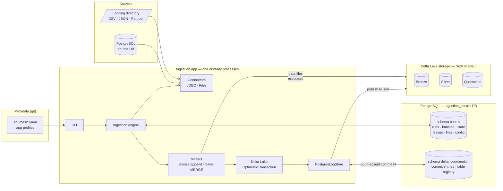

# Phase 0 — Architecture Discovery & Project Definition

| | |
|---|---|
| **Status** | v3 — **Phase 0 closed** · decisions D1–D7 applied · next phase: P1 |
| **Date** | 2026-09-25 · closed 2026-11-10 |
| **Scope** | Analysis and decisions prior to writing code. No implementation. |
| **Decision records** | [`docs/adr/`](../adr/README.md) — this document summarises; the ADRs are authoritative |

**Revision history**

| Version | Change |
|---|---|
| v1 | Initial discovery (Spanish). Proposed a single writer per Delta table (AD-06). |
| v2 | Decisions D1–D6 applied. **AD-06 removed**: multi-writer tables are in the MVP through a PostgreSQL-coordinated Delta LogStore (ADR-0004). Phase plan re-sequenced around the LogStore, which is now the highest-risk component. Translated to English (D6). |
| v3 | Phase 0 closed. Phase plan confirmed, with P2 split into P2a (protocol, one JVM) and P2b (multi-process proof). Application security baseline added (D7, ADR-0013). Repository name `lakehouse-ingestion-framework`, base package `lakehouse.ingestion` (ADR-0012). |

---

## 0. Summary of decisions

| # | Decision | Outcome | ADR |
|---|---|---|---|
| D1 | Development environment | WSL2 (Ubuntu) + Docker Engine inside WSL + JDK 17/sbt in WSL + VS Code Remote-WSL with Metals. Code lives in the WSL filesystem. | [ADR-0001](../adr/0001-development-environment.md) |
| D2 | Control plane | PostgreSQL holds state, leases (with epoch), the batch write-ahead log and the audit trail. This is a design decision that holds in the cloud too, not a workaround for the local filesystem. | [ADR-0003](../adr/0003-control-plane-in-postgresql.md) |
| D3 | Multi-writer concurrency | Custom **PostgreSQL-coordinated Delta LogStore** (same pattern as `S3DynamoDBLogStore`). The MVP covers *Type 2* concurrency: several processes writing the **same** Delta table. Correct by design for multi-instance, multi-node and multi-cluster. Multi-instance is demonstrated in the MVP; multi-node and multi-cluster are extensions. | [ADR-0004](../adr/0004-postgresql-coordinated-delta-logstore.md), [ADR-0010](../adr/0010-concurrent-write-conflict-handling.md), [ADR-0011](../adr/0011-storage-profiles.md) |
| D4 | Versions | Spark 4.1.4 · Delta 4.4.1 (`delta-spark_4.1_2.13`) · Java 17 · Scala 2.13.17 · sbt 1.13.1 — patch versions updated in P1 | [ADR-0002](../adr/0002-technology-stack.md), [ADR-0014](../adr/0014-stack-versions-pinned-at-p1.md) |
| D5 | Phase plan | Confirmed at closure: re-sequenced for D3, spike split RED (P1) / GREEN (P2b), P2 split into P2a and P2b (§17) | — |
| D6 | Repository identity | Code, comments, commits and docs in English. Repository `lakehouse-ingestion-framework`, base package `lakehouse.ingestion`, independent of the GitHub handle. Organization placeholder defined in one place (§21). | [ADR-0012](../adr/0012-module-structure.md) |
| D7 | Application security | Validated SQL identifiers and no concatenated SQL; file paths confined to allowed roots; least-privilege PostgreSQL roles; dependency vulnerability scanning in CI. Recommended: pinned non-root images, configurable TLS, safe YAML loading, a brief threat model. Woven into existing phases (§17). | [ADR-0013](../adr/0013-application-security-baseline.md) |

---

## 1. Critical analysis

### What is well framed
- **Scope ends at Silver.** Gold is business modelling; an ingestion framework that owns it becomes a "framework for everything".
- **Concurrency is designed in from the start.** Retrofitting it is what breaks in-house frameworks.
- **Correctness before performance**, with before/after measurement for any optimisation.
- **Finishing is the main risk.** The phase plan has two coherent stopping points (§17).

### What was challenged, and how it was resolved

| # | Topic | Problem | Resolution |
|---|---|---|---|
| C1 | Environment | Spark Standalone on native Windows is fragile (bash launch scripts, `winutils`). Docker Desktop on Windows Home needs WSL2 anyway. Memory is tight at 7.4 GB. | WSL2 with Docker Engine and memory caps (ADR-0001). |
| C2 | Delta on the local filesystem with several writer processes | `HDFSLogStore` checks that `N.json` does not exist, then renames onto it with `rename(2)`, which replaces an existing file. Its `synchronized (this)` lock is per instance, so it never spans JVMs, and on `file://` it is not even taken (corrected in P1.4d: first described as a JVM-static `LOCAL_FS_WRITE_LOCK`). Two JVMs committing to the same table can overwrite each other's `N.json` and lose a commit. Delta does not notice. The RED spike measured it: [docs/spikes/logstore-red.md](../spikes/logstore-red.md). | Commit exclusivity is moved to PostgreSQL through a custom LogStore (ADR-0004). The loss is demonstrated before and after in the spike (RED in P1, GREEN in P2b). |
| C3 | Type 2 concurrency in the MVP | v1 proposed one writer per table. The owner requires Type 2 in the MVP (D3). | AD-06 removed. The LogStore makes multi-writer tables safe on `file://` and `s3a://`. |
| C4 | Separate "synthetic data" phase | Data generators without a consumer drift from what the tests need. | Each generator is built in the phase of the connector that consumes it. |
| C5 | Lineage, observability and audit as three phases | All three derive from one execution model (run, batch, Delta version). | Modelled once (P4), exposed in P11. |
| C6 | CI/CD late (old phase 15) | CI added at the end only declares good practice. | Minimal CI in P1, growing every phase. |
| C7 | Advanced testing as a late phase | Failure tests need injection points designed into the code. | Fault hooks are part of the engine and LogStore design. |
| C8 | Parquet in the MVP | Adds little to the story, but costs nothing through `DataFrameReader`. | Supported; one smoke test. |
| C9 | Streaming | Nothing blocks it as long as connectors split *plan* from *read*. | Contract keeps `plan`/`read` replayable (§12). |
| C10 | *New in v2:* owning a correctness-critical LogStore | A bug here corrupts tables, which is worse than any bug in the engine. | Port a proven protocol (`BaseExternalLogStore`), justify every deviation, test with fault injection at each step plus a stress verifier. It is the first thing built after bootstrap (P2a protocol, P2b multi-process proof) and the top-ranked risk (R0). |

---

## 2. Functional requirements

| ID | Requirement | MVP |
|---|---|---|
| RF-01 | Define sources through versioned metadata files, with no per-source code | ✅ |
| RF-02 | Validate the whole configuration at startup, before touching data, reporting all errors at once | ✅ |
| RF-03 | JDBC connector (PostgreSQL as reference): full load and incremental by watermark | ✅ |
| RF-04 | File connector (CSV, JSON; Parquet at no extra cost): process only new files | ✅ |
| RF-05 | Bronze append with ingestion metadata and fidelity to the source | ✅ |
| RF-06 | Silver: typing, name normalisation, deduplication by key, upsert (`MERGE`) | ✅ |
| RF-07 | Delete detection: implicit on full loads, key reconciliation on incremental loads | ✅ |
| RF-08 | Persistent incremental state, consistent with the data written | ✅ |
| RF-09 | Automatic recovery of an interrupted run | ✅ |
| RF-10 | Explicit, audited reprocessing and backfills that do not disturb incremental state | ✅ |
| RF-11 | Controlled, audited reset of a source's state | ✅ |
| RF-12 | Configurable per-source schema evolution policy, including schema changes made concurrently by another writer | ✅ (basic) |
| RF-13 | Corrupt records routed to quarantine, with a rejection threshold | ✅ |
| RF-14 | Error classification (transient / permanent / data / conflict) with bounded retries | ✅ |
| RF-15 | Mutual exclusion per (source, layer) across instances: lease with expiry and epoch | ✅ |
| RF-16 | Audit record per run and per batch | ✅ |
| RF-17 | Table/batch lineage: source → Bronze Delta version → Silver Delta version | ✅ |
| RF-18 | Real per-run metrics and per-source freshness | ✅ |
| RF-19 | PII tagging in metadata; pseudonymisation in Silver | ✅ |
| RF-20 | CLI modes `run`, `plan` (dry run), `backfill`, `reprocess`, `reset-state`, `reconcile-deletes`, `maintain`, `adopt-table` | ✅ (progressive) |
| RF-21 | Parallel ingestion of N sources inside one Spark application | ✅ |
| **RF-25** | **Coordinated commits: several processes can write the same Delta table safely (Type 2), on `file://` and `s3a://`** | ✅ |
| **RF-26** | **Refuse to run if the LogStore is not configured for every lake scheme, and detect commits written without coordination** | ✅ |
| RF-22 | Multi-instance demonstration: N processes on one machine writing shared tables, checked by a verifier | ✅ (was an extension in v1) |
| RF-27 | Multi-node demonstration (Spark Standalone with several workers + MinIO) | Extension |
| RF-28 | Multi-cluster demonstration (independent Spark applications/clusters sharing storage and coordination) | Extension |
| RF-23 | REST connector | Extension |
| RF-24 | SCD type 2 in Silver | Extension |

## 3. Non-functional requirements

| ID | Requirement | Verification |
|---|---|---|
| RNF-01 | **Correct under failure**: killing a run at any point neither duplicates nor loses data | Fault injection at every engine hook and every LogStore protocol step, plus an e2e `kill -9` test |
| RNF-02 | **Idempotent**: re-running the same ingestion produces the same final state | Run twice, compare tables and state |
| RNF-03 | **Concurrency-safe (same source)**: N instances on one source give one effective executor and N−1 audited `SKIPPED_LOCKED` | Lease tests with N threads against real PostgreSQL |
| **RNF-12** | **Concurrency-safe (Type 2, same table)**: N writer processes produce contiguous versions with no lost commits, and every expected `txnVersion` is present exactly once | LogStore stress test with random `kill -9` and a final verifier (ADR-0004) |
| **RNF-13** | **Fail closed**: if coordination (PostgreSQL) is unavailable, no commit is ever written without it | Fault tests with PostgreSQL stopped at each step |
| **RNF-14** | **Deployment-level agnostic**: nothing in the design assumes one JVM, one machine or one cluster for correctness | Design review against ADR-0011; E1/E2 demonstrations |
| RNF-04 | **Extensible**: a new source type is one class implementing the contract plus a registration | A test connector added without touching the `engine` module |
| RNF-05 | **Auditable**: every run, including failed and skipped ones, leaves a record | Tests on audit records |
| RNF-06 | **Testable**: domain logic does not depend on Spark or I/O | The `core` module has no Spark dependency (compiler-enforced) |
| RNF-07 | **Reproducible**: deterministic seeded test data; environment up with one command | `docker compose up` + `sbt test` |
| RNF-08 | **Observable**: structured logs with `run_id` and `source_id` on every line | Log layout test |
| RNF-09 | **Secure**: no secret in configuration, logs or audit | Redaction test |
| RNF-10 | **Resource bounded**: the MVP runs inside the WSL budget (§7.3) | `.wslconfig` limits and Spark memory settings |
| RNF-11 | **Streaming-ready** (not implemented): no decision closes the door | Connector contract review |
| **RNF-15** | **Hardened inputs**: identifiers and paths from configuration can neither inject SQL nor escape their allowed roots; runtime database roles have least privilege | Malicious-input corpus, symlink tests, privilege-denial tests (ADR-0013) |
| **RNF-16** | **Supply chain**: no new dependency with a known high-severity vulnerability; images and actions pinned | CI dependency review; pinned-image check (ADR-0013) |

---

## 4. Requirements missing from the original brief

| Missing requirement | Why it matters | Level |
|---|---|---|
| **Orchestrator contract**: CLI and exit codes (0 OK, 2 skipped/locked, 3 transient failure, 4 permanent failure, 5 data threshold exceeded, 64 usage error, 70 internal error; the whole table is in §14.1) | The framework does not schedule itself. The orchestrator must tell "retry" from "do not retry". | Required |
| **Partially written files** | A file still being copied would be ingested truncated. Needs a minimum file age, temp-name exclusion, or a marker file. | Required |
| **Bounded batch size** (`max_files_per_batch`, max watermark range) | An unbounded first load or a file backlog breaks memory and produces huge commits. | Required |
| **Time zones** | `timestamp without time zone` combined with a different Spark session zone is a classic watermark bug. Everything is UTC. | Required |
| **Clock source** | Instances' clocks differ. Leases and commit-entry timestamps use PostgreSQL `now()`; watermark upper bounds use the **source's** clock. | Required |
| **First run of a source** | Incremental with no watermark means a bounded full load. | Required |
| **Breaking configuration changes** (primary key, watermark column, target) | They invalidate state. Detected against the last used config snapshot; require an explicit `reset-state`. | Required |
| **Canonical table identity** *(new)* | Two spellings of the same table path (symlink, `s3://` vs `s3a://`) would give two coordination keys, and therefore **no mutual exclusion**. | Required (ADR-0004, ADR-0011) |
| **LogStore enforcement** *(new)* | One misconfigured writer without the LogStore voids every guarantee. | Required (ADR-0004) |
| **Dry run / `plan`** | Show what would be read without writing. Cheap, and valuable for demos and operations. | Recommended |
| **Retention**: Bronze, quarantine (holds PII), audit history, `VACUUM`, LogStore temp files | Without retention there is no credible GDPR story and no cost control. | Recommended |
| **Ownership of Delta maintenance** (`OPTIMIZE`/`VACUUM`) | Concurrent maintenance is now *allowed* (Type 2); its conflicts must be classified (ADR-0010). | Recommended |
| **Retiring a source** | Deleting the YAML orphans its state. A `disabled` flag is enough. | Recommended |
| **CSV encoding and dialect** | The real source of most "corrupt records". | Required (in config) |
| **Freshness SLA per source** | `source_freshness` needs a threshold to alert on. | Recommended |
| **Environment profiles** (local / test / CI / multinode) | Different lake URIs and connections without touching source definitions. | Required |

---

## 5. Risks and decision index

### Risks

| Risk | Prob. | Impact | Mitigation |
|---|---|---|---|
| **R0 — PostgreSQL LogStore is incorrect** (lost or duplicated commit, partial `N.json` visible, deadlock, fail-open path). **Highest-risk component of the project.** | Medium | **Critical**: table corruption | Port Delta's proven prepare–commit–acknowledge protocol; every deviation justified (ADR-0004); fault injection at each step; stress test with `kill -9` and a verifier; built right after bootstrap (P2a/P2b) so the rest of the project stands on verified ground; spike shows before/after. |
| R1 — Local environment insufficient (RAM, Windows) | High | High | WSL2 with caps; `local[*]` day to day; stress and multi-node at small N locally, full size in CI (§7.3). |
| R2 — Scope creep / not finishing | High | High | Checkpoints A and B; README kept useful from P1; extensions kept separate. |
| R3 — Reliance on Delta internals (`Snapshot.transactions`, `DeltaLog.getChanges` and the `txn` action of a commit, commit on the caller thread, which files go through `LogStore.write`) | Medium | Medium | Isolated behind small adapters; verification items listed in §20; pinned Delta version with an upgrade test. |
| R4 — Over-designed control plane | Medium | Medium | Seven control tables plus two coordination tables; every column justified. |
| R5 — Consistency subtleties (zombies, expired leases, non-monotonic commit order) | Medium | High | Epoch fencing in the control plane; `txnAppId`/`txnVersion` discard stale writes in Delta; Silver cursor is the Bronze Delta version (ADR-0010). |
| R6 — Slow Spark tests discourage testing | Medium | Medium | `core` and LogStore unit tests have no Spark; one shared session per suite; integration module separate. |
| R7 — Spark 4 / Scala 2.13 ecosystem | Low | Medium | Few, mature dependencies; verified in P1. |
| R8 — Windows ↔ WSL friction (filesystem performance, IDE) | Medium | Medium | Code lives in the WSL filesystem, never under `/mnt/c`. |

### Architectural decisions

| ID | Decision | ADR |
|---|---|---|
| AD-01 | Metadata as YAML (one file per source), typed validation at startup | [0007](../adr/0007-metadata-format.md) |
| AD-02 | State, leases, WAL and audit in PostgreSQL | [0003](../adr/0003-control-plane-in-postgresql.md) |
| AD-03 | Data ↔ state consistency via *plan → idempotent write → commit* with a batch WAL | [0005](../adr/0005-batch-wal-and-idempotent-writes.md) |
| AD-04 | `run_id` = UUIDv7 (attempt) ≠ `batch_seq` (logical unit of data) | [0005](../adr/0005-batch-wal-and-idempotent-writes.md) |
| AD-05 | Per-(source, layer) lease with expiry, heartbeat and epoch fencing | [0006](../adr/0006-source-leases-with-epoch-fencing.md) |
| ~~AD-06~~ | ~~One writer per Delta table~~ — **removed (D3)** | — |
| **AD-13** | Multi-writer Delta tables through a PostgreSQL-coordinated LogStore | [0004](../adr/0004-postgresql-coordinated-delta-logstore.md) · [0015](../adr/0015-hard-link-publish-on-local-file-systems.md) (publish on `file://`) · [0017](../adr/0017-a-failed-publish-is-reported-not-swallowed.md) (failed publish) |
| **AD-14** | Conflict classification (retry vs re-plan), Silver partitioning for concurrent `MERGE`, Silver cursor = Bronze Delta version | [0010](../adr/0010-concurrent-write-conflict-handling.md) |
| **AD-15** | Lake storage profiles (`file://` single machine, `s3a://` multi-node/multi-cluster) and canonical table identity | [0011](../adr/0011-storage-profiles.md) |
| AD-07 | Bronze keeps text formats as `string` + rescue column; typing happens in Silver | [0008](../adr/0008-layer-responsibilities.md) |
| AD-08 | Bronze append · Silver `MERGE` | [0008](../adr/0008-layer-responsibilities.md) |
| AD-09 | Deletes: `WHEN NOT MATCHED BY SOURCE` on full loads; periodic key reconciliation on incremental loads; CDC as a future option | [0009](../adr/0009-delete-detection.md) |
| AD-10 | Tables addressed by path; no metastore (behind a `TableLocator` so a catalog can be added later) | [0011](../adr/0011-storage-profiles.md) |
| AD-11 | sbt multi-module: `core` / `delta-pg-logstore` / `engine` / `cli` / `integration-tests` | [0012](../adr/0012-module-structure.md) · [0016](../adr/0016-delta-storage-provided-to-the-logstore-module.md) (the LogStore module's dependencies) |
| **AD-16** | Application security baseline: validated SQL identifiers and no concatenated SQL, path confinement, least-privilege PostgreSQL roles, dependency scanning in CI | [0013](../adr/0013-application-security-baseline.md) |

---

## 6. Overall architecture

### 6.1 High-level view



**Two planes, three coordination mechanisms.** Each mechanism protects exactly one thing, and none of them depends on a single JVM, machine or cluster:

| Mechanism | Protects | Scope | ADR |
|---|---|---|---|
| **Source lease** (row in `control.source_lease`, epoch fencing) | That only one run at a time advances the state (watermark, processed files) of a (source, layer) | Control plane | 0006 |
| **Batch WAL + `txnAppId`/`txnVersion`** | That a logical batch is applied to a table exactly once, even across crashes and zombies | Control plane + Delta log | 0005 |
| **PostgresLogStore** (put-if-absent on `(table, version)`) | That exactly one writer creates `N.json` for each version of a table (Delta's *mutual exclusion* requirement) | Delta log | 0004 |
| **Delta optimistic concurrency** (built in) | That a commit is not logically invalidated by a concurrent one (e.g. two `MERGE`s touching the same files) | Delta log | 0010 |

### 6.2 Concurrency taxonomy and deployment levels

| Concurrency type | Example | What makes it safe |
|---|---|---|
| **Same source, same layer** | Two overlapping orchestrator triggers for `sales.orders` | Lease: the second run is `SKIPPED_LOCKED` (exit 2) |
| **Type 1 — different sources, different tables** | 20 sources ingested in parallel | Nothing is shared except the control plane (row-level operations) |
| **Type 2 — several processes, same Delta table** | Fan-in (several sources → one table), backfill running alongside the incremental run, `OPTIMIZE` alongside ingestion | LogStore (physical exclusivity per version) + Delta OCC (logical conflicts) + `txnAppId` (idempotence) |

| Deployment level | Definition | Requirement for correctness | Demonstrated in |
|---|---|---|---|
| **Multi-instance** | Several driver JVMs on one machine | Shared PostgreSQL; shared lake (`file://` is fine on one machine) | MVP (P2b stress test, P11 engine demo) |
| **Multi-node** | One Spark cluster; executors on different machines write data files | Shared storage reachable by every executor (`s3a://` MinIO); `file://` is not valid | Extension E1 |
| **Multi-cluster** | Independent Spark applications/clusters, each with its own driver | Same PostgreSQL and the same canonical lake URI for all writers | Extension E2 |

Decisions that would have closed the door on multi-node or multi-cluster, and are therefore **forbidden** (ADR-0011):
- JVM-local locks or in-memory state for correctness (only as an optimisation, as `PathLock` is in Delta's base class).
- Client clocks for leases or commit timestamps.
- Temporary files outside the table's `_delta_log/` (a recovering node must see them).
- Mixing URI schemes or path spellings for the same table.

### 6.3 Layer responsibilities

(Full rationale in [ADR-0008](../adr/0008-layer-responsibilities.md).)

| Layer | Holds | Does NOT hold / do | Write | Errors |
|---|---|---|---|---|
| **Landing** (files only) | The producer's drop directory. **The framework neither copies nor moves files**; it records what it processed. | Intermediate copies. Moving files would be a side effect that is not atomic with the Delta commit, and it would break replay. | Written by the producer | Unreadable file → `FAILED` record + policy (`fail` or `skip`) |
| **Bronze** | Fidelity to the source. JDBC keeps native types; CSV/JSON are kept as `string` + `_rescued_data`. Minimal ingestion metadata: `_run_id`, `_batch_seq`, `_ingested_at`, `_source_file` (files only). | Typing of text, deduplication, renames, business logic | Idempotent append (`txnAppId`/`txnVersion`) | Structurally broken records → Bronze quarantine. Threshold exceeded → the batch is not committed. |
| **Silver** | Current state per key, typed to the declared schema, `snake_case` names, pseudonymised PII, soft deletes (`_is_deleted`, `_deleted_at`) | Cross-source joins, aggregates, business rules | `MERGE` on the primary key with an ordering guard (`updated_at`), partitioned where writers fan in | Cast failures → Silver quarantine with the original Bronze record |
| **Gold** | Out of scope | — | — | — |

### 6.4 Lineage

- **Required (MVP)**: table + batch level. Every Bronze row carries `_run_id` and `_batch_seq`. Every batch records its input (watermark range or file list) and its output (table + **Delta version**).
- **v2 improvement**: the LogStore records, for each commit entry, the `run_id` of the committing run (via a commit context set by the engine; ADR-0004 §Attribution). The mapping *Delta version ↔ run* then lives in the control plane directly, with no `DESCRIBE HISTORY` scans. `userMetadata` in the commit is kept as a redundant, self-describing copy.
- **Future**: column-level lineage and OpenLineage events. The run/batch/input/output model maps 1:1 onto an OpenLineage `RunEvent`.

---

## 7. Stack, environment and resource budget

### 7.1 Stack

(Verified 2026-09-25 against Maven Central and the official docs; details in [ADR-0002](../adr/0002-technology-stack.md). Patch versions re-pinned in P1, 2026-11-13: [ADR-0014](../adr/0014-stack-versions-pinned-at-p1.md).)

| Component | Version |
|---|---|
| Java | 17 (Temurin, inside WSL) |
| Scala | 2.13.17 (the patch Spark 4.1.4 is built with) |
| Apache Spark | 4.1.4 |
| Delta Lake | 4.4.1 — `io.delta:delta-spark_4.1_2.13` (+ `delta-storage`, transitive) |
| sbt | 1.13.1 (pinned in `project/build.properties`) |
| PostgreSQL | 17 (`postgres:17`): source DB and control DB in one container, separate databases |
| JDBC driver | `org.postgresql:postgresql` 42.7.x |
| Connection pool (LogStore) | HikariCP. Justified by the LogStore's commit-path round trips (ADR-0004). |
| Control-plane migrations | Flyway |
| Config | circe + circe-yaml (safe loading, ADR-0013) |
| Tests | ScalaTest 3.2.x + Testcontainers (PostgreSQL; MinIO in E1) |
| Logging | log4j2 (Spark's own) with `JsonTemplateLayout` |
| Quality | scalafmt, `-Xlint` + selective `-Werror`, scoverage |
| CI | GitHub Actions · sbt dependency submission + Dependabot alerts + dependency review (ADR-0013) |
| Object storage (extension) | MinIO + `hadoop-aws` matching Spark's Hadoop version (verified in E1) |

### 7.2 Environment

Target environment: WSL2 Ubuntu 24.04 on Windows 10 22H2 (build 19045.6466, firmware virtualisation enabled, 8 cores, 7.4 GB RAM, 131 GB free disk).

Step-by-step installation and `.wslconfig`: **[`docs/setup/dev-environment.md`](../setup/dev-environment.md)**.

### 7.3 Resource budget (updated for D3)

WSL cap: `memory=5GB`, `swap=4GB`, `processors=6`. Outside WSL, Windows + the VS Code UI + a browser use about 2.4 GB.

| Scenario | Processes inside WSL | Est. RAM | Where it runs |
|---|---|---|---|
| Daily development | VS Code server + Metals (~1.2) · sbt + forked test JVM (~1.5) · PostgreSQL (~0.3) | ~3.0 GB | Local |
| LogStore stress test (P2b), default N=3 | PostgreSQL (~0.4) · 3 writer JVMs, `local[1]`, 512 MB heap (~0.75 each) · sbt orchestrator (~0.8) · **Metals stopped** | ~3.5 GB | Local (N=3); CI with N=8 |
| Engine multi-instance demo (P11) | PostgreSQL (~0.4) · 3 ingestion processes `local[2]` (~0.9 each) | ~3.1 GB | Local |
| Same, on local Spark Standalone (optional variant) | master (~0.3) · worker with 2 cores / 2 GB for executors (~2.2) · 3 client-mode drivers (~0.5 each) · PostgreSQL (~0.4) | ~4.4 GB | Local, Metals stopped |
| **E1 — multi-node** | MinIO (~0.4) · master (~0.3) · 2 workers × 1 GB (~2.4) · 2 drivers (~1.0) · PostgreSQL (~0.4) | ~4.5 GB | At the limit locally with small N; full size in CI |
| **E2 — multi-cluster** | Two independent stacks | > budget | CI (GitHub-hosted runner) or cloud |

Mitigations: swap as a safety net rather than something to rely on; configurable writer counts (`-Dstress.writers`, `-Dstress.commits`); heavy suites tagged and run in CI. Standard GitHub-hosted Linux runners for public repositories have considerably more memory than this laptop's WSL budget. The exact size is verified when E1/E4 start.

---

## 8. State, idempotency and recovery (summary)

Full design: [ADR-0005](../adr/0005-batch-wal-and-idempotent-writes.md).

- **Run ≠ Batch.** `run_id` (UUIDv7) identifies an *attempt*. `batch_seq` identifies a *logical unit of data* (watermark range or file set) and is allocated by the control plane per `txnAppId`. Idempotence is anchored to the batch.
- **`txnAppId` = `<source_id>/<layer>`** (not per table). A backfill uses its own `<source_id>/<layer>/backfill/<backfill_id>`, so it can run concurrently with the incremental run on the same table (Type 2). `txnVersion` = `batch_seq`, monotonic per `txnAppId`.
- **Protocol:** lease → recover pending batch → plan + persist (WAL) → read → write quarantine and data with `txnAppId`/`txnVersion` → one PostgreSQL transaction advances the watermark, marks the batch `COMMITTED` and the run `SUCCEEDED`, conditional on the lease epoch.
- **Recovery:** if a `PLANNED` batch exists, check the table's `txn` for its `txnAppId`. If `version ≥ batch_seq`, *roll forward* the state. Otherwise *replay* exactly the persisted plan.
- **Zombies:** a writer that lost its lease cannot advance the state (epoch check). If it still commits data, Delta discards any `txnVersion ≤` the recorded one; a concurrent commit with the same `txnAppId` raises `ConcurrentTransactionException` for one of the two. The residual window (v1 §9.3) closes much further than in v1.
  - *From P5.10 ([ADR-0019](../adr/0019-a-commit-names-the-epoch-of-its-lease.md)):* it commits no data either. A run announces the epoch of its lease to the LogStore before it asks a table anything, every commit names its epoch, and the LogStore takes a commit only while that epoch is the one in force. What a table says of a batch is then true for the run that asked, and the residual window is closed.
- **Incremental watermark:** the upper bound is fixed at planning time using the source clock (`now() − safety_margin`); a `lookback` handles late commits; Silver's ordering guard deduplicates.
- **Files:** the plan *is* the file list. Identity is `path + size + mtime`. Reprocessing creates a new batch.
- **Deletes:** [ADR-0009](../adr/0009-delete-detection.md).

---

## 9. Multi-writer concurrency (summary)

Full design: [ADR-0004](../adr/0004-postgresql-coordinated-delta-logstore.md) (LogStore) and [ADR-0010](../adr/0010-concurrent-write-conflict-handling.md) (conflict handling).

### 9.1 The LogStore in one paragraph

Delta's ACID guarantees require three properties from the storage layer: **atomic visibility**, **mutual exclusion** and **consistent listing** (the `LogStore` Javadoc). A local POSIX filesystem gives atomic visibility (rename) and consistent listing, but no cross-process mutual exclusion. S3 gives atomic visibility (PUT) and strongly consistent listing; mutual exclusion comes from put-if-absent. `PostgresLogStore` takes mutual exclusion from PostgreSQL: a conditional `INSERT` of `(table, version)` is the linearisation point of each commit. It follows Delta's `BaseExternalLogStore` **prepare → commit → acknowledge** protocol:
- write the temp file `T(N)`;
- `INSERT` the entry `E(N, complete=false)`;
- publish `N.json` atomically;
- mark `complete=true`.

Any reader or writer that finds an incomplete latest entry finishes publishing it.

### 9.2 Deviations from `BaseExternalLogStore` (detail in ADR-0004)

1. **Ported, not subclassed.** The changes below sit inside the base class's `write()` flow, which cannot be overridden piecemeal, and the base class ships in an artifact that pulls in the AWS SDK.
2. **Atomic publish on POSIX.** The base class copies `T(N)` to `N.json` as a stream, which is atomic only on object stores. On `file://` ours publishes with a hard link, which is atomic and fails if `N.json` already exists ([ADR-0015](../adr/0015-hard-link-publish-on-local-file-systems.md); before, a copy to a second temp file and a rename).
3. **`isPartialWriteVisible`** is `true` on `file://` and `false` on `s3a://`, so Delta writes checkpoints via temp + rename on POSIX.
4. **No silent swallowing of a foreign `N.json`.** The base class ignores every error after the `INSERT`. On a content mismatch between `N.json` and `T(N)`, ours raises a fatal error and taints the table. A publish that fails is retried and then reported, because Delta 4.4 reads `N.json` as soon as `write` returns ([ADR-0017](../adr/0017-a-failed-publish-is-reported-not-swallowed.md)).
5. **Uncoordinated-writer detection** through a table adoption registry and gap detection.
6. **Entries are kept** (commit audit trail) instead of expiring after one day.
7. **PostgreSQL `now()`** instead of client clocks.
8. **Run attribution** on each entry.
9. **Latest entry by numeric version**, not by file-name sort.
10. **No DDL from the data path**: the LogStore checks its schema version at startup and fails closed.

### 9.3 Fail closed and safeguards

- Every PostgreSQL error surfaces as an `IOException`, never as "no entry". There is no fallback path. Reads fail too, because the latest version cannot be guaranteed.
- **At startup the engine refuses to run** unless `spark.delta.logStore.<scheme>.impl` points to `PostgresLogStore` for every scheme in the active lake profile.
- **Tables must be registered.** They are registered when created through the LogStore, or adopted explicitly with `adopt-table`. A commit to an unregistered table is rejected, which also catches aliased paths.
- **Gap detection:** a published `N.json` with no entry above the adoption version means a foreign writer. The table is marked `TAINTED` and writes are refused until an operator re-verifies it.
- **Honest limit:** *preventing* an arbitrary external writer (someone else's misconfigured Spark job) needs storage access control, or protocol-level blocking as in `catalogManaged`. That is an enterprise feature; the design detects, fails closed and documents.

### 9.4 Official alternatives in Delta 4.4 (compared in ADR-0004)

| Option | Status | Why it is not the MVP choice |
|---|---|---|
| `S3DynamoDBLogStore` + MinIO + DynamoDB Local | Official, production-proven | `s3a` only by design; adds DynamoDB Local and the AWS SDK; duplicates the coordination store we already have in PostgreSQL. On `file://` it would have issues 2 and 4. It would be the production choice on AWS. |
| `coordinatedCommits-preview` writer feature + custom `CommitCoordinatorClient` over PostgreSQL | Present in 4.4 (`CommitCoordinatorProvider.registerBuilder`), preview-named | Undocumented preview API while upstream converges on `catalogManaged`. Its protocol-level blocking of unaware writers is a real advantage, recorded as the benchmark for our safeguards. |
| `catalogManaged` tables + Unity Catalog OSS (≥ 0.4) as commit coordinator | GA since Delta 4.0.1 | Requires running a catalog server; no path-based access; cannot be enabled on existing tables; `CREATE OR REPLACE` unsupported. **This is the industry direction** and a Future evolution. `TableLocator` keeps the door open. |

---

## 10. Schema evolution (summary)

Per-source policy (`on_new_column`, `on_missing_column`, `on_type_change`, `renames`), unchanged from v1. The full ADR is written in its phase (P9).

- **Native in Delta:** `mergeSchema`, type widening (the conversions 4.4 supports are verified in P9), column mapping.
- **To build:** comparison of read schema vs table schema, the policy decision, `_rescued_data`, and the audit of the change.
- **Renames** are indistinguishable from drop + add without external metadata, which is why `renames:` exists.
- **New in v2 — concurrent schema change.** With Type 2, another writer may evolve the table's schema between our plan and our commit. Delta raises `MetadataChangedException`. The engine **re-plans**: it re-evaluates the policy against the new table schema, then retries or fails permanently (ADR-0010).

---

## 11. Security and governance

Two halves: **data governance** (secrets, PII, masking, GDPR) and **application security** (the application's own attack surface: config-supplied identifiers and paths, database privileges, supply chain). The second half was added at Phase 0 closure; its full design and test plan are in [ADR-0013](../adr/0013-application-security-baseline.md).

| Topic | Required | Recommended | Enterprise | Future |
|---|---|---|---|---|
| Secrets | `secretRef: env:NAME` / `file:/run/secrets/x` + `SecretResolver`; redaction in logs and config snapshots. The LogStore reads the *name* of the password variable from Hadoop conf, never the value. | Docker secrets in compose | Vault / KMS | — |
| PII | Column tags in metadata (`pii: email`) | Quarantine inherits the classification | Automatic classification in a catalog | — |
| Silver masking | Deterministic pseudonymisation (HMAC-SHA256 with a secret key), which keeps joins possible | Per-type strategies | Dynamic masking by role | — |
| Access control | Filesystem permissions. **Separate PostgreSQL roles with least privilege** (*Recommended* in v2): migrator (DDL, Flyway only), control, coordination (no `DELETE`, no DDL), maintenance, source (read-only). Denial tests. | — | Storage ACLs so that only the service identity can write `_delta_log/` (true prevention of uncoordinated writers); Unity Catalog / Ranger | — |
| Input hardening | Config identifiers parsed into an allow-listed `SqlIdentifier`; no SQL assembled from config or data values (bind parameters; Spark JDBC predicates); source and target paths confined to their roots, symlinks included. Malicious-input tests. | Safe YAML loading (alias, depth and size limits; duplicate keys rejected) | — | — |
| Supply chain | Dependency vulnerability scanning in CI (dependency submission, Dependabot alerts, PR gate on new high-severity findings) | Images pinned by digest and non-root; GitHub Actions pinned by SHA with a least-privilege token | Signed artifacts | Image scanning once the project builds its own images |
| Encryption | — (local FS) | Document disk encryption; TLS configurable to PostgreSQL (and MinIO in E1) | Encryption at rest, TLS everywhere, mTLS | Parquet modular encryption |
| Audit | Control plane + commit entries | — | SIEM | — |
| GDPR erasure | Documented procedure: `DELETE` in Silver/Bronze + `VACUUM` after retention, since Delta keeps old files for time travel until `VACUUM` | Short retention in Bronze and quarantine | Crypto-shredding | — |
| Threat model | — | Brief threat model in `docs/security/` (P12) | Formal threat modelling and penetration testing | — |

---

## 12. Engine and connector contract

### 12.1 Modules

(See [ADR-0012](../adr/0012-module-structure.md).)

| Module | Content | Depends on |
|---|---|---|
| `core` | Domain model, config, validation, pure planning, error classification, run state machine. **No Spark.** | cats, circe |
| `delta-pg-logstore` | `PostgresLogStore`, its schema, commit-context API. **Standalone and reusable**: no dependency on `core` or `engine`. | `delta-storage` and Hadoop client API (both provided, ADR-0016), PostgreSQL JDBC, HikariCP |
| `engine` | Connectors, Delta writers, control-plane repositories, the engine, the conflict classifier | `core`, `delta-pg-logstore`, Spark (provided), Delta |
| `cli` | `Main`, argument parsing, wiring, exit codes, startup enforcement | `engine` |
| `integration-tests` | Testcontainers, e2e, fault injection, stress tests, verifier | all |

### 12.2 Connector contract (design sketch, not implementation)

```scala
trait SourceConnector[C <: ConnectorConfig] {
  def kind: String                                                     // `type: jdbc` in YAML
  def validate(cfg: C): ValidatedNel[ConfigError, C]                   // static, no I/O, run at startup
  def plan(ctx: PlanContext, cfg: C, state: SourceState): Either[IngestError, BatchPlan]   // deterministic, serialisable (WAL)
  def read(ctx: ReadContext, cfg: C, plan: BatchPlan): Either[IngestError, ReadResult]     // replayable, side-effect free
}
```

Guarantees:
- `plan` is deterministic and serialisable.
- `read(plan)` is replayable and has no side effects.
- **The connector never writes to the lake and never touches state or audit.**
- Errors are typed.
- A connector is registered through a `ConnectorRegistry`, so adding a type does not change the engine.

### 12.3 Patterns and their concrete reason

| Pattern | Where | Reason |
|---|---|---|
| Trait as contract | `SourceConnector`; `CoordinationStore` inside the LogStore | Extensibility without touching the engine; the LogStore protocol is testable against a fault-injecting store |
| Factory / registry | `ConnectorRegistry` | Resolve YAML `type:` to an implementation |
| Strategy | `WriteStrategy` (BronzeAppend, SilverMerge, SnapshotMerge) | Writes differ by layer and load mode |
| Repository | `RunRepository`, `StateRepository`, `LeaseRepository`, `FileRegistry` | Isolate control-plane SQL; in-memory fakes for unit tests |
| Dependency inversion | Engine depends on traits, not on JDBC/Delta | Testability and fault injection |
| Service layer | `IngestionService` runs the ADR-0005 protocol | One place for consistency logic |
| — rejected — | Visitor, abstract factory, event bus, DI framework | No problem here that they solve |

**Fault injection:** named hooks in the engine (`AfterPlan`, `AfterQuarantineWrite`, `AfterBronzeCommit`, `BeforeStateCommit`, …) and in the LogStore (`AfterTempWrite`, `AfterEntryInsert`, `DuringPublish`, `AfterPublish`, …). They are no-ops in production; in tests they throw or halt the JVM. *As built (P5.8, P5.9):* the engine's are `AfterPlan`, `AfterRead`, `AfterQuarantineWrite`, `AfterBronzeCommit` and `BeforeStateCommit` (`FaultPoint`, in `engine`), in the order a run reaches them.

### 12.4 Door to streaming

`plan` ≈ `latestOffset`; the WAL ≈ the offset log; the state commit ≈ the commit log; `txn` append ≈ an idempotent `foreachBatch`. The LogStore is transparent to streaming writers. Decisions that would close the door, and are forbidden by the contract: connectors moving files, or state not indexed by batch.

---

## 13. Conceptual data model

### 13.1 Metadata (YAML, one file per source)

```yaml
# conf/sources/sales.orders.yaml — illustrative
id: sales.orders
enabled: true
owner: team-sales
connector:
  type: jdbc
  connection: { url: "jdbc:postgresql://postgres:5432/sales", user: ingest_ro,
                password: { secretRef: "env:SALES_DB_PASSWORD" } }
  table: public.orders
load:
  mode: incremental            # full | incremental
  watermark: { column: updated_at, lookback: 10m, safety_margin: 1m }
  max_batch_range: 7d
keys: [order_id]
deletes: { strategy: key_reconciliation }
schema: { on_new_column: add, on_missing_column: "null", on_type_change: fail }
columns:
  customer_email: { pii: email, silver: { mask: hmac } }
quality: { max_rejected_ratio: 0.01 }
targets:
  bronze: { table: bronze/sales/orders }                  # relative to the profile's lake URI
  silver: { table: silver/sales/orders, partition_by: [_source_id] }   # fan-in target
freshness_sla: 2h
```

Rationale for YAML, versioning (SHA-256 config hash + redacted snapshot per run): [ADR-0007](../adr/0007-metadata-format.md). Table paths are **relative to the profile's lake URI** (ADR-0011), which gives one canonical location per table.

### 13.2 Control plane — schema `control` (PostgreSQL)

| Table | Key columns | Purpose |
|---|---|---|
| `ingestion_run` | `run_id` PK, `source_id`, `layer`, `run_kind`, `txn_app_id`, `batch_seq`, `status`, `instance_id`, `app_version`, `config_hash`, `lease_epoch`, `started_at`, `finished_at`, `rows_read`, `rows_written`, `rows_rejected`, `bytes_read`, `retries`, `write_conflicts`, `commit_contention`, `error_class`, `error_message` | Answer every audit question in the brief (§14) |
| `ingestion_batch` | (`txn_app_id`, `batch_seq`) PK, `source_id`, `layer`, `run_kind`, `plan` (jsonb), `status` (PLANNED/COMMITTED/ABANDONED), `planned_by_run`, `committed_by_run`, `outputs` (jsonb: table → Delta version), `input_bronze_versions` (Silver only: `[from, to]`); for a batch that was given up (ADR-0018): `abandoned_by_run`, `abandoned_at`, `abandon_reason`, `abandon_detail` (jsonb); `target_table`, the location of the table that the batch was planned to write its data to (P5.10, migration V4) | WAL for recovery; lineage input → output; why a plan was never run; which table recovery asks |
| `source_state` | (`source_id`, `layer`) PK, `watermark` (typed jsonb; for Silver: the last applied **Bronze Delta version**), `last_committed_batch_seq`, `updated_by_run` | Incremental loading |
| `state_change_log` | `id`, `source_id`, `layer`, `before`, `after`, `reason`, `actor`, `run_id`, `at` | Audit of resets and forced state |
| `source_lease` | (`lease_key`) PK, `holder_run_id`, `instance_id`, `epoch`, `acquired_at`, `expires_at` | Mutual exclusion with crash recovery. Keys are `<source_id>/<layer>` or `backfill/<backfill_id>`. |
| `processed_file` | (`source_id`, `path`, `size`, `mtime`) PK, `batch_seq`, `status`, `error` | Exactly-once file ingestion |
| `config_snapshot` | `config_hash` PK, `source_id`, `content` (redacted jsonb), `first_seen_at` | Which exact config each run used |

Derived views: `v_source_freshness`, `v_run_summary`, `v_table_commits` (joins commit entries to runs).

### 13.3 Coordination — schema `delta_coordination` (owned by `delta-pg-logstore`)

| Table | Key columns | Purpose |
|---|---|---|
| `commit_entry` | (`table_uri`, `version`) PK, `temp_path`, `complete`, `created_at`, `completed_at` (PostgreSQL clock), `writer_instance`, `run_id` (nullable, best effort), `generation` (of the registration its writer read), `epoch_key` and `epoch` (the epoch it was taken under, if its writer named one) | The put-if-absent that gives mutual exclusion; recovery; commit audit trail; Delta version ↔ run lineage |
| `coordinated_table` | `table_uri` PK, `delta_table_id`, `registered_version`, `registered_at`, `generation` (given by the database) | Adoption registry: rejects unregistered or aliased paths, and claims made for an earlier registration (a foreign key from `commit_entry`); gap detection baseline |
| `table_taint` | `table_uri` PK, `reason`, `tainted_at` | A table where a commit from outside the LogStore was detected. Writes are refused while its row exists. |
| `writer_epoch` | `epoch_key` PK, `epoch`, `announced_at` (PostgreSQL clock) | The epoch in force under a key, which only grows (ADR-0019). A commit that names an epoch takes its version only while it is the one in force. For the engine the key is that of a lease, and the epoch the lease's |
| `schema_version` | One row: `version` | What the LogStore checks before touching a table (ADR-0004, deviation 10) |

As built by the migration `V1__coordination_schema.sql` (P2a.3). It differs in form from the conceptual schema of ADR-0004 §3.1:
- the entry's key is the version, because only commit files get an entry and the file name follows from the version;
- a taint is a row of its own, not a status column, so the commit path can be allowed to add it and not to clear it;
- the commit path may only insert rows and mark an entry complete; maintenance may only delete.
- since `V2__operator_privileges.sql` (P2a.11), maintenance may also register a table and move the version it is registered at, for adopting a table and adopting it again; the schema is at version 2.
- since `V3__registration_generation.sql` (2026-11-16), a registration has a generation and an entry names the one its writer read, through its foreign key. A writer that looked at the registry before an operator adopted the table again, or reset it, gets no version afterwards (ADR-0004 §3.5); the schema is at version 3.
- since `V4__writer_epoch.sql` (P5.10, 2026-11-19), a writer may commit under an epoch (ADR-0019). `writer_epoch` has the epoch in force under each key, with a trigger that refuses an earlier one whoever asks, and an entry says the epoch that it was taken under. The commit path announces an epoch and locks its row while it takes a version; it cannot delete one. Maintenance may delete the epochs of a key, for a control plane that is made anew and starts its numbers again; the schema is at version 4.

A separate schema and a separate role mean the LogStore can be extracted as a library, and it only has the privileges it needs.

### 13.4 Quarantine (Delta, one table per source and layer)

`_quarantine/<layer>/<source_id>`: `run_id`, `batch_seq`, `source_file`, `error_type`, `error_detail`, `raw_record`, `quarantined_at`. Full record + short retention + same PII classification as the source. With Type 2 the per-source table is no longer *required* for safety; it is kept because it simplifies retention and access control per source.

*As built (P5.9):* the table of Bronze is `_quarantine/bronze/<source_id>`, with those seven columns in that order (`Quarantine`, in `core`). `error_type` is `unparsed`, the one kind that a read sets apart, and `error_detail` is empty: the parser does not say why. The directory `_quarantine` is the engine's own. No path of a configuration is under it, since no segment of one starts with `_`, so no source can name a quarantine as its target.

*As built (P5.10):* **a quarantine is read without the batches that were given up.** A batch writes its quarantine before its data, whatever becomes of it, so a batch that is given up afterwards (ADR-0018) leaves its records in the table, and the batch after it sets the same records apart again under its own number. Nothing is deleted or rewritten for it: what says that a batch was given up is the control plane, and a record says its batch. `QuarantineReader` reads a quarantine so, and **whoever reads the table directly must do the same**, leaving out the `batch_seq` that this gives:

```sql
SELECT batch_seq FROM control.ingestion_batch
 WHERE txn_app_id = '<source_id>/<layer>' AND status = 'ABANDONED';
```

The records of a batch that is still `PLANNED` are kept: of a batch that was not committed because too many of its records were rejected, they are what there is to look at. A run that lost its lease adds nothing to a quarantine after its batch was given up (ADR-0019).

---

## 14. Errors and retries (summary)

| Class | Examples | Reaction | Exit |
|---|---|---|---|
| Transient | Connection lost, timeout, SQLState `08xxx`/`40001`/`57014`; **coordination store unavailable** | Retry the **step** with exponential backoff + jitter (max N), then fail with consistent state. Never bypass coordination. | 3 |
| Conflict — retryable | `ConcurrentAppendException`, `ConcurrentDeleteReadException`, `ConcurrentDeleteDeleteException`, `ConcurrentWriteException` | Re-run the whole Delta operation on a fresh snapshot (bounded), counted in `write_conflicts` | 3 if exhausted |
| Conflict — re-plan | `MetadataChangedException`, `ProtocolChangedException` | Re-evaluate the schema policy / protocol, then retry once or fail permanently | 4 |
| Conflict — identity | `ConcurrentTransactionException` (same `txnAppId` committed concurrently) | Not retried: go to recovery (roll forward if `txn ≥ batch_seq`), otherwise fail permanently and alert | 4 |
| Permanent | Credentials, missing table, invalid config, schema change under `fail`, LogStore misconfigured, table `TAINTED` | Immediate failure, no retries | 4 |
| Data | Corrupt records, cast failures | Quarantine. Above `max_rejected_ratio`, the batch is not committed. | 0 / 5 |
| Source changed under a plan | A file written again, or removed, after its batch was planned | Nothing of the batch is written. The run that holds the lease gives the batch up, if its table does not have it, and the next run plans anew ([ADR-0018](../adr/0018-a-run-gives-up-a-batch-whose-source-changed.md)). Not retried in the run: the plan is what is wrong | 3 |
| Lease lost | The run could not renew its lease before it ran out, or another run took it | The jobs of the run are stopped, and it takes no step after that starts one or writes a table. Whatever it then fails with, it ends as a run that lost its lease. Not retried in the run: another run is doing the work, or will ([ADR-0006](../adr/0006-source-leases-with-epoch-fencing.md), [ADR-0019](../adr/0019-a-commit-names-the-epoch-of-its-lease.md)) | 3 |

Full classification and reasoning: [ADR-0010](../adr/0010-concurrent-write-conflict-handling.md).

### 14.1 Exit codes: the contract with the orchestrator

The framework does not schedule itself (§4). Whoever starts it has the exit code to tell "run it again" from "do not", and nothing else. So a code has one meaning, and the whole table is here and in one place of the code (`Main.Exit`, in `cli`), where a test pins the numbers.

| Code | Meaning | What an orchestrator does with it |
|---|---|---|
| **0** | The command did what it was asked. A run ended well; rows may have been quarantined, within what the source allows (`quality.max_rejected_ratio`). `validate`: the configuration is valid. `migrate`: the schemas are at the version of the application | Nothing |
| **2** | `SKIPPED_LOCKED`: another run holds the lease of the source (ADR-0006). Nothing was read or written, and the run is recorded as skipped. It is not a failure | Its own decision (ADR-0006). The run that holds the lease is doing the work, so the next trigger is soon enough |
| **3** | A transient failure that outlasted the retries, or a retryable conflict that did: a connection lost, a timeout, the coordination database not answering. Or a batch that was given up because its files changed after they were planned: the next run plans anew (ADR-0018). Or a run that lost its lease, by its own count or to another run: what it left is finished by the next run of the source (ADR-0006). The state is consistent | Run it again later. Alert if it goes on |
| **4** | A permanent failure: what running again does not mend. A configuration that is not valid (`validate`, and every command before it does anything), credentials, a missing table, a schema change under `fail`, a LogStore that is not configured, a tainted table, a conflict that cannot be settled | Do not run it again until somebody has changed something. Alert |
| **5** | The data threshold was exceeded: more rows were rejected than `quality.max_rejected_ratio` allows, and the batch was not committed. The rejected rows are in quarantine | Run again as it is, the same data gives the same result. Tell whoever owns the source |
| **64** | The command line is not one: an unknown command, an option that is missing, repeated or unknown. Nothing was looked at. `EX_USAGE` of `sysexits.h` | Never run it again: the invocation is wrong, which is a mistake in the orchestrator's own configuration |
| **70** | An exception that nothing classified: a mistake in the application itself, not in what it was given. `EX_SOFTWARE` of `sysexits.h`. *From P8: until then such an exception ends the process with the JVM's own 1* | Alert: it is a bug to look into. What the run left behind is recovered by the next run of the source (ADR-0005, P7), so whether to run again is the orchestrator's to decide |

- **Why 64, and not a small number** (decided on 2026-11-18, with the first command, `validate`). A usage error first had the code 2, which is `SKIPPED_LOCKED`. An orchestrator answers a lease that is taken by trying again at its next trigger, so it would have tried a mistyped command line again for ever, and told nobody. 64 is what `sysexits.h` has for a usage error, and it is far from the codes of a run.
- **0, 3, 4 and 64 are given by a command today.** `validate` gives 0, 4 and 64. `migrate` (P4.2) gives those and 3, when a database could not be reached; it does not wait and try again by itself, so its 3 is that of one attempt, and what to do with it is the same: run it again later. 2 and 5 are those of a run, as is the 3 of retries that ran out, and come with the engine (P4, P5) and with the classification of errors (P8). 70 comes with P8 as well.
- **Codes that the application does not choose.** 1 is the JVM's own for an exception that nothing caught, and 128 + n is a signal: 137 for `kill -9` or the out-of-memory killer, 143 for `SIGTERM`. Such a code says nothing of how far a run got. What a run that died left behind is recovered by the next run of the source (ADR-0005, P7).
- **An exception that nothing classified will end in 70, not in the JVM's 1** (decided on 2026-11-18, to be built in P8). 1 is what any process gives for anything, and an orchestrator cannot tell it from a command that does not exist. `Main` is to catch what nothing else did, log it whole, and end in 70: `EX_SOFTWARE` of `sysexits.h`, next to the 64 of a usage error, and as far from the codes of a run.

---

## 15. Observability (summary)

- **Required:** JSON logs (log4j2 `JsonTemplateLayout`) with `run_id` / `source_id` / `batch_seq` in the MDC; metrics persisted on `ingestion_run`. Where each metric comes from:
  - `rows_written` — Delta commit `operationMetrics`
  - `bytes_read` — planned file sizes
  - `rows_rejected` — quarantine written
  - `rows_read` — `written + rejected`, checked as an invariant
  - `retries` — counted by the engine
  - `write_conflicts` — logical conflicts surfaced by Delta and retried by the engine
  - **`commit_contention`** — version collisions resolved internally by Delta, counted by the LogStore through the commit context
  - `source_freshness` — a view
- **Extension:** Grafana reading the control-plane PostgreSQL directly.
- **Future:** Prometheus Pushgateway / OpenTelemetry.

---

## 16. Initial repository structure

```text
lakehouse-ingestion-framework/
├── build.sbt                     # ThisBuild / organization — the single identity placeholder (§21)
├── project/                      # build.properties · plugins.sbt · Dependencies.scala
├── .scalafmt.conf
├── .sdkmanrc                     # pins the JDK for `sdk env`
├── modules/
│   ├── core/                     # pure domain, no Spark
│   ├── delta-pg-logstore/        # PostgresLogStore (standalone, reusable)
│   │   └── src/main/resources/db/migration/delta_coordination/
│   ├── engine/                   # Spark, Delta, connectors, repositories
│   │   └── src/main/resources/db/migration/control/
│   ├── cli/                      # Main, wiring, exit codes, startup enforcement
│   └── integration-tests/        # Testcontainers, e2e, fault injection, stress + verifier
├── conf/
│   ├── app/                      # local.yaml · test.yaml · multinode.yaml
│   └── sources/                  # example sources used by the demos
├── docker/                       # docker-compose.yml, images pinned by digest (+ multinode overlay in E1) · postgres/init (databases, roles)
├── scripts/                      # run-local.sh · stress-logstore.sh · demo-*.sh
├── docs/
│   ├── architecture/             # this document · diagrams
│   ├── adr/                      # 0001 … 0017
│   ├── setup/                    # dev-environment.md
│   ├── spikes/                   # logstore-red.md (P1) · logstore-green.md (P2b)
│   ├── security/                 # threat-model.md (P12)
│   └── runbooks/                 # recover-run · reset-state · adopt-table · untaint-table · gdpr-erasure
├── .github/workflows/            # ci.yml · dependency submission + review (ADR-0013)
└── README.md                     # includes the spike results (lost commits without / with the LogStore)
```

sbt 1.9+ deprecates the `IntegrationTest` configuration; the current standard is a separate subproject.

---

## 17. Revised phase plan

Every phase ends with code, green tests in CI, an updated README and commit(s). **Any stopping point leaves a coherent repository.**

| Phase | Content | Type |
|---|---|---|
| **P0** | Architecture & requirements (this document) + ADRs | MVP |
| **P1** | Environment (WSL2, Docker, JDK, sbt) · sbt multi-module skeleton · compose PostgreSQL (source + control DBs) · Spark + Delta smoke test · **stress harness + verifier** · **spike RED**: N JVMs on `file://` with the default LogStore → measured lost commits (natural race plus a widened-window variant using a delaying `FileSystem` wrapper, for deterministic reproduction) · minimal CI (fmt + compile + unit) · *security:* PostgreSQL roles in the compose init script, dependency scanning in CI (submission + Dependabot alerts + PR review gate), images pinned by digest and non-root, Actions pinned by SHA with a least-privilege token | MVP |
| **P2a** | **PostgresLogStore — protocol, one JVM** (highest risk, built first): the P2a verification items from §20 closed first, since the port depends on them · coordination schema and migrations · `CoordinationStore` trait (PostgreSQL and fault-injecting implementations) · protocol port with the 10 deviations, with the storage-specific publish for `file://` only (the `s3a://` one arrives in E1, where MinIO exists to test it; until then other schemes are refused at startup) · fail-closed behaviour · **all safeguards**: configuration guard (layer 1, as a library function the `cli` calls later), table registry and adoption, gap and publish-race detection → `TAINTED`, schema-version check at init · fault-injection suite **F1–F17** (ADR-0004 §7.1; F15–F17 added in P2a) against Testcontainers PostgreSQL · *security:* least-privilege coordination role (no `DELETE`, no DDL) with denial tests; bind parameters only. **Exit:** F1–F17 green in CI; the answers to the P2a items recorded in ADR-0004 §8. | MVP |
| **P2b** | **PostgresLogStore — multi-process proof**: the P1 harness gains chaos (random `kill -9` of writers, PostgreSQL restart, concurrent `OPTIMIZE` *(moved to P11 at the start of P2b, 2026-11-16: breakdown below)*) · verifier extended to killed writers (prefix property, ADR-0004 §7.2) · a writer process configured with the default LogStore is refused by the guard · **spike GREEN** with the same harness, including the widened-window variant · README results next to RED. **Exit:** zero anomalies over the same budget as RED; stress verifier green at N=3, K=200 locally and N=8, K=500 in CI. **Met** (2026-11-17): locally in P2b.3 to P2b.5, and in CI by the first run of the stress workflow, 4,000 commits of eight writers with none lost and no anomaly in any GREEN run. | MVP |
| **P3** | Metadata model · YAML decoding · accumulating validation · secrets · config hash/snapshot · lake profiles and canonical table URIs · *security:* `SqlIdentifier` allow-list and static path validation with malicious-input tests, safe YAML loading, TLS options in profiles | MVP |
| **P4** | Control plane: Flyway, repositories, `run_id` UUIDv7, runs, **leases with epoch**, batch WAL, `txnAppId` allocation · lease concurrency tests (N threads, real PostgreSQL) · *security:* control-role grants with denial tests, TLS-only PostgreSQL integration test | MVP |
| **P5** | Engine + connector contract + **file connector** → Bronze (new files, processed-file registry, idempotent append, engine fault hooks, commit context → LogStore attribution) · file generator with drift/corruption · **Type 2 fan-in test**: two file sources → one Bronze table, concurrently · *security:* runtime path confinement (canonical paths, symlinks) with traversal tests | MVP |
| **P6** | **JDBC connector**: full + incremental watermark (lookback, upper bound) · PostgreSQL generator with inserts/updates/deletes · *security:* quoted identifiers and DataFrame predicates only, SQL-injection integration test | MVP |
| **P7** | **Correct under failure**: roll-forward/replay recovery · reprocess · **backfill concurrent with incremental on the same table** (Type 2) · reset-state · fault tests at every engine hook + e2e `kill -9` | MVP |
| ⛳ | **Checkpoint A — minimum demonstrable**: files + JDBC → Bronze, full & incremental, idempotent, crash-recoverable, **multi-writer-safe tables (stress-verified)**, source leases, audited (+ README pass) | |
| **P8** | Technical validations · error and **conflict classification** (retry vs re-plan) · retries · quarantine + threshold · exit codes (§14.1; with 70 for an exception that nothing classified) | MVP |
| **P9** | Schema evolution (basic policies + `renames` + concurrent schema change → re-plan) | MVP |
| **P10** | Silver: typing, normalisation, dedupe, `MERGE` with ordering guard, **partitioning for concurrent `MERGE`**, Bronze-version cursor, soft deletes (snapshot + reconciliation), PII masking | MVP |
| **P11** | Lineage + observability (commit ↔ run views, freshness, JSON logs, `write_conflicts`/`commit_contention`) · in-JVM parallel runner · **multi-instance engine demo**: N ingestion processes on shared Bronze/Silver tables + `OPTIMIZE` running concurrently, checked by a verifier | MVP |
| **P12** | Documentation & portfolio v1: README, architecture, ADRs, runbooks, demo script, known limitations, **threat model** (`docs/security/`) · tag `v1.0` | MVP |
| ⛳ | **Checkpoint B — MVP-for-CV** | |
| E1 | **Multi-node**: Docker Compose with Spark Standalone (master + 2 workers) + MinIO (`s3a`) + PostgreSQL; the LogStore's `s3a://` publish, with its tests; the coordination secret mounted on the workers (ADR-0004 §3.9); same stress harness and verifier; `spark.cores.max` pitfalls | Extension |
| E2 | **Multi-cluster**: two independent Spark applications/clusters sharing MinIO and PostgreSQL; run in CI or cloud (documented cloud variant: S3 + managed PostgreSQL) | Extension |
| E3 | Performance engineering with before/after measurement (partitioned JDBC reads, small files, `OPTIMIZE`/Z-order, `MERGE` pruning, LogStore commit latency) | Extension |
| E4 | Full CI/CD (coverage threshold, heavy stress/multi-node suites in CI, release artifact) | Extension |
| E5 | Grafana over the control plane | Extension |
| E6 | REST connector | Extension |
| E7 | SCD2 in Silver | Extension |
| — | Streaming, CDC, Gold, OpenLineage, column-level lineage, **migration to `catalogManaged` tables with Unity Catalog OSS** | Future (not designed) |

**P1 breakdown** (decided during P1, 2026-11-13). Each part ends with a commit on `main`; until the CI exists (P1.5), commits go straight to `main`.

| Part | Content | Status |
|---|---|---|
| P1.1 | sbt multi-module skeleton, module boundary check, scalafmt, JDK pin | Done |
| P1.2 | Local PostgreSQL (control + source databases) with a least-privilege bootstrap, tested through Testcontainers | Done |
| P1.3 | Spark + Delta smoke test in the forked test JVM (Java 17 `--add-opens`, drift check against Spark's own list), including idempotent writes with `txnAppId`/`txnVersion` | Done |
| P1.4a | Stress harness: N writer JVMs, start barrier, acknowledgement journals, orphan watchdog | Done |
| P1.4b | Stress verifier: raw log view, writer journals and Delta reader compared; anomaly classes; Markdown report | Done |
| P1.4c | **Spike RED**: N JVMs on `file://` with the default LogStore, natural race and widened-window variant (`DelayingLocalFs`), writer probes as preconditions, `sbt stress` and `scripts/stress-logstore.sh`, reports in `target/stress/<run>/report.md` | Done |
| P1.4d | RED write-up ([docs/spikes/logstore-red.md](../spikes/logstore-red.md)): ADR-0004 corrections (§1.2 lock, §3.4 `.crc` sidecars on `file://`), `DELTA_AMBIGUOUS_PATHS_IN_CREATE_TABLE` against §3.6, and the RED result (what Delta detects and what it does not) · the widened window also asserts the sidecar-free reader | Done |
| P1.5 | Minimal CI (fmt + compile + tests) · dependency scanning · Actions pinned by SHA with a least-privilege token · Ryuk image pinning. **The repository goes public when P1.5 is done.** GitHub Actions workflow `ci.yml`: pin check (`scripts/check-pins.sh`), the sbt gate (format, boundaries, compile, unit and integration tests), dependency submission (one merged manifest, `scripts/dependency-snapshot.sh`) and the pull-request dependency review; Dependabot for the actions; Ryuk pinned in `testcontainers.properties` and checked by `RyukImageSpec`. The dependency jobs run only on a public repository, so they are proven after the switch: submission on the next push to `main`, the review on the first pull request. From then on, changes reach `main` through pull requests (ADR-0013 §4). | Done |

The spike comes before the CI so that the CI starts out testing everything P1 builds, and so that the repository goes public with the RED result in it.

**P2a breakdown** (decided at the start of P2a, 2026-11-14). One commit per part, with its tests. Parts reach `main` in six pull requests of two or three parts each.

| Part | Content | Scenarios | PR | Status |
|---|---|---|---|---|
| P2a.1 | What Delta 4.4.1 asks of a LogStore, pinned by a characterisation suite over a recording LogStore (`DeltaLogStoreContractSpec`): files written and their `overwrite`, the retry path, the committing thread, instance lifecycle, LogStores created in Spark tasks. ADR-0004 amended with the answers and with the decisions below. No production code. | The four P2a items of §20 | 1 | Done |
| P2a.2 | Build: `delta-storage` as `provided`, Unity Catalog's client libraries excluded from the LogStore module, a boundary rule that keeps them out | — | 1 | Done |
| P2a.3 | Coordination schema: migration, its own schema version, grants per role | Denial tests (ADR-0013 §3) | 2 | Done |
| P2a.4 | `CoordinationStore` trait, domain types, in-memory implementation, one contract suite for every implementation | — | 2 | Done |
| P2a.5 | PostgreSQL implementation: lazy JVM-wide pool, settings and password reference, bounded timeouts, every error an `IOException`. Its fault tests break real connections (a TCP proxy, `docker pause`, `docker stop`). | F13; N threads, one winner | 2 | Done |
| P2a.6 | Canonical table identity: one function from any spelling of a table path to its coordination key (`TableIdentity`), and no other way to build a key. On `file://` the key is the qualified form of the real directory; a table that is about to be created has its key already; a location with no single key is refused. | Spellings, symlinks | 3 | Done |
| P2a.7 | Log file I/O on `file://`, behind the storage interface (`LogStorage`, `LocalLogStorage`): durable temp file, hard-link publish, atomic replace, no sidecars. `file://` has a storage only when Hadoop's own local file system serves it. | No partial file; both readers clean | 3 | Done |
| P2a.8 | Write path (`PostgresLogStore.write`, `CommitProtocol`): prepare, `INSERT`, publish, acknowledge; the commit before is finished first; registration at version 0; fault hooks, selectable from configuration. Each scenario is tested with a store that fails on request and again against PostgreSQL behind a proxy. | F1, F5, F6, F9, F12, F15, F16 | 4 | Done |
| P2a.9 | Read path and recovery (`PostgresLogStore.listFrom`): before a log is listed, the latest commit is published and acknowledged if its writer stopped, and its file must be in the log. First Delta smoke test on the LogStore (`PostgresLogStoreDeltaSpec`): create, append, read, recover, retry a taken version, checkpoint. | F2, F3, F4, F7, F8, F14, F17 | 4 | Done |
| P2a.10 | Uncoordinated-writer detection: gap and publish race → `TAINTED`. A commit without an entry is found by the reader that lists the log, which goes on, and by the writer that comes after it, which stops; a foreign file under the name of a commit being published stops whoever publishes. The foreign writer in the tests is Delta's default LogStore. | F10, F11 | 5 | Done |
| P2a.11 | Operator operations (adopt, re-adopt, registry reset, temp GC) and the configuration guard (layer 1). The grant re-adoption needs, maintenance updating `registered_version`, arrives as migration V2. The guard also refuses a `file://` that Hadoop's own local file system does not serve (`LogStorage.of`, built in P2a.7), and probes the lake root for hard links. Built as `TableMaintenance` over `RegistryMaintenance`, run as `ingest_maintenance`, and `StartupGuard`. | The rest of F1 and F9 | 5 | Done |
| P2a.12 | Attribution: `CommitContext`, `writer_instance`, contention counter. One context for a run (`CommitContext.forRun`), entered around each Delta write (`attribute`): the commits written on that thread record the run in their entries, and the context counts every version they lose to another writer, whether the writer learns it from the commit file or from the `INSERT`. `writer_instance` has had its final form since P2a.8. | — | 5 | Done |
| P2a.13 | Delta end to end on the LogStore (`PostgresLogStoreEndToEndSpec`): an idempotent append whose publication fails and is repeated, `MERGE`, `UPDATE`, `DELETE`, `OPTIMIZE`, `VACUUM`, a checkpoint with a commit left unfinished after it, Delta's log cleanup, a table created by two transactions and one created again after a drop. The module's README: how to use it, the scenario ↔ test matrix, the known limitations. A review of all of P2a, which found four defects in recovery and in who is told what when a version is lost; each is fixed in a commit of its own, with the test that failed. | F1–F17 green in CI | 6 | Done |

**Migrations are append-only:** one that has reached `main` is never edited; a change is a new version.

Decisions taken with the breakdown, recorded in ADR-0004 unless another ADR is named:
- **Publish on `file://` with a hard link**, outside Hadoop's checksummed file system: atomic, exclusive, and no `.crc` sidecar ([ADR-0015](../adr/0015-hard-link-publish-on-local-file-systems.md), which supersedes the publish of ADR-0004 §3.4).
- **A publish that fails is retried and reported**, not swallowed as in the base class ([ADR-0017](../adr/0017-a-failed-publish-is-reported-not-swallowed.md)).
- **Three scenarios added**, F15–F17: an `INSERT` whose outcome is unknown, a publish that fails without a crash, an entry whose temp file is gone (§7.1).
- **`s3a://` is not implemented in P2a**: the interface is, and other schemes are refused at startup (§2).
- **One behaviour in every JVM**: a LogStore created in a Spark task that lists `_delta_log` does the coordinated read, with the password resolved by reference in that JVM (§3.9).
- **A known limit of detection**: a foreign writer that replaces a commit after it was published (§3.5).
- **Found by the review of P2a (P2a.13) and fixed**: a creator that lost version 0 was told its table was stale (§3.2); a writer wrote after a commit that was gone from the log (§3.2); a commit that another process had finished was reported as lost once its temporary file was collected (§3.8); adopting a table again while a reader published a commit removed that commit's entry (§3.5).
- **Found by the review and left open, as known limits** (the module's README lists them): nothing fences a stalled writer against an operator's reset or re-adoption; the temporary files of commits that Delta's log cleanup expired are kept; the table id in the registry is the first creator's, not necessarily the winner's; the schema version is checked once for each store.
- **Closed after P2a, before P2b (2026-11-16)**: a writer is held to the registration it read by a generation that its `INSERT` names, and an operator's change to the entries it examined (migration V3, §3.5); the temporary files of commits that Delta's log cleanup expired are collected, told from lost commits by the version of the last checkpoint (§3.8). The table id in the registry stays informative, and collecting temporary files is documented as not built for large logs.
- **`delta-storage` is `provided` to the LogStore module**, without Unity Catalog's client libraries ([ADR-0016](../adr/0016-delta-storage-provided-to-the-logstore-module.md)).
- **GREEN widens the LogStore's own window**: the delay of the RED spike sits on a rename the LogStore no longer makes (§7.3).

**P2b breakdown** (decided at the start of P2b, 2026-11-16). One commit per part, with its tests; two or three parts in each pull request.

| Part | Content | PR | Status |
|---|---|---|---|
| P2b.1 | The harness on `PostgresLogStore`: the orchestrator starts PostgreSQL behind the proxy that a run can break, and every writer JVM is set up for the LogStore by `-Dspark.*` options. A writer that is asked to passes the startup guard before it touches the table, checks which LogStore its Delta resolved, and refuses to run otherwise (exit code 4). Every writer attributes its commits to a run, and its probe reports the versions it lost to other writers and its waits at the fault hooks, which now count them (`FaultHooks.waitsAt`). `CoordinatedHarnessSpec` runs it in every build: one writer; two that contend; one misconfigured, refused. The two controls of the GREEN spike (`SpikeGreenSpec`, `sbt stress`). | 1 | Done |
| P2b.2 | The verifier extended for a run on `PostgresLogStore`. It reads the registry with plain SQL, after the readers have read the table, and holds the run to it: a complete entry for every commit above the registered version, a commit for every complete entry, no taint, and each writer's commits under its own run. Sidecars: on a commit file there must be none; on any other file of the log, one that exists must match the file. A run that is not coordinated is held to none of this, and a writer that refused to run attempted nothing. The prefix rule for a writer that was killed was already there (P1.4b). Every rule has a case on views built by hand (`VerifierSpec`), and `CoordinatedHarnessSpec` damages two real runs: a commit by Delta's default LogStore, and a taken commit whose temporary file is lost. | 1 | Done |
| P2b.3 | **Spike GREEN**: the suite of RED on `PostgresLogStore` (`SpikeGreenSpec`). The widened window is made with the LogStore's own fault hooks, once on each side of the `INSERT`, and must show versions lost there. The natural race runs ten times and reports the contention of each run, with the versions lost at the `INSERT` counted apart (`CommitContext.contentionAtInsert`). One more variant has the exact configuration of RED, `DelayingLocalFs` included. **Result** (2026-11-16, RED run again on the same harness the same day; [write-up](../spikes/logstore-green.md)): no commit lost in any run. Widened window: RED lost a commit in 6 runs of 6, GREEN in none, with 52 versions lost at the `INSERT` and settled. Natural race: RED lost commits in 2 runs of 6, GREEN in 0 of 10, with 376 collisions at the `INSERT`; the natural run of RED of the same day lost nothing, so that race alone does not tell the two apart. | 2 | Done |
| P2b.4 | `kill -9` of a writer at `beforeInsert`, `afterInsert` and `afterPublish`, and at random; the killed writer is started again and repeats its batch (`SpikeGreenKillSpec`). The victim is held at the point by a fault hook, in it alone, and killed from outside when the registry and the log directory show it there (`WriterKiller`). A kill is reported with what was seen when it was decided, how long the process took to die, and what it left. `CoordinatedHarnessSpec` kills a writer after its `INSERT` in every build. **Result** (2026-11-17; [write-up](../spikes/logstore-green.md#writers-killed-inside-a-commit)): no batch lost or written twice in any run. Killed before the `INSERT`: no version taken, and the batch committed once, by the process started in its place. Killed after the `INSERT` and after the publish: the batch in the table at the version the dead process had taken, finished by another process. Six kills at random moments, of writers that were committing, all fell before the `INSERT`: that run adds deaths outside a commit, and none inside one. | 2 | Done |
| P2b.5 | PostgreSQL killed and started again in the middle of a run, with writers that repeat a batch that failed (`SpikeGreenOutageSpec`). It is killed as `docker kill` does, with no shutdown, and recovers from its write-ahead log 30 s later: longer than the LogStore waits for the database, so that the outage reaches every writer as a batch that failed. A writer repeats a failed batch under its `txnVersion`, and each failed attempt is in its journal (`RETRY`). One run is natural; in the other PostgreSQL is killed when the registry shows a version taken and not published. `CoordinatedHarnessSpec` kills PostgreSQL in every build, for 6 s, under writers that give a connection up after 1 s. **Result** (2026-11-17; [write-up](../spikes/logstore-green.md#postgresql-killed-in-the-middle-of-a-run)): no batch lost or written twice in either run. Every attempt made while PostgreSQL was down failed, 15 in each run. No version that PostgreSQL had confirmed was gone after its recovery. The commit whose version was taken before the kill was published by its writer without the database, and its entry was completed after the restart. An outage of 10 s, tried first, was waited out by one writer inside its commit and showed nothing of it. | 3 | Done |
| P2b.6 | The stress job in CI (N=8, K=500), the GREEN write-up (`docs/spikes/logstore-green.md`), the RED and GREEN results side by side in the README, and a review. The job is a workflow of its own (`.github/workflows/stress.yml`), on demand and weekly: it runs `scripts/stress-logstore.sh` with the natural race at eight writers and 500 commits each (`STRESS_WRITERS`, `STRESS_COMMITS`), puts what each run's verifier found in the job summary (`scripts/stress-summary.sh`), and keeps the reports. **Result** (2026-11-17, the first run of the workflow; [write-up](../spikes/logstore-green.md#the-stress-job-in-ci-with-the-natural-race-of-eight-writers)): green. The natural race of eight writers acknowledged 4,000 commits and lost none; the twelve GREEN runs of the job acknowledged 4,477 and were all without anomalies; and the widened window of RED lost its commit on the runner as it does on the development machine, 7 runs of 7 now. With the 21 runs on the development machine, `PostgresLogStore` has acknowledged 10,954 commits in 33 runs and lost none. The exit criterion of P2b is met. | 3 | Done |

Decisions taken with the breakdown:
- **The criterion of GREEN** is fixed: the suite of RED with no commit lost, no stale sidecar, and both readers reading the table.
- **A writer is killed from outside, with the real LogStore.** A long delay at one fault hook, in the victim alone, holds it at the point; the orchestrator sees it there in the registry and in the log, and kills it. No LogStore made for the test stands in for the one that is deployed.
- **Through an outage of PostgreSQL the writers repeat their batch**, as the engine will. Without that the run would only show again that a commit fails closed (F5).
- **A concurrent `OPTIMIZE` moves to P11**, where the engine demo already has one. The LogStore does not look at what a commit says, and here it would mean a verifier for other kinds of commit.
- **The stress job in CI is a workflow of its own**: on demand and weekly. *(Changed on 2026-11-17, when the job was built. It was also to run on pull requests that touch the LogStore module. The runs take more than an hour and are evidence under load, not a gate: the gate is the build's own tests. A pull request that touches the LogStore is run through the workflow by hand, on its branch, before it is merged.)*
- **The natural race is the weak evidence, and the report says so.** A run without a lost commit can be luck, as three of the five RED runs were. It is run ten times, with the contention of each run reported and some required in total. The strong evidence is the widened window and the kills, where the race is made to happen every time.
- **The refusal of a misconfigured process comes with P2b.1**, not as a part of its own: the guard enters the writer there, and its refusal is tested where it is added.

**P3 breakdown** (decided at the start of P3, 2026-11-17). One commit per part, with its tests; two or three parts in each pull request. All of it is in `core`, which has no Spark, no JDBC and no Hadoop, except the command of P3.8.

| Part | Content | PR | Status |
|---|---|---|---|
| P3.1 | The verification item of §20 on circe-yaml, closed. cats and circe in `core`. The reader of configuration, `SafeYaml`: one YAML 1.2 document into JSON, built from the events of snakeyaml-engine's parser, with limits on size, nesting and aliases, and no tag, no duplicate key, no key that is not a scalar. Each refusal is tested with the document it exists for: the billion laughs, a hundred thousand levels of nesting, a collection that contains itself, the tags of CVE-2022-1471. circe-yaml was measured and then left out (decisions below). | 1 | Done |
| P3.2 | Value types with an allow-list grammar, each parsed from text into a type that nothing else can make: `SqlIdentifier` and `QualifiedName` (a name, or `schema.name`); `RelativePath` (plain segments, none hidden, written one way); `SecretRef` (`env:`, `file:`) with `SecretResolver` and a `Secret` that does not print itself; durations with a unit (`Durations`). The malicious corpus of ADR-0013 §1 and §2 and its family, refused whole. A refusal names a character by its code point and does not repeat the text. `SecretRefAgreementSpec` holds `core` and the LogStore to one syntax of references. | 1 | Done |
| P3.3 | The profile (`conf/app/<profile>.yaml`, `Profile`): lake, `landing.root`, the databases with their TLS mode and timeouts, the retry budget, Spark's master and settings. How a file is read (`Read`): a mapping knows its fields, a field that is not one is an error with the one that was probably meant, and every mistake of a file is kept, each with the path of its field. `RootUri` and `PostgresUrl`, which takes no parameters. The static rules of ADR-0011 §2, and that the retry budget is longer than the LogStore waits. `conf/app/local.example.yaml`, validated by a test, to copy to a `conf/app/local.yaml` that git ignores (a lake needs a directory of the machine that lasts, and one under `/tmp` is warned of); a profile with 17 mistakes gives its 17 errors at once. `LogStoreNumbersAgreementSpec` holds the numbers of `core` to the LogStore's. | 2 | Done |
| P3.4 | The source (`conf/sources/*.yaml`, §13.1; `Source`): id, connector, load, keys, deletes, schema policy, columns with their PII tag and mask, quality, targets, freshness. A kind of connector reads its own section (`ConnectorKind`): the JDBC and the file kinds are two of them, and a test adds a third without touching the model. `DatabaseConnection` is one shape for the databases of a profile and for the one a JDBC source reads. The rules about more than one field of a source: a kind loads in its own ways, an incremental load has a watermark, Silver needs keys and a table of its own, deletes go with the load. Two examples in `conf/sources/`, validated by a test; a source with 19 mistakes gives its 19 errors at once. | 2 | Done |
| P3.5 | `Configuration`: a profile and every source, read whatever is wrong in the others, and then the rules about more than one source, for those that are valid by themselves. An id once, and a source in the file of its name; a table in one layer, and no table inside another; a Silver table that several sources merge into partitioned one way, by a column that is part of the key of each, or by `_source_id` (ADR-0010 §3). A corpus of whole configurations in `core`'s test resources: 5 valid and 11 invalid, each invalid one with the errors it must give, in a file. A new case is a new directory. Passwords written out are refused in every place a profile or a source could have one, and no error repeats them. | 2 | Done |
| P3.6 | `TableLocator` and `PathTableLocator`: the root of the lake and the relative path of a table into a `TableLocation`, the one URI of the table. Both are written one way already, so joining them is all there is to it: one table has one URI however the lake was written, two tables never share one, and no text names a table outside the lake. `TableLocationAgreementSpec` (`integration-tests`) holds that URI to the key the LogStore's `TableIdentity` gives it, for a lake without links, and shows what `core` does not claim: through a link in the lake's root, two URIs and one key. | 3 | Done |
| P3.7 | `ConfigVersion`: the configuration that a run of a source used, as a content written one way and its SHA-256. The content is the resolved configuration, the profile and the source with every default, under the names of the fields of the files: read back, it is the same profile and the same source. Two files that differ in the order of their keys, in comments, in `120s` for `2m` or in a default written out have one hash, and one hash is pinned by a test. `breakingChanges` compares the snapshot of the last run with the configuration of now, by a few paths of the content: another key, another watermark column, another table or partitioning, another lake, and, for a source loaded by a watermark, another origin of its rows. Storing the snapshot is P4. | 3 | Done |
| P3.8 | `ConfigLoader` (`core`): the file of a profile and a directory with one `.yaml` file for each source, read strictly as UTF-8 and up to 1 MiB. Nothing that could be a source is passed over in silence: a `.yml` file and a directory under the sources are errors, and a file that cannot be read is said with what is wrong in those that can. The command `validate` (`cli`, `lakehouse.ingestion.cli.Main`): every error on a line of its own and their count, warnings apart, and for a valid configuration its sources, each with the hash it would run with. Exit codes of §14.1: 0 valid, 4 not valid, and 64 for a command line that is not one. No connection is opened: a test validates a configuration whose databases cannot be reached. The tests of `cli` validate the examples of the repository, so the build does. | 4 | Done |
| P3.9 | Documentation: [how to add a source](../configuration/adding-a-source.md), step by step, and [the reference](../configuration/reference.md) of every field, with how values are written, YAML as it is read here, the rules about several fields and several sources, the command and the version of a configuration. `ConfigurationReferenceSpec` holds the reference to the code: its fields are those of the model, no more and no fewer, and the examples it marks as valid are valid. The README has the configuration. The review found three things in the code, fixed with their tests, and the open items of §20 that are P5's. | 4 | Done |

**Exit criterion of P3**, met on 2026-11-18: the example configurations validate; the corpus of invalid ones gives all its errors at once, each with its file and field; the malicious corpus is refused whole; the hash of a configuration does not change with the order of its keys or its comments; a profile whose databases cannot be reached validates in milliseconds; `core` has no Spark, JDBC or Hadoop.

Decisions taken with the breakdown:
- **P3 starts while the first run of the stress job in CI is still going** (§20, open items; the run was green, and P2b closed on 2026-11-17). The plan had P3 wait for P2b to pass. P3 is all in `core`, which shares no code with the LogStore, so a failed run is fixed on a branch of its own. The engine (P4, P5) does wait.
- **Validation is static, and opens no connection.** A dependency that is down costs seconds for each attempt: a batch without the coordination database takes 5 s to fail (P2b.5). Whether a database or a source answers is another step, with timeouts of its own (P5, P8).
- **Timeouts and the retry budget are in the model of the profile from P3**, with one rule: the engine's budget for errors that pass must be longer than the LogStore itself waits for the database, the connect timeout times its three attempts. A shorter one would give up on outages that would have passed. The policy itself is P8.
- **`core` normalises a table's URI by its text alone.** What needs the file system, symbolic links, stays in the LogStore's `TableIdentity`, which is the key that commits are coordinated under; a test holds the two to the same answer. `core` may not depend on the LogStore or on Hadoop, and two implementations of the whole rule could give one table two keys. ADR-0011 §2 has the note.
- **The hash is of the resolved configuration, defaults included**: what ran. A new field with a default then changes every hash when the application is upgraded, and a run records the version of the application next to its hash to tell that apart (`ingestion_run.app_version`).
- **A field that the model does not know is an error.** A misspelt `watermark` must not become a full load that nobody asked for.
- **The command `validate` is part of P3**, though the row of P3 does not name it: it makes the phase something to run, and the build validates the examples with it.
- **circe stays at 0.14.15.** Its later releases are built with Scala 2.13.18, and the build's Scala is Spark's, 2.13.17.
- **Validation has two stages, as ADR-0007 says, and each says everything it finds.** The rules about several fields of a file need every field of it to be right, and the rules about several sources need each source to be valid. A mistake of the second kind is said once those of the first are gone.
- **`_source_id` is part of every key without being written in one.** ADR-0010 has the key of a fan-in table include its partition column. The engine adds `_source_id` to every row and puts it in the condition of the `MERGE` itself, so a source need not list it among its keys. Any other partition column must be one of them.
- **The profile is in the hash of a source.** The same source in another lake, or with another retry budget, did not run with the same configuration. A change to a profile is then a new hash for every source, which is what happened to them.
- **Nothing is redacted, because nothing in a configuration is a secret.** ADR-0007 has the content redacted. The model holds references to secrets and has no place for a value: a URL takes no password, a password is a reference, and a Spark setting that is a credential is refused. The content keeps the references, which say where each secret was.
- **For a source loaded by a watermark, reading from somewhere else is a breaking change** (decided on 2026-11-18, beyond the three that ADR-0007 names, which has the note). The stored watermark is of the table that was read before, and going on from it would skip rows of the new one without a word. Each kind of connector says which of its fields are the origin of its rows: for JDBC the URL of the database and the table, and not the role, the password or the timeouts. A full load is free to read from wherever it likes.
- **The partitioning of a Silver table counts as its target** among the breaking changes: ADR-0007 names the key, the watermark column and the target, and a table that exists cannot be partitioned another way. A source that gives Silver up, or goes from a watermark to full loads, breaks nothing that was done.
- **A source is in the file of its name**, `<id>.yaml`: one place to look for a source, and an id cannot be given twice by copying a file and forgetting it.
- **The values of the schema policy and of the masks are those P3 needs to read a source** (`add`, `rescue`, `fail`; `null`, `fail`; `widen`, `fail`; `hmac`, `redact`). What each does is decided where it is built, P9 and P10, which may add to them.
- **A file source loads by `new_files`**, a third mode next to `full` and `incremental`: §13.1 shows the two of a table. Each kind of connector says which modes it has.
- **circe-yaml is not used** (2026-11-17, after P3.1 was first built on it). `SafeYaml` already went through the events of a document to refuse what circe-yaml's loader does not; building the JSON from those events as well took the loader out, and with it a second parse, a library built for another major version of the parser, and two failures that the look at the events did not cover: a collection that contains itself ended in a `StackOverflowError`, and `${HOME}` became an object. The two gave the same JSON for every document of a corpus that both accept. ADR-0007 has the note, ADR-0013 §5 what was measured.

**P4 breakdown** (decided at the start of P4, 2026-11-18). One commit per part, with its tests; two or three parts in each pull request. The pure model is in `core`; what talks to PostgreSQL is in `engine`, and is tested against a real one.

| Part | Content | PR | Status |
|---|---|---|---|
| P4.1 | The contract of the control plane gathered from §8, §13.2 and ADR-0005 and 0006 before a name is fixed, and its pure model in `core` (`lakehouse.ingestion.core.control`): `RunId`, a UUID of version 7 that each instance makes for itself; `Layer`; `LeaseKey` and `TxnAppId`, `<source_id>/<layer>`; `Epoch`; `BatchSeq`; the statuses of a run and of a batch, with what each may come to. The names of the statuses are pinned by a test. | 1 | Done |
| P4.2 | Migration V1 of the schema `control`: the tables that P4 uses (`ingestion_run`, `ingestion_batch`, `source_state`, `source_lease`, `config_snapshot`) and their grants. The version of the schema checked before anything is touched. The command `migrate` in `cli`, which migrates `control` and `delta_coordination` as `ingest_migrator`, with its credentials by reference. Denial tests by role. | 1 | Done |
| P4.3 | The connection to the control plane from the profile, with its TLS mode and its timeouts, and the same for the LogStore. An integration test against a PostgreSQL that takes TLS alone. | 2 | Done |
| P4.4 | Runs: a run is opened and closed, with its instance, the version of the application and the hash of its configuration. The snapshot of a configuration stored once for each hash, and the last one of a source, for the comparison of P3.7 that finds a breaking change. | 2 | Done |
| P4.5 | Leases with an epoch: acquire, renew, release, the heartbeat, `SKIPPED_LOCKED`. `leases.ttl` in the profile, with its minimum. **Self-fencing**: a process that cannot renew its lease before it expires stops working. Tests with N threads on a real PostgreSQL, expiry and takeover, and a zombie whose connection is cut for real. | 3 | Done |
| P4.6 | The write-ahead log of batches: a number for each batch of a `TxnAppId`, a plan that is written down before anything is read and never changes, the planned batch found again after a crash, and the commit of the state in one transaction on condition of the epoch. **The recovery decision** of a planned batch as an interface: roll forward if the table already has its `txnVersion`, replay its plan if not. Tested with a Delta that is simulated, so that P5 has only the real check to write. | 3 | Done |
| P4.7 | The notes "as built" of ADR-0003, 0005, 0006 and 0013, and a review of the whole phase that looked for what was wrong, with a test for each thing it found and a test of the whole protocol with nothing arranged (`ProtocolInvariantsSpec`). | 4 | Done |

**Exit criterion of P4, met on 2026-11-18:** N instances on one source give one that runs and N−1 recorded as `SKIPPED_LOCKED` (RNF-03); a run that lost its lease cannot advance the state, and stops working by itself; a plan that was written down is found again, unchanged, after a crash; the commit of the state is all of it or none; each role is refused what is not its work; a PostgreSQL that takes TLS alone is reached with `verify-full`, and not without.

Decisions taken with the breakdown:
- **V1 has the tables that P4 uses, and no other.** `processed_file`, `state_change_log` and the views of §13.2 come with their phases, each in a migration of its own: a migration that is merged is not edited.
- **Migrations are run by a command, `migrate`, as the role that owns the schemas.** Flyway was a dependency of the tests alone, and a deployment had nothing to migrate with. The credentials of `ingest_migrator` are given to the command by reference, and are in no profile: the application never runs as that role (ADR-0013 §3).
- **`source_state` is made in P4**, though the row of P4 does not name it. The commit of the state is one transaction over the watermark, the batch and the run, and cannot be built or tested without it. The watermark is JSON that the control plane does not read; its connector gives it a type (P6, P7).
- **The role of the engine cannot delete what is the audit trail**: runs, batches, snapshots of configuration. How long they are kept is the maintenance role's, later.
- **The lease lasts 120 s by default, with a heartbeat every 40 s** (ADR-0006), and is set in the profile. It has a minimum: the time between two heartbeats, a third of it, is longer than the longest a renewal can take, which is the connect timeout and the statement timeout of the control database, 15 s by default. A renewal against a database that is down takes the connect timeout to fail (P2b.5); a lease shorter than 45 s would be lost to renewals that were still waiting.
- **A process that cannot renew its lease stops working before the lease expires** (self-fencing). The epoch already keeps a run that lost its lease from advancing the state. This keeps it from going on reading and writing data that nobody will commit, next to the run that took its place.
- **The recovery decision is an interface of P4.** Whether a planned batch is rolled forward or replayed depends on one fact, the last `txnVersion` that the table has for its `TxnAppId`, and on nothing else of Delta. P4 has the decision and its tests, with that fact given by hand. P5 writes what reads it from a table.
- **TLS in P4 is that of the control plane and of the LogStore.** That of the JDBC connector comes with it (P6).
- **A run is `RUNNING`, `SUCCEEDED`, `FAILED`, `SKIPPED_LOCKED` or `ABANDONED`.** The documents name `SUCCEEDED` and `SKIPPED_LOCKED`. A run is born with the answer of its lease, `RUNNING` or `SKIPPED_LOCKED`, and has no status before it. `ABANDONED` is said by the run that takes over a lease that expired: the run that held it ended halfway and said nothing. What ended does not change, so a zombie that reports late finds its run abandoned, and that stays. A run that finds itself fenced says `FAILED`, with the class of its error.
- **As built, P4.2: what ended does not change, and the database is what says so.** A trigger refuses any change to a run that is not `RUNNING` and to a batch that is not `PLANNED`, whoever asks, the owner of the tables included. The engine asks with the status in its `WHERE`, changes nothing, and is told so by the count. So the counts of a run are written in the statement that ends it, and not after.
- **As built, P4.2: the engine's role may change of a run and of a batch only how they end.** Its `UPDATE` is granted by column: the status, the end, the counts and the error of a run; the status, the commit and the outputs of a batch. Who ran, with which configuration and under which epoch, and the plan of a batch, are written once. It has no `DELETE` on any table of the schema: a lease is released by clearing its holder.
- **As built, P4.2: three rules that the code would otherwise have to get right alone.** At most one batch of a `TxnAppId` is `PLANNED` (a partial unique index), so a zombie and the run that took its place cannot both write a plan down. The holder of a lease is a run that exists, checked when the transaction ends, since the lease is written first for its epoch. And the names of the layers, statuses, kinds of run and classes of failure are `CHECK` constraints, held to the model by a test.
- **As built, P4.2: V1 has what §13.2 lists, and four columns more**: `planned_at` and `committed_at` of a batch, `updated_at` of a state, and the table `schema_version`, as the LogStore's schema has. A run has the kind `regular` and no other until backfills (P7) and key reconciliation (P10) add theirs, each in its migration.
- **As built, P4.2: the schema checks its version, and nothing calls the check yet.** `ControlSchema.verify` is what the connection to the control plane runs first (P4.3).
- **As built, P4.2: `migrate` is in `cli`, and Flyway is forbidden to `engine` by the build.** It adds three libraries to the command line and none to what ingests: `flyway-core`, `flyway-database-postgresql`, and `flyway-database-cockroachdb`, which the second depends on. `migrate` ends in 3 when a database could not be reached (SQLState `08`, `57P`) and in 4 when it refused; the classification of errors proper is P8's.
- **As built, P4.3: everything that can be wrong with the control plane is found when it opens.** `ControlDatabase.open` reads the password, makes a pool of two connections, connects, and checks the version of the schema, before a run has read or written anything. What it answers is `Unreachable` or `Refused`, the same two that `migrate` ends in 3 and 4 by: one classification (`DatabaseFailure`), for both. It is the least of the classification of errors, which stays P8's.
- **As built, P4.3: a certificate that is not trusted is a permanent failure, though the driver reports it as a connection that failed** (SQLState `08006`). A certificate that another authority signed, or that is for another host, is as wrong the next time, and an orchestrator that was told "transient" would try it for ever. So the cause of a failure is looked at before its SQLState. The driver gives a certificate for another host nothing to be told by but its words; the test against a real server holds the code to them.
- **As built, P4.3: the LogStore is given its connection from the profile, and the mode of TLS is always said.** The LogStore reads a Hadoop configuration and takes TLS in its URL (ADR-0004 §3.9), so `LogStoreSettings` writes the coordination database of the profile there: `sslmode=disable` or `sslmode=verify-full` with its root, the timeouts, and the password as the reference of the profile, never as itself. The driver's own default, `prefer`, tries TLS and goes on without it, which is neither mode of a profile; nothing of the application leaves the mode to it.
- **As built, P4.3: the TLS test is against the server of every other test, made to take TLS alone.** A script of the test, run when the container is made, has an authority of its own sign a certificate for the server, and turns every `host` line of `pg_hba.conf` into `hostssl`. `migrate`, the control plane and the LogStore reach it with `verify-full`; each is refused with TLS off, with another authority's root, and by a name that the certificate is not for.
- **As built, P4.4: the configuration that a breaking change is found against is that of the run that last advanced the state**, and not that of the last run. §4 and ADR-0007 say "the last used snapshot". A run that failed, or was refused for the very change it came with, used a snapshot and advanced nothing: were its snapshot the one compared with, the next run would find no change, and go on from a watermark that is another column's. So the snapshot is reached from `source_state.updated_by_run`. A source that has committed nothing in a layer has none, and nothing to break; a reset of its state (P7) resets what it is compared with by the same act.
- **As built, P4.4: a snapshot that is read back has the hash it was stored under.** `jsonb` keeps neither the order of the keys nor the spaces. The content is written one way before it is hashed, so what is read back hashes to the same (`ConfigVersion.hashOf`), and a test on a real PostgreSQL holds the two together.
- **As built, P4.4: the JSON that the control plane stores is read back by the safe reader of the configuration, and the engine has no JSON parser.** circe's, jawn, has no limit on the depth of what it reads until 1.7.0 (GHSA-cc4v-rvgp-2pf3, GHSA-w4cm-gvhj-cgw6), and the dependency review refused it. 1.7.0 exists, and is built with Scala 2.13.18, which the build does not take: the same reason circe stays at 0.14.15 (ADR-0014). So `circe-parser` was taken out and the build forbids jawn to `engine`. YAML 1.2 has JSON in it, and `SafeYaml` already builds `Json` from the events of its parser with limits of size and depth (ADR-0013 §5); `StoredJson` reads a `jsonb` with it. Two things it has to do for that: write as `\uXXXX` the few characters that JSON takes raw and YAML does not, and know its one limit that JSON has not, a key of an object of 1,022 characters at most as PostgreSQL writes it. Nothing is stored that could not be read back: a snapshot is checked before it is written. A test sends every kind of value and character through a real `jsonb` and back.
- **As built, P4.4: the version of the application that a run records is the version of the build and the commit it was built from**, as `0.1.0-SNAPSHOT+3f2a9c1d7e4b`, with `.dirty` after it when the build had changes that no commit has. The version alone says little while it is a snapshot. The build writes it into a resource of `engine`, from `git`, with no plugin; a build with no repository to ask has the version of the build and nothing else.
- **As built, P4.4: an instance is `<host>:<pid>:<when the process started>`.** The start is there because a process id is used again: in a container every process is number 1. The host is the kernel's name, read without a name service, as the LogStore reads it for its own commits.
- **As built, P4.4: the repositories are functions on a connection, and have no interface over them.** `Runs` and `ConfigSnapshots` run on the connection they are given, so that whoever calls them decides what is one transaction: a run is opened with its lease (P4.5), and ends well with the commit of its state (P4.6). There is one implementation and its tests run against a real PostgreSQL, as the role of the engine; an interface with a second implementation in memory would be a copy of what a transaction and an epoch do in a database, to be kept true by hand.
- **As built, P4.4: a method that changes a run says whether it did.** A run is changed only while it is `RUNNING`. One that is told "no" was ended by another: it is a zombie, and knows it by the answer. The counts of a run go in the statement that ends it, and its error message is cut at 2,000 characters.
- **As built, P4.5: a lease and the run that takes it are one transaction** (`LeasedRun.open`). The row of the lease is locked from the moment it is looked at, so of the runs that ask at the same moment one is answered and the others wait for it and are skipped. The run is written in the same transaction, `RUNNING` under the epoch or `SKIPPED_LOCKED`, and so is the end of the run whose lease expired, as `ABANDONED`: no moment has a lease whose holder is not a run that is running. The snapshot of the configuration is stored before, by itself: it is the same whoever stores it, and inside the transaction it would make every run wait on the first.
- **As built, P4.5: whether a lease has expired is judged by the time at which the transaction started** (`now()`, as ADR-0006 writes it). A transaction that waited for the row judges by an earlier time than the real one, and may skip a lease that has just expired. It errs on the side of not taking it.
- **As built, P4.5: the times of a lease are all from its time to live** (`LeaseTiming`): renewed every third of it, counted from when the renewal before was asked for and not from when it was answered; tried again every twelfth after a renewal that failed, and not a third later; taken as good by its run for five sixths. With two minutes: 40 s, 10 s and 100 s.
- **As built, P4.5: self-fencing is a count that the run keeps by itself, and that runs out before the database's.** A run takes its lease as good for five sixths of the time to live, counted from the moment its last renewal that succeeded was asked for. The database counts the whole time to live from when it got the request, which is later. So the run's count runs out first, by a sixth of the time to live, and when it does the run is told (`verify` throws, and whoever asked through `onLost` is called) and stops, before another run may take its lease.
- **As built, P4.5: that sixth is what the two clocks may differ by, and one of them jumps.** The run counts by a clock that only moves forward at its pace (`System.nanoTime`). The database counts by the time of day of its machine (`now()`), which is corrected now and then, and not always smoothly. Measured with the connection cut for real, on the machine this was built on (WSL2): the run stopped at its own count to within 20 ms every time, and the database had the lease as good for 1.50 s more, the sixth of a lease of 9 s, in five runs of six, and for 0.93 s more in the other. The time of day had been stepped forward by half a second in between; watched for 40 s by itself, it was stepped by 866 ms at once. A lease of two minutes bears 20 s of such steps between two renewals. A step beyond the margin lets another run take a lease that its holder still counts as good; the holder finds out at its next renewal, and the epoch is what keeps it from doing harm until then. ADR-0006 chose the clock of PostgreSQL so that the instances need not agree on one, and that holds: every run that asks for a lease is answered by the same clock. Only the holder counts by another.
- **As built, P4.5: the count is kept apart from the renewals.** A renewal that hangs, on a network that stopped answering without refusing, holds its own thread and no other. The lease runs out on time all the same, which a test shows with a proxy that lets nothing back.
- **As built, P4.5: self-fencing makes the time a zombie works as short as a process can, and makes no run safe.** A process that is frozen past its lease while its machine runs, by its garbage collector or by whoever stopped it, is stopped at the first thing it asks when it wakes, and not before. A machine that is suspended is worse: the clock that a run counts by does not count the time the machine was asleep, so the run wakes with time still on its count, and learns that its lease is gone at its next renewal, a third of the time to live later at most. What keeps a zombie from doing harm is the epoch, asked by every transaction that advances the state (P4.6), and the identity of a batch in the table (ADR-0005).
- **As built, P4.5: what decides how a run ends is the database, not what the process believes of its lease.** `finish` ends the run only if it is still `RUNNING`, and gives the lease up only under its epoch, in one transaction, and says whether it did. A run that another took over is told "no". A run that stopped by itself and reaches the control plane again before anybody took its lease says itself that it failed, and gives the lease up: the next run does not wait for it to expire.
- **As built, P4.5: nothing that goes wrong around the heartbeat may stop it.** The first version logged before it told the run, logged while it held its state, and interrupted its threads when it was closed. A test closed one heartbeat while another thread of it was writing the first log line of the process: log4j was left unusable for the whole JVM, and from then on every loss went untold and every retry was dropped, in silence. Now whoever asked is told before anything is logged, nothing is logged while the state is held, a log line that fails is only a log line that is missing, a task that ends in an error says so, and closing interrupts nobody.
- **As built, P4.5: `leases.ttl` is `10s` to `1d`, `2m` by default, and at least three times the connect and statement timeouts of the control database**: 45 s with the defaults. A renewal that takes as long as it may then still arrives in time. It is a new field with a default, so it changes every hash and not `schema_version` (ADR-0007): the version of the application that a run records tells the two apart.
- **As built, P4.6: "on condition of the epoch" is a lock on the row of the lease, taken first in the transaction** (`Leases.holds`). ADR-0006 puts `WHERE epoch = :epoch` on every statement that changes the state. Here the transaction asks once whether the lease is its run's under its epoch, `FOR UPDATE`, and that holds for everything it then does: a run that would take the lease over waits for the transaction to end, and one that already took it has changed the epoch. So the plan of a batch, the state of the source, the batch and the run are all written by the holder of the lease or not at all, and none of their tables needs a column for the epoch. A lease that has expired and that nobody took is still its holder's: what keeps two runs apart is whose the row is, and no time.
- **As built, P4.6: three steps of a run are a transaction each, and each starts by holding the lease** (`LeasedRun`). `planned` finds the batch that a run before left planned; `plan` writes the plan of the next one down, under the number after the last that its sequence has; `commit` moves the state of the source, marks the batch committed with what it wrote, ends the run as succeeded and gives the lease up. A run whose lease is another's is refused: `planned` and `plan` stop it, and `commit` answers "no" and changes nothing.
- **As built, P4.6: the commit is all of it or none, and says which.** Each of its four statements says whether it did. If the lease is the run's and one of them did not, the state is not what the run took it for: a batch that is not the planned one, a state that is past it, a run that is not running. The transaction ends with nothing done, and an error that names which. The state itself only moves forward: a batch that it is at, or past, moves nothing.
- **As built, P4.6: the recovery decision is a function of one number that a table has** (`Recovery.of`, `TableTransactions`). With no batch planned there is nothing to recover. With one, the table is asked for the last `txnVersion` it committed under the `TxnAppId` of the batch: at the number of the batch or beyond, the data is there and the batch is rolled forward; short of it, or with none, its plan is replayed. The table that is asked is the one a batch writes last, its data after its quarantine (ADR-0005 §3, step 5): once that one has the batch, every table has. The decision is in `core`, and is tested with a Delta that is simulated: tables that remember that number and skip a write that is not beyond it. P5 writes what reads it from a log.
- **As built, P4.6: what a batch wrote is a list of tables with their versions, and not a mapping by table** (`outputs`; §13.2 has "table → Delta version"). A path may be longer than a key that is read back may be (`StoredJson`), and a list can be asked which batch wrote a version of a table. A plan and a watermark are the connector's, and the control plane does not read them. All three are checked before they are written: what could not be read back is not written down, since a plan that cannot be read is a source that cannot be recovered.
- **Found by the review, P4.7: a transaction that ended in an interrupt was committed half done.** `ControlDatabase.transaction` rolled back on the exceptions that are safe to catch, and gave the connection back with auto-commit turned on, which commits what is pending on it. An interrupt, or an error of the JVM, in the middle of the commit of a batch would have left the state moved and the run not ended. It now rolls back on anything, turns auto-commit on only once nothing is pending, and closes a connection whose rollback failed instead of giving it back. The helper of the LogStore, which this one was written after, already rolled back on anything.
- **Found by the review, P4.7: a connection that broke in a transaction was reported as "Connection is closed", with no SQLState**, which is what the rollback said after it and not what broke the connection. With no SQLState it was a permanent failure, and it is one that passes. The error that is reported is now the one that broke it, with what failed after it as suppressed.
- **Found by the review, P4.7: a run that ended itself while another took its lease over deadlocked with it.** A takeover locks the lease and then ends the run that held it; `finish` ended the run and then gave the lease up. PostgreSQL ended one of the two, after a second. Every transaction that touches both now locks the lease first, and a deadlock is a failure that passes (SQLState `40P01`).
- **Found by the review, P4.7: a run could end as `SUCCEEDED` with a batch of its sequence planned and not committed**, through `finish`. The data was safe, since the next run finds the batch, and the audit trail was not: a run that succeeded with a batch that another committed. `finish` now refuses it: the only way past a batch is to commit it.
- **As built, P4.7: the whole protocol is tested with nothing arranged** (`ProtocolInvariantsSpec`). Six instances go at one source for twenty seconds: each run takes the lease, recovers or plans a batch, writes it and commits it, or dies at any step, and what is left of it wakes up later and does the next thing it was about to do. In one run of it, 174 batches were committed, 55 runs died and 55 woke up. What is checked is what must hold whatever happened: every batch is in the table once and in order, the batches are committed one after another with none left out, the state is at the last, no run is left running, and each epoch was one run's. Checked against defects put in on purpose: it finds the deadlock above and a plan written without holding the lease. It does not tell a commit that does not ask for the lease from one that does: a run whose lease was taken is `ABANDONED` by then and the state does not move back, so the commit is fenced twice.
- **The keys of a backfill come with backfills** (P7): `backfill/<backfill_id>` for its lease, and `<source_id>/<layer>/backfill/<backfill_id>` for its batches. Their types take the regular form alone until the id of a backfill has a grammar.

**P5 breakdown** (decided at the start of P5, 2026-11-18). One commit per part, with its tests; two or three parts in each pull request. What can be decided without Spark is in `core`; what reads or writes a table is in `engine`, and is tested against real Delta on the real LogStore.

| Part | Content | PR | Status |
|---|---|---|---|
| P5.1 | The rules of configuration that the file connector needs. The columns that the engine adds to every row are reserved, case aside, wherever a source names a column of its own. Two file sources may not read one directory. The file connector gains `min_file_age` and `max_files_per_batch`. | 1 |Done |
| P5.2 | The plan of a batch of files, pure, in `core`: from what a directory lists and what was processed, the files to read, by `path + size + mtime`, in an order that does not depend on the listing, old enough, and no more than the limit. Its form as JSON in the write-ahead log, read back as it was written. | 1 |Done |
| P5.3 | Migration V2: `processed_file` and its grants, and its rows written in the transaction that commits the state of a batch (`LeasedRun.commit`). Tests on a real PostgreSQL, the denials by role included. | 1 |Done |
| P5.4 | `DeltaTableTransactions`: the last `txnVersion` of a table under a `TxnAppId`, read from its log, and the version at which a batch was committed, which is that of the commit that holds its `txn` action. One contract test holds `SimulatedDelta` and the real one to the same answers, and a characterisation suite pins what is assumed of Delta's own classes (`DeltaSetTransactionContractSpec`). | 2 | Done |
| P5.5 | The writer of Bronze: an idempotent append (`txnAppId`, `txnVersion`, `userMetadata`), the columns of the engine, inside the run's `CommitContext`, and the table confined under the root of the lake when the run starts. | 2 | Done |
| P5.6 | The connector contract (`SourceConnector`, `ConnectorRegistry`) and the listing of the file connector, confined to its directory at runtime: canonical paths, symbolic links, and the traversal tests of ADR-0013 §2. A connector of the tests' own, registered without a change to `engine` (RNF-04). | 3 | Done |
| P5.7 | The read of a plan of files: CSV and JSON as text with `_rescued_data`, Parquet with its own types, `_source_file`, and the records that cannot be parsed set apart. | 3 | Done |
| P5.8 | `IngestionService`: the protocol of ADR-0005 from end to end on the path where nothing fails, with the fault hooks of the engine named. A second run of the same files writes nothing; a run with no new file ends well with no batch. *Added with the part (2026-11-19):* a batch whose files changed after it was planned is given up by the run that holds the lease, and the next run plans anew (ADR-0018, migration V3); a batch with no rows records its files and writes nothing. | 4 | Done |
| P5.9 | The minimal quarantine: the records that cannot be parsed written to `_quarantine/bronze/<source_id>` before the data, and `quality.max_rejected_ratio`, beyond which the batch is not committed and the run ends in 5. | 4 | Done |
| P5.10 | Recovery on real Delta: a replay and a roll-forward, `Recovery.of` asking the table of the data, and the versions that a batch rolled forward wrote, from the log of its tables. *Added on 2026-11-19 (ADR-0018):* the replay of a batch that a run inherits gives the batch up as well, when a file of it changed. And a tombstone: before a batch is marked abandoned, a commit to its table with the transaction of the batch and no data, so that a run that lost its lease and writes the batch later is skipped by Delta. If the table is not there yet, or Delta takes no such commit, an alternative is proposed with the part; and recovery has to tell a tombstone from the data of a batch. *As built (2026-11-19):* no tombstone. A commit names the epoch of its lease and the LogStore refuses one that is not in force (ADR-0019, migration V4 of `delta_coordination`); a batch says the table that it was planned for (migration V4 of `control`); a version that a log no longer keeps is recorded as not known; and a quarantine is read without the batches that were given up. | 5 | Done |
| P5.11 | The loss of the lease: `verify` before each step that needs it, the jobs of Spark cancelled from `onLost`, and the run ended as a transient failure (3). Tested with the connection to the control plane cut for real. *As built (2026-11-19):* the jobs of a run are stopped by a tag of its own, with no thread interrupted (`RunJobs`); `verify` is asked before the read, the counts, the quarantine and the data, and not before the steps of the control plane, which ask the database; and whatever a run fails with once its lease is lost, it ends as a run that lost its lease, with that failure in the log. | 5 | Done |
| P5.12 | The command `run`: a Spark session from the profile, the settings of the LogStore, `StartupGuard`, roots that must exist, and the exit codes. An end-to-end test. | 6 | |
| P5.13 | A generator of files from a seed (columns added and missing, corrupt records, empty and repeated files), and the Type 2 fan-in test: two file sources, in two processes, into one Bronze table. | 6 | |
| P5.14 | The notes "as built", §17 and §20, the README, and a review of the whole phase with a test for each thing it finds. | 6 | |

**Exit criterion of P5:** a run takes the new files of a source to Bronze once, and a second run of them writes nothing; a batch that a run left halfway is replayed or rolled forward by the next, as its table says; a run that loses its lease stops its jobs and ends in 3; two sources write one Bronze table at once and every row of each is there once; a file or a table outside its root is refused, through a symbolic link as well.

Decisions taken with the breakdown:
- **A minimal quarantine is P5's, not P8's.** The recovery decision asks the table that a batch writes last (§20), which says something only if a batch writes another table before it. Without a quarantine, the state "quarantine written, data not", which P7 tests, would not exist until P8. So P5 writes the records that cannot be parsed to the quarantine of the source, before the data, and applies the threshold of the source. P8 keeps the technical validations, the classification of errors, the retries, and the policy for a file that cannot be read (`fail`/`skip`, with `FAILED` records).
- **A file source lists its directory, and not the directories under it. Two file sources may not read one directory**, whatever their patterns are. Whether two patterns can match one name has an answer, and code to keep it right that buys nothing here: a directory for each source is how a landing zone is laid out anyway. A directory inside another source's is allowed, since neither lists the other's.
- **The six columns that the engine adds to a row are reserved, case aside**: `_run_id`, `_batch_seq`, `_ingested_at`, `_source_file`, `_source_id`, `_rescued_data`. Case aside, because Spark resolves the names of columns so by default, and `_RUN_ID` from a source would be the engine's. A configuration that names one of them where a column of the source goes is refused, except `_source_id` in `targets.silver.partition_by`, which is what a table that several sources merge into is partitioned by (ADR-0010). A source whose data has a column of one of those names fails its run as a permanent failure (4), naming the column: renaming it in silence would change what the table says without a word. The way out is `renames` (P9).
- **A process runs one source in P5.** The pool of two connections of the control plane is right for it: the run's and the heartbeat's. The open item moves to P11 (§20).
- **The engine does not make the roots of the lake and of the landing zone.** A root that is missing is more often a disk that is not mounted than a directory that nobody made, and making it would put the lake where nobody looks for it. `StartupGuard` already refuses a lake root that is not there; the landing root gets the same check, and both end in 4. The example of a local profile has them at `~/lakehouse-data/lake` and `~/lakehouse-data/landing`, made once by hand.
- **`run` is started with sbt in local development**, with Spark on the classpath of `cli/run` and the master of the profile. A package for `spark-submit` comes when something needs one (P11, E1).
- **The boundary with P7.** P5 builds recovery and tests each of its two branches on real tables. P7 has the matrix of faults at every hook of the engine, the end-to-end `kill -9`, reprocessing, backfills and the reset of a state.
- **Defaults that P5 takes, each to be revisited by the phase that owns it.** A run commits one batch at most: a plan has a limit of size (`max_files_per_batch`), and what is left is the next trigger's. A file is complete when it is older than `min_file_age`; names that start with `.` or `_` are never listed. CSV files of one batch with different headers fail the run, since Spark reads them by position and would put values under the wrong column without a word; the policy for them is P9's. A file that cannot be read, or that is outside its root, fails the run, naming it; `skip` is P8's. Two sources that create one table at once meet at its version 0, and the one that loses tries once more on the table that is there by then: the least of ADR-0010 that the fan-in test needs.
- **As built, P5.2: a file is in a plan by its name in the directory of the source, its size and when it was last changed, to the millisecond.** One written again under its name is another file, and is ingested again, whole, into Bronze: Bronze keeps every file as it was received, and does not compare one with another (ADR-0008). Its rows are then in Bronze twice, under two batches, and telling them apart is Silver's, by key with its ordering guard (P10). A file that is only touched, with its content unchanged, is taken again the same way. Files are taken oldest first, by name for files of one moment, so that no order of a listing changes a plan, and the plan of a batch is the same whoever makes it (`FilePlanner`, in `core`, with no I/O).
- **As built, P5.2: what a file may be named is the producer's, with what would be read as something else left out.** A `*`, `?`, `[`, `]`, `{`, `}` or `\` makes Spark read the path as a pattern, and read the files that it matches instead; a `:` makes Hadoop read a scheme; a control, format or separator character is one that a terminal obeys or that hides what is written. A file of the source with such a name fails the run, with its place among the files that it would take, its size and its time, and the character by its code point; the name is not repeated. Names that start with `.` or `_` are passed over, as Spark and Delta pass over them.
- **As built, P5.2: a plan has a version of its form.** It outlives the process that wrote it, and may be replayed by another version of the application, which refuses a form that it does not read. It is read back strictly: no field more or less, and no number written as text, which circe's decoders would take.
- **As built, P5.3: `processed_file` has what P5 uses** (migration V2; the schema is at version 2). A file is its source, its path under the landing root (`<directory>/<name>`), its size and its time, to the millisecond by a `CHECK`; and the batch that took it, by a foreign key to the write-ahead log. Its status and the error of a file that could not be read come with that policy (P8), in a migration of their own, as V1 had the tables of P4 and no other. The engine's role may add a row and read them, and neither change nor delete one: taking a file again is an operator's decision (P7).
- **As built, P5.3: a file is recorded by the commit of its batch, in the transaction that moves the state, and nowhere else** (`LeasedRun.commit`, `ProcessedFiles`). The files recorded are those of the plan that was written down, compared as plans and not as text (`jsonb` keeps neither the order of keys nor the spaces), and not what the caller says the batch read. One that a batch took already makes the commit change nothing, with an error that says so: each statement of the commit says whether it did all it was to do, and this one too. A batch of files committed without its files would leave them to be taken again; the engine always gives them (P5.8).
- **As built, P5.3: the time of a file reaches the database as milliseconds since the epoch, and the database makes it a time.** The driver would write a `java.sql.Timestamp` in the time zone of the JVM, and a file would then be another file on a machine in another zone. What was taken is asked by the names of a listing (`= ANY`), so the question is as large as the directory and not as the history of the source.
- **As built, P5.4: a table is asked two things, and both answers are Delta's own** (`TableTransactions`, `DeltaTableTransactions`). A write that names its transaction has it recorded by Delta in the commit of its rows, as the `txn` action of that commit, and is skipped if the table has that transaction already. Which batch of a sequence a table got to is the last transaction of the sequence, which Delta keeps in the state of a snapshot (`Snapshot.transactions`). At which version a batch is, is the version of the one commit that holds its transaction: the log is read from its end, a page of commits at a time (`DeltaLog.getChanges`), and only for a batch that the table has by its state. The table is listed anew for every answer: what a process remembers of a table is what it was when it last looked.
- **As built, P5.4: the version of a batch is exact, and nothing is taken from what a commit says of itself.** The first form of this part found the commit of a batch by its `userMetadata`, through the public `DeltaTable.history`. Any writer of a table sets that text as it likes, so a writer that is not the engine could have made a batch be recorded at the version of another commit. The version that a batch records (`BatchOutput`) is what lineage rests on, and what names the state of a table for whoever is to read it again as it was, so it is read from the transaction. The session's `lastCommitVersionInSession` was not an alternative: it says nothing when a write was skipped, nor of a batch that another run wrote.
- **As built, P5.4: three classes of Delta's that are not its API, in one file, pinned by tests of Delta alone** (R3). Delta shows neither answer through a public method. `DeltaTableTransactions` asks `Snapshot.transactions`, `DeltaLog.getChanges` and the action `SetTransaction`, and nothing else in the engine does. What is assumed of them is in `DeltaSetTransactionContractSpec`, which has no code of the engine in it, as `DeltaLogStoreContractSpec` pins what the LogStore assumes (P2a.1): a transaction is recorded in the commit of its rows and in no other; a write whose transaction a table has makes no commit; the state of a table has the last transaction of each application, also when it is read from a checkpoint; a log gives its commits from a version on, in order, and reads each when it is taken; a log that was cleaned up starts at the first commit that it keeps and says nothing of the others. An upgrade of Delta that changes one of these fails there, by the name of the assumption, or does not compile.
- **As built, P5.4: a commit of the engine names its batch whole** (`CommitMetadata`): `{run_id, source_id, txn_app_id, batch_seq}`, in that order. ADR-0005 §3 lists the run, the number and the source. A backfill has a sequence of its own on the same table (§2), and the number with the source would not tell a batch from a chunk of a backfill. It is there for whoever reads the history of a table (`DESCRIBE HISTORY`). The engine writes it and does not read it back.
- **As built, P5.4: two things that a table must keep, each pinned by a test.**
  - *Its transactions.* A table that sets `delta.setTransactionRetentionDuration` has Delta forget the transaction of an application that has not written for that long: a batch that was written before then looks as one that never was, and is written again. The engine never sets that property, and no table that it writes to may have it. A table that has it is refused (P5.5).
  - *Its commits, to say where a batch is.* Delta removes the commits older than `delta.logRetentionDuration`, thirty days by default, when it writes a checkpoint. The table still knows that a batch of then is written, since its transactions are in the checkpoint, and no longer at which version: `committedAt` answers none, and the batch is not written again. The version is asked when the batch is written, or by the run that recovers it, and is then kept by the control plane, which does not forget it with the log. So this only reaches a batch that is rolled forward more than that time after it was written (§20). Reading a table as it was at a version is another matter, and needs the log and the files of that version still to be there.
- **As built, P5.4: the simulation of P4 and the real Delta pass one contract** (`TableTransactionsContract`): the last batch of a sequence, a replay that is skipped, two sequences in one table, one sequence in two tables, a number that was passed over. What only a real table can get wrong has tests of its own: a table that is not there is not made by asking, a commit by another process is seen, a log longer than a page and across checkpoints, commits that are of no batch and say that they are, a batch whose commit says nothing or something else, and a log that was cleaned up.
- **As built, P5.5: a batch is written to Bronze once, and says where it came from** (`BronzeWriter`, `BronzeBatch`). The write names the sequence of the batch as `txnAppId` and its number as `txnVersion`, says the batch in its commit (`CommitMetadata`), and is made inside the context of the run. The writer adds `_run_id`, `_batch_seq`, `_ingested_at` and `_source_id` after what was read; `_source_file` and `_rescued_data` are a read's to give, and are written as they come. What it answers is whether this write committed the batch or the table had it, and the version of the table where the batch is (`committedAt`), which the batch records.
- **As built, P5.5: what is refused is refused before a row is written, as a permanent failure (4)** (`RunFailedException`, which carries the class of a failure from where it can be told to where a run ends).
  - *Rows with a column under a name of the engine's.* The four that the writer adds are refused however they are cased. The two that a read gives pass under their exact names alone: `_SOURCE_FILE` is a column of the source, which Spark would take for the read's. The read of a source checks its columns before it adds its own (P5.7).
  - *A table that is not in the lake* (`Lake`, ADR-0013 §2). The location of a table is under the root by its text. A symbolic link is what text cannot tell, so the location is resolved by `TableIdentity`, the one function that does so, and what it resolves to must be under what the root resolves to. A link inside the lake to another place in it is written through, and so is a lake whose root is a link. It is asked by the writer at every write, and can be asked alone when a run starts.
  - *A table that forgets its transactions.* `DeltaTableTransactions` gives no answer for a table that sets `delta.setTransactionRetentionDuration`, whatever asks: the writer, and the recovery of a batch, which would decide by an answer that may be wrong. It is so from the day the property is set, not from the day a batch is forgotten. Unsetting the property is the way out. Whether a table forgets is asked as Delta asks itself (`DeltaLog.minSetTransactionRetentionInterval`), one more thing that is not its API, in the same file and pinned by the same suite.
  - *Rows that the table does not take as they are*: a column that it does not have, another type, a name that Delta refuses. The write says that nothing is to be merged into the schema of the table, whatever the session is set to (`mergeSchema` is `false`, over `spark.databricks.delta.schema.autoMerge.enabled`): what a source may change in a table is the policy of its schema (P9). Rows that lack a column of the table are taken, with nothing in it.
- **As built, P5.5: another writer, while a batch is written** (ADR-0010). Appends do not conflict with each other, and three things still reach a writer.
  - *The table is made, or its schema or protocol changes, under the write* (`ProtocolChangedException`, `MetadataChangedException`): two sources that make one table at the same moment. The write is made again, once, on the table as it is by then, where Delta checks the rows anew, and the result says how many times (`conflicts`, for `write_conflicts`). Twice in a row is a conflict (3). The files of the write that lost stay in the table's directory, in no commit, until a `VACUUM`.
  - *Another writer commits under the same sequence* (`ConcurrentTransactionException`): a run that lost its lease and went on. It is never tried again. If the table has the batch, the other wrote the same plan and the batch is there, once; if it does not, two writers are moving one sequence, and the run fails for good.
  - *The table had the batch already.* It is asked before every attempt, because Delta skips such a write without a word. Between that question and Delta's own, another run may commit the batch; the write is then skipped by Delta and reported as this run's. The rows are there once and at the right version either way: what is off is which of the two runs is said to have written them.
- **As built, P5.5: the tests hold a write at the point where its rows are computed**, which is after Delta has looked at the table for it and before its commit, let another write run whole, and let the first go on: a table made twice, a batch written by two runs, a sequence moved under a batch. No test depends on which of two threads gets there first.
- **As built, P5.6: a connector is the half of a kind that has I/O** (`SourceConnector`, `ConnectorRegistry`). The half without it, how a section of configuration is read and validated, is the `ConnectorKind` of P3, in `core`; the sketch of §12.2 had a `validate` on the connector, and it is not there. A connector plans a batch, as JSON of its own form that the control plane stores and does not read, or none if the source has nothing new; and reads a plan, giving its rows. What it needs of the state is given to it to read (`PlanContext`: the time of the run, the watermark, the files that batches took), and what it needs besides, as the root of the landing zone, it is given when it is made. It never writes to the lake nor to the control plane.
- **As built, P5.6: the engine holds a source by what a connector binds it to, and never sees the class of its configuration** (`BoundSource`). The registry is made where the application is put together, from one list, and gives both halves: the kinds, for the configuration to be read with, and the connectors. Two of one name are refused. A kind added from outside `engine`, its configuration, its connector and its registration, is read, planned and read again in `AConnectorOfItsOwnSpec` (RNF-04).
- **As built, P5.6: the directory of a source and every file of it that the source would take are resolved on the file system, and must be under what the root resolves to** (`Landing`, ADR-0013 §2). A link inside the landing zone is read through; the root and the directory of a source may be links. A file that leads out of the landing zone, a link to nothing or round a loop, and what is not a file (a pipe, a socket, a device, which a read could wait on for ever) fail the run as permanent (4), each by its name, all of them and the first ten in the message; where a link leads is not said. Directories are not listed, nor links to them. A name that no run can read is listed as it is, unresolved, for the planner to refuse by its place. A link changed between the listing and the read is not caught by the listing: the read resolves its files again (P5.7), and the rest is a limit of reading by name. A landing zone on `s3a://` is refused when it is listed (E2).
- **As built, P5.7: a read reads a plan of files only while each name leads to a file of the planned size and time, and to the same file from just before Spark reads it to just after** (`Landing.confirm`, `Landing.confirmAgain`, `FileIdentity`). A plan keeps each file by its name, size and time, as `processed_file` does. Just before the read, each name must lead to a file of that size and time, under the root, and its device and inode are taken from the same `stat`; just after, each must still be that file, of that size and time. A file written again, deleted, or a link that leads out, fails the read as permanent (4) before anything is written, naming each file and what changed; a file renamed over, or a link changed, is caught by its size or time if it was before the read, and by its inode as well if it was during it. The device and the inode are never written to the plan: a plan outlives its process, and a restart of the machine or of its container may give the same disk another device number, which would fail as permanent a batch whose files never changed, and stop its source until P7.
- **As built, P5.7: what Spark read is kept apart from the files, and everything after the read is made from it** (`Dataset.localCheckpoint`). Spark reads lazily, and the write of a batch would otherwise read the files at its commit, after any check made by the read; and the data and its records set apart would be two reads, which could differ. The copy is Spark's, in the memory and on the disks of its executors, not a copy of the files; one that is lost is not read again from the files, and the job that needs it fails. It is released when Spark's cleaner finds it unused: a process runs one source in P5 (P11).
- **As built, P5.7: what the checks leave open.** Between the plan and the look before the read, a file is known by its size and time alone: another file put in its place with the same size and time, or the file changed in its place with them put back, is read, as a plan made at that moment would take it. While it is read, a file put in its place is caught; one changed in its place with its size and time put back, or changed and put back between the two looks, is not. Telling those needs the content, read twice, and it takes a producer that means to hide a change. Closing it means taking a file out of the producer's reach before it is read, or storage whose objects never change (E2). Both kinds are pinned by tests (`FileSourceConnectorSpec`, "what the checks cannot see"). The real directory is read by the name of each file, so `_source_file` is the name that the source left it under (`<directory>/<name>`, as `processed_file` records it), a link inside the landing zone included.
- **As built, P5.7: CSV and JSON as text, Parquet with its own types** (`FileSourceConnector`). CSV: the columns of the header, every value a string, values that span lines when quoted; every file of a batch must have the header of the others (`enforceSchema` off), or the batch fails as permanent. JSON: one object to a line, the columns of every object of the batch, an object or a list kept as the JSON it was written as. Both have `_rescued_data`, empty until the policy of the schema fills it (P9), so that a text table has the shape of ADR-0008 from its first batch. Parquet: the columns of every file (`mergeSchema`), a column of two types fails the read. A column of the source under a name of the engine's, case aside, fails as permanent (4).
- **As built, P5.7: what is set apart is what the parser says it could not parse**: a line that is not JSON, a record of CSV with more values or fewer than its header. Each with its file and its text (`ReadResult.unparsed`), for the quarantine (P5.9). A quote of CSV that is never closed is not one: the parser takes the rest of the file into that value and says nothing, and the row is kept as it was read.
- **As built, P5.8: a run is one pass of the protocol, held together in one place** (`IngestionService`). The lease, and the run under its epoch; the plan of the next batch, by the connector, written down before anything of it is read; the read; the rows appended to Bronze under the number of the batch; and one transaction that moves the state, records the files, commits the batch with what it wrote, ends the run and gives the lease up. A source with nothing new has no batch, and its run ends well. The service names no kind of source: one of the tests' own kind is run by it, each batch from the watermark that the commit of the batch before recorded.
- **As built, P5.8: what the commit of a plan records is said by its connector, from the plan alone** (`Progress`, `SourceConnector.progress`): the watermark that the next batch starts from, and the files that the batch took. The engine gives them to the commit, and never reads a plan itself. A batch whose data is found written is then committed with nothing read (P5.10).
- **As built, P5.8: a batch whose source changed under its plan is given up by the run that holds the lease** (ADR-0018; `SourceChangedException`, `LeasedRun.abandon`). The file connector says it with a type of its own, from both of its looks at the files, with each file and what changed of it; it gave a permanent failure before, and the batch stayed planned for every run to fail on. The engine then asks the table whether it has the batch, as recovery asks (`Recovery.of`).
  - *It does not.* The batch is `ABANDONED`, with the run that gave it up, the time, the reason, and what changed (the first thousand files, and how many there were); the run ends as a transient failure (3); the lease is given up. One transaction, on condition of the epoch. Nothing of the batch is accounted for: no file is recorded, and the state does not move.
  - *It does.* Nothing is given up and nothing is changed, and the run ends as an error that nothing classified: another writer of the sequence wrote the batch, and the run after this one recovers it as the table says.
  - *The next run* finds nothing planned and plans anew, under the next number. The file that was written again is another file by its size and time, and is taken as a new one; the files that did not change are planned again; one that is gone is not. No operator, and no command.
- **As built, P5.8: `min_file_age` is what makes that rare, and it was there** (P5.1): a file is planned once it has gone unchanged for that long, a minute by default, `0s` to `1d`, with a unit, for each source. It is a guess about a producer and not a promise from one, which is why the batch is given up when the guess is wrong. A source whose runs often end so has a producer slower than its `min_file_age`.
- **As built, P5.8: migration V3, the schema is at version 3.** An abandoned batch has `abandoned_by_run`, `abandoned_at`, `abandon_reason` and `abandon_detail` (jsonb, the engine's). The constraints hold a batch to it: abandoned exactly when it has a time and a reason that is not white space, and none of the four on a batch that is planned or committed. The run is not required: a batch that an operator gives up has none (P7). The engine's role may write the four columns, once, since what ended does not change. A batch that was abandoned by hand before V3 had its status and nothing else, and could not be changed to say more: the migration gives it its own moment and a reason that says so, with the trigger lifted for that one statement.
- **As built, P5.8: a batch with no rows writes nothing.** Files that are all empty, or that have a header and no record, are recorded as taken by the commit of their batch, whose outputs are none. No table is made and none is given a version: the table of a source is made by its first batch that has rows, with the columns of the source. Such a batch is never in a table, so a run that dies before its commit leaves a batch that is replayed, to the same nothing. The numbers that Delta has under a sequence are then not every number of it, which Delta takes.
- **As built, P5.8: the fault points of the engine** (`FaultPoint`, `FaultHooks`): `AfterPlan`, `AfterRead`, `AfterBronzeCommit`, `BeforeStateCommit`, in the order a run reaches them; a batch with no rows never is after a commit to Bronze. Each is given the batch that the run is on. They do nothing outside tests, and the tests do the real thing at them: a file written again or removed on disk, the batch written to its table by another writer, the lease taken over in the database, a run that goes no further.
- **As built, P5.8: how a run ends.** A failure that says its class ends the run as `FAILED` with it and gives the lease up; the batch, if there is one, stays planned. An exception that nothing classified is let through with nothing said to the control plane: the lease is no longer renewed, and the run that takes it over marks this one `ABANDONED`, as it does for a process that died (the 70 of §14.1 is P8's). A run that finds its lease another's, where it asks the control plane or at its commit, has changed nothing and reports a transient failure; stopping the jobs of Spark at that moment is P5.11.
- **As built, P5.8: what a run counts.** `rows_read` is the rows and the records set apart, counted from what Spark keeps of the read; `rows_written`, the rows that this run gave to Delta when its write was the one that committed the batch, and nothing when the table had the batch already; `bytes_read`, the sizes of the planned files; `write_conflicts`, from the writer; `commit_contention`, from the commit context of the run. A run with nothing to do counts zeros, which it knows. `retries` is not counted yet (P8). §15 has `rows_written` from the commit of Delta (§20).
- **As built, P5.8: what waits for the next parts.** A batch that a run before left planned is not recovered: the run fails as permanent and says that recovery is P5.10. Until then a batch that failed after its plan, for any reason but its source having changed, stops its source. Records that could not be parsed fail the batch as a data failure (5), with nothing written, until P5.9 puts them in quarantine.
- **As built, P5.8: the tests** (`IngestionServiceSpec`) run the service on real files, a real Delta on the coordinated LogStore and a real control plane, with one PostgreSQL for both schemas, as a deployment has it, and a clock of their own. Three defects were put in on purpose, and each fails the test that guards it: giving a batch up without asking the table, writing a batch that has no rows, and committing a batch without its files. With the check of the lease taken out of `LeasedRun.abandon`, the zombie test fails (`BatchesSpec`).
- **As built, P5.9: the records that a read sets apart are written to the quarantine of their source, before the data** (`QuarantineWriter`, ADR-0005 §3, step 5). Each is kept whole, as the text that it was, with its file, the run, the batch, when it was set apart, and why: `unparsed`, with no detail, since that is all that the parser says. The technical validations that say more are P8's. The write is the one that the data has: an append under the number of the batch, which Delta takes once, with the batch said in the commit, inside the context of the run. So the two writers share it (`BatchAppend`), and the writer of Bronze is the columns of the engine and the names that it refuses, over that. A batch with nothing rejected does not write to its quarantine, and one whose records were all rejected, where its source allows it, writes nothing else.
- **As built, P5.9: the quarantine of a source is a table under the engine's own directory of the lake** (`_quarantine/bronze/<source_id>`; `Quarantine.table`, `RelativePath.quarantine`). The grammar of the paths of a configuration leaves out every segment that starts with `_`, which was there for `_delta_log`. So nothing that a source names is under `_quarantine`, and two things follow with no rule of validation: a source cannot give a quarantine as its target, its own or another's, and no table of a source can be where the engine will put one. The engine makes the path from the id of the source, and reads it back from where a batch recorded it (`RelativePath.stored`), which takes a path of a configuration or one under that directory and nothing else. Delta writes, reads and lists a table there as any other, which a test pins.
- **As built, P5.9: more rejected records than the source allows, and the batch is not committed** (`quality.max_rejected_ratio`, `Quality.exceededBy`). The share is of the records that the batch read, those rejected among them, and it is allowed whole: one of a hundred is not beyond `0.01`. It is compared in decimals, as it was written, and not in the doubles that it is kept in, where `0.07 × 100` is a little more than 7 and a batch at its limit would be refused. By default no record may be rejected.
  - *Beyond it*, the run ends as a data failure (5) and gives its lease up. The rejected records are in quarantine by then, since the quarantine is written whatever becomes of the batch: it is what whoever owns the source is told to look at. Nothing is written to Bronze, no file is recorded, and the batch stays planned: the same data gives the same result, until the source allows more or an operator gives the batch up (P7; §20).
  - *Within it*, the data is written, and the batch records both tables, the quarantine first, each with its version.
- **As built, P5.9: what a run counts of it.** `rows_rejected` is the records that were set apart, which is what the quarantine has of the batch; `rows_read`, those and the rows; `write_conflicts`, the conflicts of both writes; `commit_contention`, what the one commit context of the run counted over both.
- **As built, P5.9: the fault point after the quarantine** (`AfterQuarantineWrite`) is the state that P5 took a quarantine for: a batch that is written in part. A run that dies there leaves a planned batch whose quarantine has it and whose data does not; asked of the data table, recovery says "replay", and the replay finds the quarantine written and skips it (P5.10). A quarantine keeps the records of a batch that is later given up (ADR-0018): they say their batch, which the control plane says was abandoned, and the batch after it sets the same records apart again under its own number.
- **As built, P5.9: a quarantine holds what its source holds**, the personal data of the source among it, as text. Its retention, and who may read it, are those of its source, and are not built yet (§4, retention; P12).
- **As built, P5.9: the tests.** `QuarantineWriterSpec`, on real tables through the coordinated LogStore: what is kept of a record, a text kept whatever it holds, the records of a batch written once, and a table under `_quarantine`. `IngestionServiceSpec`: the quarantine before the data, by what each table has at each fault point; a batch beyond its threshold, and one at it; a batch whose records were all rejected; a quarantine over several batches; and a run that dies between the two writes. Two defects put in on purpose each fail the test that guards them: not applying the threshold, and not writing the quarantine.
- **As built, P5.10: a batch that a run left planned is finished by the run after it, as its table says** (`IngestionService`, ADR-0005 §3, step 2). The table of the data is asked whether it has the batch (`Recovery.of`), since it is the one that a batch writes last.
  - *It has it.* The state is rolled forward, with nothing read and nothing written: what the commit records is said by the connector from the plan alone, so the files of the plan need not be there any more. The versions that the batch wrote are read from the logs of its tables, the quarantine included if it has the batch. The run reports an outcome of its own (`RolledForward`), and counts that it read nothing; what the batch wrote was the dead run's to count.
  - *It does not.* The plan is run again as it was written, under its number, by the path of a new batch. A quarantine that has the batch is skipped by Delta and recorded where it is; a batch with no rows is run again to the same nothing; more rejected records than the source allows fail the run again, as they did. A file that came since is not of the plan, and is the next batch's.
  - *A file of the plan changed since.* The batch is given up, as by the run that planned it (ADR-0018), and the next run plans anew.
- **As built, P5.10: a batch is finished in the table that it was planned for** (migration V4; the schema `control` is at version 4). The run that plans a batch writes the location of its table down with the plan (`ingestion_batch.target_table`), and no role of the engine can change it. A run that finds a batch planned for another table than its configuration names fails as permanent (4), with both tables in its message, and changes nothing: the other table has no batch of it, and would be given its rows a second time. With the table that it had, the batch is recovered, and the next batch is planned for the new one. A batch that was planned before V4 says no table, and is finished where the configuration says.
- **As built, P5.10: a version that the log of a table no longer keeps is recorded as not known** (`BatchOutput.version`, `"version": null`). A table keeps the transactions of its batches for ever and its commits for thirty days by default. A batch that was left written for longer is rolled forward all the same, since refusing it would stop a source on a batch that cannot be given up; its lineage says that the batch is in the table, and not at which version. No version is made up.
- **As built, P5.10: a run that lost its lease commits to no table** ([ADR-0019](../adr/0019-a-commit-names-the-epoch-of-its-lease.md)). The tombstone that ADR-0018 planned was not built. P5.10 found that a record of intent in the control plane cannot tell a tombstone from data: a zombie that commits the batch between the intent and the tombstone leaves a table that has the number of the batch with its rows, and Delta skips the tombstone without a word. And a tombstone leaves out a table that is not there yet. What closes the window is the place where a commit happens, which is the project's own:
  - a run announces the epoch of its lease to the LogStore before it asks a table anything, and every write of it names that epoch;
  - the LogStore takes a version only while the epoch of the commit is the one in force under its key, and decides it in the transaction that takes the version, with the row of the epoch locked. A claim and an announcement of one key exclude each other: once an announcement has returned, a commit under an earlier epoch is in the registry, where the next listing of the log finds and publishes it, or is refused for ever;
  - the refusal is an error of its own (`EpochNotInForceException`), asked once and tried again by nobody. The engine ends the run as one that lost its lease;
  - a commit that names no epoch, as an operator's `OPTIMIZE`, is taken as before.

  So what a table says of a batch is true for the run that asked, and "the table has the transaction of a batch" still means that its data is there. A batch that is given up is written by nobody afterwards, to a table that is there, to one that is not, or to a quarantine.
- **As built, P5.10: a run that cannot announce its epoch** ends as a transient failure (3) with its lease given up and nothing read. One that is told a later epoch is in force has lost its lease, or its control plane was made anew over a coordination database that remembers the epochs of the old one: those are forgotten with the maintenance role, as the log line says.
- **As built, P5.10: a quarantine is read without the batches that were given up** (`QuarantineReader`, §13.4). Nothing is deleted from a quarantine: the control plane says which batches do not count, and a record says its batch.
- **As built, P5.10: the tests.** `IngestionServiceSpec` kills a run at each fault point and has the next one finish its batch, on real files, real tables and a real control plane; it takes a run over between its read and its writes, and has the LogStore refuse it. Mutations that each fail the test that guards them: never rolling forward, not looking at the table that a batch was planned for, and writing with no epoch. `WriterEpochRaceSpec` forces both orders of a claim and an announcement in PostgreSQL, with transactions that are left open; with the lock taken out of the claim, four of its five tests fail. The contract of the coordination store runs the same race as it comes, which did not find the missing lock in twenty rounds: the forced orders are what guards it. The stress runs have the epochs as well (`SpikeGreenEpochSpec`, added after the part, 2026-11-19): writer JVMs that commit under an epoch and are taken over, while they commit, by a process under the next, with the verifier held to one invariant more, that no commit of an epoch is of a batch beyond what the process of a later epoch was told by the table. One run holds the claim of the process that is taken over with its version taken and not committed, and announces then; with the lock taken out, it reports that anomaly at every takeover. A first form of that hold, before the `INSERT`, was clean with the lock and without it, since the claim that was held lost its version meanwhile: a run that cannot fail proves nothing, and it was the run without the lock that said so. What a run that is killed for real (`kill -9`) leaves, and the faults at every hook of the engine, are P7's.
- **As built, P5.11: a run that loses its lease stops working** (`IngestionService`, `RunJobs`). It is what keeps a run from reading what nobody will commit; what keeps it from doing harm is the epoch (ADR-0019), which does not depend on any of this.
  - *The jobs of Spark that the run is in are stopped at that moment*, from `LeasedRun.onLost`: by the count of the run, or by a renewal that was answered "no". The jobs of a run have a tag of its own, the id of the run, put on the thread of the run for as long as it works: a tag and not a job group, since a thread has one group, which whatever runs on it may set again. So the jobs of another run of the same process go on, which is what the parallel runner needs (P11). Whoever started the job is told at once, with why.
  - *No thread is interrupted.* Spark stops a task between two of its records. A query of Spark SQL would have its tasks interrupted in the middle of one (`spark.sql.execution.interruptOnCancel` is on by default in 4.1), and a thread that is interrupted in the middle of a log line can leave a process with no logging (P4.5). The thread of a run says that its jobs are not to be, and Spark SQL leaves that as it finds it.
  - *Stopping is of what is running.* A job that starts afterwards is not stopped, so the run asks `verify` before each step that starts one or writes a table: the read, the counts of what was read, the quarantine, and the data. `verify` asks nobody: it is the count that the run keeps.
  - *The steps of the control plane are not asked for so.* The commit of a batch, an abandonment and the end of a run each ask the database, in their own transaction and under the epoch, which is the answer that counts (P4.5). A run whose count ran out with its data written, and that reaches a control plane that has the lease as its own still, commits its batch: a count that says "stop" there would throw away a batch that is written.
  - *How it ends.* As a transient failure (3). A run whose lease another run holds says nothing: that run has ended it, as `ABANDONED`. A run whose lease ran out by its own count tells the control plane once that it failed: if the lease is its own there still, it is `FAILED` and the lease is given up, so the next run does not wait; if the control plane does not answer, which is most often why the lease ran out, the lease expires.
  - *Whatever a run fails with once its lease is lost, it ends as a run that lost its lease.* What a job that was stopped fails with is not read: Spark wraps it as it pleases, and the lease is what says why. That goes for a failure that says its class as well (decided with the part): a run without its lease has nothing to say of its source that counts, the same failure would otherwise be reported as its class or as an exception that nothing classified, by whether the control plane answers, and the next run finds it again and says it with its lease. What the run failed with is logged whole, as the cause: a mistake of the application that happens as a lease is lost is still one to look into.
  - *What it does not do.* A step is more than one job, and a job that starts after the lease is lost is not stopped: a write that was between two of its jobs at that moment goes on to its commit, which is then the epoch's to refuse, if another run has announced a later one. And a thread that started jobs for a run without the properties of the thread of the run would start them without its tag. Spark SQL and Delta hand them on (pinned by a test); a pool of the engine's own would have to, when there is one (P11).
- **As built, P5.11: the tests.** The lease is lost for real, both ways.
  - `LeaseLossSpec`: a run reaches its control plane through a proxy, which is cut while the run is in a read that would take a minute. The read is stopped ten seconds into a lease of twelve, no task is interrupted, nothing is written, and the run after it finishes the batch. A lease that another run takes in the database stops the read at the next renewal. At each fault point up to the data, a run that lost its lease takes no step after it: no job, no table. A run whose count ran out says that it failed and gives its lease up, if the control plane has it still; and one whose data is written commits its batch. A mistake of the application, and a failure that says its class, in a run that lost its lease: the run ends as one, and the failure is in the log with its stack.
  - `SparkJobCancellationContractSpec` pins what is assumed of Spark 4.1 and of Delta, as the suite of `SetTransaction` does (ADR-0014): every job of a thread inside a run has its tag, a read that is kept, a write to Delta and a question to its log among them; a job that is stopped fails with `SPARK_JOB_CANCELLED` and with the reason given; its tasks stop between two records, and are interrupted outside a run; the jobs of another run go on; and a job that starts after the stop runs.
  - Mutations that each fail the tests that guard them: not stopping the jobs, no `verify`, a failure after the loss not taken for the loss, and tasks that are interrupted. Of the four checks of the lease, three are told apart by a test of their own. The one before the quarantine is not: a run that reaches it has just passed the one before the counts, and no fault point is between the two.

**Changes from v1:**
- The LogStore enters as **P2**, before the engine, so every later phase is built and tested on verified multi-writer ground (risk-first).
- Type 2 tests are woven into P5 (fan-in), P7 (backfill ∥ incremental), P10 (concurrent `MERGE`) and P11 (engine demo with concurrent `OPTIMIZE`).
- Multi-instance moves into the MVP. Multi-node (E1) and multi-cluster (E2) replace the old "Standalone demo" extension.
- The old "multi-writer on object storage" extension disappears: the design covers it; E1 demonstrates it.
- MVP phases grow from 12 to 13.

**Changes in v3 (Phase 0 closure):**
- **P2 is split into P2a and P2b**, each with its own exit criterion. "P2" elsewhere in the docs means both. Reasons:
  - P2a is **deterministic**: named fault points, one JVM, Testcontainers. P2b is **probabilistic and resource-heavy**: several JVMs, `kill -9`, PostgreSQL restarts.
  - Debugging a protocol bug through a flaky multi-process harness is the expensive way to find it. After P2a, the stress test can only find what the deterministic suite cannot express, such as interleavings between concurrent recoverers.
  - It adds a green, committed stopping point inside the riskiest phase.
- **All safeguards are built in P2a**, not P2b. F10–F13 test them (gap detection, publish race, unregistered table, schema version), so P2a's exit criterion cannot be met without them. The configuration guard (layer 1) is a pure configuration check, also deterministic, so it goes in P2a too. P2b only demonstrates the guard against a real misconfigured process.
- **No downside found in the split.** Checkpoint A still requires P2b, and P3 does not start until P2b passes: a protocol that has not survived the stress test is not a foundation to build on.
- MVP phases: 14.
- **Application security** ([ADR-0013](../adr/0013-application-security-baseline.md)) is woven into P1, P2a, P3, P4, P5, P6 and P12 (the *security:* items above). There is no security phase: each control lands with the component it protects, and its tests land with it.
- The spike split (**RED in P1**, **GREEN in P2b**, same harness and verifier) is confirmed. Doing both in P1 would mean writing the LogStore in the bootstrap phase without its fault-injection suite, either as throwaway code or as untested critical code.

---

## 18. Must-have vs nice-to-have

| Must-have (MVP) | Nice-to-have |
|---|---|
| Validated YAML config, secrets by reference | Metadata tables / UI |
| JDBC + file connectors (CSV, JSON) | Dedicated Parquet tests, REST |
| Full + incremental + new files | Tuned partitioned JDBC reads |
| Batch WAL + idempotent writes + recovery | Content hashing of files |
| Lease + epoch + audit with `instance_id` | — |
| **PostgresLogStore + stress verifier + safeguards** | LogStore entry pruning, protocol-level writer blocking |
| Quarantine + threshold + error/conflict classification | Per-class configurable retry policies |
| Schema: add / rescue / fail / renames / concurrent change | Advanced type widening |
| Silver SCD1 + soft deletes + masking + concurrent `MERGE` | SCD2 |
| Table/batch lineage + freshness views | Grafana, OpenLineage |
| CI: fmt, compile, unit, integration | Coverage threshold, releases, heavy suites |
| Multi-instance demo | Multi-node (E1), multi-cluster (E2) |
| Validated SQL identifiers, path confinement, least-privilege roles, dependency scanning | TLS, image and Actions hardening, threat model (Recommended); image scanning |

---

## 19. Comparison with existing tools

| Tool | What it solves and how | Same here | Different here, and why |
|---|---|---|---|
| **Airbyte** | Hundreds of connectors as containers speaking a JSON protocol; per-stream state; PostgreSQL config/state DB | Connector contract, per-source state, control plane in PostgreSQL | In-process Scala connectors on Spark, not containers; Airbyte does no Silver and no scaled transformation |
| **dlt** | Python library: schema inference/evolution, cursor-based incremental loads, **state stored in the destination** | Schema policies, cursor increments | dlt assumes a single writer per pipeline; here state lives in a control plane because of multi-instance and multi-writer operation |
| **Apache NiFi** | Visual flows, back-pressure, **record-level provenance** | Audit and lineage | Continuous flow with a GUI, not Spark; here batch, config in git, batch-level lineage |
| **Databricks Auto Loader** | New-file discovery, RocksDB checkpoint, `_rescued_data`, schema evolution | No file moves, processed-file registry, rescue column, Bronze as text | Batch; registry in PostgreSQL; no cloud notifications |
| **Delta `S3DynamoDBLogStore` / `catalogManaged`** | Multi-writer commit coordination on object stores, via DynamoDB or a catalog | Same protocol family: external put-if-absent + publish | PostgreSQL as coordinator, works on `file://` and `s3a://`, attribution to runs; the catalog route is the future evolution |
| **In-house frameworks at banks / large enterprises** | Per-ingestion metadata, generic parameterised Spark jobs, a corporate scheduler (e.g. Control-M), strong governance | "Configuration, not code", generic engine, audit | They usually rely on the scheduler to guarantee one writer. Here correctness under concurrency is guaranteed by the engine and storage layer themselves. |

**Honest answer to "why not use an existing tool?"** In a company, for standard connectors, I would use one. This project does not compete with them. It implements, and lets me explain, **what they hide**:
- effective exactly-once through a WAL plus idempotent commits;
- leases with fencing;
- **how a lakehouse table format gets mutual exclusion from storage that doesn't give it**;
- schema policies;
- the Bronze/Silver boundary.

That is what Data Platform interviews probe, and what you need in order to operate or debug those tools.

---

## 20. Verification items (facts to confirm in code, with the phase that closes them)

| Item | Why it matters | Phase |
|---|---|---|
| Exact Scala 2.13 patch used by Spark; latest sbt 1.x | Binary compatibility | P1 — **closed**: 2.13.17, 1.13.1 (ADR-0014) |
| Which files Delta 4.4 writes through `LogStore.write(overwrite=false)` (commits, `.crc` checksums, compacted logs…) and with `overwrite=true` (`_last_checkpoint`) | Key and "latest entry" semantics of `commit_entry` | P2a — **closed** (P2a.1): commits are the only files that need exclusion. A V2 checkpoint in JSON also arrives with `overwrite=false` when `isPartialWriteVisible` is `true`. `_last_checkpoint` and `_last_vacuum_info` are overwritten. Delta's `.crc` checksums and Parquet checkpoints do not pass through the LogStore. ADR-0004 §8, item 1. |
| `OptimisticTransaction` retry path on `FileAlreadyExistsException` in 4.4 (logical conflict check, then retry at N+1) | The LogStore relies on it to turn version collisions into automatic retries | P2a — **closed** (P2a.1): confirmed, for `java.nio.file.FileAlreadyExistsException` only. Also found: Delta reads the commit file's status as soon as `write` returns. ADR-0004 §8, item 2. |
| The commit runs on the caller thread | Commit-context attribution of `run_id` | P2a — **closed** (P2a.1): yes, for appends with a `txnAppId`, `MERGE`, `DELETE` and `OPTIMIZE`. ADR-0004 §8, item 3. |
| LogStore instantiation lifecycle (per scheme / per `DeltaLog` / cached?) | JVM-wide connection pool sharing | P2a — **closed** (P2a.1): one instance per `DeltaLog` and scheme, a new one when the `DeltaLog` leaves the cache, more inside Spark tasks; never closed. Hence a lazy pool per JVM. ADR-0004 §3.9 and §8, item 4. |
| Reading `txn` versions for an `appId` (`Snapshot.transactions`, internal) | Roll-forward recovery; isolated behind an adapter | P5 — **closed** (P5.4): `Snapshot.transactions` is there in 4.4.1, a map from the `appId` to its last version, and is read after `DeltaLog.update()` in `DeltaTableTransactions` alone. It is kept across checkpoints and the cleanup of a log, and for ever unless a table sets `delta.setTransactionRetentionDuration`, which the engine never does. The commit of a transaction is read through `DeltaLog.getChanges`, by its `SetTransaction` action. All three are pinned by `DeltaSetTransactionContractSpec` |
| Stopping the jobs of one run of a process: which jobs have the tag of a thread, what whoever started one is told, and whether its tasks are interrupted | A run that loses its lease stops its jobs, and no other's (ADR-0006) | P5.11 — **closed**: a tag of the thread (`SparkContext.addJobTag`) is on every job that the thread starts, those of a read that is kept, of a write to Delta and of a question to its log among them, and `cancelJobsWithTag` stops the ones that are running and no job that starts later. Whoever started one gets a `SparkException` with the condition `SPARK_JOB_CANCELLED` and the reason given. Spark SQL has the tasks of a query interrupted (`spark.sql.execution.interruptOnCancel`, on by default in 4.1) unless the thread says otherwise (`setInterruptOnCancel`), which it leaves as it finds it. All of it is pinned by `SparkJobCancellationContractSpec` |
| Idempotent DML via `spark.databricks.delta.write.txnAppId`/`txnVersion` (internal session confs, present in 4.4) and their behaviour under concurrent sessions | Idempotent Silver `MERGE`; one `SparkSession` per concurrent task | P10 |
| Change Data Feed read cost on append-only Bronze | Silver cursor by Bronze version | P10 |
| Type-widening conversions supported by Delta 4.4 | Schema policy defaults | P9 |
| `hadoop-aws` version matching Spark's Hadoop (3.4.2, ADR-0014) | `s3a://` profile | E1 |
| `dependency-review-action` evaluates the dependency snapshots submitted for sbt (it needs one for the base and one for the head commit) | The CI vulnerability gate (ADR-0013) | P1.5 |
| The official `postgres` image runs as a non-root `user:` with a named volume | Non-root containers (ADR-0013) | P1 — **closed**: yes. The image creates the data directory with mode 1777, so `user: postgres` works on a fresh named volume; `cap_drop: ALL` and `no-new-privileges` also work. Tested by `PostgresBootstrapSpec`. |
| circe-yaml: which loader limits it exposes (aliases, depth, size), duplicate-key behaviour, and whether its YAML 1.2 module fits | Safe YAML loading (ADR-0013) | P3 — **closed** (P3.1): `circe-yaml-v12` 0.16.1 reads YAML 1.2 with the JSON schema (`yes`, `True` and `~` are strings) and exposes limits on size and on aliases of collections. It has **no limit on nesting**: a hundred thousand levels end in a `StackOverflowError`, and so does a collection that contains itself. It throws on a duplicate key where it returns its other failures, and it turns an unknown tag, and the plain scalar `${HOME}`, into an object. It is not used: `SafeYaml` builds the JSON from the events of snakeyaml-engine's parser, 3.0.1, the version Spark brings (ADR-0013 §5). |

### Open items and accepted exceptions

Follow-ups found while building a phase that belong to a later one. Each row says who closes it.

| Item | Status | Why it matters | Phase |
|---|---|---|---|
| Testcontainers pulls its Ryuk sidecar (`testcontainers/ryuk:0.14.0`) by tag, not by digest | **Closed** (P1.5): pinned by digest through `ryuk.container.image` in the test classpath's `testcontainers.properties`. `scripts/check-pins.sh` checks the file; `RyukImageSpec` checks that Testcontainers resolves that image. A Testcontainers upgrade must re-pin it to the tag the new version expects. | Every image the build pulls should be pinned (RNF-16). Ryuk runs with the Docker socket mounted, so it is the most privileged container in the test run. | P1.5 |
| Inside the PostgreSQL container, connections over the local Unix socket use `trust` (the image's default `pg_hba.conf`) | **Accepted** (P1.2). Only processes already running inside the container can reach that socket, and they run as the database user anyway. Every TCP connection, including those from the host on `127.0.0.1`, needs a password (`PostgresBootstrapSpec`). | A reviewer reading `pg_hba.conf` will ask. The threat model records it. | P12 (threat model) |
| In the `sales` demo database, the bootstrap superuser stands in for the source system's owner and creates its tables | Open (from P1.2). Consider a dedicated `sales_owner` role that owns `public` in `sales`, so that neither the generator nor the tests need the superuser | Least privilege (ADR-0013 §3) also in the demo source, and a closer imitation of a real source system | P6 |
| A run counts its lease by a clock that stops while its machine is suspended | **Accepted** (P4.7, ADR-0006). A run that is resumed after its lease expired still counts it as good, and is told at its next renewal, a third of the time to live later at most; its epoch keeps it from advancing anything in the meantime. The time of day would count the suspension on a machine that sets it right when it wakes, and is stepped on others, the one this was built on among them | Self-fencing shortens the time a zombie works; it is the epoch that makes a zombie harmless | — |
| A lease expires by the time of day of the machine of PostgreSQL, which may be stepped | **Accepted** (P4.5, ADR-0006). A run stops by its own count a sixth of the time to live before its lease expires, which bears steps forward of that size, 20 s by default. Beyond it a holder can be taken over while it still counts its lease as good; it is told at its next renewal, and its epoch keeps it from advancing anything | What takes time out of the question is the epoch (ADR-0005), not the lease. A lease that did not depend on any time of day would have every run that takes one over watch it for a whole time to live first | — |
| On a roll-forward, the version of each table at which the batch was committed is not known to the run that recovers it | **Closed** (P5.10). The run that rolls a batch forward asks each table of the batch for the version (`TableTransactions.committedAt`), the quarantine included, and records it. A version that the log no longer keeps is recorded as not known (`BatchOutput.version`, `"version": null`), and never made up: the batch is rolled forward all the same, since it cannot be given up with its rows in the table. *What the item said:* Open (from P4.6). `TableTransactions` gives the last `txnVersion` of a table, which decides the recovery, and not the version of the table at which that write was committed, which `outputs` records. It is in the log of the table: the version of the commit that holds the `txn` action of the batch. *P5.4:* the table is asked for it (`TableTransactions.committedAt`), for a batch that a run wrote itself and for one that it found written; the recovery that asks is P5.10. It also decides what a roll-forward records for a batch whose commit the log no longer keeps (older than `delta.logRetentionDuration`): the batch is known to be written, and its version is not | Lineage from a batch to the versions it wrote, for a batch that a run finished for another | P5.10 — **closed** |
| A table that sets `delta.setTransactionRetentionDuration` forgets the batches that were written to it | **Closed** (P5.5). The engine never sets the property, and gives a permanent failure for a table that has it: `DeltaTableTransactions` answers nothing for such a table, so neither the writer of Bronze nor the recovery of a batch decides by what the table may have forgotten. A profile whose Spark settings give new tables the property (`spark.databricks.delta.properties.defaults.setTransactionRetentionDuration`) is not refused when it is validated: the first table made under it is refused at the next thing asked of it | A source that is not run for longer than that would have its last batch written twice by a replay, with nothing to say so | P5.5 |
| The recovery decision asks the table that a batch writes last | **Closed** (P5.10). `IngestionService` gives `Recovery.of` the table of the data, which a batch writes after its quarantine, and a batch whose quarantine is written and whose data is not is run again, with its quarantine skipped by Delta (`IngestionServiceSpec`). The table is the one that the batch was planned for: its location is written down with the plan (`ingestion_batch.target_table`, migration V4), and a run whose configuration names another fails as permanent, and changes nothing. *What the item said:* Open (from P4.6). The engine is to write the quarantine of a batch before its data, as ADR-0005 §3 has it, and to pass the data table to `Recovery.of`. *P5.9:* the quarantine is written before the data, and a run that dies between the two leaves a batch that the data table says is to be replayed, and that the quarantine would have said is written (`IngestionServiceSpec`). What gives a batch up asks the data table (P5.8); the recovery that asks it is P5.10 | A batch whose quarantine is written and whose data is not must be replayed, and one whose data is written must not | P5.10 — **closed** |
| The answer of a commit that is lost | Open (from P4.7). The transaction that commits a batch may be committed by the database with the answer never reaching the run: the connection breaks after the `COMMIT`. The run sees an error, and its batch is committed. The state is right, and the next run plans the next batch; what is wrong is what the process says of itself, a failure for a run that succeeded | The exit code of that process, and whoever acts on it. A run that gets an error from a commit is to look at its batch before it says how it ended | P8 |
| A planned batch whose plan cannot be run blocks its source | Open (from P4.7). A plan is replayed exactly, by every run, until it is committed. One that fails for a reason that does not pass is replayed for ever, and nothing short of an operator gives a batch up (`ABANDONED`). *P5.8:* a batch whose files changed after it was planned is no longer one of them: the run that holds the lease gives it up (ADR-0018). What is left for an operator: files of CSV with different headers, a plan whose connector is configured otherwise by now (another format, other options) or of a form that the application no longer reads, and more records rejected than the source allows. *P5.10:* a source that was given another table since its batch was planned is not one of them. The table of a batch is written down with its plan, and the run that finds another in its configuration fails as permanent, saying both: with the table that the source had, the batch is finished, and the next one is planned for the new table | A source that is stuck on one batch, with every run failing the same way | P7 |
| A process has two connections to its control plane, for however many runs | Open (from P4.7; moved from P5 to P11 at the start of P5, 2026-11-18). One is the run's and one the heartbeat's. Several runs in one process would share them, and a heartbeat that waits for a connection is a renewal that is late. In P5 a process runs one source, and two connections are what it needs. The parallel runner of P11 is where several runs share a process: the heartbeats are to have a pool of their own there | A lease lost to a pool that is too small, in a process that runs several sources at once | P11 |
| The transaction helper of the LogStore reports what the rollback said, and not what broke the connection | Open (from P4.7). `PostgresCoordinationStore` rolls back on anything, so it commits nothing half done, and then turns auto-commit on in a `finally`, whose error replaces the first. The LogStore reports every failure of its database as one kind, so only the message is wrong | The message of a failed commit to a table, when the coordination database goes away in the middle | P8 |
| A run is told the moment it loses its lease (`LeasedRun.onLost`, `verify`), and nothing reacts to it yet | **Closed** (P5.11). The jobs of Spark that a run is in are stopped the moment its lease is lost, by a tag of the run's own and with no thread interrupted (`RunJobs`); the run asks `verify` before each step that starts a job or writes a table, and not before the steps of the control plane, which ask the database; and it ends as a transient failure, having told the control plane so if its lease ran out by its own count. Whatever it fails with once the lease is lost, it ends as a run that lost its lease, and that failure is logged whole (`LeaseLossSpec`, with the control plane cut for real). *What the item said:* Open (from P4.5). The engine is to ask `verify` before each step that it must not take without its lease, and to stop the jobs of Spark from `onLost`. A run that lost its lease is to end with the exit code of a transient failure, 3: another run is doing the work, or will. *P5.10:* such a run no longer writes: its next commit to a table is refused by the LogStore for its epoch, and the run stops there (ADR-0019). It still reads until then, and nothing stops its jobs the moment the lease is lost | Without it, self-fencing tells a run to stop and the run goes on reading what nobody will commit | P5.11 — **closed** |
| How `PostgresLogStore` publishes `N.json` on `file://` given Hadoop's `.crc` sidecars: through the raw local file system, or through `LocalFs` with the sidecar's second rename covered by recovery and by F3/F11 | **Closed** (P2a.7): a hard link, outside Hadoop's checksummed file system, so coordinated commit files have no sidecar (ADR-0015). `LocalLogStorage` implements it. `LocalLogStorageSpec` tests it against concurrent readers and with both kinds of reader, with and without checksums. | On `file://` the RED spike showed that a stale sidecar makes every checksum-verifying reader fail on the commit file. A crash between the two renames, or a foreign writer, would leave one behind. | P2a.7 |
| In a cluster, the workers need the coordination secret and a route to PostgreSQL: Delta lists `_delta_log` from Spark tasks when it resolves a timestamp over a history longer than 2000 commits | Open (from P2a.1, ADR-0004 §3.9). Local mode is unaffected: tasks run in the driver JVM. | The task fails closed if it cannot connect. E1 mounts the secret on the workers and tests the path, or documents `spark.databricks.delta.history.maxKeysPerList` as the way to keep the search on the driver. | E1 |
| With `isPartialWriteVisible = true`, Delta lets one thread at a time commit to a table inside a JVM (its per-`DeltaLog` commit lock) | **Accepted** (P2a.1, ADR-0004 §8, item 4). It is Delta's behaviour for every `file://` LogStore, and correct. | The in-JVM parallel runner cannot commit to one table from two threads at once on `file://`: runs that share a table take turns at the commit. Runs on different tables are unaffected. | P11 |
| `-z`/`-t` cannot narrow `sbt stress` to one variant: ScalaTest implements them as a dynamic include tag, and include tags are OR-ed with the configuration's `-n Stress`, so every stress test runs | **Accepted** (P1.4d): the whole RED suite takes about 7–10 minutes. Fix it if single-variant runs become frequent (P2b iterations): for example, an environment variable that makes `Stress / testOptions` pass `-z` instead of `-n`. | A developer expects `sbt "integration-tests/Stress/testOnly … -- -z widened"` to run one variant, and it silently runs all four | P2b |
| Spark's default JVM options include `-Dio.netty.handler.ssl.defaultEndpointVerificationAlgorithm=NONE`: Netty clients using TLS in the same JVM skip hostname verification. The test JVM copies the option (`project/SparkTestJvm.scala`), and `spark-submit` applies it to every driver and executor. | **Accepted** (P1.3), to be recorded in the threat model. It is Spark's own default, and removing it would make the test JVM differ from `spark-submit`. None of the planned TLS clients uses Netty: pgjdbc (JDBC connector, control plane, LogStore) and s3a's AWS SDK HTTP client are unaffected. Revisit if a Netty-based TLS client enters the JVM (e.g. an async AWS SDK client in E1, or a REST connector in E6). | ADR-0013 makes TLS with `verify-full` configurable. A process-wide property that disables hostname verification for one HTTP stack is exactly what a security reviewer asks about. | P12 (threat model) |

---
| The stress job had not run in CI when P2b.6 was merged, so the natural race had not been run with eight writers and 500 commits each: `workflow_dispatch` starts a workflow only once it is on `main`, and eight writer JVMs do not fit the development machine | **Closed** (2026-11-17): the first run of the workflow was green. 4,000 commits of eight writers, none lost; no anomaly in any GREEN run; the widened window of RED lost its commit on the runner too | It was half of the exit criterion of P2b, and Checkpoint A rests on tables that several writers can write | P2b |
| The stress workflow does not run on pull requests, by decision (2026-11-17): a change to the LogStore that the build's tests let through would reach `main` and be found by the weekly run | **Accepted** (P2b.6). The build injects every fault of the protocol at a named point and runs writers in several processes, with a killed writer and a killed PostgreSQL. A pull request that touches the LogStore is run through the workflow by hand before the merge | A stress run is the only test with the natural race | — |
| No kill at a random moment has landed inside a commit (0 of 12 in two executions): a commit is milliseconds of a batch that takes more than a second | **Accepted** (P2b.4). The deaths inside a commit are the ones at the three chosen points, and the fault tests of P2a | What a random kill adds is deaths in the rest of a batch | — |
| PostgreSQL is killed as a process, once in a run and for 30 s. A loss of power, with data written and not yet synced, is not tried, for PostgreSQL or for a writer | **Accepted** (P2b.5). It needs a machine that can be cut off, not a container | The protocol relies on PostgreSQL keeping what it confirmed, and on a published commit file staying | E1 at the earliest |
| A batch that fails for want of the coordination database fails after the connect timeout, 5 s by default, and after three times that at the `INSERT`; an outage shorter than that is waited out inside the commit | Open (from P2b.5). The engine's rule for errors that pass has to be set with these numbers: how long it goes on, and how far apart | A retry budget shorter than the LogStore's own wait gives up on outages that would have passed | P8 |
| The classpaths with Spark in them, the engine's and the integration tests', resolved `scala-library` and `scala-reflect` 2.13.18, and the build's Scala is 2.13.17 (ADR-0014: the patch Spark is built with) | **Closed** (2026-11-17, found in P3.1). Spark 4.1.4 depends on jackson-module-scala 2.21.2, which is built with Scala 2.13.18 and asks for that library. Spark's own build manages Scala's modules to 2.13.17, so its distribution runs on that one; sbt does not read that management and took the newer. The build now pins `scala-library`, `scala-reflect` and `scala-compiler` to its Scala (`Dependencies.scalaAlignment`), `checkBoundaries` fails on any other version in a compile or test classpath, and the 390 tests of the build pass on 2.13.17. The stress suites were not run again on the development machine after the pin; the second run of the stress workflow in CI, the first with the pin, was green (2026-11-18) | Since P1 the integration tests, the stress runs among them, ran Spark on a Scala library that was neither the one the code was compiled against nor the one of `spark-submit` | P3 |
| Two file sources may read one directory of the landing zone, or one a directory inside the other's. Validation does not look at it (P3.5): whether that is a mistake depends on whether the file connector goes into the directories under its own, and on whether their patterns can match one file | **Closed** (P5.1): a file source lists its directory, and not the directories under it, so a directory inside another source's is another source's alone. Two file sources that read one directory are refused, whatever their patterns, with the rules about several sources (`Configuration`): each kind of connector says what it has to itself (`ConnectorConfig.exclusive`), and a JDBC source has nothing, since two sources may read one table | A file that two sources take is ingested twice, into two tables or, with fan-in to Bronze, twice into one | P5 — **closed** |
| A source may name, as a key, a watermark or a column of its own, a column that the engine adds to every row (`_run_id`, `_batch_seq`, `_ingested_at`, `_source_file`, `_source_id`, `_rescued_data`): validation takes any name of the grammar. And a source whose table has a column of one of those names would have two of it in Bronze | **Closed** (P5.1): the six are one list, `EngineColumns`, reserved case aside. A configuration that names one as a key, a watermark, the column of `deleted_flag`, a column under `columns` or the new name of a rename is refused; `targets.silver.partition_by` takes `_source_id`, written so. The old name of a rename may be one: it is the way out for a source that has such a column. A source whose data brings one, not renamed, fails its run as permanent (4), naming the column: P5.5 checks it | Two columns of one name in a table, or a key that is the engine's own column and says nothing | P5 — **closed** |
| An exception that nothing classified ends the process with the JVM's own exit code, 1, which is no code of the contract with the orchestrator (§14.1) | Open (decided on 2026-11-18): `Main` catches what nothing else did, logs it whole and ends in 70, `EX_SOFTWARE`. `Main.Exit` has the code already, so that nothing else takes the number. *P5.8:* a run that ends so says nothing to the control plane, as a process that died says nothing: its lease runs out, and the runs of its source are skipped until then. Whether such a run is to give its lease up at once is decided with the code | An orchestrator cannot tell a mistake of the application from a command that does not exist, and has nothing to alert on | P8 |
| A batch of files whose files changed after it was planned cannot be read as it was planned, by this run or any other | **Closed** (P5.8, ADR-0018). The read says that the source changed, and the run that holds the lease gives the batch up, if its table does not have it: `ABANDONED`, with the reason and the files, and the run ends in 3. The next run plans anew and takes the changed file as a new file. `connector.min_file_age` keeps it rare. The command of P7 stays, for the plans that cannot be run for another reason | A producer that writes a file again while its batch is planned stops its source | P5.8 — **closed** |
| A batch of files that are all empty reads no rows and no column of the source | **Closed** (P5.8). A batch with no rows is committed with its files and with nothing written: no table is made, and none is given a version. The table of a source is made by its first batch that has rows | The first batch of a source would decide the shape of its table by an empty file | P5.8 — **closed** |
| A run that lost its lease may write a batch to Bronze after the batch was given up | **Closed** (P5.10, [ADR-0019](../adr/0019-a-commit-names-the-epoch-of-its-lease.md)), and not with a tombstone. A run announces the epoch of its lease to the LogStore before it asks a table anything, every commit names its epoch, and the LogStore takes a commit only while that epoch is the one in force, decided in the transaction that takes the version. A run that lost its lease writes the batch to no table: not to one that is there, not to one that is not there yet, not to a quarantine (`IngestionServiceSpec`, `WriterEpochRaceSpec`). The three questions below have no object: there is no tombstone to write, to take or to tell from data. *What the item said:* Open (from P5.8, ADR-0018). The question to the table and the abandonment are in two systems. A zombie that read the files before they changed and commits the batch afterwards leaves rows that the control plane says were never written, and the next batch reads the unchanged files again: those rows are in Bronze twice, until Silver keeps one. The window closes with the commit of the next batch to the table. To be closed with a tombstone, a commit with the transaction of the batch and no data, before the batch is marked abandoned. To settle first: a table that is not there yet, whether Delta takes such a commit, and how recovery tells a tombstone from data, since a run that dies between the two leaves a planned batch whose number the table has | Rows in Bronze that no committed batch accounts for | P5.10 — **closed** |
| A batch that a run left planned is not recovered | **Closed** (P5.10). The run that finds one asks the table of its data: a batch that is written is rolled forward with nothing read, and one that is not is run again as it was planned, under its number. A file of it that changed since gives it up, as for the run that planned it (ADR-0018). Tested by killing a run at each fault point of the engine and having the next one finish its batch (`IngestionServiceSpec`). *What the item said:* the run that finds one fails as permanent, and says that recovery is not built | The exit criterion of P5: a batch left halfway is replayed or rolled forward by the next run | P5.10 — **closed** |
| `rows_written` is counted by the engine, and not read from the commit of Delta | Open (from P5.8). §15 has it from the `operationMetrics` of the commit, so that `rows_read = written + rejected` compares two counts made apart. The engine counts the rows that it gives to Delta, and says nothing for a batch that the table had already, nor for one that it rolled forward (P5.10): the rows of that batch were the dead run's to count, and it did not get to say. The commit of a batch is found by its transaction (`committedAt`), and its metrics are in the same commit | An invariant that checks a count against itself; and no count for a batch that is rolled forward | P11 |
| The epochs in force are kept by the coordination store, and numbered by the control plane | **Accepted** (P5.10, ADR-0019). A control plane that is made anew over a coordination database that is kept starts its epochs at 1, under keys whose epochs in force are later: every run is told that it has lost its lease, and says in its log what to do. An operator forgets the epochs of those keys with the maintenance role (`DELETE FROM delta_coordination.writer_epoch`). It fails closed, and it is one statement; the runbook is P12's | A deployment that is rebuilt in part stops ingesting until somebody acts, with a message that names a lease and not a rebuild | P12 (runbooks) |
| A record of a quarantine says the number of its batch, and not the sequence that the number is of | Open (from P5.10). `QuarantineReader` leaves out the numbers of the batches of `<source_id>/<layer>` that were given up. A backfill has a sequence of its own and writes to the quarantine of its source (ADR-0005 §2): its chunk 3 and the batch 3 of the regular sequence would be one number there. A record also says its run, which the control plane has with its sequence, so nothing is lost; the reader is to go by it, or the quarantine is to say the sequence, when backfills are built | A record of a backfill left out, or kept, for a batch of the regular sequence with its number | P7 |
| Nothing of the application reads a quarantine yet | Open (from P5.10). `QuarantineReader` is there, tested, and used by no command: what shows a quarantine to whoever owns its source, and what counts it, come with the technical validations and with observability | The rule that a reader leaves out the batches that were given up is one that a person has to follow by hand until then (§13.4) | P8, P11 |

## 21. Project identity (D6)

Decided at Phase 0 closure; recorded in [ADR-0012](../adr/0012-module-structure.md).

| Item | Value |
|---|---|
| **Repository** | `lakehouse-ingestion-framework` |
| **Base package** | `lakehouse.ingestion` (`.core`, `.logstore`, `.engine`, `.cli`, `.it`) |
| **Organization (`groupId`)** | `io.github.miguelortegamilla` (GitHub handle `MiguelOrtegaMilla`, decided in P1), defined once in `build.sbt` |
| **Artifacts** | `lakehouse-ingestion-<module>` |

- **The base package is independent of the GitHub handle.** A Scala package is declared in every source file and cannot be parameterised from sbt, so it can never live in "one place". The handle therefore appears **only** as the Maven `groupId`. This decoupling is standard: a package names the software, a `groupId` names the publisher.
- **Why this name** over the shorter `metaingest` (the v2 recommendation): maximum keyword clarity for recruiters and reviewers, with no tagline needed to explain it. The accepted cost is a long, generic name.
- Names deliberately avoided: `delta-*` (suggests affiliation with the Delta Lake project or its trademark), `lakeflow` (a Databricks product), `autoloader` (a Databricks feature).

---

## Decisions Required From Me

**Closed (2026-11-10).** Every Phase 0 decision is taken:

| Decision | Resolution |
|---|---|
| Revised phase plan (§17) | Confirmed: LogStore before the engine; spike RED (P1) / GREEN (P2b) with one harness; multi-instance in the MVP, multi-node as E1, multi-cluster as E2. P2 split into P2a and P2b. |
| Application security | Baseline added (D7, [ADR-0013](../adr/0013-application-security-baseline.md)), woven into existing phases |
| Repository name (§21) | `lakehouse-ingestion-framework`; base package `lakehouse.ingestion`, independent of the GitHub handle |

**Closed in P1 (2026-11-13):** the GitHub handle, `MiguelOrtegaMilla`. The `groupId` is `io.github.miguelortegamilla` (ADR-0012).
