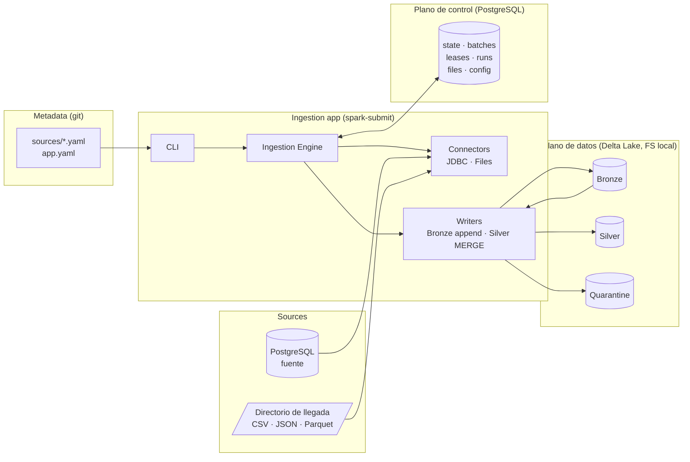
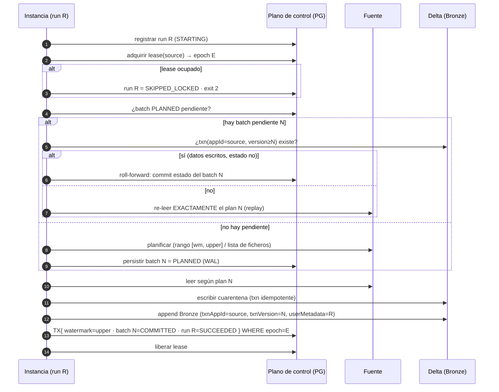

# Phase 0 — Architecture Discovery & Project Definition

> Estado: **borrador para revisión** · Fecha: 2026-09-25
> Alcance: análisis y decisiones previas al código. No contiene implementación.

---

## 0. TL;DR (lo que cambia respecto al planteamiento inicial)

1. **El entorno actual no puede ejecutar el proyecto**: Windows 10 Home, 7.4 GB de RAM, sin Docker, sin WSL, sin Scala, sin sbt y sin `winutils`. Recomiendo **WSL2 + Docker Engine dentro de WSL** como entorno de desarrollo. Es un bloqueante de Phase 1.
2. **Hallazgo crítico para la concurrencia multi-instancia.** Delta Lake sobre **sistema de ficheros local no garantiza exclusión mutua entre procesos distintos**. `HDFSLogStore` protege el commit con un lock *estático dentro de la JVM* (`LOCAL_FS_WRITE_LOCK`) porque `RawLocalFileSystem.rename` no falla si el destino existe. Dos `spark-submit` escribiendo la misma tabla Delta local pueden **sobrescribir el mismo commit** sin que el control optimista lo detecte. La sección 13 no puede apoyarse en el OCC de Delta entre procesos.
3. Por (2), recomiendo que el **plano de control** (estado incremental, leases, auditoría) viva en **PostgreSQL**, que ya forma parte del stack, y que el **plano de datos** (Bronze, Silver, cuarentena) viva en Delta. Es el patrón de Airflow, Airbyte o Hive Metastore: metadatos transaccionales en un RDBMS y datos en el lake.
4. La consistencia *datos ↔ watermark* se resuelve con un protocolo **plan → commit con write-ahead log**, el mismo modelo que los offset/commit logs de Spark Structured Streaming. Se apoya en las **escrituras idempotentes nativas de Delta** (`txnAppId` / `txnVersion`). No hace falta transacción distribuida.
5. Reduzco las 19 fases a **12 fases MVP + extensiones**, con dos puntos de parada coherentes: el *mínimo demostrable* (fin de Phase 6) y el *MVP-para-CV* (fin de Phase 11).
6. Stack verificado: **Java 17 · Scala 2.13 · Spark 4.1.3 · Delta 4.4.0 (`delta-spark_4.1_2.13`) · PostgreSQL 17 · sbt 1.x**.

---

## 1. Análisis crítico del proyecto

### Lo que está bien planteado

- **El alcance llega hasta Silver, y es correcto.** Estoy de acuerdo en dejar Gold fuera. Gold es modelado dimensional o lógica de producto y pertenece a otro sistema, normalmente dbt o jobs de dominio. Un framework de ingesta que la incluye acaba siendo un "framework de todo".
- **La concurrencia se diseña desde el inicio.** Retrofitearla es exactamente lo que rompe los frameworks internos.
- **La prioridad de corrección sobre rendimiento**, y la optimización con medición antes/después.
- **La preocupación por no terminar.** Es el riesgo número uno.

### Lo que cuestiono

| # | Punto | Problema | Propuesta |
|---|---|---|---|
| C1 | Entorno | Spark Standalone en Windows nativo es frágil: los scripts `start-*.sh` son bash y hace falta `winutils`/`hadoop.dll`. Docker Desktop en Windows Home exige WSL2 igualmente. Con 7.4 GB, Docker Desktop + Spark + IDE va muy justo. | WSL2 (Ubuntu) con Docker Engine nativo en WSL, sin Docker Desktop, y límite de memoria en `.wslconfig`. |
| C2 | Delta como almacén de estado y auditoría compartidos | Con Delta en FS local, varios procesos escribiendo la misma tabla (auditoría, watermarks) **no es seguro**. En cloud se resuelve con un LogStore con coordinación externa, p. ej. S3 + DynamoDB. | Plano de control en PostgreSQL (§6.2). |
| C3 | "Varias ingestas escribiendo en la misma tabla Delta" | Es un requisito legítimo, pero sobre FS local no se puede demostrar entre procesos con garantías reales. | MVP: **un escritor por tabla**, garantizado por lease y validado en la config. OCC real de Delta demostrado **dentro de una JVM** (runner paralelo). Multi-proceso sobre la misma tabla como extensión con MinIO + LogStore coordinado. **Lo decides tú** (D3). |
| C4 | Phase 2 separada de "fuentes sintéticas" | Una fase de datos sin consumidor produce datos que luego no encajan con los tests reales. | Cada generador de datos nace en la fase del conector que lo usa. |
| C5 | Lineage, observabilidad y auditoría como tres fases | Los tres salen del **mismo modelo de ejecución** (run, batch, versión Delta). Separarlos obliga a volver a tocar el núcleo. | Diseñarlos juntos en Phase 3 (modelo) y exponerlos en Phase 10 (vistas, logs, métricas). |
| C6 | CI/CD como fase tardía (15) | Un CI al final no demuestra buenas prácticas, solo las declara. | CI mínimo en Phase 1, que crece en cada fase. La extensión solo añade extras (cobertura, releases). |
| C7 | Testing avanzado como fase (14) | Los tests de fallo solo son creíbles si el código se diseñó con puntos de inyección. | La inyección de fallos entra en el diseño del motor (Phase 4) y los tests de recuperación en Phase 6. |
| C8 | Parquet en el MVP | Aporta poco a la historia (no hay drift de texto ni registros corruptos), pero cuesta cero porque el conector de ficheros usa `DataFrameReader`. | Soportado "gratis" y documentado. Sin casos de test dedicados más allá de uno de humo. |
| C9 | Streaming | Nada del diseño lo impide, siempre que el conector separe *planificar* de *leer* (§12). | Mantener el contrato `plan/read` replayable. |

---

## 2. Requisitos funcionales

| ID | Requisito | MVP |
|---|---|---|
| RF-01 | Definir fuentes mediante ficheros de metadata versionados en git, sin código por fuente | ✅ |
| RF-02 | Validar toda la configuración al arrancar, antes de tocar datos, acumulando todos los errores | ✅ |
| RF-03 | Conector JDBC (PostgreSQL de referencia): full load e incremental por watermark | ✅ |
| RF-04 | Conector de ficheros (CSV, JSON; Parquet sin coste extra): procesar solo ficheros nuevos | ✅ |
| RF-05 | Escribir Bronze en append con metadatos de ingesta y fidelidad a la fuente | ✅ |
| RF-06 | Silver: tipado, normalización de nombres, deduplicación por clave y upsert (`MERGE`) | ✅ |
| RF-07 | Detección de borrados: implícita en full load y por reconciliación de claves en incremental | ✅ |
| RF-08 | Estado incremental persistente y consistente con los datos escritos | ✅ |
| RF-09 | Recuperación automática de una ejecución interrumpida | ✅ |
| RF-10 | Reprocesamiento y backfill explícitos y auditados, sin romper el estado incremental | ✅ |
| RF-11 | Reset controlado y auditado del estado de una fuente | ✅ |
| RF-12 | Política de evolución de esquema configurable por fuente | ✅ (básica) |
| RF-13 | Separación de registros corruptos a cuarentena con umbral de rechazo | ✅ |
| RF-14 | Clasificación de errores (transitorio / permanente / datos) con reintentos acotados | ✅ |
| RF-15 | Exclusión mutua por fuente entre instancias (lease con expiración) | ✅ |
| RF-16 | Registro de auditoría por ejecución y por batch | ✅ |
| RF-17 | Lineage a nivel tabla/batch: fuente → versión Delta Bronze → versión Delta Silver | ✅ |
| RF-18 | Métricas reales por ejecución + frescura por fuente | ✅ |
| RF-19 | Marcado de PII en metadata y masking/pseudonimización en Silver | ✅ |
| RF-20 | CLI con modos `run`, `plan` (dry-run), `backfill`, `reprocess`, `reset-state`, `reconcile-deletes`, `maintain` | ✅ (progresivo) |
| RF-21 | Ingesta en paralelo de N fuentes dentro de una aplicación Spark | ✅ |
| RF-22 | Demo multi-proceso (N `spark-submit` concurrentes) con verificación | Extensión |
| RF-23 | Conector REST | Extensión |
| RF-24 | SCD tipo 2 en Silver | Extensión |

## 3. Requisitos no funcionales

| ID | Requisito | Cómo se verifica |
|---|---|---|
| RNF-01 | **Corrección bajo fallo**: matar la ejecución en cualquier punto no duplica ni pierde datos | Tests con inyección de fallos en cada punto del protocolo, más un test e2e con `kill -9` |
| RNF-02 | **Idempotencia**: relanzar la misma ingesta produce el mismo estado final | Test: ejecutar 2 veces y comparar tablas y estado |
| RNF-03 | **Seguridad bajo concurrencia**: N instancias sobre la misma fuente implican 1 ejecutor efectivo y N−1 `SKIPPED_LOCKED` auditados | Tests de concurrencia (hilos contra PostgreSQL real; procesos en extensión) |
| RNF-04 | **Extensibilidad**: un tipo de fuente nuevo = una clase que implementa el contrato + registro | Un conector de test añadido sin tocar el módulo `engine` |
| RNF-05 | **Auditabilidad**: toda ejecución, incluso fallida o bloqueada, deja registro | Tests sobre el registro de auditoría |
| RNF-06 | **Testabilidad**: la lógica de dominio no depende de Spark ni de I/O | Módulo `core` sin dependencia de Spark (lo impone el compilador) |
| RNF-07 | **Reproducibilidad**: datos de test deterministas (semilla) y entorno levantable con un comando | `docker compose up` + `sbt test` |
| RNF-08 | **Observabilidad**: logs estructurados con `run_id` y `source_id` en cada línea | Inspección de logs y test del layout |
| RNF-09 | **Seguridad**: ningún secreto en config, logs ni auditoría | Test que verifica la redacción de secretos |
| RNF-10 | **Recursos**: todo el entorno cabe en ~5 GB de RAM | Límites en `.wslconfig` y en la configuración de Spark |
| RNF-11 | **Portabilidad a streaming**: no cerrar la puerta (no se implementa) | Revisión del contrato de conector |

---

## 4. Requisitos que faltan en el planteamiento

Estos puntos no aparecen en el brief original, pero una ingesta real los necesita. Los clasifico por necesidad.

| Requisito ausente | Por qué importa | Nivel |
|---|---|---|
| **Contrato con el orquestador**: CLI, **códigos de salida** (0 OK, 2 bloqueado, 3 fallo transitorio, 4 fallo permanente, 5 umbral de datos superado) | El framework no se autoplanifica (cron/Airflow/Control-M lo invocan). El orquestador necesita distinguir "reintenta" de "no reintentes". | Required |
| **Ficheros a medio escribir** | Un fichero que el productor aún está copiando se ingeriría truncado. Se necesita edad mínima (`min_file_age`), patrón de exclusión de temporales o fichero marcador. | Required |
| **Tamaño de batch acotado** (`max_files_per_batch`, rango máximo de watermark) | Sin límite, la primera carga de una fuente grande o un atasco de ficheros revienta la memoria o genera commits enormes. | Required |
| **Zona horaria** | `timestamp without time zone` en PostgreSQL + zona de sesión de Spark distinta es un bug clásico de watermarks. Todo en UTC (`spark.sql.session.timeZone=UTC`). | Required |
| **Fuente de reloj para leases y watermarks** | Los relojes de distintas instancias difieren. Los leases usan `now()` de PostgreSQL de control. El límite superior del watermark usa el reloj de la **fuente**. | Required |
| **Primera ejecución de una fuente** (sin estado) | Hay que definirla: incremental sin watermark = carga completa acotada. | Required |
| **Cambios de configuración "rompientes"** (cambiar la PK, la columna de watermark o el destino) | Invalidan el estado. Se detectan comparando con la última config usada (hash + snapshot) y exigen `reset-state` explícito. | Required |
| **Dry-run / `plan`** | Muestra qué se leería sin escribir nada. Cuesta muy poco y aporta mucho a la demo y a la operación. | Recommended |
| **Retención**: Bronze, cuarentena (contiene PII), histórico de auditoría, `VACUUM` | Sin retención no hay GDPR creíble ni control de coste. | Recommended |
| **Propiedad del mantenimiento Delta** (`OPTIMIZE`/`VACUUM`) | Si corre en paralelo a una ingesta, entra en conflicto. Debe tomar el mismo lease que la fuente. | Recommended |
| **Baja de una fuente** | Borrar el YAML deja estado huérfano. Basta con un estado `disabled` en la config. | Recommended |
| **Encoding y dialecto CSV** (separador, comillas, cabecera, encoding) | Es la fuente real de la mayoría de los "registros corruptos". | Required (en config) |
| **SLA de frescura por fuente** | Sin un objetivo declarado, la métrica `source_freshness` no tiene umbral contra el que alertar. | Recommended |
| **Perfiles de entorno** (local / test / CI) | Rutas del lake y conexiones distintas sin tocar las definiciones de fuente. | Required |

---

## 5. Riesgos y decisiones arquitectónicas clave

### Riesgos

| Riesgo | Prob. | Impacto | Mitigación |
|---|---|---|---|
| R1 — Entorno local insuficiente (RAM, Windows) | Alta | Alto | WSL2 con límites de memoria; `local[*]` para desarrollo y tests; Standalone solo para demos |
| R2 — Scope creep / no terminar | Alta | Alto | Puntos de parada A y B; README útil desde Phase 1; extensiones separadas |
| R3 — Garantías de Delta en FS local malinterpretadas | Media | Alto | Documentado aquí; un escritor por tabla + lease; test de "spike" en Phase 1 que lo evidencia |
| R4 — Sobrediseño del plano de control | Media | Medio | Solo 7 tablas; cada columna justificada; nada de colas ni servicios adicionales |
| R5 — Sutilezas de consistencia (zombies, leases expirados) | Media | Alto | Epoch como fencing token en el plano de control; limitación documentada honestamente en Delta (§14) |
| R6 — Tests Spark lentos que desincentivan testear | Media | Medio | `core` sin Spark (tests en ms); una `SparkSession` compartida por suite; integración separada |
| R7 — Ecosistema Spark 4 / Scala 2.13 | Baja | Medio | Pocas dependencias, maduras, verificadas en Phase 1 |
| R8 — Windows ↔ WSL (rendimiento de FS, IDE) | Media | Medio | Código **dentro** del FS de WSL (`~/…`), no en `/mnt/c` |

### Decisiones arquitectónicas (se detallan en §6–§15)

| ID | Decisión | Recomendación |
|---|---|---|
| AD-01 | Formato de metadata | YAML (un fichero por fuente) + validación tipada al arrancar |
| AD-02 | Dónde vive estado/lease/auditoría | PostgreSQL (plano de control) |
| AD-03 | Consistencia datos ↔ estado | Protocolo *plan → write idempotente → commit* con WAL de batches |
| AD-04 | Identidad de ejecución | `run_id` = UUIDv7 (intento) ≠ `batch_seq` (unidad lógica de datos) |
| AD-05 | Coordinación entre instancias | Lease por fuente con expiración, heartbeat y epoch (fencing) |
| AD-06 | Escritores por tabla Delta | Uno por tabla en el MVP (validado en config + lease) |
| AD-07 | Bronze para ficheros de texto | Columnas como `string` + columna de rescate; tipado en Silver |
| AD-08 | Escritura por capa | Bronze append · Silver `MERGE` |
| AD-09 | Borrados | Full load → `WHEN NOT MATCHED BY SOURCE`; incremental → reconciliación de claves periódica; CDC como futuro |
| AD-10 | Catálogo | Tablas Delta por ruta (sin metastore) |
| AD-11 | Modularidad | sbt multi-módulo: `core` (sin Spark) / `engine` / `cli` / `integration-tests` |

---

## 6. Arquitectura general

### 6.1 Vista de alto nivel



### 6.2 Por qué dos planos (AD-02)

| | |
|---|---|
| **Decision** | Estado incremental, leases, WAL de batches y auditoría en **PostgreSQL** (base `ingestion_control`). Datos, cuarentena y lineage de versiones en **Delta**. |
| **Why** | (1) Los leases necesitan operaciones atómicas *compare-and-set* entre procesos. PostgreSQL las da (`UPDATE … WHERE … RETURNING`) y Delta en FS local no. (2) Avanzar el watermark, cerrar el batch y cerrar el run deben ser **una** transacción: en PostgreSQL es un `COMMIT`; en Delta serían tres commits en tres tablas. (3) La auditoría la escriben todas las instancias a la vez, y eso es multi-escritor sobre la misma tabla (C2). |
| **Alternatives** | (a) Todo en tablas Delta. (b) Ficheros JSON de estado por fuente. (c) MinIO + Delta con LogStore coordinado (DynamoDB Local). (d) Zookeeper/etcd para locks. |
| **Trade-offs** | (+) Correcto por construcción, fácil de consultar, reutiliza un componente ya presente. (−) Hay dos sistemas, así que no hay transacción única datos+estado. Se resuelve con el protocolo de §8 y es un trade-off que *quiero* que expliques en entrevista. (−) La auditoría no es "una tabla Delta más" consultable con Spark; se lee vía JDBC. |
| **Industry practice** | Airflow (metadata DB), Airbyte (config/state DB en PostgreSQL), Hive Metastore, Dagster: plano de control en RDBMS. Delta/Iceberg con catálogo (Unity, Nessie, Polaris) desplazan justo la coordinación de commits a un servicio externo. |
| **Why it fits** | Cero infraestructura nueva: se usa el mismo contenedor PostgreSQL con **otra base de datos**, separada de la fuente. En producción serían instancias distintas. |

### 6.3 Responsabilidad por capa

| Capa | Guarda | NO guarda / NO hace | Escritura | Errores |
|---|---|---|---|---|
| **Landing** (solo ficheros) | El directorio donde el productor deja ficheros. **El framework no copia ni mueve**: registra lo procesado en el plano de control. | Copias intermedias. Mover ficheros sería un efecto lateral no atómico con el commit Delta y rompería el replay. | La escribe el productor | Fichero ilegible → registro `FAILED` + política (`fail` o `skip`) |
| **Bronze** | Fidelidad a la fuente. JDBC con tipos nativos. CSV/JSON como `string` + `_rescued_data`. Metadatos mínimos: `_run_id`, `_batch_seq`, `_ingested_at`, `_source_file` (solo ficheros). | Tipado de texto, deduplicación, renombrados, lógica de negocio | Append idempotente (`txnAppId`/`txnVersion`) | Registros estructuralmente corruptos → cuarentena Bronze. Umbral superado → el batch no se commitea. |
| **Silver** | Estado actual por clave, tipado según el esquema declarado, nombres normalizados (`snake_case`), PII enmascarada, soft-delete (`_is_deleted`, `_deleted_at`) | Joins entre fuentes, agregados, reglas de negocio, métricas de negocio | `MERGE` por PK con guarda de orden (`updated_at`) | Fallos de cast → cuarentena Silver con el registro Bronze original |
| **Gold** | Fuera de alcance | — | — | — |

**¿Aporta valor una landing propia?** No como copia, pero sí como *contrato*: ruta por fuente (`landing/<source_id>/`), regla de fichero completo (edad mínima o marcador) y ficheros inmutables. Es exactamente lo que hace Auto Loader: no mueve ficheros y lleva la cuenta de los procesados en su checkpoint.

**Por qué Bronze guarda texto como `string`:** si Bronze tipara, un `"12,5"` en una columna decimal sería un fallo *en Bronze*. Se perdería la fidelidad y el registro original. Con `string`, Bronze solo rechaza lo **estructuralmente** roto (JSON inválido, número de columnas incorrecto) y Silver es la frontera del tipado. Es el mismo comportamiento por defecto de Auto Loader (`inferColumnTypes=false`).

### 6.4 Lineage (qué nivel es razonable)

- **Required (MVP)**: nivel **tabla + batch**. Cada fila Bronze lleva `_run_id` y `_batch_seq`. Cada batch registra su input (rango de watermark o lista de ficheros) y su output (tabla y **versión Delta** resultante). Silver registra qué `batch_seq` de Bronze aplicó y en qué versión Silver quedó. Con eso se responde "¿de qué fichero viene esta fila Silver?" con dos joins.
- **Técnica**: cada commit Delta lleva `userMetadata = {run_id, batch_seq, source_id}`. La versión se localiza en `DESCRIBE HISTORY` por `run_id`, no con "la última versión", que no es fiable si hubiera otro escritor.
- **Future**: lineage a nivel columna y emisión de eventos OpenLineage. El modelo run/batch/input/output es 1:1 con `RunEvent` de OpenLineage, así que es un adaptador, no un rediseño.

---

## 7. Stack concreto y compatibilidad

Verificado el 2026-09-25 contra Maven Central y la documentación oficial.

| Componente | Versión | Justificación / compatibilidad |
|---|---|---|
| Java | **17** (Temurin, dentro de WSL) | Spark 4.1 soporta Java 17 y 21. Ya usas 17 en Windows. 21 no aporta nada al proyecto. |
| Scala | **2.13.x** (la misma minor que usa Spark 4.1.3) | Spark 4 solo se publica para 2.13. Scala 3 no es viable con encoders de Dataset (dependen de `TypeTag`). |
| Apache Spark | **4.1.3** | Línea 4.1 madura (3 parches). Spark 4.2.0 salió en julio de 2026 y es una `.0`. Migrar después es cambiar dos coordenadas. |
| Delta Lake | **4.4.0**, artefacto `io.delta:delta-spark_4.1_2.13` | Desde Delta 4.1 los artefactos llevan la versión de Spark. 4.4.0 soporta Spark 4.0/4.1/4.2. |
| sbt | 1.x más reciente (se fija en Phase 1) | Estándar de Scala. `sbt-assembly` para el fat jar con Spark como `provided`. |
| PostgreSQL | **17** (imagen oficial `postgres:17`) | Fuente y plano de control en el mismo contenedor, dos bases de datos |
| Driver JDBC | `org.postgresql:postgresql` 42.7.x | Estándar |
| Migraciones del plano de control | **Flyway** | Esquema versionado del plano de control. Es el estándar de la industria y evita SQL "a mano" al arrancar. |
| Config | `circe` + `circe-yaml` | YAML → case classes con errores de decodificación precisos. `circe` ya trae `cats` (`Validated` para acumular errores). |
| Tests | ScalaTest 3.2.x + Testcontainers (PostgreSQL) | Testcontainers requiere Docker, que estará disponible en WSL y en GitHub Actions |
| Logging | log4j2 (el de Spark) con `JsonTemplateLayout` | Sin segundo framework de logging (evita conflictos de binding SLF4J con Spark) |
| Calidad | scalafmt, `-Xlint` + `-Werror` selectivo, scoverage | Suficiente. scalafix queda opcional. |
| CI | GitHub Actions (`ubuntu-latest` trae Docker) | Integración con Testcontainers sin configuración extra |
| Contenedores | Docker Engine + Compose v2 **dentro de WSL2** | Sin Docker Desktop: menos RAM y sin licencia |

**Incompatibilidades detectadas:**
- El JDK 8 que tienes instalado no sirve para Spark 4 (solo afecta si queda primero en el `PATH`).
- IntelliJ 2023.3 no tiene el plugin de Scala instalado, y es antiguo para Scala 2.13 reciente y sbt 1.10+. Si usas IntelliJ, conviene actualizarlo (ver D1).
- Windows nativo exige `winutils.exe`/`hadoop.dll` para que Spark/Delta escriban en disco. WSL2 lo elimina.

**Presupuesto de memoria (7.4 GB físicos):**

| Proceso | RAM |
|---|---|
| WSL2 VM (tope en `.wslconfig`) | 5 GB |
| ↳ PostgreSQL | ~0.3 GB |
| ↳ Spark local (tests / dev): driver | 2 GB |
| ↳ Spark Standalone (demo): master 0.5 + worker 2.5 (2 apps × 1 GB) | 3 GB (no simultáneo con los tests) |
| Windows + IDE | ~2.4 GB |

Funciona, pero sin margen para ejecutar tests y Standalone a la vez. Ese es otro motivo para usar `local[*]` en el día a día.

---

## 8. Estado, idempotencia y recuperación (el núcleo)

### 8.1 Run ≠ Batch (AD-04)

- **Run** = un *intento* de ejecución. `run_id` es un **UUIDv7**: 48 bits de timestamp + 74 aleatorios. Se genera sin coordinación, no colisiona entre instancias y se ordena por tiempo. En Java 17 no viene de serie, pero se generan fácilmente (~15 líneas).
- **Batch** = la *unidad lógica de datos* (rango de watermark o conjunto de ficheros). `batch_seq` es monotónico **por fuente y capa** y lo asigna el plano de control dentro del lease.
- Un batch puede necesitar varios runs (crash + recuperación). La **idempotencia se ancla al batch, no al run**. Esta distinción es la que separa un diseño correcto de uno que "casi" funciona.

### 8.2 Protocolo de ejecución



**Por qué es correcto sin transacción distribuida:**
- **Delta es la fuente de verdad** de si los datos del batch N están escritos: `txnAppId`/`txnVersion` quedan en el log de Delta en el mismo commit atómico que los datos.
- **El plan se persiste antes de leer** (write-ahead). Si se muere antes del commit Delta, se relee el *mismo* plan. Si se muere después, se detecta vía `txn` y se completa el estado (*roll-forward*). En ningún caso hay duplicados ni huecos.
- Es el modelo de Spark Structured Streaming: offset log (plan) + commit log (estado), y `foreachBatch` idempotente con `txnAppId`/`txnVersion`. **Esto mantiene abierta la puerta al streaming** (§12).

### 8.3 Ficheros

- Registro `processed_file(source_id, path, size, mtime)`. El identificador es `path + size + mtime`: el mismo nombre con contenido distinto cuenta como fichero nuevo. El hash de contenido queda como opción futura por su coste en ficheros grandes.
- El plan de un batch de ficheros **es la lista de ficheros**, persistida. Replay = leer esa lista.
- Reprocesar un fichero exige `reprocess --files …`. Crea un **batch nuevo** (`run_kind=REPROCESS`), nunca reutiliza el anterior, y queda auditado.

### 8.4 Incremental por watermark

- `upper_bound` se fija **al planificar** con el reloj de la fuente: `now() − safety_margin`. Esto evita perder filas de transacciones largas que hacen commit con un `updated_at` anterior al leído.
- `lookback` configurable: se lee `updated_at > wm − lookback AND updated_at <= upper_bound`. Las filas repetidas entran en Bronze con otro `batch_seq` (es historia de recepción) y Silver las deduplica con la guarda `source.updated_at >= target.updated_at`.
- **Datos tardíos**: el `lookback` cubre el retraso típico y la guarda de orden en Silver impide que un dato viejo pise uno nuevo.
- **Backfill**: `backfill --from --to` crea batches `run_kind=BACKFILL` que **no leen ni mueven** el watermark incremental. Silver los absorbe gracias a la guarda de orden.
- **Reset**: `reset-state --source X --to <valor> --reason "..."` escribe en `state_change_log` (quién, cuándo, antes, después y motivo).

### 8.5 Borrados en origen (AD-09)

| Opción | Detecta | Coste | Recomendación |
|---|---|---|---|
| Full load periódico | Todo | Alto (tabla completa) | Solo para tablas pequeñas: `load: full` |
| Soft delete en la fuente (`deleted_at`) | Todo, si la fuente lo tiene | Nulo | Soportar si existe (`deleted_flag_column`) |
| **Reconciliación de claves** (leer solo la PK y anti-join con Silver) | Borrados, con retraso de un ciclo | Bajo: solo una columna, indexada | **Recomendada** para incrementales, invocada por el orquestador con `reconcile-deletes` |
| CDC real (Debezium / logical replication) | Todo, en orden y en tiempo casi real | Infraestructura (Kafka/Connect) | Evolución futura |

En Silver los borrados son **soft deletes** (`_is_deleted`, `_deleted_at`) para mantener la auditabilidad. El borrado físico se reserva para GDPR (§11).

---

## 9. Concurrencia multi-instancia (sección 13 del brief)

### 9.1 Qué se fija ya (va en el modelo de Phase 3, aunque la demo sea posterior)

| # | Decisión | Diseño |
|---|---|---|
| 1 | `run_id` a prueba de colisión | UUIDv7 generado por la instancia. Sin coordinación ni infraestructura. |
| 2 | Coordinación sobre una misma fuente | **Lease** en `source_lease`: `UPDATE … SET holder=?, epoch=epoch+1, expires_at=now()+ttl WHERE source_id=? AND (holder IS NULL OR expires_at < now()) RETURNING epoch`. Un hilo de heartbeat renueva el lease. Si la instancia muere, el lease expira sin dejar locks huérfanos. Tiempo del servidor PG, no de la instancia. Si está ocupado: `SKIPPED_LOCKED` (auditado) y exit 2, sin esperar. |
| 3 | Estado incremental | Solo el titular del lease avanza el estado, y el commit de estado es condicional: `… WHERE epoch = :mi_epoch`. Un "zombi" con lease expirado **no puede** avanzar el watermark. El epoch es un *fencing token*. |
| 4 | Conflictos de escritura Delta | Un escritor por tabla (AD-06). Las excepciones de OCC (`ConcurrentAppendException`, etc.) solo pueden venir del mantenimiento o del runner paralelo in-JVM. Se reintentan con backoff acotado **solo** porque las operaciones son idempotentes (append con `txn`, `MERGE` recomputable), y se cuentan en `write_conflicts`. |
| 5 | Auditoría bajo concurrencia | Cada fila de auditoría lleva `run_id` + `instance_id` (host, pid, `spark.app.id`) + `lease_epoch`. Dos runs solapados son siempre distinguibles, y el que perdió el lease queda marcado. |

### 9.2 Por qué lease con epoch y no `pg_advisory_lock`

`pg_advisory_lock` es más simple, pero está atado a la **conexión JDBC**. Si la conexión cae y el proceso sigue vivo, el lock desaparece en silencio: dos ejecutores a la vez sin que nadie lo sepa. Además no da fencing token ni deja rastro auditable. El lease cuesta una tabla y un hilo de heartbeat.

### 9.3 Límite honesto (para la entrevista)

El fencing protege el **plano de control**, pero Delta en FS local no puede rechazar la escritura de un zombi. Mitigaciones del MVP:
1. TTL del lease ≫ duración máxima de un commit.
2. Comprobación del lease justo antes del commit Delta.
3. Idempotencia por `txnVersion`: si un zombi y el nuevo titular escriben el *mismo* batch, Delta descarta el segundo.

La ventana residual se documenta. Cerrarla del todo requiere que el almacenamiento soporte commits condicionales (coordinated commits / catálogo), y eso es enterprise.

### 9.4 Riesgo de sobrecomplicar el MVP y cómo acotarlo

- **Dentro del MVP**: lease + epoch + WAL de batch + `run_id`/`instance_id`, tests de concurrencia de leases con N hilos contra PostgreSQL real (que es multi-proceso de verdad a nivel BD), y **runner paralelo in-JVM** (N fuentes, `FAIR` scheduler) donde el OCC de Delta sí es real y demostrable.
- **Fuera del MVP**: N `spark-submit` simultáneos en Standalone con script de verificación (extensión E1), y multi-escritor sobre la **misma** tabla Delta entre procesos (extensión E5, requiere MinIO + LogStore coordinado).
- **Gotcha que la demo debe mostrar**: en Standalone, cada app coge **todos los cores** si no se fija `spark.cores.max`, y la segunda instancia queda en `WAITING`. Es "concurrencia" que no lo es.

---

## 10. Evolución de esquema (resumen; se diseña en su fase)

Política por fuente:

```yaml
schema:
  on_new_column: add | rescue | fail          # default: add (Bronze), rescue para JSON
  on_missing_column: null | fail              # default: null
  on_type_change: widen | rescue | fail       # default: fail (JDBC)
  renames: { old_name: new_name }             # única forma fiable de expresar un renombrado
```

- **Nativo de Delta**: `mergeSchema` (añadir columnas), *type widening* (ampliar tipos compatibles; se verifica en su fase qué conversiones cubre 4.4), *column mapping* (renombrar/borrar sin reescribir).
- **Hay que construirlo**: la comparación esquema-leído vs esquema-tabla, la decisión según la política, la columna `_rescued_data` y la auditoría del cambio (`schema_change` en el run).
- **Renombrados**: sin metadatos externos, `a → b` es indistinguible de "se borró `a` y apareció `b`", porque el esquema solo tiene nombres y tipos, no identidad. Por eso existe `renames` en la config.
- En Bronze-texto (todo `string`) los cambios de tipo **no existen**: aparecen en Silver como fallos de cast → cuarentena. Es otra ventaja de AD-07.

---

## 11. Seguridad y governance

| Tema | Required | Recommended | Enterprise | Future |
|---|---|---|---|---|
| Secretos | `secretRef: env:NAME` / `file:/run/secrets/x` + `SecretResolver`; redacción en logs y en el snapshot de config | Docker secrets en compose | Vault / KMS | — |
| PII | Tags en la metadata de columna (`pii: email`) | Heredar la clasificación en cuarentena | Catálogo con clasificación automática | — |
| Masking Silver | Pseudonimización determinista (HMAC-SHA256 con clave secreta), que mantiene los joins | Estrategias por tipo (hash, truncado, nulo) | Masking dinámico por rol en el motor de consulta | — |
| Control de acceso | Permisos de FS + usuario PG de solo lectura sobre la fuente | Usuarios PG separados: fuente (RO) y control (RW) | Unity Catalog / Ranger | — |
| Encriptación | — (FS local) | Documentar cifrado de disco | Cifrado en reposo del storage, TLS JDBC | Parquet modular encryption |
| Audit logs | Plano de control (§13) | — | SIEM | — |
| GDPR supresión | Procedimiento documentado: `DELETE` en Silver/Bronze + `VACUUM` tras la retención (Delta conserva los ficheros para time travel hasta el `VACUUM`) | Retención corta en Bronze y cuarentena | **Crypto-shredding** (clave por sujeto) | — |

**Tensión Bronze inmutable ↔ GDPR:** Bronze no es inmutable a nivel físico. Es *append-only por convenio*. La supresión es una excepción auditada (`run_kind=ERASURE`) y exige `VACUUM` para ser efectiva, porque sin él los datos siguen en versiones anteriores. Esa es la respuesta que buscan en entrevista.

---

## 12. Motor de ingesta y contrato de conector

### 12.1 Módulos

| Módulo | Contenido | Depende de |
|---|---|---|
| `core` | Modelo de dominio, config, validación, planificación pura, clasificación de errores, máquina de estados del run. **Sin Spark.** | cats/circe |
| `engine` | Conectores, writers Delta, repositorios del plano de control (JDBC + Flyway), motor | `core`, Spark (provided), Delta |
| `cli` | `Main`, parseo de argumentos, wiring y códigos de salida | `engine` |
| `integration-tests` | Testcontainers, e2e, fallos inyectados, concurrencia | todos |

La separación I/O ↔ lógica la **impone el compilador**: `core` no puede importar Spark.

### 12.2 Contrato de conector (borrador de diseño, no implementación)

```scala
trait SourceConnector[C <: ConnectorConfig] {
  /** Identificador usado en YAML: `type: jdbc` */
  def kind: String

  /** Validación estática de su config. Sin I/O. Se ejecuta al arrancar para TODAS las fuentes. */
  def validate(cfg: C): ValidatedNel[ConfigError, C]

  /** Decide QUÉ leer. Determinista y serializable (se persiste como WAL). */
  def plan(ctx: PlanContext, cfg: C, state: SourceState): Either[IngestError, BatchPlan]

  /** Lee EXACTAMENTE lo que dice el plan. Replayable, sin efectos laterales. */
  def read(ctx: ReadContext, cfg: C, plan: BatchPlan): Either[IngestError, ReadResult]
}

final case class ReadResult(
  valid: DataFrame,        // registros válidos + columnas de metadatos de origen
  corrupt: DataFrame,      // registros estructuralmente rotos (raw + motivo)
  inputStats: InputStats   // ficheros/bytes leídos (medidos, no estimados)
)
```

**Garantías que exige el contrato, y por qué:**
1. `plan` es **determinista y serializable**. Si no lo fuera, no se podría persistir el WAL ni hacer replay.
2. `read(plan)` es **replayable y sin efectos laterales**: no mueve ficheros ni muta la fuente. Si no, la recuperación releería otra cosa.
3. **El conector nunca escribe en el lake ni toca estado o auditoría.** Esa es responsabilidad exclusiva del motor. Así un conector nuevo no puede romper la consistencia.
4. Los errores se devuelven **tipados** (`Transient` / `Permanent` / `Data`) o los clasifica el motor (p. ej. SQLState `08xxx` → transitorio, `28xxx` → permanente, `42P01` → permanente).
5. Se registra en un `ConnectorRegistry` (factory por `kind`). Añadir un tipo = una clase + una línea de registro. El motor no cambia.

### 12.3 Patrones y su razón concreta

| Patrón | Dónde | Razón |
|---|---|---|
| Trait como contrato | `SourceConnector` | Extensibilidad sin tocar el motor |
| Factory / registry | `ConnectorRegistry` | Resolver `type:` del YAML a una implementación |
| Strategy | `WriteStrategy` (BronzeAppend, SilverMerge, SnapshotMerge) | La escritura varía por capa y modo de carga. La lectura ya la cubre el conector. |
| Repository | `RunRepository`, `StateRepository`, `LeaseRepository`, `FileRegistry` | Aislar el SQL del plano de control y permitir fakes en memoria en los tests de `core`/`engine` |
| Dependency inversion | El motor depende de los traits, no de JDBC/Delta concretos | Testabilidad e inyección de fallos |
| Service layer | `IngestionService` orquesta el protocolo de §8.2 | Un único sitio con la lógica de consistencia |
| — descartados — | Visitor, Abstract Factory, event bus, DI framework | No hay problema que resuelvan aquí. El wiring manual en `cli` basta. |

**Inyección de fallos**: el motor expone *hooks* con nombre (`AfterPlan`, `AfterQuarantineWrite`, `AfterBronzeCommit`, `BeforeStateCommit`…). En producción son un no-op; en los tests lanzan una excepción o hacen `halt`. Es la base de RNF-01.

### 12.4 Puerta al streaming

`plan` ≈ `latestOffset`, el WAL ≈ offset log, el commit de estado ≈ commit log, y el append con `txn` ≈ `foreachBatch` idempotente. Un conector de streaming encajaría como adaptador. **La decisión que la cerraría** sería permitir que los conectores muevan ficheros o que el estado no esté indexado por batch. El contrato lo prohíbe expresamente.

---

## 13. Modelo conceptual de datos

### 13.1 Metadata (YAML, un fichero por fuente)

```yaml
# conf/sources/sales.orders.yaml — ilustrativo
id: sales.orders
enabled: true
owner: team-sales
connector:
  type: jdbc
  connection: { url: "jdbc:postgresql://postgres:5432/sales", user: ingest_ro,
                password: { secretRef: "env:SALES_DB_PASSWORD" } }
  table: public.orders
load:
  mode: incremental            # full | incremental
  watermark: { column: updated_at, lookback: 10m, safety_margin: 1m }
  max_batch_range: 7d
keys: [order_id]
deletes: { strategy: key_reconciliation }
schema: { on_new_column: add, on_missing_column: null, on_type_change: fail }
columns:
  customer_email: { pii: email, silver: { mask: hmac } }
quality: { max_rejected_ratio: 0.01 }
targets:
  bronze: { path: bronze/sales/orders }
  silver: { path: silver/sales/orders, partition_by: [] }
freshness_sla: 2h
```

**¿Por qué YAML? (AD-01)** Es legible por perfiles no Scala, es el estándar de facto (dbt, Airbyte, dlt, Kubernetes), produce diffs revisables en PR (governance por git) y circe lo decodifica a tipos. **Alternativas:** HOCON/PureConfig es excelente para la *app config* en Scala, pero minoritario fuera de Scala. JSON no admite comentarios. Las tablas Delta dan una peor experiencia de desarrollo y pierden la revisión por PR (tienen sentido con cientos de fuentes y una UI, como evolución). Un DSL propio es sobreingeniería. **Versionado**: el hash SHA-256 de la config canonicalizada se registra en cada run y el contenido (con secretos redactados) se guarda en `config_snapshot`.

### 13.2 Plano de control (PostgreSQL) — 7 tablas

| Tabla | Columnas clave | Para qué (sin esta tabla no se puede…) |
|---|---|---|
| `ingestion_run` | `run_id` PK, `source_id`, `layer`, `run_kind`, `batch_seq`, `status`, `instance_id`, `app_version`, `config_hash`, `lease_epoch`, `started_at`, `finished_at`, `rows_read`, `rows_written`, `rows_rejected`, `bytes_read`, `retries`, `write_conflicts`, `error_class`, `error_message` | …responder todas las preguntas de auditoría de la sección 14 del brief |
| `ingestion_batch` | (`source_id`, `layer`, `batch_seq`) PK, `run_kind`, `plan` (jsonb: rango o ficheros), `status` (PLANNED/COMMITTED/ABANDONED), `planned_by_run`, `committed_by_run`, `delta_table`, `delta_version`, `input_batch_seqs` (Silver → Bronze) | …recuperar tras un crash (WAL) y dar lineage input → output |
| `source_state` | (`source_id`, `layer`) PK, `watermark` (jsonb tipado), `last_committed_batch_seq`, `updated_by_run` | …carga incremental |
| `state_change_log` | `id`, `source_id`, `layer`, `before`, `after`, `reason`, `actor`, `run_id`, `at` | …auditar resets y forzados de estado |
| `source_lease` | `source_id` PK, `holder_run_id`, `instance_id`, `epoch`, `acquired_at`, `expires_at` | …exclusión mutua con recuperación ante muerte |
| `processed_file` | (`source_id`, `path`, `size`, `mtime`) PK, `batch_seq`, `status`, `error` | …ingesta exactamente-una-vez de ficheros |
| `config_snapshot` | `config_hash` PK, `source_id`, `content` (jsonb redactado), `first_seen_at` | …saber qué config exacta usó cada run |

Vistas derivadas (sin almacenamiento extra): `v_source_freshness` (edad del último batch COMMITTED vs `freshness_sla`), `v_run_summary`.

**Deliberadamente no incluido:** tabla de métricas separada (las métricas son columnas del run: una fila por run basta), tabla de lineage separada (es `ingestion_batch`) y `duration` (se deriva de `finished_at − started_at`).

### 13.3 Cuarentena (Delta, una tabla por fuente y capa)

`_quarantine/<layer>/<source_id>`: `run_id`, `batch_seq`, `source_file`, `error_type`, `error_detail`, `raw_record` (string), `quarantined_at`.

**Trade-off**: guardar el registro completo permite reprocesar y depurar, pero replica PII. Guardar solo metadata impide ambas cosas. **Recomendación**: registro completo + retención corta + misma clasificación de PII que la fuente. Los conteos agregados van en `ingestion_run`. Es una tabla por fuente para respetar AD-06 (un escritor por tabla).

---

## 14. Errores y reintentos (resumen)

| Clase | Ejemplos | Reacción | Exit |
|---|---|---|---|
| Transitorio | Conexión caída, timeout, SQLState `08xxx`/`40001`/`57014`, conflicto OCC en operación idempotente | Reintento **del paso** con backoff exponencial + jitter (máx. N). Agotado → fallo con estado consistente. | 3 |
| Permanente | Credenciales, tabla inexistente, config inválida, cambio de esquema con `fail` | Fallo inmediato, sin reintentos | 4 |
| Datos | Registros corruptos, fallos de cast | Cuarentena. Si `rejected/read > max_rejected_ratio` → **no se commitea el batch** | 0 / 5 |
| Parcial | Crash entre commits | No existe a nivel tabla (commit Delta atómico). Entre sistemas lo resuelve el protocolo de §8.2. | — |

Los reintentos son *dentro* del run (paso a paso). El reintento del run completo es cosa del orquestador, guiado por el código de salida.

---

## 15. Observabilidad (resumen)

- **Required**: logs JSON (log4j2 `JsonTemplateLayout`) con MDC `run_id`/`source_id`/`batch_seq`, y métricas persistidas en `ingestion_run`. **Origen real de cada métrica**: `rows_written` sale de `operationMetrics` del commit Delta, `bytes_read` del tamaño de los ficheros planificados y `rows_rejected` del conteo de la cuarentena escrita. `rows_read = written + rejected`, validado como invariante en lugar de contar dos veces el DataFrame. `retries` y `write_conflicts` los cuenta el motor, `duration` se deriva y `source_freshness` es una vista.
- **Extension (barata, recomendada)**: **Grafana leyendo directamente el plano de control PostgreSQL**. No necesita Prometheus porque los datos ya están ahí, y son dashboards reales con un contenedor extra.
- **Future**: Prometheus Pushgateway (patrón correcto para jobs batch) u OpenTelemetry. Su coste es alto para el valor que añaden aquí.

---

## 16. Estructura inicial del repositorio

```text
ingestion-framework/
├── build.sbt
├── project/            build.properties · plugins.sbt · Dependencies.scala
├── .scalafmt.conf
├── modules/
│   ├── core/            src/{main,test}/scala/…   # dominio puro, sin Spark
│   ├── engine/          src/{main,test}/scala/…   # Spark, Delta, conectores, repos
│   │   └── src/main/resources/db/migration/       # Flyway (plano de control)
│   ├── cli/             src/main/scala/…          # Main, wiring, exit codes
│   └── integration-tests/ src/test/scala/…        # Testcontainers, e2e, fallos, concurrencia
├── conf/
│   ├── app/             local.yaml · test.yaml
│   └── sources/         *.yaml (ejemplos reales usados en la demo)
├── docker/              docker-compose.yml · postgres/init/*.sql
├── scripts/             dev-setup.sh · run-local.sh · standalone-up.sh · demo-*.sh
├── docs/
│   ├── architecture/    00-architecture-discovery.md · diagramas
│   ├── adr/             0001-… (un ADR por decisión AD-xx)
│   └── runbooks/        recover-run.md · reset-state.md · gdpr-erasure.md
├── .github/workflows/   ci.yml
└── README.md
```

Nota: sbt 1.9+ desaconseja la configuración `IntegrationTest`. El estándar actual es un subproyecto separado, y de ahí `integration-tests`.

---

## 17. Estructura de fases mejorada

Cada fase termina con: código + tests verdes en CI + README actualizado + commit(s). **Cualquier punto de parada deja un repo coherente.**

| Fase | Contenido | Tipo |
|---|---|---|
| **P0** | Architecture & Requirements (este documento) + ADRs | MVP |
| **P1** | Entorno (WSL2, Docker, JDK, sbt) · sbt multi-módulo · compose PostgreSQL (fuente + control) · smoke test Spark+Delta · **spike que evidencia el problema multi-JVM en FS local** · CI mínimo (fmt + compile + unit) | MVP |
| **P2** | Modelo de metadata · decodificación YAML · validación acumulativa · secretos · config hash/snapshot | MVP |
| **P3** | Plano de control: Flyway, repositorios, `run_id` UUIDv7, runs, **leases con epoch**, WAL de batches · tests de concurrencia de leases (N hilos, PG real) | MVP |
| **P4** | Motor + contrato de conector + **conector de ficheros** → Bronze (ficheros nuevos, registro de procesados, append idempotente, hooks de fallo) · generador de ficheros con drift/corrupción | MVP |
| **P5** | **Conector JDBC**: full + incremental por watermark (lookback, upper bound) · generador PostgreSQL con inserts/updates/deletes | MVP |
| **P6** | **Correcto bajo fallo**: recuperación roll-forward/replay · reprocess · backfill · reset-state · tests con fallo inyectado en cada hook + e2e `kill -9` | MVP |
| ⛳ | **Checkpoint A — mínimo demostrable** (+ pase de README) | |
| **P7** | Validaciones técnicas · clasificación de errores · reintentos · cuarentena + umbral · códigos de salida | MVP |
| **P8** | Evolución de esquema (políticas básicas + `renames`) | MVP |
| **P9** | Silver: tipado, normalización, dedupe, `MERGE` con guarda de orden, soft deletes (snapshot + reconciliación), masking PII | MVP |
| **P10** | Lineage y observabilidad: versiones Delta por batch, vistas de frescura, logs JSON · runner paralelo in-JVM (OCC real de Delta) | MVP |
| **P11** | Documentación & portfolio v1: README, arquitectura, ADRs, runbooks, script de demo, limitaciones · tag `v1.0` | MVP |
| ⛳ | **Checkpoint B — MVP-para-CV** | |
| E1 | Demo multi-proceso en Spark Standalone (N `spark-submit`, `spark.cores.max`, script verificador) | Extensión |
| E2 | Performance Engineering con medición antes/después (JDBC particionado, small files, `OPTIMIZE`/Z-order, poda de `MERGE`) | Extensión |
| E3 | CI/CD completo (cobertura con umbral, integración en CI si no estaba, release del jar) | Extensión |
| E4 | Grafana sobre el plano de control | Extensión |
| E5 | Multi-escritor real entre procesos: MinIO + LogStore coordinado | Extensión |
| E6 | Conector REST | Extensión |
| E7 | SCD2 en Silver | Extensión |
| — | Streaming, CDC, Gold, OpenLineage, lineage por columna | Futuro (no se diseña) |

**Qué contiene el Checkpoint A (fin de P6):** ficheros + JDBC → Bronze, full e incremental, idempotente, recuperable ante crash, con exclusión entre instancias y auditado. Es ya un "framework de ingesta Bronze correcto" defendible en entrevista, aunque sin Silver.

**Qué contiene el Checkpoint B (fin de P11):** la historia completa Source → Bronze → Silver.

**Cambios frente a tu hipótesis:** P2 (datos) se reparte en P4/P5. Lineage y observabilidad se unen (P10). Testing avanzado entra en P6 y crece en cada fase. CI empieza en P1. Concurrencia: diseño en P3 y demo en E1. Performance pasa a extensión, con la medición como requisito.

---

## 18. Imprescindible vs nice-to-have

| Imprescindible (MVP) | Nice-to-have |
|---|---|
| Config YAML validada, secretos por referencia | Tablas de metadata / UI |
| Conectores JDBC + ficheros (CSV, JSON) | Parquet con tests dedicados, REST |
| Full + incremental + ficheros nuevos | Particionado JDBC afinado |
| WAL de batch + escrituras idempotentes + recuperación | Hash de contenido de ficheros |
| Lease + epoch + auditoría con `instance_id` | Demo multi-proceso, multi-escritor por tabla |
| Cuarentena + umbral + clasificación de errores | Reintento configurable por clase de error |
| Esquema: add / rescue / fail / renames | Type widening avanzado |
| Silver SCD1 + soft deletes + masking | SCD2 |
| Lineage tabla/batch + vistas de frescura | Grafana, OpenLineage |
| CI: fmt, compile, unit, integración | Cobertura con umbral, releases |

---

## 19. Comparación con herramientas existentes

| Herramienta | Qué resuelve y cómo | Igual que aquí | Distinto aquí, y por qué |
|---|---|---|---|
| **Airbyte** | Cientos de conectores como contenedores que hablan un protocolo JSON. Estado por stream, plano de control en PostgreSQL. | Contrato de conector, estado por fuente, control en PG | Aquí el conector es una clase Scala in-process sobre Spark, no un contenedor. Airbyte no hace Silver ni transforma a escala. |
| **dlt** | Librería Python: inferencia y evolución de esquema, incremental por cursor, **estado guardado en el propio destino** | Políticas de esquema, cursor incremental | dlt guarda el estado en el destino (un único escritor asumido). Aquí va en un plano de control porque hay multi-instancia (C2). |
| **Apache NiFi** | Flujos visuales, back-pressure, **provenance por registro** | Auditoría y lineage | NiFi es flujo continuo con GUI y no es Spark. Aquí: batch, config en git, lineage a nivel batch. |
| **Databricks Auto Loader** | Descubrimiento de ficheros nuevos (listing/notificaciones), checkpoint RocksDB, `_rescued_data`, evolución de esquema | Sin mover ficheros, registro de procesados, rescue column, Bronze texto | Aquí es batch y el registro vive en PG en vez de un checkpoint. Sin notificaciones cloud. |
| **Frameworks internos de banca / grandes empresas** | Metadata por ingesta (tablas o ficheros), jobs Spark genéricos parametrizados, planificador corporativo (p. ej. Control-M), fuerte governance | Filosofía "configuración, no código", motor genérico, auditoría | Suelen asumir un solo ejecutor por fuente, que garantiza el planificador. Aquí la corrección bajo concurrencia la garantiza el propio motor. |

**Respuesta honesta a "¿por qué no usar una herramienta?":** en una empresa, para los conectores estándar, **usaría una** (Airbyte/dlt/Auto Loader). Este proyecto no compite con ellas. Es un ejercicio que implementa, y permite explicar, **lo que esas herramientas esconden**: exactly-once efectivo mediante WAL + commits idempotentes, leases con fencing, políticas de esquema y la frontera Bronze/Silver. Es justo lo que se pregunta en una entrevista de Data Platform, y justo lo que hay que entender para operar o depurar esas herramientas.

---

## 20. Decisiones a tomar antes de escribir código

La mayoría las propongo y quedan en ADRs salvo objeción tuya (AD-01 … AD-11). Las que requieren tu input están en la sección siguiente. Además, en **P1** se verifican con un test: la versión exacta de sbt y Scala 2.13 que trae Spark 4.1.3, y el comportamiento de Delta multi-JVM en FS local (spike).

---

## Decisions Required From Me

1. **D1 — Entorno de desarrollo** (bloqueante de P1; instalar WSL2 requiere admin y un reinicio):
   - **(A, recomendada)** WSL2 Ubuntu + Docker Engine en WSL + JDK/sbt en WSL + **VS Code (Remote-WSL) con Metals**.
   - (B) Igual que A, pero con **IntelliJ en Windows** (actualizar a 2025.x + plugin Scala) abriendo el proyecto en WSL. Mejor IDE para Scala, pero más RAM y más fricción de FS.
   - (C) Windows nativo + Docker Desktop + `winutils`. No lo recomiendo.
2. **D2 — Plano de control en PostgreSQL** (estado, leases, WAL, auditoría) frente a todo en Delta. Recomiendo PostgreSQL por el hallazgo de §0.2. Es la decisión estructural más importante del proyecto.
3. **D3 — Acotar la concurrencia multi-escritor** (la decisión de simplificar es tuya):
   - **(Recomendada)** MVP con un escritor por tabla (lease + validación de config) y OCC real demostrado in-JVM. Multi-proceso sobre la misma fuente demostrado con leases (E1). Multi-escritor entre procesos sobre la **misma tabla Delta** como extensión E5 (MinIO + LogStore coordinado).
   - Alternativa: meter E5 en el MVP. Suma MinIO y el LogStore coordinado (~1 GB de RAM y una fase más) para demostrar OCC Delta entre procesos.
4. **D4 — Versiones**: confirmar **Spark 4.1.3 + Delta 4.4.0** (recomendado) frente a Spark 4.2.0 (más nuevo, `.0`).
5. **D5 — Plan de fases**: aprobar P0–P11 + E1–E7 y los checkpoints A/B, o indicar cambios.
6. **D6 — Identidad del repo**: idioma del código y la documentación (**recomiendo inglés** para el repo y la conversación en español), tu usuario de GitHub (para el paquete, p. ej. `io.github.<usuario>.ingestion`) y el nombre del repositorio.
