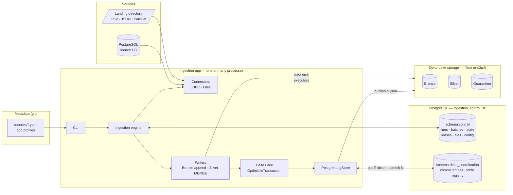

# Phase 0 — Architecture Discovery & Project Definition

| | |
|---|---|
| **Status** | v3 — **Phase 0 closed** · decisions D1–D7 applied · next phase: P1 |
| **Date** | 2026-09-25 · closed 2026-11-10 |
| **Scope** | Analysis and decisions prior to writing code. No implementation. |
| **Decision records** | [`docs/adr/`](../adr/README.md) — this document summarises; the ADRs are authoritative |

**Revision history**

| Version | Change |
|---|---|
| v1 | Initial discovery (Spanish). Proposed a single writer per Delta table (AD-06). |
| v2 | Decisions D1–D6 applied. **AD-06 removed**: multi-writer tables are in the MVP through a PostgreSQL-coordinated Delta LogStore (ADR-0004). Phase plan re-sequenced around the LogStore, which is now the highest-risk component. Translated to English (D6). |
| v3 | Phase 0 closed. Phase plan confirmed, with P2 split into P2a (protocol, one JVM) and P2b (multi-process proof). Application security baseline added (D7, ADR-0013). Repository name `lakehouse-ingestion-framework`, base package `lakehouse.ingestion` (ADR-0012). |

---

## 0. Summary of decisions

| # | Decision | Outcome | ADR |
|---|---|---|---|
| D1 | Development environment | WSL2 (Ubuntu) + Docker Engine inside WSL + JDK 17/sbt in WSL + VS Code Remote-WSL with Metals. Code lives in the WSL filesystem. | [ADR-0001](../adr/0001-development-environment.md) |
| D2 | Control plane | PostgreSQL holds state, leases (with epoch), the batch write-ahead log and the audit trail. This is a design decision that holds in the cloud too, not a workaround for the local filesystem. | [ADR-0003](../adr/0003-control-plane-in-postgresql.md) |
| D3 | Multi-writer concurrency | Custom **PostgreSQL-coordinated Delta LogStore** (same pattern as `S3DynamoDBLogStore`). The MVP covers *Type 2* concurrency: several processes writing the **same** Delta table. Correct by design for multi-instance, multi-node and multi-cluster. Multi-instance is demonstrated in the MVP; multi-node and multi-cluster are extensions. | [ADR-0004](../adr/0004-postgresql-coordinated-delta-logstore.md), [ADR-0010](../adr/0010-concurrent-write-conflict-handling.md), [ADR-0011](../adr/0011-storage-profiles.md) |
| D4 | Versions | Spark 4.1.4 · Delta 4.4.1 (`delta-spark_4.1_2.13`) · Java 17 · Scala 2.13.17 · sbt 1.13.1 — patch versions updated in P1 | [ADR-0002](../adr/0002-technology-stack.md), [ADR-0014](../adr/0014-stack-versions-pinned-at-p1.md) |
| D5 | Phase plan | Confirmed at closure: re-sequenced for D3, spike split RED (P1) / GREEN (P2b), P2 split into P2a and P2b (§17) | — |
| D6 | Repository identity | Code, comments, commits and docs in English. Repository `lakehouse-ingestion-framework`, base package `lakehouse.ingestion`, independent of the GitHub handle. Organization placeholder defined in one place (§21). | [ADR-0012](../adr/0012-module-structure.md) |
| D7 | Application security | Validated SQL identifiers and no concatenated SQL; file paths confined to allowed roots; least-privilege PostgreSQL roles; dependency vulnerability scanning in CI. Recommended: pinned non-root images, configurable TLS, safe YAML loading, a brief threat model. Woven into existing phases (§17). | [ADR-0013](../adr/0013-application-security-baseline.md) |

---

## 1. Critical analysis

### What is well framed
- **Scope ends at Silver.** Gold is business modelling; an ingestion framework that owns it becomes a "framework for everything".
- **Concurrency is designed in from the start.** Retrofitting it is what breaks in-house frameworks.
- **Correctness before performance**, with before/after measurement for any optimisation.
- **Finishing is the main risk.** The phase plan has two coherent stopping points (§17).

### What was challenged, and how it was resolved

| # | Topic | Problem | Resolution |
|---|---|---|---|
| C1 | Environment | Spark Standalone on native Windows is fragile (bash launch scripts, `winutils`). Docker Desktop on Windows Home needs WSL2 anyway. Memory is tight at 7.4 GB. | WSL2 with Docker Engine and memory caps (ADR-0001). |
| C2 | Delta on the local filesystem with several writer processes | `HDFSLogStore` checks that `N.json` does not exist, then renames onto it with `rename(2)`, which replaces an existing file. Its `synchronized (this)` lock is per instance, so it never spans JVMs, and on `file://` it is not even taken (corrected in P1.4d: first described as a JVM-static `LOCAL_FS_WRITE_LOCK`). Two JVMs committing to the same table can overwrite each other's `N.json` and lose a commit. Delta does not notice. The RED spike measured it: [docs/spikes/logstore-red.md](../spikes/logstore-red.md). | Commit exclusivity is moved to PostgreSQL through a custom LogStore (ADR-0004). The loss is demonstrated before and after in the spike (RED in P1, GREEN in P2b). |
| C3 | Type 2 concurrency in the MVP | v1 proposed one writer per table. The owner requires Type 2 in the MVP (D3). | AD-06 removed. The LogStore makes multi-writer tables safe on `file://` and `s3a://`. |
| C4 | Separate "synthetic data" phase | Data generators without a consumer drift from what the tests need. | Each generator is built in the phase of the connector that consumes it. |
| C5 | Lineage, observability and audit as three phases | All three derive from one execution model (run, batch, Delta version). | Modelled once (P4), exposed in P11. |
| C6 | CI/CD late (old phase 15) | CI added at the end only declares good practice. | Minimal CI in P1, growing every phase. |
| C7 | Advanced testing as a late phase | Failure tests need injection points designed into the code. | Fault hooks are part of the engine and LogStore design. |
| C8 | Parquet in the MVP | Adds little to the story, but costs nothing through `DataFrameReader`. | Supported; one smoke test. |
| C9 | Streaming | Nothing blocks it as long as connectors split *plan* from *read*. | Contract keeps `plan`/`read` replayable (§12). |
| C10 | *New in v2:* owning a correctness-critical LogStore | A bug here corrupts tables, which is worse than any bug in the engine. | Port a proven protocol (`BaseExternalLogStore`), justify every deviation, test with fault injection at each step plus a stress verifier. It is the first thing built after bootstrap (P2a protocol, P2b multi-process proof) and the top-ranked risk (R0). |

---

## 2. Functional requirements

| ID | Requirement | MVP |
|---|---|---|
| RF-01 | Define sources through versioned metadata files, with no per-source code | ✅ |
| RF-02 | Validate the whole configuration at startup, before touching data, reporting all errors at once | ✅ |
| RF-03 | JDBC connector (PostgreSQL as reference): full load and incremental by watermark | ✅ |
| RF-04 | File connector (CSV, JSON; Parquet at no extra cost): process only new files | ✅ |
| RF-05 | Bronze append with ingestion metadata and fidelity to the source | ✅ |
| RF-06 | Silver: typing, name normalisation, deduplication by key, upsert (`MERGE`) | ✅ |
| RF-07 | Delete detection: implicit on full loads, key reconciliation on incremental loads | ✅ |
| RF-08 | Persistent incremental state, consistent with the data written | ✅ |
| RF-09 | Automatic recovery of an interrupted run | ✅ |
| RF-10 | Explicit, audited reprocessing and backfills that do not disturb incremental state | ✅ |
| RF-11 | Controlled, audited reset of a source's state | ✅ |
| RF-12 | Configurable per-source schema evolution policy, including schema changes made concurrently by another writer | ✅ (basic) |
| RF-13 | Corrupt records routed to quarantine, with a rejection threshold | ✅ |
| RF-14 | Error classification (transient / permanent / data / conflict) with bounded retries | ✅ |
| RF-15 | Mutual exclusion per (source, layer) across instances: lease with expiry and epoch | ✅ |
| RF-16 | Audit record per run and per batch | ✅ |
| RF-17 | Table/batch lineage: source → Bronze Delta version → Silver Delta version | ✅ |
| RF-18 | Real per-run metrics and per-source freshness | ✅ |
| RF-19 | PII tagging in metadata; pseudonymisation in Silver | ✅ |
| RF-20 | CLI modes `run`, `plan` (dry run), `backfill`, `reprocess`, `reset-state`, `reconcile-deletes`, `maintain`, `adopt-table` | ✅ (progressive) |
| RF-21 | Parallel ingestion of N sources inside one Spark application | ✅ |
| **RF-25** | **Coordinated commits: several processes can write the same Delta table safely (Type 2), on `file://` and `s3a://`** | ✅ |
| **RF-26** | **Refuse to run if the LogStore is not configured for every lake scheme, and detect commits written without coordination** | ✅ |
| RF-22 | Multi-instance demonstration: N processes on one machine writing shared tables, checked by a verifier | ✅ (was an extension in v1) |
| RF-27 | Multi-node demonstration (Spark Standalone with several workers + MinIO) | Extension |
| RF-28 | Multi-cluster demonstration (independent Spark applications/clusters sharing storage and coordination) | Extension |
| RF-23 | REST connector | Extension |
| RF-24 | SCD type 2 in Silver | Extension |

## 3. Non-functional requirements

| ID | Requirement | Verification |
|---|---|---|
| RNF-01 | **Correct under failure**: killing a run at any point neither duplicates nor loses data | Fault injection at every engine hook and every LogStore protocol step, plus an e2e `kill -9` test |
| RNF-02 | **Idempotent**: re-running the same ingestion produces the same final state | Run twice, compare tables and state |
| RNF-03 | **Concurrency-safe (same source)**: N instances on one source give one effective executor and N−1 audited `SKIPPED_LOCKED` | Lease tests with N threads against real PostgreSQL |
| **RNF-12** | **Concurrency-safe (Type 2, same table)**: N writer processes produce contiguous versions with no lost commits, and every expected `txnVersion` is present exactly once | LogStore stress test with random `kill -9` and a final verifier (ADR-0004) |
| **RNF-13** | **Fail closed**: if coordination (PostgreSQL) is unavailable, no commit is ever written without it | Fault tests with PostgreSQL stopped at each step |
| **RNF-14** | **Deployment-level agnostic**: nothing in the design assumes one JVM, one machine or one cluster for correctness | Design review against ADR-0011; E1/E2 demonstrations |
| RNF-04 | **Extensible**: a new source type is one class implementing the contract plus a registration | A test connector added without touching the `engine` module |
| RNF-05 | **Auditable**: every run, including failed and skipped ones, leaves a record | Tests on audit records |
| RNF-06 | **Testable**: domain logic does not depend on Spark or I/O | The `core` module has no Spark dependency (compiler-enforced) |
| RNF-07 | **Reproducible**: deterministic seeded test data; environment up with one command | `docker compose up` + `sbt test` |
| RNF-08 | **Observable**: structured logs with `run_id` and `source_id` on every line | Log layout test |
| RNF-09 | **Secure**: no secret in configuration, logs or audit | Redaction test |
| RNF-10 | **Resource bounded**: the MVP runs inside the WSL budget (§7.3) | `.wslconfig` limits and Spark memory settings |
| RNF-11 | **Streaming-ready** (not implemented): no decision closes the door | Connector contract review |
| **RNF-15** | **Hardened inputs**: identifiers and paths from configuration can neither inject SQL nor escape their allowed roots; runtime database roles have least privilege | Malicious-input corpus, symlink tests, privilege-denial tests (ADR-0013) |
| **RNF-16** | **Supply chain**: no new dependency with a known high-severity vulnerability; images and actions pinned | CI dependency review; pinned-image check (ADR-0013) |

---

## 4. Requirements missing from the original brief

| Missing requirement | Why it matters | Level |
|---|---|---|
| **Orchestrator contract**: CLI and exit codes (0 OK, 2 skipped/locked, 3 transient failure, 4 permanent failure, 5 data threshold exceeded) | The framework does not schedule itself. The orchestrator must tell "retry" from "do not retry". | Required |
| **Partially written files** | A file still being copied would be ingested truncated. Needs a minimum file age, temp-name exclusion, or a marker file. | Required |
| **Bounded batch size** (`max_files_per_batch`, max watermark range) | An unbounded first load or a file backlog breaks memory and produces huge commits. | Required |
| **Time zones** | `timestamp without time zone` combined with a different Spark session zone is a classic watermark bug. Everything is UTC. | Required |
| **Clock source** | Instances' clocks differ. Leases and commit-entry timestamps use PostgreSQL `now()`; watermark upper bounds use the **source's** clock. | Required |
| **First run of a source** | Incremental with no watermark means a bounded full load. | Required |
| **Breaking configuration changes** (primary key, watermark column, target) | They invalidate state. Detected against the last used config snapshot; require an explicit `reset-state`. | Required |
| **Canonical table identity** *(new)* | Two spellings of the same table path (symlink, `s3://` vs `s3a://`) would give two coordination keys, and therefore **no mutual exclusion**. | Required (ADR-0004, ADR-0011) |
| **LogStore enforcement** *(new)* | One misconfigured writer without the LogStore voids every guarantee. | Required (ADR-0004) |
| **Dry run / `plan`** | Show what would be read without writing. Cheap, and valuable for demos and operations. | Recommended |
| **Retention**: Bronze, quarantine (holds PII), audit history, `VACUUM`, LogStore temp files | Without retention there is no credible GDPR story and no cost control. | Recommended |
| **Ownership of Delta maintenance** (`OPTIMIZE`/`VACUUM`) | Concurrent maintenance is now *allowed* (Type 2); its conflicts must be classified (ADR-0010). | Recommended |
| **Retiring a source** | Deleting the YAML orphans its state. A `disabled` flag is enough. | Recommended |
| **CSV encoding and dialect** | The real source of most "corrupt records". | Required (in config) |
| **Freshness SLA per source** | `source_freshness` needs a threshold to alert on. | Recommended |
| **Environment profiles** (local / test / CI / multinode) | Different lake URIs and connections without touching source definitions. | Required |

---

## 5. Risks and decision index

### Risks

| Risk | Prob. | Impact | Mitigation |
|---|---|---|---|
| **R0 — PostgreSQL LogStore is incorrect** (lost or duplicated commit, partial `N.json` visible, deadlock, fail-open path). **Highest-risk component of the project.** | Medium | **Critical**: table corruption | Port Delta's proven prepare–commit–acknowledge protocol; every deviation justified (ADR-0004); fault injection at each step; stress test with `kill -9` and a verifier; built right after bootstrap (P2a/P2b) so the rest of the project stands on verified ground; spike shows before/after. |
| R1 — Local environment insufficient (RAM, Windows) | High | High | WSL2 with caps; `local[*]` day to day; stress and multi-node at small N locally, full size in CI (§7.3). |
| R2 — Scope creep / not finishing | High | High | Checkpoints A and B; README kept useful from P1; extensions kept separate. |
| R3 — Reliance on Delta internals (`Snapshot.transactions`, commit on the caller thread, which files go through `LogStore.write`) | Medium | Medium | Isolated behind small adapters; verification items listed in §20; pinned Delta version with an upgrade test. |
| R4 — Over-designed control plane | Medium | Medium | Seven control tables plus two coordination tables; every column justified. |
| R5 — Consistency subtleties (zombies, expired leases, non-monotonic commit order) | Medium | High | Epoch fencing in the control plane; `txnAppId`/`txnVersion` discard stale writes in Delta; Silver cursor is the Bronze Delta version (ADR-0010). |
| R6 — Slow Spark tests discourage testing | Medium | Medium | `core` and LogStore unit tests have no Spark; one shared session per suite; integration module separate. |
| R7 — Spark 4 / Scala 2.13 ecosystem | Low | Medium | Few, mature dependencies; verified in P1. |
| R8 — Windows ↔ WSL friction (filesystem performance, IDE) | Medium | Medium | Code lives in the WSL filesystem, never under `/mnt/c`. |

### Architectural decisions

| ID | Decision | ADR |
|---|---|---|
| AD-01 | Metadata as YAML (one file per source), typed validation at startup | [0007](../adr/0007-metadata-format.md) |
| AD-02 | State, leases, WAL and audit in PostgreSQL | [0003](../adr/0003-control-plane-in-postgresql.md) |
| AD-03 | Data ↔ state consistency via *plan → idempotent write → commit* with a batch WAL | [0005](../adr/0005-batch-wal-and-idempotent-writes.md) |
| AD-04 | `run_id` = UUIDv7 (attempt) ≠ `batch_seq` (logical unit of data) | [0005](../adr/0005-batch-wal-and-idempotent-writes.md) |
| AD-05 | Per-(source, layer) lease with expiry, heartbeat and epoch fencing | [0006](../adr/0006-source-leases-with-epoch-fencing.md) |
| ~~AD-06~~ | ~~One writer per Delta table~~ — **removed (D3)** | — |
| **AD-13** | Multi-writer Delta tables through a PostgreSQL-coordinated LogStore | [0004](../adr/0004-postgresql-coordinated-delta-logstore.md) · [0015](../adr/0015-hard-link-publish-on-local-file-systems.md) (publish on `file://`) · [0017](../adr/0017-a-failed-publish-is-reported-not-swallowed.md) (failed publish) |
| **AD-14** | Conflict classification (retry vs re-plan), Silver partitioning for concurrent `MERGE`, Silver cursor = Bronze Delta version | [0010](../adr/0010-concurrent-write-conflict-handling.md) |
| **AD-15** | Lake storage profiles (`file://` single machine, `s3a://` multi-node/multi-cluster) and canonical table identity | [0011](../adr/0011-storage-profiles.md) |
| AD-07 | Bronze keeps text formats as `string` + rescue column; typing happens in Silver | [0008](../adr/0008-layer-responsibilities.md) |
| AD-08 | Bronze append · Silver `MERGE` | [0008](../adr/0008-layer-responsibilities.md) |
| AD-09 | Deletes: `WHEN NOT MATCHED BY SOURCE` on full loads; periodic key reconciliation on incremental loads; CDC as a future option | [0009](../adr/0009-delete-detection.md) |
| AD-10 | Tables addressed by path; no metastore (behind a `TableLocator` so a catalog can be added later) | [0011](../adr/0011-storage-profiles.md) |
| AD-11 | sbt multi-module: `core` / `delta-pg-logstore` / `engine` / `cli` / `integration-tests` | [0012](../adr/0012-module-structure.md) · [0016](../adr/0016-delta-storage-provided-to-the-logstore-module.md) (the LogStore module's dependencies) |
| **AD-16** | Application security baseline: validated SQL identifiers and no concatenated SQL, path confinement, least-privilege PostgreSQL roles, dependency scanning in CI | [0013](../adr/0013-application-security-baseline.md) |

---

## 6. Overall architecture

### 6.1 High-level view



**Two planes, three coordination mechanisms.** Each mechanism protects exactly one thing, and none of them depends on a single JVM, machine or cluster:

| Mechanism | Protects | Scope | ADR |
|---|---|---|---|
| **Source lease** (row in `control.source_lease`, epoch fencing) | That only one run at a time advances the state (watermark, processed files) of a (source, layer) | Control plane | 0006 |
| **Batch WAL + `txnAppId`/`txnVersion`** | That a logical batch is applied to a table exactly once, even across crashes and zombies | Control plane + Delta log | 0005 |
| **PostgresLogStore** (put-if-absent on `(table, version)`) | That exactly one writer creates `N.json` for each version of a table (Delta's *mutual exclusion* requirement) | Delta log | 0004 |
| **Delta optimistic concurrency** (built in) | That a commit is not logically invalidated by a concurrent one (e.g. two `MERGE`s touching the same files) | Delta log | 0010 |

### 6.2 Concurrency taxonomy and deployment levels

| Concurrency type | Example | What makes it safe |
|---|---|---|
| **Same source, same layer** | Two overlapping orchestrator triggers for `sales.orders` | Lease: the second run is `SKIPPED_LOCKED` (exit 2) |
| **Type 1 — different sources, different tables** | 20 sources ingested in parallel | Nothing is shared except the control plane (row-level operations) |
| **Type 2 — several processes, same Delta table** | Fan-in (several sources → one table), backfill running alongside the incremental run, `OPTIMIZE` alongside ingestion | LogStore (physical exclusivity per version) + Delta OCC (logical conflicts) + `txnAppId` (idempotence) |

| Deployment level | Definition | Requirement for correctness | Demonstrated in |
|---|---|---|---|
| **Multi-instance** | Several driver JVMs on one machine | Shared PostgreSQL; shared lake (`file://` is fine on one machine) | MVP (P2b stress test, P11 engine demo) |
| **Multi-node** | One Spark cluster; executors on different machines write data files | Shared storage reachable by every executor (`s3a://` MinIO); `file://` is not valid | Extension E1 |
| **Multi-cluster** | Independent Spark applications/clusters, each with its own driver | Same PostgreSQL and the same canonical lake URI for all writers | Extension E2 |

Decisions that would have closed the door on multi-node or multi-cluster, and are therefore **forbidden** (ADR-0011):
- JVM-local locks or in-memory state for correctness (only as an optimisation, as `PathLock` is in Delta's base class).
- Client clocks for leases or commit timestamps.
- Temporary files outside the table's `_delta_log/` (a recovering node must see them).
- Mixing URI schemes or path spellings for the same table.

### 6.3 Layer responsibilities

(Full rationale in [ADR-0008](../adr/0008-layer-responsibilities.md).)

| Layer | Holds | Does NOT hold / do | Write | Errors |
|---|---|---|---|---|
| **Landing** (files only) | The producer's drop directory. **The framework neither copies nor moves files**; it records what it processed. | Intermediate copies. Moving files would be a side effect that is not atomic with the Delta commit, and it would break replay. | Written by the producer | Unreadable file → `FAILED` record + policy (`fail` or `skip`) |
| **Bronze** | Fidelity to the source. JDBC keeps native types; CSV/JSON are kept as `string` + `_rescued_data`. Minimal ingestion metadata: `_run_id`, `_batch_seq`, `_ingested_at`, `_source_file` (files only). | Typing of text, deduplication, renames, business logic | Idempotent append (`txnAppId`/`txnVersion`) | Structurally broken records → Bronze quarantine. Threshold exceeded → the batch is not committed. |
| **Silver** | Current state per key, typed to the declared schema, `snake_case` names, pseudonymised PII, soft deletes (`_is_deleted`, `_deleted_at`) | Cross-source joins, aggregates, business rules | `MERGE` on the primary key with an ordering guard (`updated_at`), partitioned where writers fan in | Cast failures → Silver quarantine with the original Bronze record |
| **Gold** | Out of scope | — | — | — |

### 6.4 Lineage

- **Required (MVP)**: table + batch level. Every Bronze row carries `_run_id` and `_batch_seq`. Every batch records its input (watermark range or file list) and its output (table + **Delta version**).
- **v2 improvement**: the LogStore records, for each commit entry, the `run_id` of the committing run (via a commit context set by the engine; ADR-0004 §Attribution). The mapping *Delta version ↔ run* then lives in the control plane directly, with no `DESCRIBE HISTORY` scans. `userMetadata` in the commit is kept as a redundant, self-describing copy.
- **Future**: column-level lineage and OpenLineage events. The run/batch/input/output model maps 1:1 onto an OpenLineage `RunEvent`.

---

## 7. Stack, environment and resource budget

### 7.1 Stack

(Verified 2026-09-25 against Maven Central and the official docs; details in [ADR-0002](../adr/0002-technology-stack.md). Patch versions re-pinned in P1, 2026-11-13: [ADR-0014](../adr/0014-stack-versions-pinned-at-p1.md).)

| Component | Version |
|---|---|
| Java | 17 (Temurin, inside WSL) |
| Scala | 2.13.17 (the patch Spark 4.1.4 is built with) |
| Apache Spark | 4.1.4 |
| Delta Lake | 4.4.1 — `io.delta:delta-spark_4.1_2.13` (+ `delta-storage`, transitive) |
| sbt | 1.13.1 (pinned in `project/build.properties`) |
| PostgreSQL | 17 (`postgres:17`): source DB and control DB in one container, separate databases |
| JDBC driver | `org.postgresql:postgresql` 42.7.x |
| Connection pool (LogStore) | HikariCP. Justified by the LogStore's commit-path round trips (ADR-0004). |
| Control-plane migrations | Flyway |
| Config | circe + circe-yaml (safe loading, ADR-0013) |
| Tests | ScalaTest 3.2.x + Testcontainers (PostgreSQL; MinIO in E1) |
| Logging | log4j2 (Spark's own) with `JsonTemplateLayout` |
| Quality | scalafmt, `-Xlint` + selective `-Werror`, scoverage |
| CI | GitHub Actions · sbt dependency submission + Dependabot alerts + dependency review (ADR-0013) |
| Object storage (extension) | MinIO + `hadoop-aws` matching Spark's Hadoop version (verified in E1) |

### 7.2 Environment

Target environment: WSL2 Ubuntu 24.04 on Windows 10 22H2 (build 19045.6466, firmware virtualisation enabled, 8 cores, 7.4 GB RAM, 131 GB free disk).

Step-by-step installation and `.wslconfig`: **[`docs/setup/dev-environment.md`](../setup/dev-environment.md)**.

### 7.3 Resource budget (updated for D3)

WSL cap: `memory=5GB`, `swap=4GB`, `processors=6`. Outside WSL, Windows + the VS Code UI + a browser use about 2.4 GB.

| Scenario | Processes inside WSL | Est. RAM | Where it runs |
|---|---|---|---|
| Daily development | VS Code server + Metals (~1.2) · sbt + forked test JVM (~1.5) · PostgreSQL (~0.3) | ~3.0 GB | Local |
| LogStore stress test (P2b), default N=3 | PostgreSQL (~0.4) · 3 writer JVMs, `local[1]`, 512 MB heap (~0.75 each) · sbt orchestrator (~0.8) · **Metals stopped** | ~3.5 GB | Local (N=3); CI with N=8 |
| Engine multi-instance demo (P11) | PostgreSQL (~0.4) · 3 ingestion processes `local[2]` (~0.9 each) | ~3.1 GB | Local |
| Same, on local Spark Standalone (optional variant) | master (~0.3) · worker with 2 cores / 2 GB for executors (~2.2) · 3 client-mode drivers (~0.5 each) · PostgreSQL (~0.4) | ~4.4 GB | Local, Metals stopped |
| **E1 — multi-node** | MinIO (~0.4) · master (~0.3) · 2 workers × 1 GB (~2.4) · 2 drivers (~1.0) · PostgreSQL (~0.4) | ~4.5 GB | At the limit locally with small N; full size in CI |
| **E2 — multi-cluster** | Two independent stacks | > budget | CI (GitHub-hosted runner) or cloud |

Mitigations: swap as a safety net rather than something to rely on; configurable writer counts (`-Dstress.writers`, `-Dstress.commits`); heavy suites tagged and run in CI. Standard GitHub-hosted Linux runners for public repositories have considerably more memory than this laptop's WSL budget. The exact size is verified when E1/E4 start.

---

## 8. State, idempotency and recovery (summary)

Full design: [ADR-0005](../adr/0005-batch-wal-and-idempotent-writes.md).

- **Run ≠ Batch.** `run_id` (UUIDv7) identifies an *attempt*. `batch_seq` identifies a *logical unit of data* (watermark range or file set) and is allocated by the control plane per `txnAppId`. Idempotence is anchored to the batch.
- **`txnAppId` = `<source_id>/<layer>`** (not per table). A backfill uses its own `<source_id>/<layer>/backfill/<backfill_id>`, so it can run concurrently with the incremental run on the same table (Type 2). `txnVersion` = `batch_seq`, monotonic per `txnAppId`.
- **Protocol:** lease → recover pending batch → plan + persist (WAL) → read → write quarantine and data with `txnAppId`/`txnVersion` → one PostgreSQL transaction advances the watermark, marks the batch `COMMITTED` and the run `SUCCEEDED`, conditional on the lease epoch.
- **Recovery:** if a `PLANNED` batch exists, check the table's `txn` for its `txnAppId`. If `version ≥ batch_seq`, *roll forward* the state. Otherwise *replay* exactly the persisted plan.
- **Zombies:** a writer that lost its lease cannot advance the state (epoch check). If it still commits data, Delta discards any `txnVersion ≤` the recorded one; a concurrent commit with the same `txnAppId` raises `ConcurrentTransactionException` for one of the two. The residual window (v1 §9.3) closes much further than in v1.
- **Incremental watermark:** the upper bound is fixed at planning time using the source clock (`now() − safety_margin`); a `lookback` handles late commits; Silver's ordering guard deduplicates.
- **Files:** the plan *is* the file list. Identity is `path + size + mtime`. Reprocessing creates a new batch.
- **Deletes:** [ADR-0009](../adr/0009-delete-detection.md).

---

## 9. Multi-writer concurrency (summary)

Full design: [ADR-0004](../adr/0004-postgresql-coordinated-delta-logstore.md) (LogStore) and [ADR-0010](../adr/0010-concurrent-write-conflict-handling.md) (conflict handling).

### 9.1 The LogStore in one paragraph

Delta's ACID guarantees require three properties from the storage layer: **atomic visibility**, **mutual exclusion** and **consistent listing** (the `LogStore` Javadoc). A local POSIX filesystem gives atomic visibility (rename) and consistent listing, but no cross-process mutual exclusion. S3 gives atomic visibility (PUT) and strongly consistent listing; mutual exclusion comes from put-if-absent. `PostgresLogStore` takes mutual exclusion from PostgreSQL: a conditional `INSERT` of `(table, version)` is the linearisation point of each commit. It follows Delta's `BaseExternalLogStore` **prepare → commit → acknowledge** protocol:
- write the temp file `T(N)`;
- `INSERT` the entry `E(N, complete=false)`;
- publish `N.json` atomically;
- mark `complete=true`.

Any reader or writer that finds an incomplete latest entry finishes publishing it.

### 9.2 Deviations from `BaseExternalLogStore` (detail in ADR-0004)

1. **Ported, not subclassed.** The changes below sit inside the base class's `write()` flow, which cannot be overridden piecemeal, and the base class ships in an artifact that pulls in the AWS SDK.
2. **Atomic publish on POSIX.** The base class copies `T(N)` to `N.json` as a stream, which is atomic only on object stores. On `file://` ours publishes with a hard link, which is atomic and fails if `N.json` already exists ([ADR-0015](../adr/0015-hard-link-publish-on-local-file-systems.md); before, a copy to a second temp file and a rename).
3. **`isPartialWriteVisible`** is `true` on `file://` and `false` on `s3a://`, so Delta writes checkpoints via temp + rename on POSIX.
4. **No silent swallowing of a foreign `N.json`.** The base class ignores every error after the `INSERT`. On a content mismatch between `N.json` and `T(N)`, ours raises a fatal error and taints the table. A publish that fails is retried and then reported, because Delta 4.4 reads `N.json` as soon as `write` returns ([ADR-0017](../adr/0017-a-failed-publish-is-reported-not-swallowed.md)).
5. **Uncoordinated-writer detection** through a table adoption registry and gap detection.
6. **Entries are kept** (commit audit trail) instead of expiring after one day.
7. **PostgreSQL `now()`** instead of client clocks.
8. **Run attribution** on each entry.
9. **Latest entry by numeric version**, not by file-name sort.
10. **No DDL from the data path**: the LogStore checks its schema version at startup and fails closed.

### 9.3 Fail closed and safeguards

- Every PostgreSQL error surfaces as an `IOException`, never as "no entry". There is no fallback path. Reads fail too, because the latest version cannot be guaranteed.
- **At startup the engine refuses to run** unless `spark.delta.logStore.<scheme>.impl` points to `PostgresLogStore` for every scheme in the active lake profile.
- **Tables must be registered.** They are registered when created through the LogStore, or adopted explicitly with `adopt-table`. A commit to an unregistered table is rejected, which also catches aliased paths.
- **Gap detection:** a published `N.json` with no entry above the adoption version means a foreign writer. The table is marked `TAINTED` and writes are refused until an operator re-verifies it.
- **Honest limit:** *preventing* an arbitrary external writer (someone else's misconfigured Spark job) needs storage access control, or protocol-level blocking as in `catalogManaged`. That is an enterprise feature; the design detects, fails closed and documents.

### 9.4 Official alternatives in Delta 4.4 (compared in ADR-0004)

| Option | Status | Why it is not the MVP choice |
|---|---|---|
| `S3DynamoDBLogStore` + MinIO + DynamoDB Local | Official, production-proven | `s3a` only by design; adds DynamoDB Local and the AWS SDK; duplicates the coordination store we already have in PostgreSQL. On `file://` it would have issues 2 and 4. It would be the production choice on AWS. |
| `coordinatedCommits-preview` writer feature + custom `CommitCoordinatorClient` over PostgreSQL | Present in 4.4 (`CommitCoordinatorProvider.registerBuilder`), preview-named | Undocumented preview API while upstream converges on `catalogManaged`. Its protocol-level blocking of unaware writers is a real advantage, recorded as the benchmark for our safeguards. |
| `catalogManaged` tables + Unity Catalog OSS (≥ 0.4) as commit coordinator | GA since Delta 4.0.1 | Requires running a catalog server; no path-based access; cannot be enabled on existing tables; `CREATE OR REPLACE` unsupported. **This is the industry direction** and a Future evolution. `TableLocator` keeps the door open. |

---

## 10. Schema evolution (summary)

Per-source policy (`on_new_column`, `on_missing_column`, `on_type_change`, `renames`), unchanged from v1. The full ADR is written in its phase (P9).

- **Native in Delta:** `mergeSchema`, type widening (the conversions 4.4 supports are verified in P9), column mapping.
- **To build:** comparison of read schema vs table schema, the policy decision, `_rescued_data`, and the audit of the change.
- **Renames** are indistinguishable from drop + add without external metadata, which is why `renames:` exists.
- **New in v2 — concurrent schema change.** With Type 2, another writer may evolve the table's schema between our plan and our commit. Delta raises `MetadataChangedException`. The engine **re-plans**: it re-evaluates the policy against the new table schema, then retries or fails permanently (ADR-0010).

---

## 11. Security and governance

Two halves: **data governance** (secrets, PII, masking, GDPR) and **application security** (the application's own attack surface: config-supplied identifiers and paths, database privileges, supply chain). The second half was added at Phase 0 closure; its full design and test plan are in [ADR-0013](../adr/0013-application-security-baseline.md).

| Topic | Required | Recommended | Enterprise | Future |
|---|---|---|---|---|
| Secrets | `secretRef: env:NAME` / `file:/run/secrets/x` + `SecretResolver`; redaction in logs and config snapshots. The LogStore reads the *name* of the password variable from Hadoop conf, never the value. | Docker secrets in compose | Vault / KMS | — |
| PII | Column tags in metadata (`pii: email`) | Quarantine inherits the classification | Automatic classification in a catalog | — |
| Silver masking | Deterministic pseudonymisation (HMAC-SHA256 with a secret key), which keeps joins possible | Per-type strategies | Dynamic masking by role | — |
| Access control | Filesystem permissions. **Separate PostgreSQL roles with least privilege** (*Recommended* in v2): migrator (DDL, Flyway only), control, coordination (no `DELETE`, no DDL), maintenance, source (read-only). Denial tests. | — | Storage ACLs so that only the service identity can write `_delta_log/` (true prevention of uncoordinated writers); Unity Catalog / Ranger | — |
| Input hardening | Config identifiers parsed into an allow-listed `SqlIdentifier`; no SQL assembled from config or data values (bind parameters; Spark JDBC predicates); source and target paths confined to their roots, symlinks included. Malicious-input tests. | Safe YAML loading (alias, depth and size limits; duplicate keys rejected) | — | — |
| Supply chain | Dependency vulnerability scanning in CI (dependency submission, Dependabot alerts, PR gate on new high-severity findings) | Images pinned by digest and non-root; GitHub Actions pinned by SHA with a least-privilege token | Signed artifacts | Image scanning once the project builds its own images |
| Encryption | — (local FS) | Document disk encryption; TLS configurable to PostgreSQL (and MinIO in E1) | Encryption at rest, TLS everywhere, mTLS | Parquet modular encryption |
| Audit | Control plane + commit entries | — | SIEM | — |
| GDPR erasure | Documented procedure: `DELETE` in Silver/Bronze + `VACUUM` after retention, since Delta keeps old files for time travel until `VACUUM` | Short retention in Bronze and quarantine | Crypto-shredding | — |
| Threat model | — | Brief threat model in `docs/security/` (P12) | Formal threat modelling and penetration testing | — |

---

## 12. Engine and connector contract

### 12.1 Modules

(See [ADR-0012](../adr/0012-module-structure.md).)

| Module | Content | Depends on |
|---|---|---|
| `core` | Domain model, config, validation, pure planning, error classification, run state machine. **No Spark.** | cats, circe |
| `delta-pg-logstore` | `PostgresLogStore`, its schema, commit-context API. **Standalone and reusable**: no dependency on `core` or `engine`. | `delta-storage` and Hadoop client API (both provided, ADR-0016), PostgreSQL JDBC, HikariCP |
| `engine` | Connectors, Delta writers, control-plane repositories, the engine, the conflict classifier | `core`, `delta-pg-logstore`, Spark (provided), Delta |
| `cli` | `Main`, argument parsing, wiring, exit codes, startup enforcement | `engine` |
| `integration-tests` | Testcontainers, e2e, fault injection, stress tests, verifier | all |

### 12.2 Connector contract (design sketch, not implementation)

```scala
trait SourceConnector[C <: ConnectorConfig] {
  def kind: String                                                     // `type: jdbc` in YAML
  def validate(cfg: C): ValidatedNel[ConfigError, C]                   // static, no I/O, run at startup
  def plan(ctx: PlanContext, cfg: C, state: SourceState): Either[IngestError, BatchPlan]   // deterministic, serialisable (WAL)
  def read(ctx: ReadContext, cfg: C, plan: BatchPlan): Either[IngestError, ReadResult]     // replayable, side-effect free
}
```

Guarantees:
- `plan` is deterministic and serialisable.
- `read(plan)` is replayable and has no side effects.
- **The connector never writes to the lake and never touches state or audit.**
- Errors are typed.
- A connector is registered through a `ConnectorRegistry`, so adding a type does not change the engine.

### 12.3 Patterns and their concrete reason

| Pattern | Where | Reason |
|---|---|---|
| Trait as contract | `SourceConnector`; `CoordinationStore` inside the LogStore | Extensibility without touching the engine; the LogStore protocol is testable against a fault-injecting store |
| Factory / registry | `ConnectorRegistry` | Resolve YAML `type:` to an implementation |
| Strategy | `WriteStrategy` (BronzeAppend, SilverMerge, SnapshotMerge) | Writes differ by layer and load mode |
| Repository | `RunRepository`, `StateRepository`, `LeaseRepository`, `FileRegistry` | Isolate control-plane SQL; in-memory fakes for unit tests |
| Dependency inversion | Engine depends on traits, not on JDBC/Delta | Testability and fault injection |
| Service layer | `IngestionService` runs the ADR-0005 protocol | One place for consistency logic |
| — rejected — | Visitor, abstract factory, event bus, DI framework | No problem here that they solve |

**Fault injection:** named hooks in the engine (`AfterPlan`, `AfterQuarantineWrite`, `AfterBronzeCommit`, `BeforeStateCommit`, …) and in the LogStore (`AfterTempWrite`, `AfterEntryInsert`, `DuringPublish`, `AfterPublish`, …). They are no-ops in production; in tests they throw or halt the JVM.

### 12.4 Door to streaming

`plan` ≈ `latestOffset`; the WAL ≈ the offset log; the state commit ≈ the commit log; `txn` append ≈ an idempotent `foreachBatch`. The LogStore is transparent to streaming writers. Decisions that would close the door, and are forbidden by the contract: connectors moving files, or state not indexed by batch.

---

## 13. Conceptual data model

### 13.1 Metadata (YAML, one file per source)

```yaml
# conf/sources/sales.orders.yaml — illustrative
id: sales.orders
enabled: true
owner: team-sales
connector:
  type: jdbc
  connection: { url: "jdbc:postgresql://postgres:5432/sales", user: ingest_ro,
                password: { secretRef: "env:SALES_DB_PASSWORD" } }
  table: public.orders
load:
  mode: incremental            # full | incremental
  watermark: { column: updated_at, lookback: 10m, safety_margin: 1m }
  max_batch_range: 7d
keys: [order_id]
deletes: { strategy: key_reconciliation }
schema: { on_new_column: add, on_missing_column: "null", on_type_change: fail }
columns:
  customer_email: { pii: email, silver: { mask: hmac } }
quality: { max_rejected_ratio: 0.01 }
targets:
  bronze: { table: bronze/sales/orders }                  # relative to the profile's lake URI
  silver: { table: silver/sales/orders, partition_by: [_source_id] }   # fan-in target
freshness_sla: 2h
```

Rationale for YAML, versioning (SHA-256 config hash + redacted snapshot per run): [ADR-0007](../adr/0007-metadata-format.md). Table paths are **relative to the profile's lake URI** (ADR-0011), which gives one canonical location per table.

### 13.2 Control plane — schema `control` (PostgreSQL)

| Table | Key columns | Purpose |
|---|---|---|
| `ingestion_run` | `run_id` PK, `source_id`, `layer`, `run_kind`, `txn_app_id`, `batch_seq`, `status`, `instance_id`, `app_version`, `config_hash`, `lease_epoch`, `started_at`, `finished_at`, `rows_read`, `rows_written`, `rows_rejected`, `bytes_read`, `retries`, `write_conflicts`, `commit_contention`, `error_class`, `error_message` | Answer every audit question in the brief (§14) |
| `ingestion_batch` | (`txn_app_id`, `batch_seq`) PK, `source_id`, `layer`, `run_kind`, `plan` (jsonb), `status` (PLANNED/COMMITTED/ABANDONED), `planned_by_run`, `committed_by_run`, `outputs` (jsonb: table → Delta version), `input_bronze_versions` (Silver only: `[from, to]`) | WAL for recovery; lineage input → output |
| `source_state` | (`source_id`, `layer`) PK, `watermark` (typed jsonb; for Silver: the last applied **Bronze Delta version**), `last_committed_batch_seq`, `updated_by_run` | Incremental loading |
| `state_change_log` | `id`, `source_id`, `layer`, `before`, `after`, `reason`, `actor`, `run_id`, `at` | Audit of resets and forced state |
| `source_lease` | (`lease_key`) PK, `holder_run_id`, `instance_id`, `epoch`, `acquired_at`, `expires_at` | Mutual exclusion with crash recovery. Keys are `<source_id>/<layer>` or `backfill/<backfill_id>`. |
| `processed_file` | (`source_id`, `path`, `size`, `mtime`) PK, `batch_seq`, `status`, `error` | Exactly-once file ingestion |
| `config_snapshot` | `config_hash` PK, `source_id`, `content` (redacted jsonb), `first_seen_at` | Which exact config each run used |

Derived views: `v_source_freshness`, `v_run_summary`, `v_table_commits` (joins commit entries to runs).

### 13.3 Coordination — schema `delta_coordination` (owned by `delta-pg-logstore`)

| Table | Key columns | Purpose |
|---|---|---|
| `commit_entry` | (`table_uri`, `version`) PK, `temp_path`, `complete`, `created_at`, `completed_at` (PostgreSQL clock), `writer_instance`, `run_id` (nullable, best effort), `generation` (of the registration its writer read) | The put-if-absent that gives mutual exclusion; recovery; commit audit trail; Delta version ↔ run lineage |
| `coordinated_table` | `table_uri` PK, `delta_table_id`, `registered_version`, `registered_at`, `generation` (given by the database) | Adoption registry: rejects unregistered or aliased paths, and claims made for an earlier registration (a foreign key from `commit_entry`); gap detection baseline |
| `table_taint` | `table_uri` PK, `reason`, `tainted_at` | A table where a commit from outside the LogStore was detected. Writes are refused while its row exists. |
| `schema_version` | One row: `version` | What the LogStore checks before touching a table (ADR-0004, deviation 10) |

As built by the migration `V1__coordination_schema.sql` (P2a.3). It differs in form from the conceptual schema of ADR-0004 §3.1:
- the entry's key is the version, because only commit files get an entry and the file name follows from the version;
- a taint is a row of its own, not a status column, so the commit path can be allowed to add it and not to clear it;
- the commit path may only insert rows and mark an entry complete; maintenance may only delete.
- since `V2__operator_privileges.sql` (P2a.11), maintenance may also register a table and move the version it is registered at, for adopting a table and adopting it again; the schema is at version 2.
- since `V3__registration_generation.sql` (2026-11-16), a registration has a generation and an entry names the one its writer read, through its foreign key. A writer that looked at the registry before an operator adopted the table again, or reset it, gets no version afterwards (ADR-0004 §3.5); the schema is at version 3.

A separate schema and a separate role mean the LogStore can be extracted as a library, and it only has the privileges it needs.

### 13.4 Quarantine (Delta, one table per source and layer)

`_quarantine/<layer>/<source_id>`: `run_id`, `batch_seq`, `source_file`, `error_type`, `error_detail`, `raw_record`, `quarantined_at`. Full record + short retention + same PII classification as the source. With Type 2 the per-source table is no longer *required* for safety; it is kept because it simplifies retention and access control per source.

---

## 14. Errors and retries (summary)

| Class | Examples | Reaction | Exit |
|---|---|---|---|
| Transient | Connection lost, timeout, SQLState `08xxx`/`40001`/`57014`; **coordination store unavailable** | Retry the **step** with exponential backoff + jitter (max N), then fail with consistent state. Never bypass coordination. | 3 |
| Conflict — retryable | `ConcurrentAppendException`, `ConcurrentDeleteReadException`, `ConcurrentDeleteDeleteException`, `ConcurrentWriteException` | Re-run the whole Delta operation on a fresh snapshot (bounded), counted in `write_conflicts` | 3 if exhausted |
| Conflict — re-plan | `MetadataChangedException`, `ProtocolChangedException` | Re-evaluate the schema policy / protocol, then retry once or fail permanently | 4 |
| Conflict — identity | `ConcurrentTransactionException` (same `txnAppId` committed concurrently) | Not retried: go to recovery (roll forward if `txn ≥ batch_seq`), otherwise fail permanently and alert | 4 |
| Permanent | Credentials, missing table, invalid config, schema change under `fail`, LogStore misconfigured, table `TAINTED` | Immediate failure, no retries | 4 |
| Data | Corrupt records, cast failures | Quarantine. Above `max_rejected_ratio`, the batch is not committed. | 0 / 5 |

Full classification and reasoning: [ADR-0010](../adr/0010-concurrent-write-conflict-handling.md).

---

## 15. Observability (summary)

- **Required:** JSON logs (log4j2 `JsonTemplateLayout`) with `run_id` / `source_id` / `batch_seq` in the MDC; metrics persisted on `ingestion_run`. Where each metric comes from:
  - `rows_written` — Delta commit `operationMetrics`
  - `bytes_read` — planned file sizes
  - `rows_rejected` — quarantine written
  - `rows_read` — `written + rejected`, checked as an invariant
  - `retries` — counted by the engine
  - `write_conflicts` — logical conflicts surfaced by Delta and retried by the engine
  - **`commit_contention`** — version collisions resolved internally by Delta, counted by the LogStore through the commit context
  - `source_freshness` — a view
- **Extension:** Grafana reading the control-plane PostgreSQL directly.
- **Future:** Prometheus Pushgateway / OpenTelemetry.

---

## 16. Initial repository structure

```text
lakehouse-ingestion-framework/
├── build.sbt                     # ThisBuild / organization — the single identity placeholder (§21)
├── project/                      # build.properties · plugins.sbt · Dependencies.scala
├── .scalafmt.conf
├── .sdkmanrc                     # pins the JDK for `sdk env`
├── modules/
│   ├── core/                     # pure domain, no Spark
│   ├── delta-pg-logstore/        # PostgresLogStore (standalone, reusable)
│   │   └── src/main/resources/db/migration/delta_coordination/
│   ├── engine/                   # Spark, Delta, connectors, repositories
│   │   └── src/main/resources/db/migration/control/
│   ├── cli/                      # Main, wiring, exit codes, startup enforcement
│   └── integration-tests/        # Testcontainers, e2e, fault injection, stress + verifier
├── conf/
│   ├── app/                      # local.yaml · test.yaml · multinode.yaml
│   └── sources/                  # example sources used by the demos
├── docker/                       # docker-compose.yml, images pinned by digest (+ multinode overlay in E1) · postgres/init (databases, roles)
├── scripts/                      # run-local.sh · stress-logstore.sh · demo-*.sh
├── docs/
│   ├── architecture/             # this document · diagrams
│   ├── adr/                      # 0001 … 0017
│   ├── setup/                    # dev-environment.md
│   ├── spikes/                   # logstore-red.md (P1) · logstore-green.md (P2b)
│   ├── security/                 # threat-model.md (P12)
│   └── runbooks/                 # recover-run · reset-state · adopt-table · untaint-table · gdpr-erasure
├── .github/workflows/            # ci.yml · dependency submission + review (ADR-0013)
└── README.md                     # includes the spike results (lost commits without / with the LogStore)
```

sbt 1.9+ deprecates the `IntegrationTest` configuration; the current standard is a separate subproject.

---

## 17. Revised phase plan

Every phase ends with code, green tests in CI, an updated README and commit(s). **Any stopping point leaves a coherent repository.**

| Phase | Content | Type |
|---|---|---|
| **P0** | Architecture & requirements (this document) + ADRs | MVP |
| **P1** | Environment (WSL2, Docker, JDK, sbt) · sbt multi-module skeleton · compose PostgreSQL (source + control DBs) · Spark + Delta smoke test · **stress harness + verifier** · **spike RED**: N JVMs on `file://` with the default LogStore → measured lost commits (natural race plus a widened-window variant using a delaying `FileSystem` wrapper, for deterministic reproduction) · minimal CI (fmt + compile + unit) · *security:* PostgreSQL roles in the compose init script, dependency scanning in CI (submission + Dependabot alerts + PR review gate), images pinned by digest and non-root, Actions pinned by SHA with a least-privilege token | MVP |
| **P2a** | **PostgresLogStore — protocol, one JVM** (highest risk, built first): the P2a verification items from §20 closed first, since the port depends on them · coordination schema and migrations · `CoordinationStore` trait (PostgreSQL and fault-injecting implementations) · protocol port with the 10 deviations, with the storage-specific publish for `file://` only (the `s3a://` one arrives in E1, where MinIO exists to test it; until then other schemes are refused at startup) · fail-closed behaviour · **all safeguards**: configuration guard (layer 1, as a library function the `cli` calls later), table registry and adoption, gap and publish-race detection → `TAINTED`, schema-version check at init · fault-injection suite **F1–F17** (ADR-0004 §7.1; F15–F17 added in P2a) against Testcontainers PostgreSQL · *security:* least-privilege coordination role (no `DELETE`, no DDL) with denial tests; bind parameters only. **Exit:** F1–F17 green in CI; the answers to the P2a items recorded in ADR-0004 §8. | MVP |
| **P2b** | **PostgresLogStore — multi-process proof**: the P1 harness gains chaos (random `kill -9` of writers, PostgreSQL restart, concurrent `OPTIMIZE` *(moved to P11 at the start of P2b, 2026-11-16: breakdown below)*) · verifier extended to killed writers (prefix property, ADR-0004 §7.2) · a writer process configured with the default LogStore is refused by the guard · **spike GREEN** with the same harness, including the widened-window variant · README results next to RED. **Exit:** zero anomalies over the same budget as RED; stress verifier green at N=3, K=200 locally and N=8, K=500 in CI. **Met** (2026-11-17): locally in P2b.3 to P2b.5, and in CI by the first run of the stress workflow, 4,000 commits of eight writers with none lost and no anomaly in any GREEN run. | MVP |
| **P3** | Metadata model · YAML decoding · accumulating validation · secrets · config hash/snapshot · lake profiles and canonical table URIs · *security:* `SqlIdentifier` allow-list and static path validation with malicious-input tests, safe YAML loading, TLS options in profiles | MVP |
| **P4** | Control plane: Flyway, repositories, `run_id` UUIDv7, runs, **leases with epoch**, batch WAL, `txnAppId` allocation · lease concurrency tests (N threads, real PostgreSQL) · *security:* control-role grants with denial tests, TLS-only PostgreSQL integration test | MVP |
| **P5** | Engine + connector contract + **file connector** → Bronze (new files, processed-file registry, idempotent append, engine fault hooks, commit context → LogStore attribution) · file generator with drift/corruption · **Type 2 fan-in test**: two file sources → one Bronze table, concurrently · *security:* runtime path confinement (canonical paths, symlinks) with traversal tests | MVP |
| **P6** | **JDBC connector**: full + incremental watermark (lookback, upper bound) · PostgreSQL generator with inserts/updates/deletes · *security:* quoted identifiers and DataFrame predicates only, SQL-injection integration test | MVP |
| **P7** | **Correct under failure**: roll-forward/replay recovery · reprocess · **backfill concurrent with incremental on the same table** (Type 2) · reset-state · fault tests at every engine hook + e2e `kill -9` | MVP |
| ⛳ | **Checkpoint A — minimum demonstrable**: files + JDBC → Bronze, full & incremental, idempotent, crash-recoverable, **multi-writer-safe tables (stress-verified)**, source leases, audited (+ README pass) | |
| **P8** | Technical validations · error and **conflict classification** (retry vs re-plan) · retries · quarantine + threshold · exit codes | MVP |
| **P9** | Schema evolution (basic policies + `renames` + concurrent schema change → re-plan) | MVP |
| **P10** | Silver: typing, normalisation, dedupe, `MERGE` with ordering guard, **partitioning for concurrent `MERGE`**, Bronze-version cursor, soft deletes (snapshot + reconciliation), PII masking | MVP |
| **P11** | Lineage + observability (commit ↔ run views, freshness, JSON logs, `write_conflicts`/`commit_contention`) · in-JVM parallel runner · **multi-instance engine demo**: N ingestion processes on shared Bronze/Silver tables + `OPTIMIZE` running concurrently, checked by a verifier | MVP |
| **P12** | Documentation & portfolio v1: README, architecture, ADRs, runbooks, demo script, known limitations, **threat model** (`docs/security/`) · tag `v1.0` | MVP |
| ⛳ | **Checkpoint B — MVP-for-CV** | |
| E1 | **Multi-node**: Docker Compose with Spark Standalone (master + 2 workers) + MinIO (`s3a`) + PostgreSQL; the LogStore's `s3a://` publish, with its tests; the coordination secret mounted on the workers (ADR-0004 §3.9); same stress harness and verifier; `spark.cores.max` pitfalls | Extension |
| E2 | **Multi-cluster**: two independent Spark applications/clusters sharing MinIO and PostgreSQL; run in CI or cloud (documented cloud variant: S3 + managed PostgreSQL) | Extension |
| E3 | Performance engineering with before/after measurement (partitioned JDBC reads, small files, `OPTIMIZE`/Z-order, `MERGE` pruning, LogStore commit latency) | Extension |
| E4 | Full CI/CD (coverage threshold, heavy stress/multi-node suites in CI, release artifact) | Extension |
| E5 | Grafana over the control plane | Extension |
| E6 | REST connector | Extension |
| E7 | SCD2 in Silver | Extension |
| — | Streaming, CDC, Gold, OpenLineage, column-level lineage, **migration to `catalogManaged` tables with Unity Catalog OSS** | Future (not designed) |

**P1 breakdown** (decided during P1, 2026-11-13). Each part ends with a commit on `main`; until the CI exists (P1.5), commits go straight to `main`.

| Part | Content | Status |
|---|---|---|
| P1.1 | sbt multi-module skeleton, module boundary check, scalafmt, JDK pin | Done |
| P1.2 | Local PostgreSQL (control + source databases) with a least-privilege bootstrap, tested through Testcontainers | Done |
| P1.3 | Spark + Delta smoke test in the forked test JVM (Java 17 `--add-opens`, drift check against Spark's own list), including idempotent writes with `txnAppId`/`txnVersion` | Done |
| P1.4a | Stress harness: N writer JVMs, start barrier, acknowledgement journals, orphan watchdog | Done |
| P1.4b | Stress verifier: raw log view, writer journals and Delta reader compared; anomaly classes; Markdown report | Done |
| P1.4c | **Spike RED**: N JVMs on `file://` with the default LogStore, natural race and widened-window variant (`DelayingLocalFs`), writer probes as preconditions, `sbt stress` and `scripts/stress-logstore.sh`, reports in `target/stress/<run>/report.md` | Done |
| P1.4d | RED write-up ([docs/spikes/logstore-red.md](../spikes/logstore-red.md)): ADR-0004 corrections (§1.2 lock, §3.4 `.crc` sidecars on `file://`), `DELTA_AMBIGUOUS_PATHS_IN_CREATE_TABLE` against §3.6, and the RED result (what Delta detects and what it does not) · the widened window also asserts the sidecar-free reader | Done |
| P1.5 | Minimal CI (fmt + compile + tests) · dependency scanning · Actions pinned by SHA with a least-privilege token · Ryuk image pinning. **The repository goes public when P1.5 is done.** GitHub Actions workflow `ci.yml`: pin check (`scripts/check-pins.sh`), the sbt gate (format, boundaries, compile, unit and integration tests), dependency submission (one merged manifest, `scripts/dependency-snapshot.sh`) and the pull-request dependency review; Dependabot for the actions; Ryuk pinned in `testcontainers.properties` and checked by `RyukImageSpec`. The dependency jobs run only on a public repository, so they are proven after the switch: submission on the next push to `main`, the review on the first pull request. From then on, changes reach `main` through pull requests (ADR-0013 §4). | Done |

The spike comes before the CI so that the CI starts out testing everything P1 builds, and so that the repository goes public with the RED result in it.

**P2a breakdown** (decided at the start of P2a, 2026-11-14). One commit per part, with its tests. Parts reach `main` in six pull requests of two or three parts each.

| Part | Content | Scenarios | PR | Status |
|---|---|---|---|---|
| P2a.1 | What Delta 4.4.1 asks of a LogStore, pinned by a characterisation suite over a recording LogStore (`DeltaLogStoreContractSpec`): files written and their `overwrite`, the retry path, the committing thread, instance lifecycle, LogStores created in Spark tasks. ADR-0004 amended with the answers and with the decisions below. No production code. | The four P2a items of §20 | 1 | Done |
| P2a.2 | Build: `delta-storage` as `provided`, Unity Catalog's client libraries excluded from the LogStore module, a boundary rule that keeps them out | — | 1 | Done |
| P2a.3 | Coordination schema: migration, its own schema version, grants per role | Denial tests (ADR-0013 §3) | 2 | Done |
| P2a.4 | `CoordinationStore` trait, domain types, in-memory implementation, one contract suite for every implementation | — | 2 | Done |
| P2a.5 | PostgreSQL implementation: lazy JVM-wide pool, settings and password reference, bounded timeouts, every error an `IOException`. Its fault tests break real connections (a TCP proxy, `docker pause`, `docker stop`). | F13; N threads, one winner | 2 | Done |
| P2a.6 | Canonical table identity: one function from any spelling of a table path to its coordination key (`TableIdentity`), and no other way to build a key. On `file://` the key is the qualified form of the real directory; a table that is about to be created has its key already; a location with no single key is refused. | Spellings, symlinks | 3 | Done |
| P2a.7 | Log file I/O on `file://`, behind the storage interface (`LogStorage`, `LocalLogStorage`): durable temp file, hard-link publish, atomic replace, no sidecars. `file://` has a storage only when Hadoop's own local file system serves it. | No partial file; both readers clean | 3 | Done |
| P2a.8 | Write path (`PostgresLogStore.write`, `CommitProtocol`): prepare, `INSERT`, publish, acknowledge; the commit before is finished first; registration at version 0; fault hooks, selectable from configuration. Each scenario is tested with a store that fails on request and again against PostgreSQL behind a proxy. | F1, F5, F6, F9, F12, F15, F16 | 4 | Done |
| P2a.9 | Read path and recovery (`PostgresLogStore.listFrom`): before a log is listed, the latest commit is published and acknowledged if its writer stopped, and its file must be in the log. First Delta smoke test on the LogStore (`PostgresLogStoreDeltaSpec`): create, append, read, recover, retry a taken version, checkpoint. | F2, F3, F4, F7, F8, F14, F17 | 4 | Done |
| P2a.10 | Uncoordinated-writer detection: gap and publish race → `TAINTED`. A commit without an entry is found by the reader that lists the log, which goes on, and by the writer that comes after it, which stops; a foreign file under the name of a commit being published stops whoever publishes. The foreign writer in the tests is Delta's default LogStore. | F10, F11 | 5 | Done |
| P2a.11 | Operator operations (adopt, re-adopt, registry reset, temp GC) and the configuration guard (layer 1). The grant re-adoption needs, maintenance updating `registered_version`, arrives as migration V2. The guard also refuses a `file://` that Hadoop's own local file system does not serve (`LogStorage.of`, built in P2a.7), and probes the lake root for hard links. Built as `TableMaintenance` over `RegistryMaintenance`, run as `ingest_maintenance`, and `StartupGuard`. | The rest of F1 and F9 | 5 | Done |
| P2a.12 | Attribution: `CommitContext`, `writer_instance`, contention counter. One context for a run (`CommitContext.forRun`), entered around each Delta write (`attribute`): the commits written on that thread record the run in their entries, and the context counts every version they lose to another writer, whether the writer learns it from the commit file or from the `INSERT`. `writer_instance` has had its final form since P2a.8. | — | 5 | Done |
| P2a.13 | Delta end to end on the LogStore (`PostgresLogStoreEndToEndSpec`): an idempotent append whose publication fails and is repeated, `MERGE`, `UPDATE`, `DELETE`, `OPTIMIZE`, `VACUUM`, a checkpoint with a commit left unfinished after it, Delta's log cleanup, a table created by two transactions and one created again after a drop. The module's README: how to use it, the scenario ↔ test matrix, the known limitations. A review of all of P2a, which found four defects in recovery and in who is told what when a version is lost; each is fixed in a commit of its own, with the test that failed. | F1–F17 green in CI | 6 | Done |

**Migrations are append-only:** one that has reached `main` is never edited; a change is a new version.

Decisions taken with the breakdown, recorded in ADR-0004 unless another ADR is named:
- **Publish on `file://` with a hard link**, outside Hadoop's checksummed file system: atomic, exclusive, and no `.crc` sidecar ([ADR-0015](../adr/0015-hard-link-publish-on-local-file-systems.md), which supersedes the publish of ADR-0004 §3.4).
- **A publish that fails is retried and reported**, not swallowed as in the base class ([ADR-0017](../adr/0017-a-failed-publish-is-reported-not-swallowed.md)).
- **Three scenarios added**, F15–F17: an `INSERT` whose outcome is unknown, a publish that fails without a crash, an entry whose temp file is gone (§7.1).
- **`s3a://` is not implemented in P2a**: the interface is, and other schemes are refused at startup (§2).
- **One behaviour in every JVM**: a LogStore created in a Spark task that lists `_delta_log` does the coordinated read, with the password resolved by reference in that JVM (§3.9).
- **A known limit of detection**: a foreign writer that replaces a commit after it was published (§3.5).
- **Found by the review of P2a (P2a.13) and fixed**: a creator that lost version 0 was told its table was stale (§3.2); a writer wrote after a commit that was gone from the log (§3.2); a commit that another process had finished was reported as lost once its temporary file was collected (§3.8); adopting a table again while a reader published a commit removed that commit's entry (§3.5).
- **Found by the review and left open, as known limits** (the module's README lists them): nothing fences a stalled writer against an operator's reset or re-adoption; the temporary files of commits that Delta's log cleanup expired are kept; the table id in the registry is the first creator's, not necessarily the winner's; the schema version is checked once for each store.
- **Closed after P2a, before P2b (2026-11-16)**: a writer is held to the registration it read by a generation that its `INSERT` names, and an operator's change to the entries it examined (migration V3, §3.5); the temporary files of commits that Delta's log cleanup expired are collected, told from lost commits by the version of the last checkpoint (§3.8). The table id in the registry stays informative, and collecting temporary files is documented as not built for large logs.
- **`delta-storage` is `provided` to the LogStore module**, without Unity Catalog's client libraries ([ADR-0016](../adr/0016-delta-storage-provided-to-the-logstore-module.md)).
- **GREEN widens the LogStore's own window**: the delay of the RED spike sits on a rename the LogStore no longer makes (§7.3).

**P2b breakdown** (decided at the start of P2b, 2026-11-16). One commit per part, with its tests; two or three parts in each pull request.

| Part | Content | PR | Status |
|---|---|---|---|
| P2b.1 | The harness on `PostgresLogStore`: the orchestrator starts PostgreSQL behind the proxy that a run can break, and every writer JVM is set up for the LogStore by `-Dspark.*` options. A writer that is asked to passes the startup guard before it touches the table, checks which LogStore its Delta resolved, and refuses to run otherwise (exit code 4). Every writer attributes its commits to a run, and its probe reports the versions it lost to other writers and its waits at the fault hooks, which now count them (`FaultHooks.waitsAt`). `CoordinatedHarnessSpec` runs it in every build: one writer; two that contend; one misconfigured, refused. The two controls of the GREEN spike (`SpikeGreenSpec`, `sbt stress`). | 1 | Done |
| P2b.2 | The verifier extended for a run on `PostgresLogStore`. It reads the registry with plain SQL, after the readers have read the table, and holds the run to it: a complete entry for every commit above the registered version, a commit for every complete entry, no taint, and each writer's commits under its own run. Sidecars: on a commit file there must be none; on any other file of the log, one that exists must match the file. A run that is not coordinated is held to none of this, and a writer that refused to run attempted nothing. The prefix rule for a writer that was killed was already there (P1.4b). Every rule has a case on views built by hand (`VerifierSpec`), and `CoordinatedHarnessSpec` damages two real runs: a commit by Delta's default LogStore, and a taken commit whose temporary file is lost. | 1 | Done |
| P2b.3 | **Spike GREEN**: the suite of RED on `PostgresLogStore` (`SpikeGreenSpec`). The widened window is made with the LogStore's own fault hooks, once on each side of the `INSERT`, and must show versions lost there. The natural race runs ten times and reports the contention of each run, with the versions lost at the `INSERT` counted apart (`CommitContext.contentionAtInsert`). One more variant has the exact configuration of RED, `DelayingLocalFs` included. **Result** (2026-11-16, RED run again on the same harness the same day; [write-up](../spikes/logstore-green.md)): no commit lost in any run. Widened window: RED lost a commit in 6 runs of 6, GREEN in none, with 52 versions lost at the `INSERT` and settled. Natural race: RED lost commits in 2 runs of 6, GREEN in 0 of 10, with 376 collisions at the `INSERT`; the natural run of RED of the same day lost nothing, so that race alone does not tell the two apart. | 2 | Done |
| P2b.4 | `kill -9` of a writer at `beforeInsert`, `afterInsert` and `afterPublish`, and at random; the killed writer is started again and repeats its batch (`SpikeGreenKillSpec`). The victim is held at the point by a fault hook, in it alone, and killed from outside when the registry and the log directory show it there (`WriterKiller`). A kill is reported with what was seen when it was decided, how long the process took to die, and what it left. `CoordinatedHarnessSpec` kills a writer after its `INSERT` in every build. **Result** (2026-11-17; [write-up](../spikes/logstore-green.md#writers-killed-inside-a-commit)): no batch lost or written twice in any run. Killed before the `INSERT`: no version taken, and the batch committed once, by the process started in its place. Killed after the `INSERT` and after the publish: the batch in the table at the version the dead process had taken, finished by another process. Six kills at random moments, of writers that were committing, all fell before the `INSERT`: that run adds deaths outside a commit, and none inside one. | 2 | Done |
| P2b.5 | PostgreSQL killed and started again in the middle of a run, with writers that repeat a batch that failed (`SpikeGreenOutageSpec`). It is killed as `docker kill` does, with no shutdown, and recovers from its write-ahead log 30 s later: longer than the LogStore waits for the database, so that the outage reaches every writer as a batch that failed. A writer repeats a failed batch under its `txnVersion`, and each failed attempt is in its journal (`RETRY`). One run is natural; in the other PostgreSQL is killed when the registry shows a version taken and not published. `CoordinatedHarnessSpec` kills PostgreSQL in every build, for 6 s, under writers that give a connection up after 1 s. **Result** (2026-11-17; [write-up](../spikes/logstore-green.md#postgresql-killed-in-the-middle-of-a-run)): no batch lost or written twice in either run. Every attempt made while PostgreSQL was down failed, 15 in each run. No version that PostgreSQL had confirmed was gone after its recovery. The commit whose version was taken before the kill was published by its writer without the database, and its entry was completed after the restart. An outage of 10 s, tried first, was waited out by one writer inside its commit and showed nothing of it. | 3 | Done |
| P2b.6 | The stress job in CI (N=8, K=500), the GREEN write-up (`docs/spikes/logstore-green.md`), the RED and GREEN results side by side in the README, and a review. The job is a workflow of its own (`.github/workflows/stress.yml`), on demand and weekly: it runs `scripts/stress-logstore.sh` with the natural race at eight writers and 500 commits each (`STRESS_WRITERS`, `STRESS_COMMITS`), puts what each run's verifier found in the job summary (`scripts/stress-summary.sh`), and keeps the reports. **Result** (2026-11-17, the first run of the workflow; [write-up](../spikes/logstore-green.md#the-natural-race-with-eight-writers-in-ci)): green. The natural race of eight writers acknowledged 4,000 commits and lost none; every GREEN run of the job was without anomalies; and the widened window of RED lost its commit on the runner as it does on the development machine. The exit criterion of P2b is met. | 3 | Done |

Decisions taken with the breakdown:
- **The criterion of GREEN** is fixed: the suite of RED with no commit lost, no stale sidecar, and both readers reading the table.
- **A writer is killed from outside, with the real LogStore.** A long delay at one fault hook, in the victim alone, holds it at the point; the orchestrator sees it there in the registry and in the log, and kills it. No LogStore made for the test stands in for the one that is deployed.
- **Through an outage of PostgreSQL the writers repeat their batch**, as the engine will. Without that the run would only show again that a commit fails closed (F5).
- **A concurrent `OPTIMIZE` moves to P11**, where the engine demo already has one. The LogStore does not look at what a commit says, and here it would mean a verifier for other kinds of commit.
- **The stress job in CI is a workflow of its own**: on demand and weekly. *(Changed on 2026-11-17, when the job was built. It was also to run on pull requests that touch the LogStore module. The runs take more than an hour and are evidence under load, not a gate: the gate is the build's own tests. A pull request that touches the LogStore is run through the workflow by hand, on its branch, before it is merged.)*
- **The natural race is the weak evidence, and the report says so.** A run without a lost commit can be luck, as three of the five RED runs were. It is run ten times, with the contention of each run reported and some required in total. The strong evidence is the widened window and the kills, where the race is made to happen every time.
- **The refusal of a misconfigured process comes with P2b.1**, not as a part of its own: the guard enters the writer there, and its refusal is tested where it is added.

**P3 breakdown** (decided at the start of P3, 2026-11-17). One commit per part, with its tests; two or three parts in each pull request. All of it is in `core`, which has no Spark, no JDBC and no Hadoop, except the command of P3.8.

| Part | Content | PR | Status |
|---|---|---|---|
| P3.1 | The verification item of §20 on circe-yaml, closed. cats and circe in `core`. The reader of configuration, `SafeYaml`: one YAML 1.2 document into JSON, built from the events of snakeyaml-engine's parser, with limits on size, nesting and aliases, and no tag, no duplicate key, no key that is not a scalar. Each refusal is tested with the document it exists for: the billion laughs, a hundred thousand levels of nesting, a collection that contains itself, the tags of CVE-2022-1471. circe-yaml was measured and then left out (decisions below). | 1 | Done |
| P3.2 | Value types with an allow-list grammar, each parsed from text into a type that nothing else can make: `SqlIdentifier` and `QualifiedName` (a name, or `schema.name`); `RelativePath` (plain segments, none hidden, written one way); `SecretRef` (`env:`, `file:`) with `SecretResolver` and a `Secret` that does not print itself; durations with a unit (`Durations`). The malicious corpus of ADR-0013 §1 and §2 and its family, refused whole. A refusal names a character by its code point and does not repeat the text. `SecretRefAgreementSpec` holds `core` and the LogStore to one syntax of references. | 1 | Done |
| P3.3 | The profile (`conf/app/<profile>.yaml`, `Profile`): lake, `landing.root`, the databases with their TLS mode and timeouts, the retry budget, Spark's master and settings. How a file is read (`Read`): a mapping knows its fields, a field that is not one is an error with the one that was probably meant, and every mistake of a file is kept, each with the path of its field. `RootUri` and `PostgresUrl`, which takes no parameters. The static rules of ADR-0011 §2, and that the retry budget is longer than the LogStore waits. `conf/app/local.example.yaml`, validated by a test, to copy to a `conf/app/local.yaml` that git ignores (a lake needs a directory of the machine that lasts, and one under `/tmp` is warned of); a profile with 17 mistakes gives its 17 errors at once. `LogStoreNumbersAgreementSpec` holds the numbers of `core` to the LogStore's. | 2 | Done |
| P3.4 | The source (`conf/sources/*.yaml`, §13.1; `Source`): id, connector, load, keys, deletes, schema policy, columns with their PII tag and mask, quality, targets, freshness. A kind of connector reads its own section (`ConnectorKind`): the JDBC and the file kinds are two of them, and a test adds a third without touching the model. `DatabaseConnection` is one shape for the databases of a profile and for the one a JDBC source reads. The rules about more than one field of a source: a kind loads in its own ways, an incremental load has a watermark, Silver needs keys and a table of its own, deletes go with the load. Two examples in `conf/sources/`, validated by a test; a source with 19 mistakes gives its 19 errors at once. | 2 | Done |
| P3.5 | `Configuration`: a profile and every source, read whatever is wrong in the others, and then the rules about more than one source, for those that are valid by themselves. An id once, and a source in the file of its name; a table in one layer, and no table inside another; a Silver table that several sources merge into partitioned one way, by a column that is part of the key of each, or by `_source_id` (ADR-0010 §3). A corpus of whole configurations in `core`'s test resources: 5 valid and 11 invalid, each invalid one with the errors it must give, in a file. A new case is a new directory. Passwords written out are refused in every place a profile or a source could have one, and no error repeats them. | 2 | Done |
| P3.6 | `TableLocator` and `PathTableLocator`: the lake URI and a relative path into one URI, normalised by its text alone. Targets that escape the lake. The test of agreement with the LogStore's `TableIdentity` (`integration-tests`). | 3 | |
| P3.7 | The version of a configuration: canonical and redacted JSON of the resolved configuration, its SHA-256, and the comparison that finds a breaking change (primary key, watermark column, target). Storing the snapshot is P4. | 3 | |
| P3.8 | `ConfigLoader` and the command `validate` in `cli`: a profile and its sources, every error at once, an exit code. No connection is opened. | 4 | |
| P3.9 | Documentation (how to add a source, the reference of the fields), the README, and a review. | 4 | |

**Exit criterion of P3:** the example configurations validate; the corpus of invalid ones gives all its errors at once, each with its file and field; the malicious corpus is refused whole; the hash of a configuration does not change with the order of its keys or its comments; a profile whose databases cannot be reached validates in milliseconds; `core` has no Spark, JDBC or Hadoop.

Decisions taken with the breakdown:
- **P3 starts while the first run of the stress job in CI is still going** (§20, open items; the run was green, and P2b closed on 2026-11-17). The plan had P3 wait for P2b to pass. P3 is all in `core`, which shares no code with the LogStore, so a failed run is fixed on a branch of its own. The engine (P4, P5) does wait.
- **Validation is static, and opens no connection.** A dependency that is down costs seconds for each attempt: a batch without the coordination database takes 5 s to fail (P2b.5). Whether a database or a source answers is another step, with timeouts of its own (P5, P8).
- **Timeouts and the retry budget are in the model of the profile from P3**, with one rule: the engine's budget for errors that pass must be longer than the LogStore itself waits for the database, the connect timeout times its three attempts. A shorter one would give up on outages that would have passed. The policy itself is P8.
- **`core` normalises a table's URI by its text alone.** What needs the file system, symbolic links, stays in the LogStore's `TableIdentity`, which is the key that commits are coordinated under; a test holds the two to the same answer. `core` may not depend on the LogStore or on Hadoop, and two implementations of the whole rule could give one table two keys. ADR-0011 §2 has the note.
- **The hash is of the resolved configuration, defaults included**: what ran. A new field with a default then changes every hash when the application is upgraded, and a run records the version of the application next to its hash to tell that apart (`ingestion_run.app_version`).
- **A field that the model does not know is an error.** A misspelt `watermark` must not become a full load that nobody asked for.
- **The command `validate` is part of P3**, though the row of P3 does not name it: it makes the phase something to run, and the build validates the examples with it.
- **circe stays at 0.14.15.** Its later releases are built with Scala 2.13.18, and the build's Scala is Spark's, 2.13.17.
- **Validation has two stages, as ADR-0007 says, and each says everything it finds.** The rules about several fields of a file need every field of it to be right, and the rules about several sources need each source to be valid. A mistake of the second kind is said once those of the first are gone.
- **`_source_id` is part of every key without being written in one.** ADR-0010 has the key of a fan-in table include its partition column. The engine adds `_source_id` to every row and puts it in the condition of the `MERGE` itself, so a source need not, and cannot, list it among its keys. Any other partition column must be one of them.
- **A source is in the file of its name**, `<id>.yaml`: one place to look for a source, and an id cannot be given twice by copying a file and forgetting it.
- **The values of the schema policy and of the masks are those P3 needs to read a source** (`add`, `rescue`, `fail`; `null`, `fail`; `widen`, `fail`; `hmac`, `redact`). What each does is decided where it is built, P9 and P10, which may add to them.
- **A file source loads by `new_files`**, a third mode next to `full` and `incremental`: §13.1 shows the two of a table. Each kind of connector says which modes it has.
- **circe-yaml is not used** (2026-11-17, after P3.1 was first built on it). `SafeYaml` already went through the events of a document to refuse what circe-yaml's loader does not; building the JSON from those events as well took the loader out, and with it a second parse, a library built for another major version of the parser, and two failures that the look at the events did not cover: a collection that contains itself ended in a `StackOverflowError`, and `${HOME}` became an object. The two gave the same JSON for every document of a corpus that both accept. ADR-0007 has the note, ADR-0013 §5 what was measured.

**Changes from v1:**
- The LogStore enters as **P2**, before the engine, so every later phase is built and tested on verified multi-writer ground (risk-first).
- Type 2 tests are woven into P5 (fan-in), P7 (backfill ∥ incremental), P10 (concurrent `MERGE`) and P11 (engine demo with concurrent `OPTIMIZE`).
- Multi-instance moves into the MVP. Multi-node (E1) and multi-cluster (E2) replace the old "Standalone demo" extension.
- The old "multi-writer on object storage" extension disappears: the design covers it; E1 demonstrates it.
- MVP phases grow from 12 to 13.

**Changes in v3 (Phase 0 closure):**
- **P2 is split into P2a and P2b**, each with its own exit criterion. "P2" elsewhere in the docs means both. Reasons:
  - P2a is **deterministic**: named fault points, one JVM, Testcontainers. P2b is **probabilistic and resource-heavy**: several JVMs, `kill -9`, PostgreSQL restarts.
  - Debugging a protocol bug through a flaky multi-process harness is the expensive way to find it. After P2a, the stress test can only find what the deterministic suite cannot express, such as interleavings between concurrent recoverers.
  - It adds a green, committed stopping point inside the riskiest phase.
- **All safeguards are built in P2a**, not P2b. F10–F13 test them (gap detection, publish race, unregistered table, schema version), so P2a's exit criterion cannot be met without them. The configuration guard (layer 1) is a pure configuration check, also deterministic, so it goes in P2a too. P2b only demonstrates the guard against a real misconfigured process.
- **No downside found in the split.** Checkpoint A still requires P2b, and P3 does not start until P2b passes: a protocol that has not survived the stress test is not a foundation to build on.
- MVP phases: 14.
- **Application security** ([ADR-0013](../adr/0013-application-security-baseline.md)) is woven into P1, P2a, P3, P4, P5, P6 and P12 (the *security:* items above). There is no security phase: each control lands with the component it protects, and its tests land with it.
- The spike split (**RED in P1**, **GREEN in P2b**, same harness and verifier) is confirmed. Doing both in P1 would mean writing the LogStore in the bootstrap phase without its fault-injection suite, either as throwaway code or as untested critical code.

---

## 18. Must-have vs nice-to-have

| Must-have (MVP) | Nice-to-have |
|---|---|
| Validated YAML config, secrets by reference | Metadata tables / UI |
| JDBC + file connectors (CSV, JSON) | Dedicated Parquet tests, REST |
| Full + incremental + new files | Tuned partitioned JDBC reads |
| Batch WAL + idempotent writes + recovery | Content hashing of files |
| Lease + epoch + audit with `instance_id` | — |
| **PostgresLogStore + stress verifier + safeguards** | LogStore entry pruning, protocol-level writer blocking |
| Quarantine + threshold + error/conflict classification | Per-class configurable retry policies |
| Schema: add / rescue / fail / renames / concurrent change | Advanced type widening |
| Silver SCD1 + soft deletes + masking + concurrent `MERGE` | SCD2 |
| Table/batch lineage + freshness views | Grafana, OpenLineage |
| CI: fmt, compile, unit, integration | Coverage threshold, releases, heavy suites |
| Multi-instance demo | Multi-node (E1), multi-cluster (E2) |
| Validated SQL identifiers, path confinement, least-privilege roles, dependency scanning | TLS, image and Actions hardening, threat model (Recommended); image scanning |

---

## 19. Comparison with existing tools

| Tool | What it solves and how | Same here | Different here, and why |
|---|---|---|---|
| **Airbyte** | Hundreds of connectors as containers speaking a JSON protocol; per-stream state; PostgreSQL config/state DB | Connector contract, per-source state, control plane in PostgreSQL | In-process Scala connectors on Spark, not containers; Airbyte does no Silver and no scaled transformation |
| **dlt** | Python library: schema inference/evolution, cursor-based incremental loads, **state stored in the destination** | Schema policies, cursor increments | dlt assumes a single writer per pipeline; here state lives in a control plane because of multi-instance and multi-writer operation |
| **Apache NiFi** | Visual flows, back-pressure, **record-level provenance** | Audit and lineage | Continuous flow with a GUI, not Spark; here batch, config in git, batch-level lineage |
| **Databricks Auto Loader** | New-file discovery, RocksDB checkpoint, `_rescued_data`, schema evolution | No file moves, processed-file registry, rescue column, Bronze as text | Batch; registry in PostgreSQL; no cloud notifications |
| **Delta `S3DynamoDBLogStore` / `catalogManaged`** | Multi-writer commit coordination on object stores, via DynamoDB or a catalog | Same protocol family: external put-if-absent + publish | PostgreSQL as coordinator, works on `file://` and `s3a://`, attribution to runs; the catalog route is the future evolution |
| **In-house frameworks at banks / large enterprises** | Per-ingestion metadata, generic parameterised Spark jobs, a corporate scheduler (e.g. Control-M), strong governance | "Configuration, not code", generic engine, audit | They usually rely on the scheduler to guarantee one writer. Here correctness under concurrency is guaranteed by the engine and storage layer themselves. |

**Honest answer to "why not use an existing tool?"** In a company, for standard connectors, I would use one. This project does not compete with them. It implements, and lets me explain, **what they hide**:
- effective exactly-once through a WAL plus idempotent commits;
- leases with fencing;
- **how a lakehouse table format gets mutual exclusion from storage that doesn't give it**;
- schema policies;
- the Bronze/Silver boundary.

That is what Data Platform interviews probe, and what you need in order to operate or debug those tools.

---

## 20. Verification items (facts to confirm in code, with the phase that closes them)

| Item | Why it matters | Phase |
|---|---|---|
| Exact Scala 2.13 patch used by Spark; latest sbt 1.x | Binary compatibility | P1 — **closed**: 2.13.17, 1.13.1 (ADR-0014) |
| Which files Delta 4.4 writes through `LogStore.write(overwrite=false)` (commits, `.crc` checksums, compacted logs…) and with `overwrite=true` (`_last_checkpoint`) | Key and "latest entry" semantics of `commit_entry` | P2a — **closed** (P2a.1): commits are the only files that need exclusion. A V2 checkpoint in JSON also arrives with `overwrite=false` when `isPartialWriteVisible` is `true`. `_last_checkpoint` and `_last_vacuum_info` are overwritten. Delta's `.crc` checksums and Parquet checkpoints do not pass through the LogStore. ADR-0004 §8, item 1. |
| `OptimisticTransaction` retry path on `FileAlreadyExistsException` in 4.4 (logical conflict check, then retry at N+1) | The LogStore relies on it to turn version collisions into automatic retries | P2a — **closed** (P2a.1): confirmed, for `java.nio.file.FileAlreadyExistsException` only. Also found: Delta reads the commit file's status as soon as `write` returns. ADR-0004 §8, item 2. |
| The commit runs on the caller thread | Commit-context attribution of `run_id` | P2a — **closed** (P2a.1): yes, for appends with a `txnAppId`, `MERGE`, `DELETE` and `OPTIMIZE`. ADR-0004 §8, item 3. |
| LogStore instantiation lifecycle (per scheme / per `DeltaLog` / cached?) | JVM-wide connection pool sharing | P2a — **closed** (P2a.1): one instance per `DeltaLog` and scheme, a new one when the `DeltaLog` leaves the cache, more inside Spark tasks; never closed. Hence a lazy pool per JVM. ADR-0004 §3.9 and §8, item 4. |
| Reading `txn` versions for an `appId` (`Snapshot.transactions`, internal) | Roll-forward recovery; isolated behind an adapter | P5 |
| Idempotent DML via `spark.databricks.delta.write.txnAppId`/`txnVersion` (internal session confs, present in 4.4) and their behaviour under concurrent sessions | Idempotent Silver `MERGE`; one `SparkSession` per concurrent task | P10 |
| Change Data Feed read cost on append-only Bronze | Silver cursor by Bronze version | P10 |
| Type-widening conversions supported by Delta 4.4 | Schema policy defaults | P9 |
| `hadoop-aws` version matching Spark's Hadoop (3.4.2, ADR-0014) | `s3a://` profile | E1 |
| `dependency-review-action` evaluates the dependency snapshots submitted for sbt (it needs one for the base and one for the head commit) | The CI vulnerability gate (ADR-0013) | P1.5 |
| The official `postgres` image runs as a non-root `user:` with a named volume | Non-root containers (ADR-0013) | P1 — **closed**: yes. The image creates the data directory with mode 1777, so `user: postgres` works on a fresh named volume; `cap_drop: ALL` and `no-new-privileges` also work. Tested by `PostgresBootstrapSpec`. |
| circe-yaml: which loader limits it exposes (aliases, depth, size), duplicate-key behaviour, and whether its YAML 1.2 module fits | Safe YAML loading (ADR-0013) | P3 — **closed** (P3.1): `circe-yaml-v12` 0.16.1 reads YAML 1.2 with the JSON schema (`yes`, `True` and `~` are strings) and exposes limits on size and on aliases of collections. It has **no limit on nesting**: a hundred thousand levels end in a `StackOverflowError`, and so does a collection that contains itself. It throws on a duplicate key where it returns its other failures, and it turns an unknown tag, and the plain scalar `${HOME}`, into an object. It is not used: `SafeYaml` builds the JSON from the events of snakeyaml-engine's parser, 3.0.1, the version Spark brings (ADR-0013 §5). |

### Open items and accepted exceptions

Follow-ups found while building a phase that belong to a later one. Each row says who closes it.

| Item | Status | Why it matters | Phase |
|---|---|---|---|
| Testcontainers pulls its Ryuk sidecar (`testcontainers/ryuk:0.14.0`) by tag, not by digest | **Closed** (P1.5): pinned by digest through `ryuk.container.image` in the test classpath's `testcontainers.properties`. `scripts/check-pins.sh` checks the file; `RyukImageSpec` checks that Testcontainers resolves that image. A Testcontainers upgrade must re-pin it to the tag the new version expects. | Every image the build pulls should be pinned (RNF-16). Ryuk runs with the Docker socket mounted, so it is the most privileged container in the test run. | P1.5 |
| Inside the PostgreSQL container, connections over the local Unix socket use `trust` (the image's default `pg_hba.conf`) | **Accepted** (P1.2). Only processes already running inside the container can reach that socket, and they run as the database user anyway. Every TCP connection, including those from the host on `127.0.0.1`, needs a password (`PostgresBootstrapSpec`). | A reviewer reading `pg_hba.conf` will ask. The threat model records it. | P12 (threat model) |
| In the `sales` demo database, the bootstrap superuser stands in for the source system's owner and creates its tables | Open (from P1.2). Consider a dedicated `sales_owner` role that owns `public` in `sales`, so that neither the generator nor the tests need the superuser | Least privilege (ADR-0013 §3) also in the demo source, and a closer imitation of a real source system | P6 |
| How `PostgresLogStore` publishes `N.json` on `file://` given Hadoop's `.crc` sidecars: through the raw local file system, or through `LocalFs` with the sidecar's second rename covered by recovery and by F3/F11 | **Closed** (P2a.7): a hard link, outside Hadoop's checksummed file system, so coordinated commit files have no sidecar (ADR-0015). `LocalLogStorage` implements it. `LocalLogStorageSpec` tests it against concurrent readers and with both kinds of reader, with and without checksums. | On `file://` the RED spike showed that a stale sidecar makes every checksum-verifying reader fail on the commit file. A crash between the two renames, or a foreign writer, would leave one behind. | P2a.7 |
| In a cluster, the workers need the coordination secret and a route to PostgreSQL: Delta lists `_delta_log` from Spark tasks when it resolves a timestamp over a history longer than 2000 commits | Open (from P2a.1, ADR-0004 §3.9). Local mode is unaffected: tasks run in the driver JVM. | The task fails closed if it cannot connect. E1 mounts the secret on the workers and tests the path, or documents `spark.databricks.delta.history.maxKeysPerList` as the way to keep the search on the driver. | E1 |
| With `isPartialWriteVisible = true`, Delta lets one thread at a time commit to a table inside a JVM (its per-`DeltaLog` commit lock) | **Accepted** (P2a.1, ADR-0004 §8, item 4). It is Delta's behaviour for every `file://` LogStore, and correct. | The in-JVM parallel runner cannot commit to one table from two threads at once on `file://`: runs that share a table take turns at the commit. Runs on different tables are unaffected. | P11 |
| `-z`/`-t` cannot narrow `sbt stress` to one variant: ScalaTest implements them as a dynamic include tag, and include tags are OR-ed with the configuration's `-n Stress`, so every stress test runs | **Accepted** (P1.4d): the whole RED suite takes about 7–10 minutes. Fix it if single-variant runs become frequent (P2b iterations): for example, an environment variable that makes `Stress / testOptions` pass `-z` instead of `-n`. | A developer expects `sbt "integration-tests/Stress/testOnly … -- -z widened"` to run one variant, and it silently runs all four | P2b |
| Spark's default JVM options include `-Dio.netty.handler.ssl.defaultEndpointVerificationAlgorithm=NONE`: Netty clients using TLS in the same JVM skip hostname verification. The test JVM copies the option (`project/SparkTestJvm.scala`), and `spark-submit` applies it to every driver and executor. | **Accepted** (P1.3), to be recorded in the threat model. It is Spark's own default, and removing it would make the test JVM differ from `spark-submit`. None of the planned TLS clients uses Netty: pgjdbc (JDBC connector, control plane, LogStore) and s3a's AWS SDK HTTP client are unaffected. Revisit if a Netty-based TLS client enters the JVM (e.g. an async AWS SDK client in E1, or a REST connector in E6). | ADR-0013 makes TLS with `verify-full` configurable. A process-wide property that disables hostname verification for one HTTP stack is exactly what a security reviewer asks about. | P12 (threat model) |

---
| The stress job had not run in CI when P2b.6 was merged, so the natural race had not been run with eight writers and 500 commits each: `workflow_dispatch` starts a workflow only once it is on `main`, and eight writer JVMs do not fit the development machine | **Closed** (2026-11-17): the first run of the workflow was green. 4,000 commits of eight writers, none lost; no anomaly in any GREEN run; the widened window of RED lost its commit on the runner too | It was half of the exit criterion of P2b, and Checkpoint A rests on tables that several writers can write | P2b |
| The stress workflow does not run on pull requests, by decision (2026-11-17): a change to the LogStore that the build's tests let through would reach `main` and be found by the weekly run | **Accepted** (P2b.6). The build injects every fault of the protocol at a named point and runs writers in several processes, with a killed writer and a killed PostgreSQL. A pull request that touches the LogStore is run through the workflow by hand before the merge | A stress run is the only test with the natural race | — |
| No kill at a random moment has landed inside a commit (0 of 12 in two executions): a commit is milliseconds of a batch that takes more than a second | **Accepted** (P2b.4). The deaths inside a commit are the ones at the three chosen points, and the fault tests of P2a | What a random kill adds is deaths in the rest of a batch | — |
| PostgreSQL is killed as a process, once in a run and for 30 s. A loss of power, with data written and not yet synced, is not tried, for PostgreSQL or for a writer | **Accepted** (P2b.5). It needs a machine that can be cut off, not a container | The protocol relies on PostgreSQL keeping what it confirmed, and on a published commit file staying | E1 at the earliest |
| A batch that fails for want of the coordination database fails after the connect timeout, 5 s by default, and after three times that at the `INSERT`; an outage shorter than that is waited out inside the commit | Open (from P2b.5). The engine's rule for errors that pass has to be set with these numbers: how long it goes on, and how far apart | A retry budget shorter than the LogStore's own wait gives up on outages that would have passed | P8 |
| The classpaths with Spark in them, the engine's and the integration tests', resolved `scala-library` and `scala-reflect` 2.13.18, and the build's Scala is 2.13.17 (ADR-0014: the patch Spark is built with) | **Closed** (2026-11-17, found in P3.1). Spark 4.1.4 depends on jackson-module-scala 2.21.2, which is built with Scala 2.13.18 and asks for that library. Spark's own build manages Scala's modules to 2.13.17, so its distribution runs on that one; sbt does not read that management and took the newer. The build now pins `scala-library`, `scala-reflect` and `scala-compiler` to its Scala (`Dependencies.scalaAlignment`), `checkBoundaries` fails on any other version in a compile or test classpath, and the 390 tests of the build pass on 2.13.17 | Since P1 the integration tests, the stress runs among them, ran Spark on a Scala library that was neither the one the code was compiled against nor the one of `spark-submit` | P3 |

## 21. Project identity (D6)

Decided at Phase 0 closure; recorded in [ADR-0012](../adr/0012-module-structure.md).

| Item | Value |
|---|---|
| **Repository** | `lakehouse-ingestion-framework` |
| **Base package** | `lakehouse.ingestion` (`.core`, `.logstore`, `.engine`, `.cli`, `.it`) |
| **Organization (`groupId`)** | `io.github.miguelortegamilla` (GitHub handle `MiguelOrtegaMilla`, decided in P1), defined once in `build.sbt` |
| **Artifacts** | `lakehouse-ingestion-<module>` |

- **The base package is independent of the GitHub handle.** A Scala package is declared in every source file and cannot be parameterised from sbt, so it can never live in "one place". The handle therefore appears **only** as the Maven `groupId`. This decoupling is standard: a package names the software, a `groupId` names the publisher.
- **Why this name** over the shorter `metaingest` (the v2 recommendation): maximum keyword clarity for recruiters and reviewers, with no tagline needed to explain it. The accepted cost is a long, generic name.
- Names deliberately avoided: `delta-*` (suggests affiliation with the Delta Lake project or its trademark), `lakeflow` (a Databricks product), `autoloader` (a Databricks feature).

---

## Decisions Required From Me

**Closed (2026-11-10).** Every Phase 0 decision is taken:

| Decision | Resolution |
|---|---|
| Revised phase plan (§17) | Confirmed: LogStore before the engine; spike RED (P1) / GREEN (P2b) with one harness; multi-instance in the MVP, multi-node as E1, multi-cluster as E2. P2 split into P2a and P2b. |
| Application security | Baseline added (D7, [ADR-0013](../adr/0013-application-security-baseline.md)), woven into existing phases |
| Repository name (§21) | `lakehouse-ingestion-framework`; base package `lakehouse.ingestion`, independent of the GitHub handle |

**Closed in P1 (2026-11-13):** the GitHub handle, `MiguelOrtegaMilla`. The `groupId` is `io.github.miguelortegamilla` (ADR-0012).
