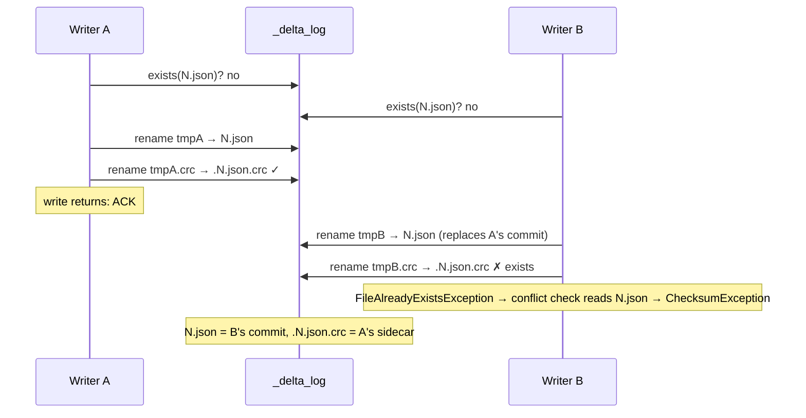

# Spike RED — Delta's default LogStore on `file://` with concurrent writers

| | |
|---|---|
| **Phase** | P1.4c (runs), P1.4d (this write-up), 2026-11-13 |
| **Plan** | [ADR-0004](../adr/0004-postgresql-coordinated-delta-logstore.md) §7.3 |
| **Code** | `SpikeRedSpec`, `DelayingLocalFs`, `WriterProbe`, the stress harness and verifier (`modules/integration-tests/.../it/stress/`) |
| **Reproduce** | `scripts/stress-logstore.sh` (about 7–10 minutes, no Docker, about 3 GB of free memory) |

## Question

Several processes append to one Delta table on the local file system, with Delta's default configuration. Does Delta lose commits whose writers were told they succeeded? If so, does anything notice?

## Answer

**Yes, it loses them.** Over five runs of the suite, the natural race (no fault injection) lost acknowledged commits in **2 of 5 runs**. The widened window lost one in **5 of 5**.

**Delta itself notices nothing.** A lost commit's `N.json` is replaced by another writer's, not removed, so Delta's log has no version gap to detect.

**What did notice, on `file://`, was Hadoop.** Its `.crc` sidecar of the replaced file went stale. From then on, every reader that checks sidecars fails, and every writer stops. That is detection by accident, and it fails stop: the commit is already lost, and its writer has already been told it succeeded. A reader that checks no sidecars reads the table without any error and without the commit. Every reader on object storage is in that position, because S3 and MinIO have no sidecars. There the loss would be silent. This was shown with a sidecar-free reader on `file://`, not measured on S3 or MinIO (that is E1).

## Setup

| | |
|---|---|
| Stack | Java 17.0.21, Spark 4.1.4, Delta 4.4.1, Hadoop 3.4.2 (Spark's) |
| Machine | WSL2 (Linux 6.18), ext4, one machine |
| Writers | 3 separate JVMs, `local[1]`, 512 MB heap each, released together by a file barrier |
| Workload | Blind appends of 10 rows each, `txnAppId = writer-<i>`, `txnVersion = 1..K`; every row tagged `(writer, txnVersion)` |
| Evidence of success | Each writer appends `ACK k` to its own journal and forces it to disk after the write returns |
| Verifier | Reads every `N.json` as bytes (no Delta, no Hadoop), compares the commits with the journals, then loads the table through two Delta readers |

The Spark settings that differ from the defaults are listed in every report, each with its reason. None of them touches the commit protocol.

### Variants

| Variant | Writers × commits | What it shows | Pass condition |
|---|---|---|---|
| Control, no delay | 1 × 10 | The harness and verifier alone find nothing | No anomaly |
| Control, delay | 1 × 5 | `DelayingLocalFs` itself loses nothing; it delays every commit exactly once | No anomaly; 5 delayed renames |
| **Widened window** | 3 × 10, 1.5 s delay | The race, every time | ≥ 1 lost commit, no version gap; the sidecar-free reader reads the table and lacks the lost commits |
| **Natural race** | 3 × 200, no delay | How often it happens without help | None: measured only |

`DelayingLocalFs` is Hadoop's local `AbstractFileSystem` with a sleep in `RawLocalFileSystem.rename(src, dst)`. That sleep comes after every existence check on the destination and before the `rename(2)` that replaces it. It only widens a window that already exists; it adds no new behaviour.

### Preconditions, checked on every writer

Each writer records what its own Delta and Hadoop resolved (`WriterProbe`), and every run asserts it:

| Fact | Value in every run | Why it matters |
|---|---|---|
| LogStore for the table | `io.delta.storage.HDFSLogStore` | The default for `file://` |
| `FileSystem` of `_delta_log` | `org.apache.hadoop.fs.LocalFileSystem` | `HDFSLogStore.write` enters its `synchronized (this)` block only on a `RawLocalFileSystem`, so here it takes **no lock**. Even when it does, the lock is per `HDFSLogStore` instance, never across JVMs. |
| `FileContext` that publishes `N.json` | `LocalFs` (natural), `DelayingLocalFs` (widened) | The code path the delay is in |

## Results

Five full runs of the suite, 2026-11-13. Every control was clean, every time.

| Run | Widened window | Natural race: acknowledged | Natural race: **lost** | Natural race: stale sidecar | Natural race: ended |
|---|---|---|---|---|---|
| 1 | 1 lost (v1) | 600 | **0** | — | All 200 commits per writer, after about 5.3 min |
| 2 | 1 lost (v1) | 437 | **1** (`writer-1` txnVersion 146) | v436 | At v436, all writers within 1 ms |
| 3 | 1 lost (v1) | 139 | 0 | v140 | At v140 |
| 4 | 1 lost (v1) | 65 | **1** (`writer-2` txnVersion 20) | v65 | At v65 |
| 5 | 1 lost (v2) | 600 | **0** | — | All 200 commits per writer |

- **The natural race lost acknowledged commits in 2 of 5 runs.** It overwrote a commit file in 3 of 5: run 3 overwrote one too (see below).
- Each overwrite ended the run. After it, every writer failed its next commit on the stale sidecar.
- The widened window lost a commit every time, in the first or second round of commits (version 1 four times, version 2 once).
- In every run there was no version gap and no duplicate, and the sidecar-free reader read the table. The default reader failed whenever a sidecar was stale.

## Mechanism

`HDFSLogStore.write(N.json, overwrite = false)` checks that `N.json` does not exist. Then it writes a temporary file and calls `FileContext.rename(tmp, N.json, NONE)`. On the local file system that rename checks for the destination twice more, then calls `rename(2)`, which replaces an existing file. Two writers that pass the checks before either renames both "succeed" at writing version N. The second rename replaces the first writer's commit and raises nothing. Any exception a writer does get comes from the sidecar step below.

Hadoop's `ChecksumFs` adds a second step. After renaming `N.json`, it renames the temporary file's `.crc` sidecar to `.N.json.crc`, also with `NONE`, and that rename does fail if the target exists:

The writer whose sidecar rename wins is the one that gets an acknowledgement. The file holds the last writer's commit. When they differ, the acknowledged commit is lost, and the sidecar describes bytes that are no longer there. Two rarer cases show that neither half of this is guaranteed:

- **A loss without a stale sidecar.** The two sidecar renames can race as well, inside a window of microseconds. Then both writers get acknowledged, and the last writer's sidecar matches its own file. The commit is lost without any sidecar going stale. The verifier therefore reports stale sidecars as an observation, never as proof of a loss.
- **An overwrite that is not a lost commit.** In run 3, `.140.json.crc` went stale, yet no acknowledged commit is missing. The writer whose commit was replaced did not get an acknowledgement: Delta re-read version 140 before returning and failed on its checksum. By the verifier's rules, that is the attempt in flight when the writer stopped, and it may be absent.

On local storage Hadoop does not move the bad file aside (`LocalFileSystem.reportChecksumFailure`). It only does that before retrying another replica, and a local file has one. The evidence stays in place.

## What Delta detects, and what it does not

| Damage to the log | Who notices | Shown by |
|---|---|---|
| A missing `N.json` (version gap) | **Delta**: `DELTA_VERSIONS_NOT_CONTIGUOUS` on load | `StressHarnessSpec`, deleted commit file |
| A replaced `N.json` (lost commit) | **Not Delta.** The log is contiguous, and every file parses. | The widened window, natural runs 2 and 4 |
| …on `file://`, with Hadoop's checksummed `LocalFileSystem` | Hadoop, by accident: `ChecksumException` on every later read, usually (not always) | Same runs, default reader |
| …on a reader that checks no sidecars (object storage) | **Nobody** | Same runs, sidecar-free reader |

This is the argument for ADR-0004. Delta's correctness on a storage without mutual exclusion is not "detected and retried". It is undetected loss, sometimes followed by an unreadable table. Exclusion has to come from the commit path itself, and `PostgresLogStore` moves it into PostgreSQL.

## Limits of this result

- **One machine, one file system** (WSL2, ext4). How often the natural race hits depends on hardware, load and commit latency. Five runs show that the race is real; they are not a rate.
- **Object storage was not measured.** The silent case is shown on `file://` with a reader that checks no sidecars. S3 and MinIO, through `S3SingleDriverLogStore`, are measured in E1.
- **Small commits.** A larger commit makes the cycle longer, and probably the overlap too, but that was not measured.

## Consequences for the project

- **GREEN (P2b)** runs the same suite with `PostgresLogStore`, the widened window included. It must show no lost commit, no stale sidecar, and both readers clean.
- **The `file://` publish of `PostgresLogStore` must account for sidecars** (ADR-0004 §3.4). If it publishes through `LocalFs`, the sidecar rename is a second, non-atomic step. Decided in P2a.
- **The verifier never reads the log through Hadoop.** Otherwise, after a loss, it would see what every other reader sees: nothing.
